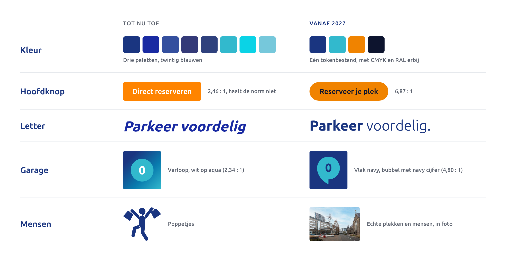
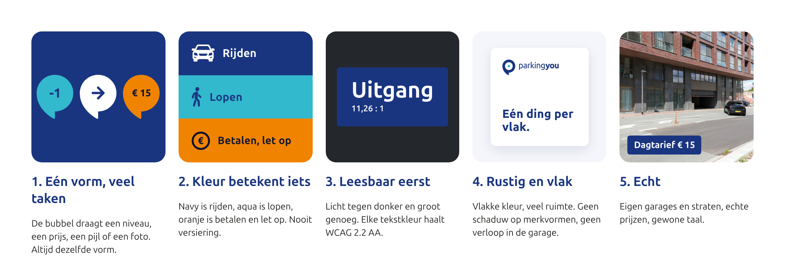

# Introductie en merkprincipes

## Waarom deze gids

ParkingYou zit op veel plekken tegelijk: op de website en in de boekingsflow, in de app, in reels, in de nieuwsbrief, op betaalautomaten, op abonnementspassen en op borden in donkere betonnen garages. Tot nu toe had elk van die plekken een eigen versie van ons merk. De website gebruikt een ander blauw dan de borden, Canva weer een ander, en in ons drukwerk zitten vijftien verschillende blauwen.

Deze gids maakt daar één taal van. Hij is gemaakt voor 2027 en verder, en hij werkt van een reel van 9:16 tot een bord van drie meter boven een inrit.

We zijn niet opnieuw begonnen. Het logo, het beeldmerk en ons blauw blijven, omdat mensen ons daaraan herkennen. Wat verandert: we maken keuzes die overal hetzelfde uitpakken, we halen weg wat niet werkt, en we leggen alles vast in één bron.

## Wat er verandert

- **Eén kleurbron.** Alle kleuren staan in één tokenbestand, met de waarden voor scherm, drukwerk en bewegwijzering erbij. De oude website- en Canva-kleuren vervallen.
- **De bubbel.** De vorm uit ons beeldmerk wordt het vaste element dat een niveau, een prijs, een pijl of een foto draagt.
- **Kleur per taak.** Navy is rijden, aqua is lopen, oranje is betalen en let op. In de garage en op het scherm.
- **Leesbaar voor iedereen.** Geen witte tekst meer op aqua of oranje. De hoofdknop wordt oranje met donkerblauwe tekst.
- **Ubuntu Sans.** De nieuwe, variabele versie van de letter die we al gebruiken. Gratis, zelfde licentie.
- **Weg:** de poppetjes in nieuw werk, cursieve koppen, kleurfilters over foto's, emoji, verlopen in de garage.

## Onze merkprincipes

**1. Eén vorm, veel taken.**
De bubbel uit ons beeldmerk draagt wat we zeggen: een niveau, een prijs, een pijl, een foto. Altijd dezelfde vorm, nooit hertekend. Zo herken je ons op de parkeervloer en in een scroll van twee seconden.

**2. Kleur betekent iets.**
Navy is rijden en het merk. Aqua is lopen. Oranje is betalen en let op. We gebruiken kleur niet als versiering. Wie de regel één keer ziet, vindt overal de weg.

**3. Leesbaar eerst.**
Licht tegen donker, groot genoeg, in elke garage en op elk scherm. Elke tekstkleur haalt WCAG 2.2 AA. Op borden rekenen we de letterhoogte uit de leesafstand.

**4. Rustig en vlak.**
Vlakke kleur, veel ruimte, één ding per vlak. Geen schaduwen op merkvormen, geen verloop in de garage. Rust is wat je wilt als je zoekt naar een plek.

**5. Echt.**
Eigen garages en straten, echte prijzen, gewone taal. Geen stockgevoel en geen beloftes die we niet waarmaken.

## Hoe we praten

We praten zoals we parkeren: zonder gedoe. Kort, concreet en vriendelijk.

- Je en jij, overal. Ook in de boekingsflow.
- Korte zinnen. Eén boodschap per zin.
- Cijfers in plaats van bijvoeglijke naamwoorden: "9 minuten lopen naar het centrum", niet "centraal gelegen".
- Prijzen als € 12,50, tijden als 18:00 tot 23:00.
- Knoppen beginnen met een werkwoord: "Reserveer je plek", "Betaal".
- Geen emoji, geen uitroeptekens op borden, geen gedachtestreepjes.
- De kernzin vet, de rest gewoon: **Parkeren** zonder gedoe.

## Hoe je deze gids gebruikt

De hoofdstukken volgen de volgorde waarin je een ontwerp opbouwt: logo, kleur, letter, grid, de bubbel en andere elementen, iconen, beweging, beeld, en daarna de toepassingen. Achterin staan de tokens, de bestanden en wie je kunt bellen.

Alle waarden in deze gids komen uit één bron: de core spec en het tokenbestand in de repository PY-ASSETS (map `brand-2027/`). Twijfel je, dan wint dat bestand. Mis je iets of wil je een nieuwe waarde, vraag het dan aan wie het merk beheert. Verzin geen eigen kleur of maat.

## Do's en don'ts

- Doe: begin bij het tokenbestand, niet bij een oude PDF of een Canva-ontwerp.
- Doe: kies per vlak één boodschap en één bubbel.
- Doe: gebruik de taakkleur die bij de handeling hoort.
- Niet: kleuren uit de oude website, Canva of drukwerk overnemen.
- Niet: het logo hertekenen, uitrekken of in een bubbel zetten.
- Niet: witte tekst op aqua of oranje.
