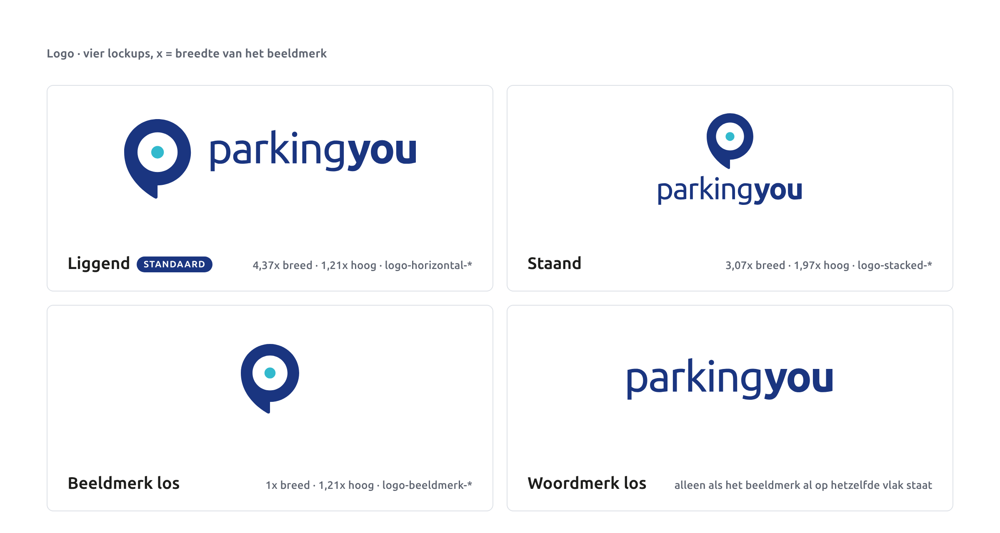
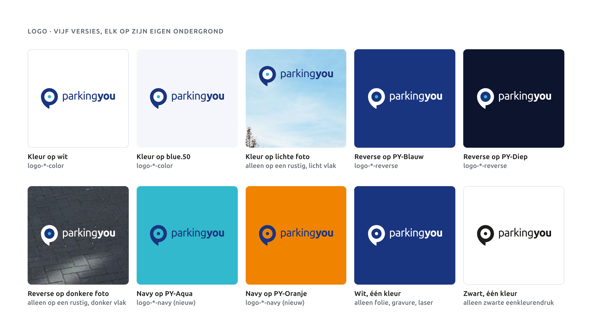
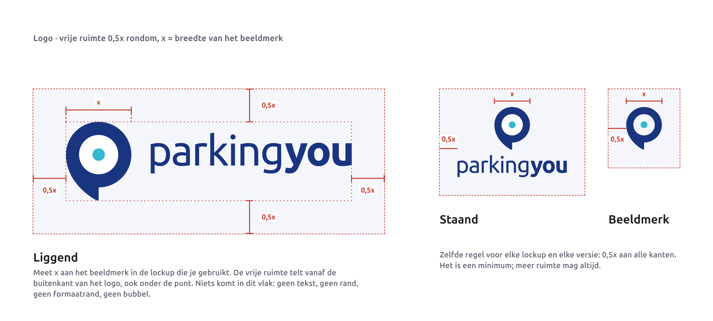
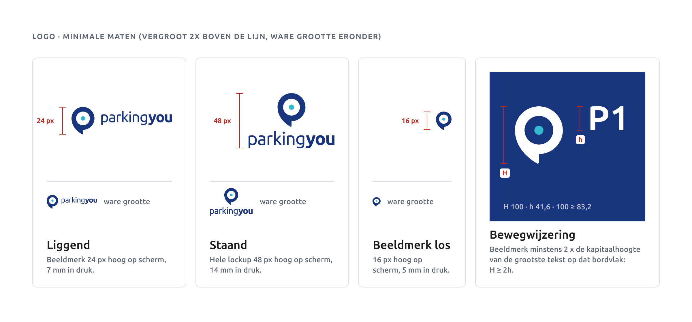
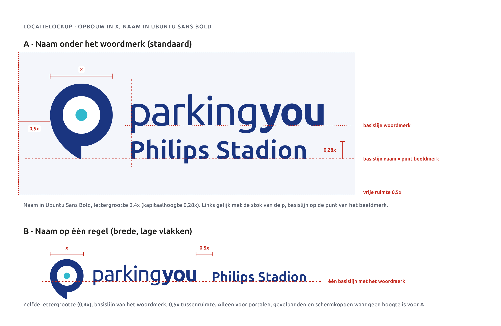
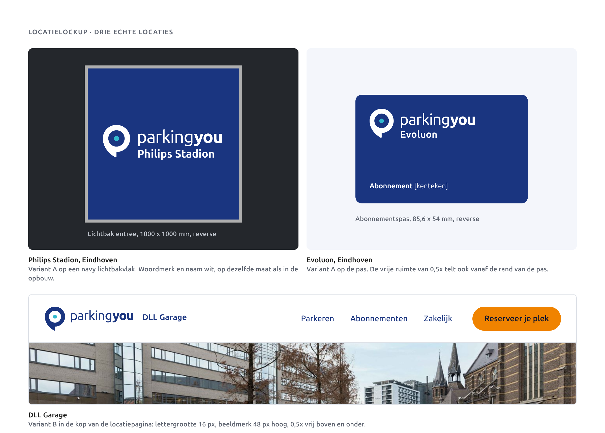
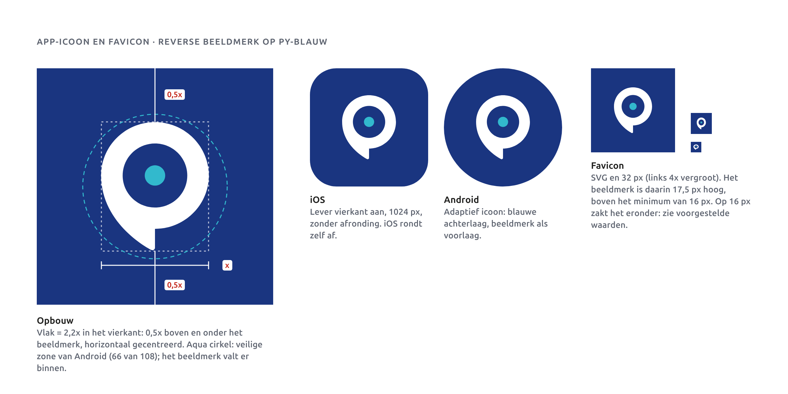
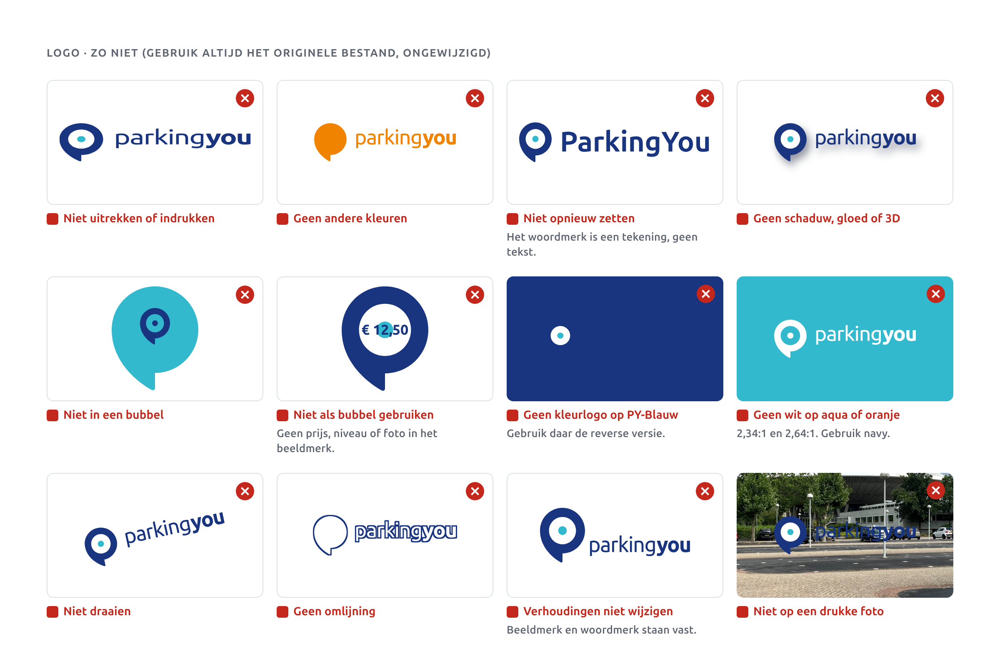

# Logo

## Wat het logo is

Het logo is het beeldmerk (een bubbel met ring en aqua stip) plus het woordmerk "parkingyou", getekend, niet getypt. Het blijft zoals het is: mensen kennen het van de lichtbak, de pas en de site. Nieuw is alleen dat de reverse versie officieel wordt en dat er een navy versie bijkomt voor aqua en oranje. Het logo draait nooit, en de bubbel ook niet.

We meten alles in **x**: de breedte van het beeldmerk in de lockup die je gebruikt.

## Lockups

- **Liggend** is de standaard. Gebruik deze als je niet zeker weet welke.
- **Staand** voor smalle, hoge vlakken: een pyloon, een story, een sticker.
- **Beeldmerk los** voor app-icoon, avatar en favicon.
- **Woordmerk los** alleen als het beeldmerk al op hetzelfde vlak staat.

Stel de delen nooit zelf samen; gebruik de bestanden.

## Vijf versies, elk op zijn eigen ondergrond

| Versie | Ondergrond | Bestand |
|---|---|---|
| Kleur (navy, aqua stip) | wit, blue.50, lichte foto met rustig vlak | `logo-*-color.svg` |
| Reverse (witte bubbel, navy ring, aqua stip) | PY-Blauw, PY-Diep, donkere foto | `logo-*-reverse.svg` |
| Wit, één kleur | alleen eenkleurige productie op donker: folie, gravure, laser | `logo-*-white.svg` |
| Navy, één kleur (nieuw) | PY-Aqua, PY-Oranje, eenkleurige navy druk | `logo-*-navy.svg` |
| Zwart, één kleur | alleen eenkleurige zwarte druk | `logo-*-black.svg` |

Op een foto zoek je een rustig vlak. Licht: kleurversie. Donker: reverse. Is de foto overal druk, zet het logo dan op een navy vlak naast de foto, niet op een donkere laag erover.

## Vrije ruimte

Rond elke lockup blijft 0,5x vrij, ook onder de punt. Daar staat niets: geen tekst, geen bubbel, geen rand van het formaat. In een hoek van een poster of pas is de marge 2u of 0,5x, wat het grootst is.

## Minimale maten

| Lockup | Scherm | Druk |
|---|---|---|
| Liggend (hoogte beeldmerk) | 24 px | 7 mm |
| Staand (hele hoogte) | 48 px | 14 mm |
| Beeldmerk los | 16 px | 5 mm |

Op borden geldt één regel: het beeldmerk is minstens 2 keer zo hoog als de kapitaalhoogte van de grootste tekst op dat bordvlak. Een bord met "P1" in 50 mm kapitaalhoogte vraagt dus een beeldmerk van minstens 100 mm hoog.

## Locatielockups

Het logo blijft het originele bestand; alleen de naam is tekst.

**A, naam onder het woordmerk (standaard).**
- Liggend logo, ongewijzigd.
- Naam in Ubuntu Sans Bold, lettergrootte 0,4x, spatiëring 0,01 em. De kapitaalhoogte is dan 0,28x.
- Naam links gelijk met de stok van de p van "parking".
- Basislijn van de naam op de punt van het beeldmerk.
- Vrije ruimte 0,5x om het geheel.

**B, naam op één regel.** Voor portalen, gevelbanden en de kop van een webpagina. Zelfde letter, op de basislijn van het woordmerk, 0,5x na "you".

De naam heeft de kleur van het woordmerk, nooit aqua of oranje. Schrijf alleen de plaatsnaam: "Philips Stadion", niet "Parking Philips Stadion". Past hij op een bord niet, gebruik dan Condensed Bold; geen tweede regel, geen kleinere letter. De staande lockup krijgt geen naam.

Maat kiezen: begin bij de naam. x = 2,5 keer de lettergrootte van de naam.
- Scherm: naam 16 px geeft x = 40 px, het beeldmerk wordt 48 px hoog.
- Druk: naam in print-h2 (22 pt) geeft x = 55 pt, ongeveer 19 mm.
- Borden: de naam volgt de leesafstand. Op 5 meter is de letter 72 mm, dus x = 180 mm. De bordregel klopt dan vanzelf.

De huidige Maashaven-lockup heeft een kleiner woordmerk dan het echte logo. Bij de volgende druk vervangen we die door deze opbouw.

## Het logo en de parkeerders

Het hoofd van onze parkeerders heeft de vorm van het beeldmerk. Dat is bewust: zo wordt het logo een mens. Het hoofd is altijd aqua, net als de stip in het logo. Twee regels houden het logo heel:

- Een parkeerder krijgt nooit het hele logo als hoofd, geen ring en geen stip. Alleen de bubbelvorm.
- Een parkeerder staat nooit tegen het logo aan. Houd de vrije ruimte van 0,5x aan, ook naar het poppetje toe.

Meer over de parkeerders staat in het hoofdstuk Patronen en designelementen.

## Tagline "The other way of parking"

**Advies: stoppen met de tagline als lockup.**
1. Hij is Engels; al onze teksten zijn Nederlands.
2. De kleurversie is aqua op wit: 2,34:1, dat haalt WCAG niet.
3. Hij staat op 0,158 keer de hoogte van het beeldmerk. Bij een logo van 24 px is dat minder dan 4 px.
4. Hij belooft iets zonder het te laten zien. "**Parkeren** zonder gedoe." als kop zegt meer.

Bestaand drukwerk mag op. Wil Rick hem houden, dan als losse regel in de layout, niet vast aan het logo.

## App-icoon en favicon

- Reverse beeldmerk op PY-Blauw.
- Vierkant vlak met 0,5x boven en onder het beeldmerk, horizontaal gecentreerd. Het beeldmerk is dan 45 procent van de breedte en valt binnen de veilige zone van Android.
- iOS: lever 1024 x 1024 px aan, vierkant, zonder afronding. iOS rondt zelf af.
- Android: adaptief icoon met PY-Blauw als achterlaag en het beeldmerk als voorlaag.
- Favicon: SVG plus 32 px. Het beeldmerk is daarin 17,5 px hoog.

## Zo niet

## Do's en don'ts

- Doe: altijd het originele bestand uit `kit/assets/` of `svg/atom/`.
- Doe: de versie die bij de ondergrond hoort.
- Doe: 0,5x vrij rondom, boven de minimale maat.
- Doe: locatienaam volgens opbouw A of B.
- Niet: uitrekken, draaien, omlijnen, schaduw of andere kleuren. Ook de bubbel draai je nooit.
- Niet: het hele logo als hoofd van een parkeerder.
- Niet: het woordmerk opnieuw typen.
- Niet: beeldmerk en woordmerk los schalen of verschuiven.
- Niet: het logo in een bubbel, of het beeldmerk als bubbel.
- Niet: kleurlogo op PY-Blauw, wit op aqua of oranje, logo op een drukke foto.
- Niet: de tagline vast aan het logo.

## Voorgestelde waarden

Goedgekeurd: zie besluiten D1 en D2 in de core spec. Waar de core spec iets anders zegt, geldt de core spec.

| Waarde | Voorstel | Reden |
|---|---|---|
| Lettergrootte naam in locatielockup | 0,4x (kapitaalhoogte 0,28x) | 0,5x getest: de naam raakt bijna de staarten van p en g en overheerst het woordmerk. Met 0,4x blijft er lucht en past "Philips Stadion" binnen de breedte van het logo. |
| Favicon 16 px | Geen eigen 16 px-versie; de browser verkleint SVG of 32 px. Uitzondering op het minimum van 16 px. | Op 16 px is het beeldmerk met vrije ruimte 8,7 px hoog. De enige plek waar het minimum niet haalbaar is. |
