# Kleur

Kleur betekent bij ParkingYou iets. Navy is het merk en rijden. Aqua is ons accent en lopen. Oranje zie je alleen waar je betaalt in de garage. Daaromheen veel wit, zodat elke kleur opvalt waar hij staat. Zo herken je ons van ver, en zo weet je in de garage waar je heen moet. Dit hoofdstuk legt vast welke kleuren er zijn, wat ze doen, hoeveel je ervan ziet, welke combinaties mogen en hoe je ze maakt in druk, folie en lak.

## Onze kleuren

De waarden van PY-Blauw, PY-Aqua en PY-Oranje veranderen niet. Nieuw is de naam PY-Diep voor de donkerste navy. De oude websitekleuren (#192AA2, #0AD3E6, #FF8400), de Canva-kleuren (#344F9E, #76C8DB) en de middenstop #097BAE van het oude verloop vervallen.

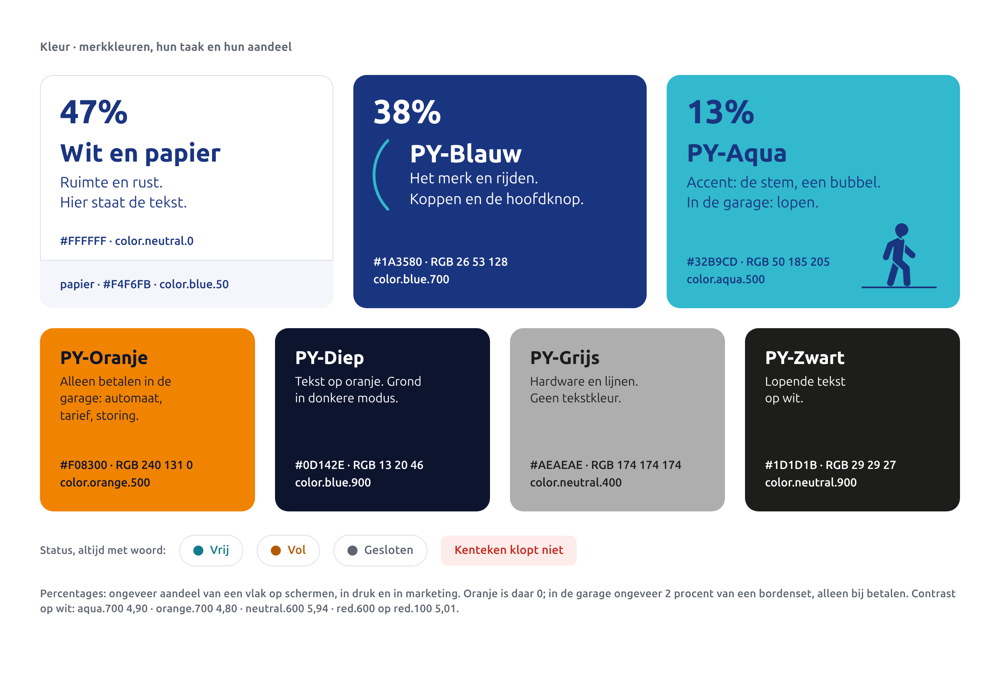

| Naam | HEX | RGB | CMYK | Token | Rol |
|---|---|---|---|---|---|
| Wit | #FFFFFF | 255 255 255 | 0 0 0 0 | `color.neutral.0` | ruimte, de grond onder de tekst |
| Papier | #F4F6FB | 244 246 251 | 5 3 2 0 | `color.blue.50` | rustige vlakken, tweede grond |
| PY-Blauw | #1A3580 | 26 53 128 | 100 83 0 17 | `color.blue.700` | het merk, rijden, koppen, de hoofdknop |
| PY-Aqua | #32B9CD | 50 185 205 | 69 0 21 0 | `color.aqua.500` | ons accent; in de garage lopen |
| PY-Oranje | #F08300 | 240 131 0 | 0 57 100 0 | `color.orange.500` | alleen betalen in de garage |
| PY-Diep | #0D142E | 13 20 46 | 100 83 0 80 | `color.blue.900` | tekst op oranje, grond in donkere modus |
| PY-Grijs | #AEAEAE | 174 174 174 | 0 0 0 42 | `color.neutral.400` | hardware, lijnen; geen tekstkleur |
| PY-Zwart | #1D1D1B | 29 29 27 | 0 0 0 100 | `color.neutral.900` | lopende tekst |

## Rustig en wit: de verhouding

Op schermen, in druk, in marketing en op social is de verhouding ongeveer: wit en papier 47, PY-Blauw 38, PY-Aqua 13 procent. Oranje is daar 0. In de garage is oranje ongeveer 2 procent van een bordenset, en dan alleen bij betalen.

Dat is een richtwaarde over een reeks vlakken, geen rekensom per vlak. Een poster is vooral wit met een navy voet, een post op social mag vooral navy zijn. Samen geven ze het beeld. Per vlak staat er één accent.

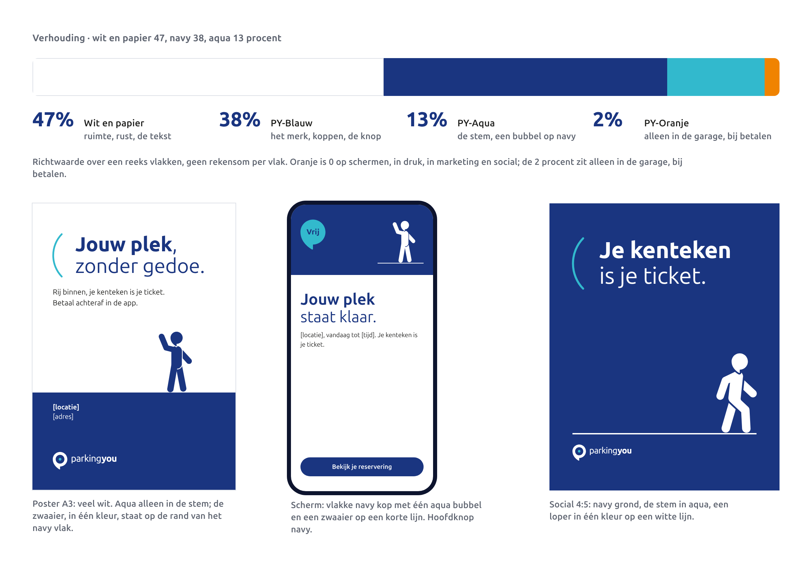

## Aqua: ons accent, en lopen

Buiten de garage is aqua het accent van het merk. Je ziet het op vier plekken, en nergens anders als vlak:

- **De stem**: de halve boog die een kop opent. Aqua op wit en op navy, navy op aqua (`voice.arc`).
- **Het hoofd van een parkeerder**: altijd aqua, want het is het beeldmerk (`figure.head`). Op een aqua grond wordt de hele figuur navy.
- **De randen van jouw vak**: de twee zijlijnen van het ene vak dat van jou is (`vak.mine-edge`).
- **Een aqua bubbel** op een navy vlak, met PY-Blauw erin.

In de garage betekent aqua altijd lopen: voetgangersroutes, lift, trap, uitgang naar de straat. Daar is aqua wel een vlak, met PY-Blauw als inhoud.

Aqua is nooit tekstkleur op wit (2,34:1); gebruik dan aqua.700 (4,90:1). Wit op aqua mag ook niet (2,34:1). Op een licht scherm is de hoofdknop navy, niet aqua.

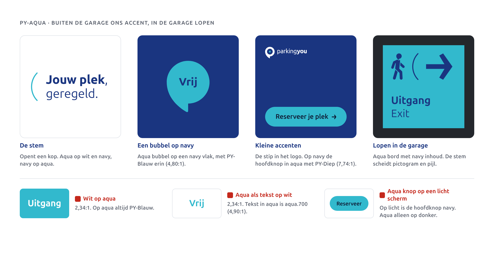

## Oranje: alleen waar je betaalt

Oranje staat alleen in de garage, op de plek waar je betaalt:

- stickers en vlakken op betaalautomaten ("Betaal hier"),
- tariefborden,
- storingen en meldingen bij de betaalplek ("Buiten gebruik").

Op een navy pyloon of lichtbak zit het oranje alleen in de bubbel bij de betaalplek. Tekst op oranje is altijd PY-Diep (6,87:1).

Oranje staat **niet** op schermen, in druk, in marketing, op social, in nieuwsbrieven of op kaarten. Wat daar vroeger oranje was, wordt:

| Was oranje | Wordt |
|---|---|
| de hoofdknop | PY-Blauw met witte tekst (11,26:1); op donker aqua met PY-Diep (7,74:1) |
| een prijs of deal in een bubbel | een navy bubbel met witte cijfers, of een witte bubbel met navy op een navy vlak |
| een accentstreep of -vlak in druk en social | de stem in aqua |
| oranje tekst bij een actie | gewoon PY-Blauw, met het sleutelwoord vet |

Op schermen blijft orange.700 (#B35A00) alleen als tekstkleur voor de status "Vol" en voor waarschuwingen, altijd met het woord erbij (4,80:1 op wit). Dat is een statuskleur, geen merkoranje, en nooit een vlak of knop.

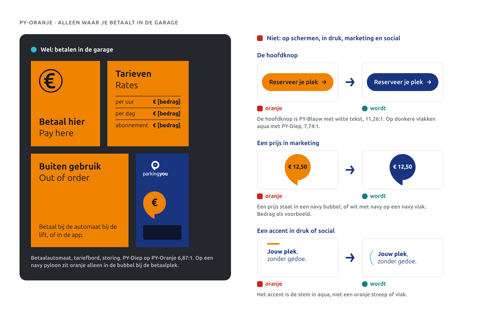

## Kleur draagt een taak in de garage

In de garage heeft elke kleur één taak. We gebruiken kleur niet als versiering.

| Taak | Ondergrond | Inhoud | Waar |
|---|---|---|---|
| Rijden | PY-Blauw | wit | portalen, in- en uitrit, lichtbakken, routeborden voor auto's, niveaus |
| Lopen | PY-Aqua | PY-Blauw | voetgangersroutes, lift, trap, uitgang naar de straat |
| Betalen | PY-Oranje | PY-Diep | betaalautomaten, tariefborden, storingen bij de betaalplek |

- Lichtbakken en portalen blijven navy. Op een verlicht vlak zit de taakkleur in de bubbel, nooit in een volledig aqua of oranje vlak.
- Geprinte borden (Dibond, wandfolie) mogen de taakkleur als hele ondergrond hebben.
- Op borden scheidt de stem de modules, bijvoorbeeld pictogram en pijl. Hij heeft de inhoudskleur van het bord: aqua op navy, PY-Blauw op aqua.
- De pijl is altijd de hoekige pijl uit het handboek, los, nooit in een cirkel of bubbel.
- Hoogtebalken houden rood en wit. Vluchtwegborden (ISO 7010, NEN 3011) en verkeersborden (RVV) krijgen nooit merkkleur, en merkkleur staat er ook niet als versiering naast.

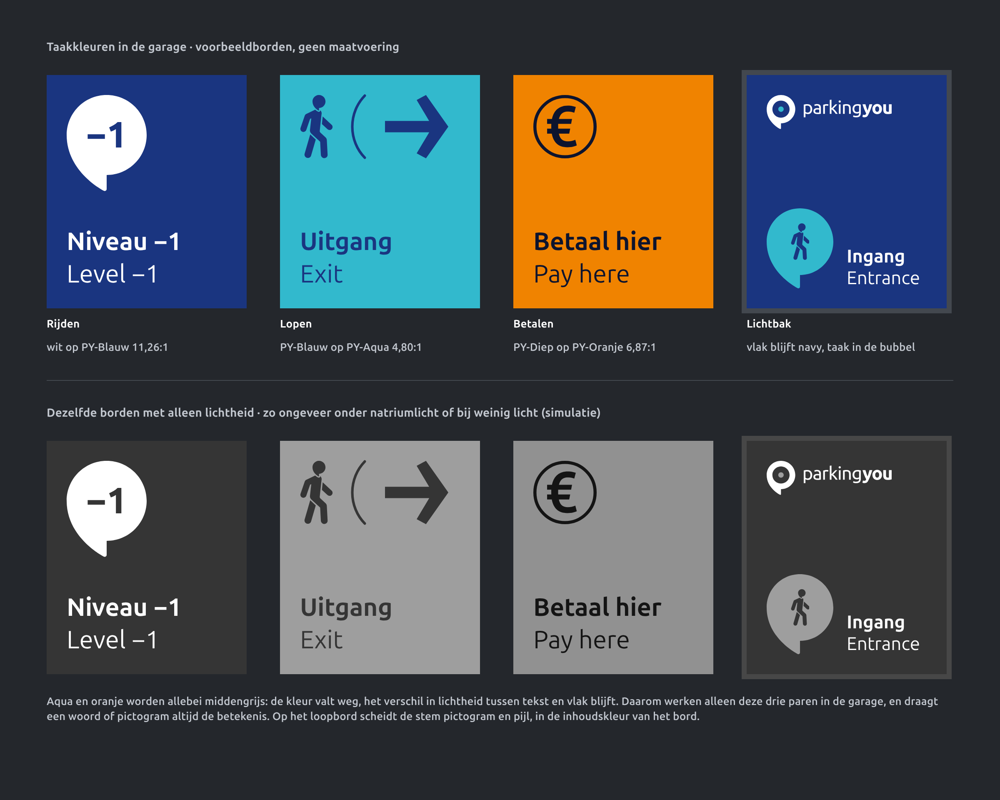

## Knoppen

De hoofdknop is PY-Blauw met witte tekst. Op donkere vlakken wordt hij aqua met PY-Diep. De tweede knop is een witte knop met een rand van 2 px in PY-Blauw. Oranje knoppen bestaan niet meer. De hoekige pijl in een knop staat op de kapitaalhoogte van het label, in de kleur van het label.

| Token | Licht | Donker | Contrast licht / donker |
|---|---|---|---|
| `action.primary-bg` / `-fg` | blue.700 / wit | aqua.500 / blue.900 | 11,26 / 7,74 |
| `action.primary-bg-hover` | blue.600 | aqua.400 | 8,15 / 9,17 |
| `action.primary-bg-pressed` | blue.800 | aqua.600 | 14,73 / 5,43 |
| `action.secondary-bg` / `-fg` | wit / blue.700 | blue.900 / aqua.300 | 11,26 / 11,01 |
| `action.secondary-bg-hover` | blue.50 | blue.800 | 10,41 / 8,93 |
| `action.secondary-bg-pressed` | blue.100 | blue.850 | 9,52 / 10,01 |

Alle verhoudingen zijn de tekstkleur van de knop op de grond van de knop, opnieuw berekend.

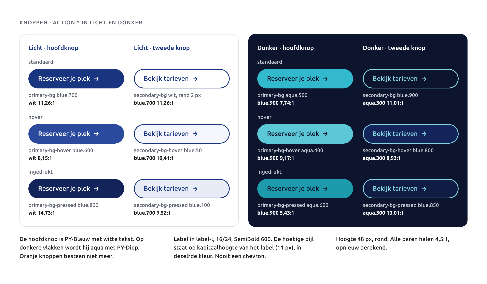

## Kleur voor de eigen elementen

De stem, het vak en de parkeerders hebben hun eigen semantische tokens. Componenten en templates lezen deze tokens, nooit de schaalwaarden.

| Token | Licht | Donker | Waarvoor |
|---|---|---|---|
| `voice.arc` | aqua.500 | aqua.500 | de stem; op een aqua grond blue.700 |
| `vak.line` | neutral.200 | blue.400 | lijnen van het vak op licht |
| `vak.line-on-brand` | blue.400 | blue.400 | lijnen van het vak op navy |
| `vak.mine` | aqua.100 | blue.600 | vulling van jouw vak op licht |
| `vak.mine-on-brand` | blue.600 | blue.600 | vulling van jouw vak op navy |
| `vak.mine-edge` | aqua.500 | aqua.500 | de twee zijlijnen van jouw vak, dubbele dikte |
| `figure.head` | aqua.500 | aqua.500 | hoofd van een parkeerder |
| `figure.body` | blue.700 | wit | lijf van een parkeerder |

De stem, het vak en het hoofd zijn vorm, geen informatie. Ze hoeven geen 3:1 te halen en dragen nooit alleen betekenis. Aqua op wit is 2,34:1, aqua op navy 4,80:1, aqua op PY-Diep 7,74:1. Het vak is bewust zacht: neutral.200 op wit is 1,31:1, blue.400 op navy 3,17:1. Het is achtergrond, en er staat nooit tekst op.

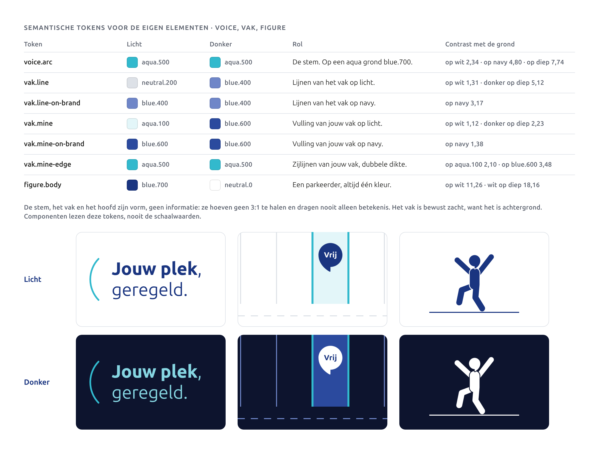

## Geen verloop meer

Het verloop van blauw naar aqua vervalt. Alle kleur is vlak. Bestaande borden en vlakken met verloop worden bij de volgende vervanging vlak PY-Blauw: niveaububbels, kolombanden, het bord voor mindervaliden en koppen op scherm en poster. Op het oude verloop stond witte tekst vaak op het aqua deel (2,34:1); vlak navy haalt 11,26:1. De rol van het verloop, het merk in één oogopslag, neemt een navy vlak met de stem in aqua over.

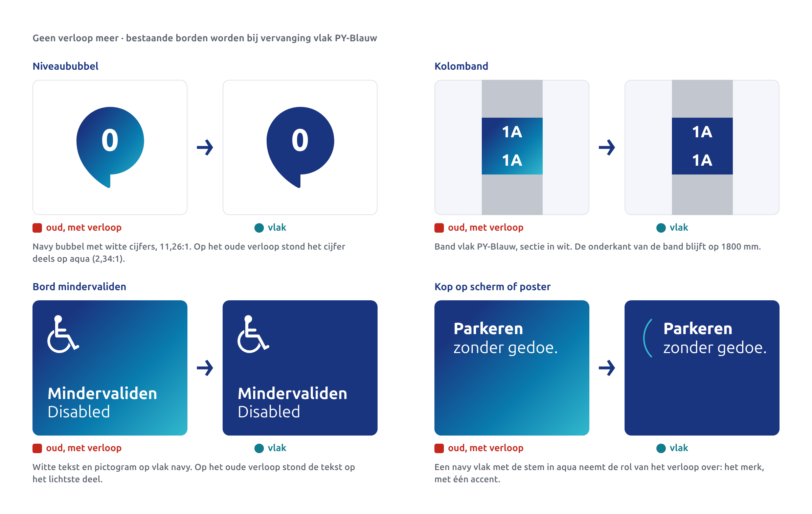

## Status en meldingen

Status heeft altijd een woord naast de kleur: Vrij, Vol, Gesloten. Kleur alleen draagt nooit betekenis, ook niet voor kleurenblinden of onder slecht licht. Statuskleuren staan alleen op `surface.default` of `surface.raised`.

| Token | Licht | Donker | Contrast op wit |
|---|---|---|---|
| `status.free` (Vrij) | aqua.700 #127C8C | aqua.300 | 4,90:1 |
| `status.full` (Vol) | orange.700 #B35A00 | orange.300 | 4,80:1 |
| `status.closed` (Gesloten) | neutral.600 #5E6470 | neutral.300 | 5,94:1 |
| `feedback.error` op `error-bg` | red.600 op red.100 | red.100 op red.700 | 5,01:1 |

## De volledige schalen

Blauw, aqua, oranje en neutraal lopen van 50 tot 900, rood heeft 100, 600 en 700. Schermen gebruiken de hele schaal via de semantische tokens; componenten lezen nooit direct een schaalwaarde. Drukwerk gebruikt alleen de merkkleuren en hun lichte tinten 50 tot 300.

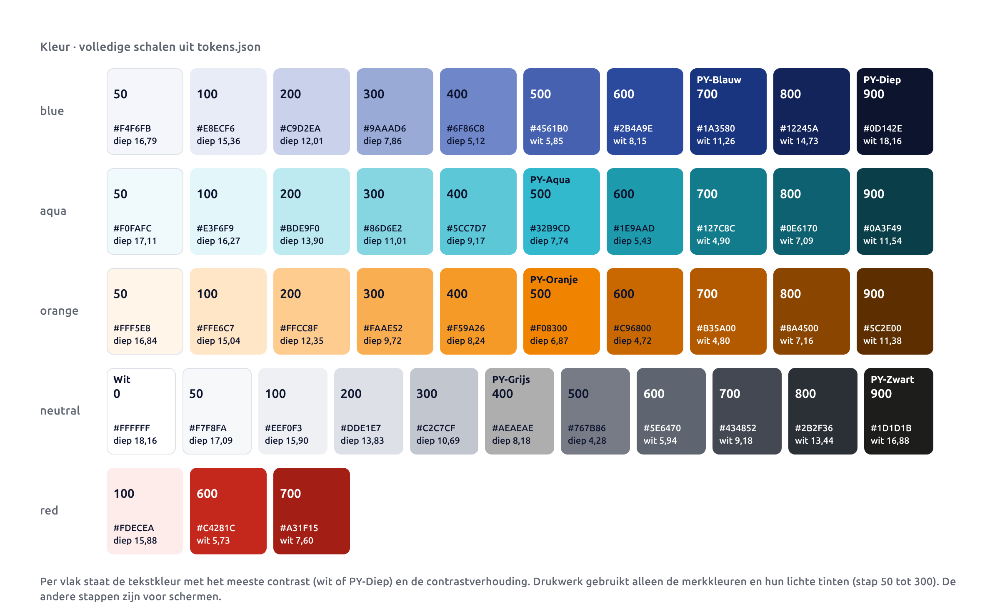

## Welke combinaties mogen

Tekst heeft 4,5:1 nodig. Grote tekst (24 px, of 19 px vet; in druk 18 pt, of 14 pt vet) en UI-grafiek hebben 3:1 nodig. Alle verhoudingen in dit hoofdstuk zijn opnieuw berekend met de WCAG 2.x-formule (relatieve luminantie, sRGB) en vergeleken met `tokens/contrast.md`: 33 paren in licht en donker, grootste afwijking 0,005. Alles komt overeen.

| Paar | Verhouding | Gebruik |
|---|---|---|
| wit op PY-Blauw | 11,26:1 | alle tekst op navy, de hoofdknop, borden voor rijden |
| PY-Blauw op PY-Aqua | 4,80:1 | loopborden, aqua bubbel |
| PY-Diep op PY-Oranje | 6,87:1 | betaalborden en automaten in de garage |
| PY-Blauw op wit | 11,26:1 | koppen en tekst in druk en op scherm |
| PY-Diep op PY-Aqua | 7,74:1 | de hoofdknop in donkere modus |
| aqua.700 op wit | 4,90:1 | aqua als tekstkleur, status Vrij |
| orange.700 op wit | 4,80:1 | status Vol en waarschuwingen op schermen, altijd met woord |

Op borden gebruiken we alleen wit op PY-Blauw, PY-Blauw op PY-Aqua en PY-Diep op PY-Oranje, altijd mat.

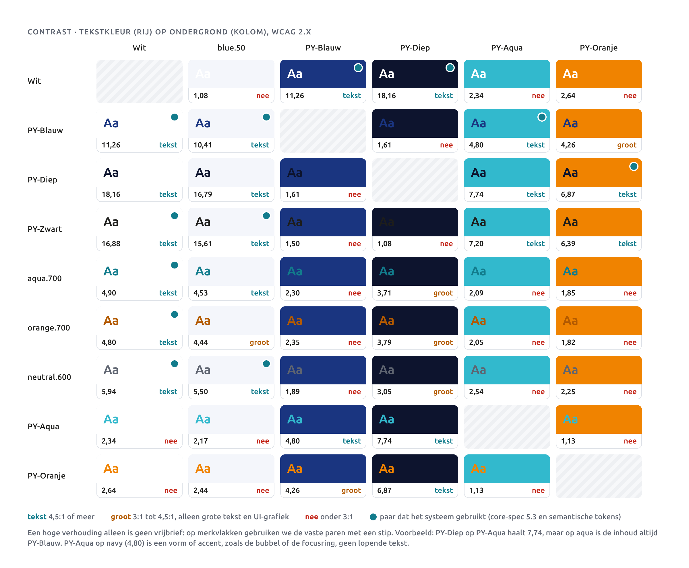

## Niet toegestaan

- Wit op aqua (2,34:1) en wit op oranje (2,64:1).
- Aqua of oranje als tekstkleur op wit (2,34 en 2,64:1). Gebruik aqua.700 of orange.700.
- PY-Blauw op oranje onder grote tekst (4,26:1).
- PY-Blauw op PY-Diep (1,61:1), bijvoorbeeld in donkere modus.
- PY-Grijs als tekst op wit (2,22:1).
- Oranje buiten de betaalplek in de garage: geen oranje knop, prijs, accent of vlak op schermen, in druk, in marketing of op social.
- Een verloop, waar dan ook.
- Kleur zonder woord, en een volledig aqua of oranje lichtbakvlak.

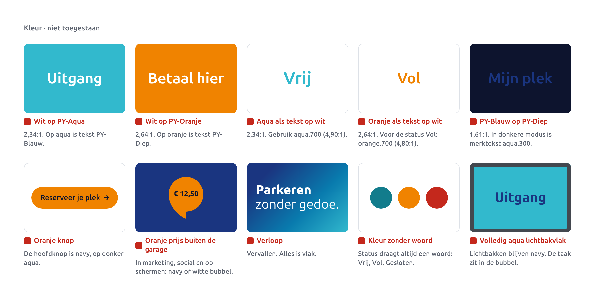

## Kleur onder garagelicht

Uit het onderzoek naar de garage: NEN 2443 vraagt gemiddeld 75 lux, oudere garages zijn op 40 lux of minder gebouwd. Op een navy bord is dat zo weinig licht dat het oog kleuren slecht scheidt. Natriumlicht maakt het erger: navy en aqua worden allebei donker, oranje bijna wit. Alleen het verschil in lichtheid tussen tekst en vlak blijft over. Daarom:

- Op borden alleen de drie paren hierboven; elk heeft een groot lichtheidsverschil.
- Een woord of pictogram draagt de betekenis, de kleur helpt alleen.
- Elke bordface krijgt mat laminaat, tegen spiegelingen van lampen.
- Geprinte lichtbakfolie wordt vaak dubbel geprint en oogt overdag donkerder.
- Voor de kleuren definitief zijn, testen we één set proefborden in een echte garage, onder het eigen licht (LED, TL en waar het nog hangt natrium).

## Donkere modus

In donkere modus is PY-Diep de ondergrond en is tekst wit (18,16:1). Navy werkt daar niet als tekst of rand (1,61:1); merktekst en links worden aqua.300 (11,01:1). De hoofdknop wordt aqua met PY-Diep (7,74:1), de tweede knop krijgt een rand en tekst in aqua.300. De stem blijft aqua (7,74:1 op PY-Diep). Het vak krijgt lijnen in blue.400 en jouw vak een vulling in blue.600, met aqua randen. Parkeerders krijgen een wit lijf en houden hun aqua hoofd. Alle waarden staan in `tokens.json` onder `modes.dark`; de schermen zelf komen uit het hoofdstuk digitaal.

## Productie

Druk in CMYK (FOGRA39 gestreken of FOGRA52 ongestreken) met 3 mm afloop. Drukwerk gebruikt alleen de merkkleuren en hun lichte tinten; zo voorkomen we de 15 blauwen en 5 aqua's die nu in omloop zijn. Borden gaan via de RIP van de leverancier met de RAL- en foliereferenties hieronder. Oranje produceren we alleen nog voor betaalborden, tariefborden en automaten. De referenties zijn gekozen in besluit D23 van de core spec; elke keuze wordt nog bevestigd op een fysiek staal en een proefbord.

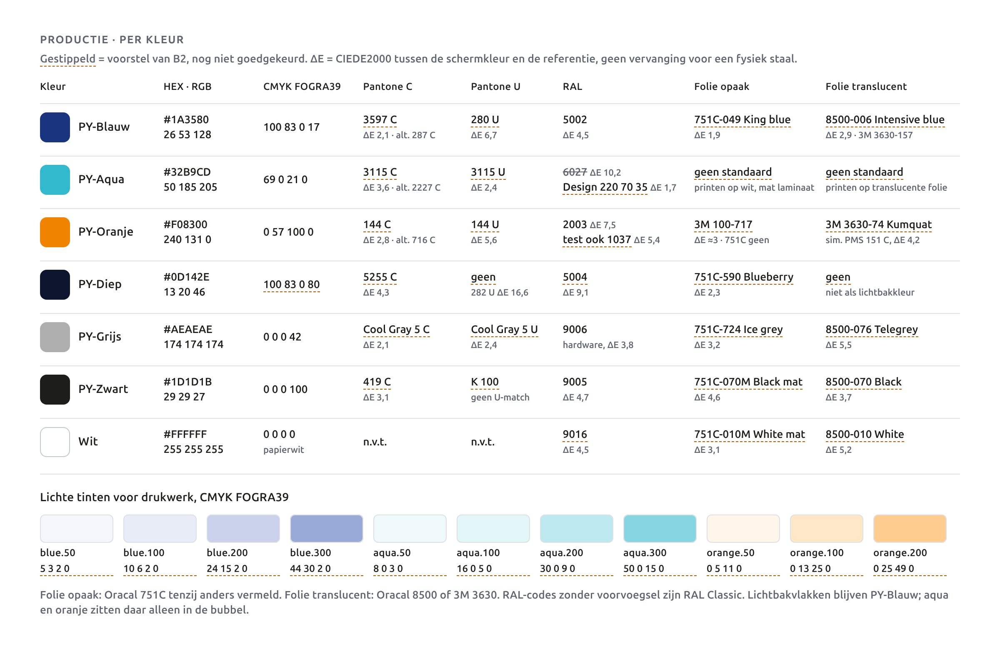

**Methode.** ΔE is CIEDE2000, zelf berekend. Voor RAL en folie: merkkleur van sRGB naar CIELab D65 en vergeleken met de gepubliceerde Lab- of sRGB-waarde. Voor Pantone: merkkleur naar CIELab D50 (Bradford) en vergeleken met de Lab-waarden uit de PANTONE+ Solid Coated en Uncoated V3 kleurboeken (X-Rite 2014). Waar de nieuwere Pantone-waarden ook te vinden waren (colorxs.com) staat de tweede ΔE erbij. Een ΔE uit schermdata vervangt nooit een fysiek staal: elke keuze wordt gecontroleerd met de Pantone-waaiers, de RAL K7 en de folie-stalen.

**CMYK.** Omgerekend met het ICC-profiel Coated FOGRA39 (ISO 12647-2:2004), uit de output intent van `source/print/15728501-1.pdf`, via LittleCMS (Pillow ImageCms), relatief colorimetrisch met zwartpuntcompensatie. De ΔE is de terugrekening via hetzelfde profiel.

| Kleur | CMYK | ΔE | Toelichting |
|---|---|---|---|
| PY-Diep | 100 83 0 80 | 4,8 | PY-Blauw plus 80 K, totaal 263 procent inkt. Valt buiten FOGRA39; het beste haalbare is 4,5. Directe ICC-omrekening geeft 100 93 47 66 (ΔE 7,7). |
| PY-Diep, tekst kleiner dan 12 pt op oranje | K 100 | n.v.t. | Drie platen op kleine tekst geven pasproblemen. PY-Zwart op oranje haalt 6,39:1. Komt alleen nog voor op betaalstickers. |
| blue.50 / 100 / 200 / 300 | 5 3 2 0 / 10 6 2 0 / 24 15 2 0 / 44 30 2 0 | 1,0 / 1,0 / 0,5 / 1,0 | ICC-omrekening |
| aqua.50 / 100 / 200 / 300 | 8 0 3 0 / 16 0 5 0 / 30 0 9 0 / 50 0 15 0 | 0,4 / 1,2 / 2,0 / 2,1 | raster van PY-Aqua (12, 23, 44, 72 procent); aqua.300 vervangt de vijf losse lichte aqua's in oud drukwerk |
| orange.50 / 100 / 200 | 0 5 11 0 / 0 13 25 0 / 0 25 49 0 | 0,0 / 0,7 / 0,8 | ICC-omrekening; in drukwerk nu niet meer nodig |

Ter controle: de handboekwaarden rekenen goed terug. PY-Blauw 100 83 0 17 geeft ΔE 2,9, PY-Aqua 69 0 21 0 geeft 0,5, PY-Oranje 0 57 100 0 geeft 1,3. Die blijven staan. FOGRA52 (ongestreken) is nog niet omgerekend, omdat het profiel niet te downloaden was; de drukker rekent dat om vanuit de sRGB- of Lab-waarden.

**Pantone.**

| Kleur | Coated | Uncoated |
|---|---|---|
| PY-Blauw | 3597 C (ΔE 2,1; nieuwere data 5,4). Alternatief 287 C (5,8; 4,8) | 280 U (6,7); ongestreken haalt dit blauw niet |
| PY-Aqua | 3115 C (3,6; nieuwere data 2,1). Alternatief 2227 C (2,4; 4,2) | 3115 U (2,4) |
| PY-Oranje | 144 C (2,8; 4,4). Alternatief 716 C (2,9; 3,9) | 144 U (5,6) |
| PY-Diep | 5255 C (4,3; 6,9) | geen bruikbare match (282 U 16,6) |
| PY-Grijs | Cool Gray 5 C (2,1) | Cool Gray 5 U (2,4) |
| PY-Zwart | 419 C (3,1); in de praktijk K 100 | K 100 |

**RAL.**

| Kleur | Was | Nu |
|---|---|---|
| PY-Aqua | RAL 6027 Lichtgrün, ΔE 10,2, te groen | RAL Design 220 70 35 Ferienblau, ΔE 1,7. Geen RAL Classic komt binnen ΔE 9. Voor borden met aqua liever geprinte folie met mat laminaat op Dibond; poedercoat in aqua alleen waar het echt moet, in RAL Design. |
| PY-Oranje | RAL 2003, ΔE 7,5 | RAL 2003 houden, maar RAL 1037 Sonnengelb (ΔE 5,4) meenemen in de proefborden. Alleen voor automaten en betaalborden. |
| PY-Diep | geen | RAL 5004 Schwarzblau, ΔE 9,1; alleen als het echt gelakt moet worden |
| Wit | geen | RAL 9016 Verkehrsweiß, ΔE 4,5, hoogste lichtreflectie (LRV 87) van de witten |
| PY-Blauw | RAL 5002, ΔE 4,5 | houden; nog steeds de beste RAL Classic |

**Folie.** Oracal 751C is glanzend, behalve wit en zwart, die ook mat bestaan (010M, 070M). Voor matte borden is printen met mat laminaat de standaard; snijfolie alleen voor één kleur op een vlak.

| Kleur | Opaak | Translucent (lichtbak) |
|---|---|---|
| PY-Blauw | Oracal 751C-049 King blue (ΔE 1,9) | Oracal 8500-006 Intensive blue (2,9) of 3M 3630-157 Sultan Blue |
| PY-Aqua | geen standaardkleur (beste: 751C-599 Pastel turquoise, 8,6). Printen, of maatkleur aanvragen | geen standaardkleur in 8500 of 3630. Printen op translucente printfolie (3M IJ3630-20), of maatkleur (3M levert 3630 op kleur) |
| PY-Oranje | 751C heeft niets binnen ΔE 9. 3M Scotchcal 100-717 Light Orange (ongeveer 3, hexwaarde niet officieel) | 3M 3630-74 Kumquat Orange (simuleert Pantone 151 C, ΔE 4,2); alleen voor de bubbel bij de betaalplek |
| PY-Diep | Oracal 751C-590 Blueberry (2,3) | geen; geen lichtbakkleur |
| PY-Grijs | Oracal 751C-724 Ice grey (3,2) | Oracal 8500-076 Telegrey (5,5) |
| PY-Zwart | Oracal 751C-070M Black mat (4,6) | Oracal 8500-070 Black (3,7) |
| Wit | Oracal 751C-010M White mat (3,1) | Oracal 8500-010 White (5,2) |

Translucente folie oogt doorgelicht anders dan op het staal. Kies lichtbakkleur altijd op een proefvlak in de lichtbak, bij dag en bij nacht.

**Bronnen.**
- Pantone Lab: PANTONE+ Solid Coated en Uncoated V3, via [jacobbubu/color-books](https://github.com/jacobbubu/color-books); controle via [colorxs.com](https://www.colorxs.com/color/pantone-3115-c) en [Pantone color finder 3597 C](https://www.pantone.com/color-finder/3597-c).
- RAL Classic Lab: [List of RAL colours, Wikipedia](https://en.wikipedia.org/wiki/List_of_RAL_colours). RAL Design: [RAL 220 70 35](https://ralcolorchart.com/ral-design/ral-220-70-35).
- Oracal sRGB-waarden: [Orafol 751C](https://www.orafol.com/en/europe/products/oracal-751c-high-performance-cast), [Orafol 8500](https://orafol.com/en/europe/products/oracal-8500-translucent-cal).
- 3M: [productbulletin 3630/3730](https://www.wensco.com/customer/docs/skudocs/3M_3630_3730_productbulletin.pdf) (namen en Pantone-simulaties), [productkaart 3630](https://www.sirvisual.com/Attachment/100/Product%20Card%203630.pdf) (maatkleuren, IJ3630-20), [kleurkaart 100](https://multimedia.3m.com/mws/media/653312O/color-card-100.pdf). De hexwaarde van 100-717 komt uit [Colorly](https://github.com/jpederson/Colorly) (MIT) en is niet officieel.
- Garagelicht: `01-research/R4-physical-environment.md`. Drukdrift: `docs/print-rules.md` 1 en 7.1.

## Do's en don'ts

| Doen | Niet doen |
|---|---|
| Veel wit; navy als merkvlak; per vlak één accent | Elk vlak vol kleur omdat het kan |
| Aqua als de stem, het hoofd van een parkeerder of de randen van jouw vak | Aqua als tekstkleur op wit of als knop op een licht scherm |
| Oranje alleen bij betalen in de garage: automaat, tarief, storing | Oranje knoppen, prijzen, strepen of vlakken op scherm, in druk of op social |
| De hoofdknop navy met witte tekst, op donker aqua met PY-Diep | Een oranje "Reserveer"-knop |
| In de garage kleur kiezen op taak: rijden navy, lopen aqua, betalen oranje | Aqua of oranje gebruiken omdat het vrolijk staat |
| Op aqua altijd PY-Blauw, op oranje altijd PY-Diep | Wit op aqua of oranje |
| Status met een woord | Alleen een gekleurde stip |
| Alles vlak; oude verloopborden bij vervanging vlak PY-Blauw | Een verloop, ook niet "alleen in marketing" |
| De tokens `voice.arc`, `vak.*`, `figure.*` en `action.*` gebruiken | Kleuren uit een oud bestand pipetten |
| Mat laminaat en een proefbord in de garage | Kleur goedkeuren op een scherm |
