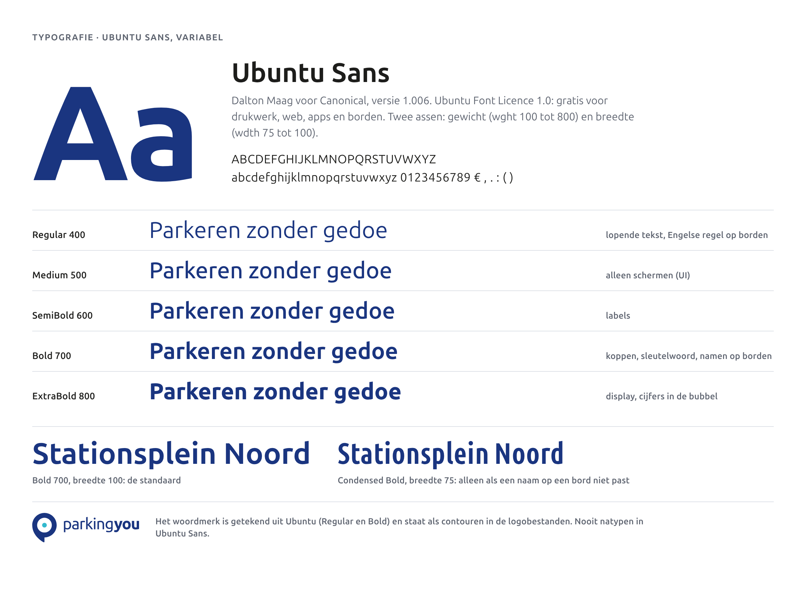
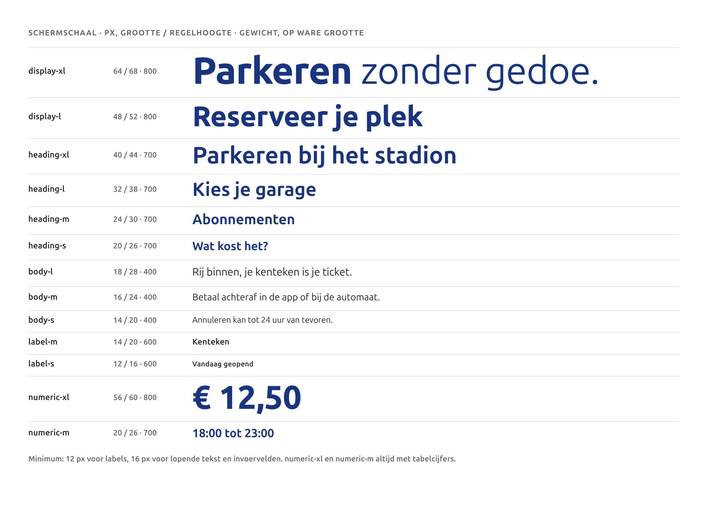
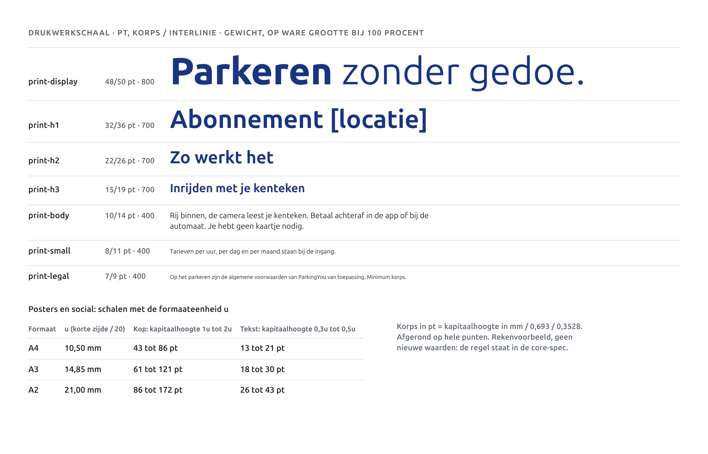
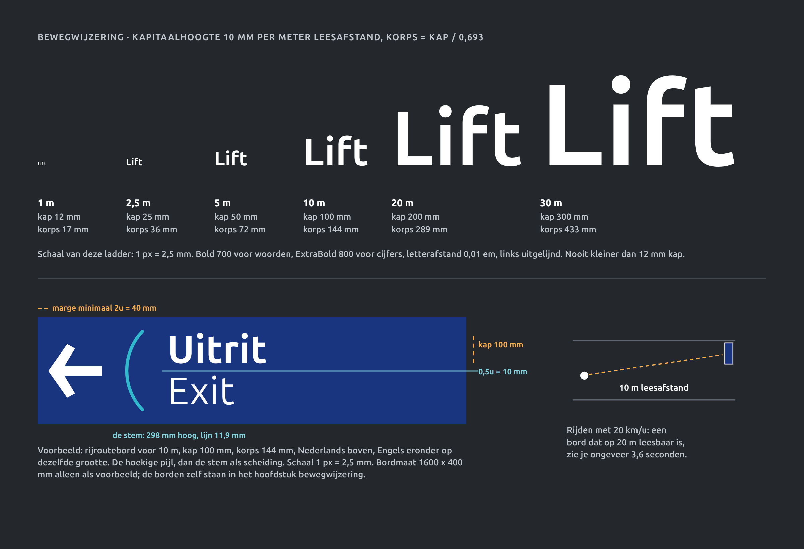
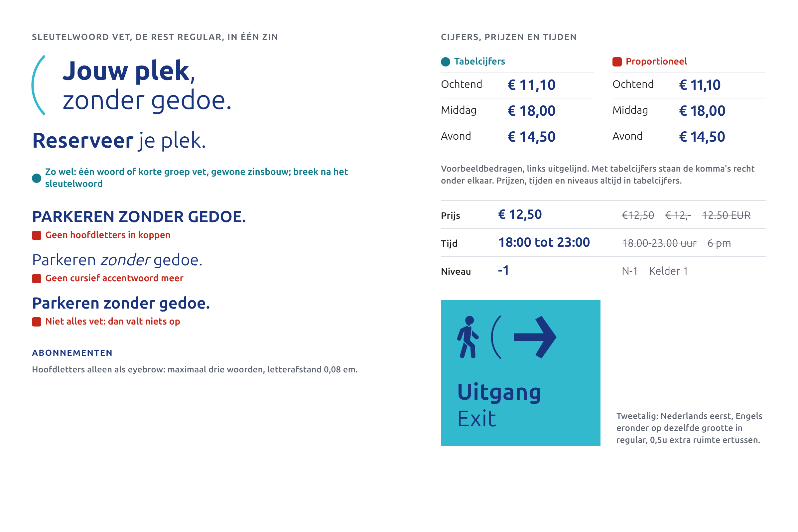

# Typografie

We gebruiken één letter: Ubuntu Sans. Op een reel, een factuur en een bord van drie meter breed. Dit hoofdstuk zegt welke gewichten je wanneer gebruikt, hoe groot tekst moet zijn op scherm, in druk en in de garage, en hoe we cijfers, prijzen en tijden schrijven.

## Ubuntu Sans

Ubuntu Sans is de opvolger van Ubuntu, de letter die ParkingYou al gebruikt. De vormen zijn dezelfde familie: rond, open, vriendelijk en goed leesbaar op afstand. Wat erbij komt:

- **Variabel.** Eén bestand met twee assen: gewicht (wght 100 tot 800) en breedte (wdth 75 tot 100). Er is dus een echte ExtraBold voor cijfers en een smalle versie voor lange namen op borden.
- **Tabelcijfers.** Alle cijfers kunnen even breed staan, zodat prijzen en tijden in kolommen netjes onder elkaar vallen.
- **Maten die we gebruiken.** Kapitaalhoogte 0,693 em, x-hoogte 0,518 em. Daarmee rekenen we lettergroottes op borden uit.

Ontwerp: Dalton Maag, in opdracht van Canonical, versie 1.006. Licentie: Ubuntu Font Licence 1.0. Gratis voor drukwerk, web, apps, e-mail en borden; je mag de bestanden delen met drukkers en bureaus zolang de licentietekst erbij zit. De letter staat ook op [Google Fonts](https://fonts.google.com/specimen/Ubuntu+Sans) en in de bron van Canonical ([Ubuntu-Sans-fonts](https://github.com/canonical/Ubuntu-Sans-fonts)).

Bestanden: `brand-2027/fonts/UbuntuSans[wdth,wght].ttf`, met de licentie in `brand-2027/fonts/UBUNTU-FONT-LICENCE.txt`. Daar staat ook een cursieve variant; die gebruiken we niet.

## Het logo blijft getekend

Het woordmerk is getekend uit de oude Ubuntu: "parking" in Regular, "you" in Bold. Het staat als contouren in de logobestanden. Je typt het nooit na, ook niet in Ubuntu Sans.

Het oude handboek zegt dat "parking" in Ubuntu Medium staat. Gemeten op de contouren is het Regular. Dat verschil lossen we op door niets te veranderen: het logo blijft zoals het getekend is, en het handboek klopt voortaan met de bestanden.

## Gewichten en wanneer

| Gewicht | Waarvoor |
|---|---|
| Regular 400 | lopende tekst, het niet-vette deel van een kop, de Engelse regel op borden |
| Medium 500 | alleen op schermen, voor UI-elementen |
| SemiBold 600 | labels |
| Bold 700 | koppen, het sleutelwoord, namen en woorden op borden |
| ExtraBold 800 | display, cijfers in de bubbel, cijfers op borden |

Light en Thin gebruiken we niet. Ze worden te dun in een donkere garage en op kleine schermen.

**Smal (wdth 75).** Alleen voor namen op borden die op normale breedte niet passen, zoals een lange straat- of locatienaam. Nooit in lopende tekst, nooit in marketing. Eerst kijken of de naam korter kan.

## Fallback

Op het web laden we Ubuntu Sans zelf. Valt die weg, dan pakt de browser de volgende:

`"Ubuntu Sans", Ubuntu, system-ui, -apple-system, "Segoe UI", Roboto, Arial, sans-serif`

In Word, PowerPoint, Outlook en nieuwsbrieven gebruiken we **Arial**. Dan ziet de ontvanger wat jij ziet, ook als die Ubuntu Sans niet heeft. Je mag Ubuntu Sans op je eigen computer zetten om te ontwerpen, maar bestanden die je deelt als Office-document zet je in Arial.

## Schermschaal

Waarden in px: grootte / regelhoogte en gewicht. Minimum 12 px voor labels, 16 px voor lopende tekst en invoervelden.

| Token | Grootte | Regel | Gewicht |
|---|---|---|---|
| display-xl | 64 | 68 | 800 |
| display-l | 48 | 52 | 800 |
| heading-xl | 40 | 44 | 700 |
| heading-l | 32 | 38 | 700 |
| heading-m | 24 | 30 | 700 |
| heading-s | 20 | 26 | 700 |
| body-l | 18 | 28 | 400 |
| body-m | 16 | 24 | 400 |
| body-s | 14 | 20 | 400 |
| label-m | 14 | 20 | 600 |
| label-s | 12 | 16 | 600 |
| numeric-xl | 56 | 60 | 800, tabelcijfers |
| numeric-m | 20 | 26 | 700, tabelcijfers |

## Drukwerkschaal

| Token | Korps / interlinie (pt) | Gewicht |
|---|---|---|
| print-display | 48 / 50 | 800 |
| print-h1 | 32 / 36 | 700 |
| print-h2 | 22 / 26 | 700 |
| print-h3 | 15 / 19 | 700 |
| print-body | 10 / 14 | 400 |
| print-small | 8 / 11 | 400 |
| print-legal | 7 / 9 | 400, het minimum |

Posters en social schalen mee met het formaat. u is de korte zijde gedeeld door 20. Een kop heeft een kapitaalhoogte van 1u tot 2u, tekst van 0,3u tot 0,5u. Op een A2 (u = 21 mm) is een kop dus 86 tot 172 pt.

## Bewegwijzering: hoe groot

Eén regel: **10 mm kapitaalhoogte per meter leesafstand**. Het korps is de kapitaalhoogte gedeeld door 0,693.

| Leesafstand | Kapitaalhoogte | Korps |
|---|---|---|
| 1 m (detail op pyloon, terminal) | 12 mm, minimum op elk bord | 17 mm |
| 2,5 m | 25 mm | 36 mm |
| 5 m | 50 mm | 72 mm |
| 10 m | 100 mm | 144 mm |
| 20 m | 200 mm | 289 mm |
| 30 m | 300 mm | 433 mm |

Op borden: Bold 700 voor woorden, ExtraBold 800 voor cijfers, letterafstand 0,01 em, links uitgelijnd, nooit uitgevuld. Weinig woorden: wie met 20 km/u rijdt, heeft een bord dat op 20 m leesbaar is ongeveer 3,6 seconden in beeld. Dat zijn een paar woorden. De maten van de borden zelf staan in het hoofdstuk bewegwijzering.

## Zo schrijven we het

**Het sleutelwoord vet.** Het belangrijkste woord vet, de rest regular, op één regel: "**Parkeren** zonder gedoe." of "**Reserveer** je plek." Niet alles vet, dan valt niets op.

**Geen hoofdletters, geen cursief.** Zinnen beginnen met een hoofdletter, de rest is klein. Hoofdletters alleen voor een eyebrow boven een kop: maximaal drie woorden, letterafstand 0,08 em. Het cursieve accentwoord van de huidige website verdwijnt.

## Cijfers, prijzen en tijden

- Prijzen, tijden en niveaus staan altijd in tabelcijfers.
- Prijs: "€ 12,50". Euroteken, spatie, decimale komma. Niet "€12,50", niet "€ 12,-".
- Tijd: "18:00 tot 23:00". Dubbele punt, en "tot" in plaats van een streepje.
- Niveau: "-1", "0", "2". In een bubbel in ExtraBold 800.
- Concrete getallen in plaats van vage woorden: "€ 12,50 per dag", niet "voordelig".

## Tweetalig

Nederlands eerst. Engels eronder, op dezelfde grootte, in Regular. Tussen de twee regels 0,5u extra ruimte. "**Uitgang** / Exit", "**Betaal hier** / Pay here".

## Licenties van alle genoemde letters

| Letter | Waar | Licentie | Kosten |
|---|---|---|---|
| Ubuntu Sans | alles | Ubuntu Font Licence 1.0 | geen |
| Ubuntu | alleen in het logo, als contouren | Ubuntu Font Licence 1.0 | geen |
| Arial | Office en e-mail | meegeleverd met Windows, macOS en Office | geen extra kosten; de bestanden niet zelf verspreiden |
| system-ui, -apple-system, Segoe UI | web-fallback, letter van het apparaat | systeemletters van Apple en Microsoft | geen; we leveren ze niet mee |
| Roboto | web-fallback op Android | open licentie (Google Fonts) | geen |
| RVV-cijfers op portalen en pylonen | verkeersborden van derden | geleverd als contouren door de bordenleverancier **(aanname)** | geen voor ParkingYou **(aanname)** |

Er zijn geen licentiekosten. Leveranciers krijgen contouren of de benoemde statische versies: Regular, Bold, ExtraBold en Condensed Bold.

## Do's en don'ts

| Doen | Niet doen |
|---|---|
| Ubuntu Sans in alles wat we zelf maken | Een tweede letter "voor de afwisseling" |
| Sleutelwoord vet, rest regular, één regel | Alles vet, of een cursief accentwoord |
| Tabelcijfers voor prijzen, tijden en niveaus | "€12,-" of "18.00-23.00 uur" |
| Op borden 10 mm kap per meter, minimaal 12 mm | Een kleinere letter omdat het bord vol is |
| Smal alleen voor een naam die anders niet past | Smal in lopende tekst |
| Arial in Office en e-mail | Ubuntu Sans in een Word-bestand dat je deelt |
| Logo als bestand plaatsen | Het woordmerk natypen |

## Voorgestelde waarden

Goedgekeurd: zie besluiten D25 in de core spec. Waar de core spec iets anders zegt, geldt de core spec.

| Onderwerp | Voorstel | Waarom |
|---|---|---|
| Meetpunt van 0,5u bij tweetalige tekst | Beide regels met regelhoogte gelijk aan het korps, en 0,5u wit tussen de twee regels (in de figuur zo getekend) | De core-spec zegt "gescheiden door 0,5u" maar niet vanaf waar. Gemeten van basislijn tot kapitaal staat het Engels op een klein bord bijna tegen het Nederlands aan. |
| Smalle letter op schermen | Niet gebruiken, ook niet in tabellen | De core-spec noemt smal alleen voor borden; zo blijft dat helder. |
