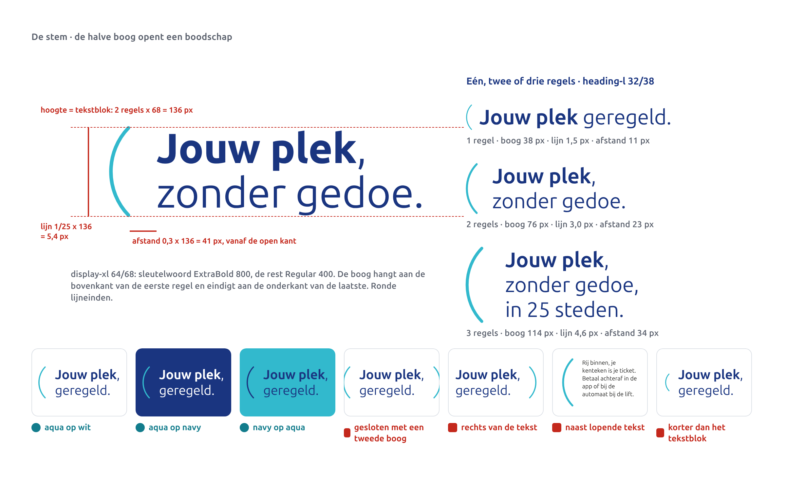
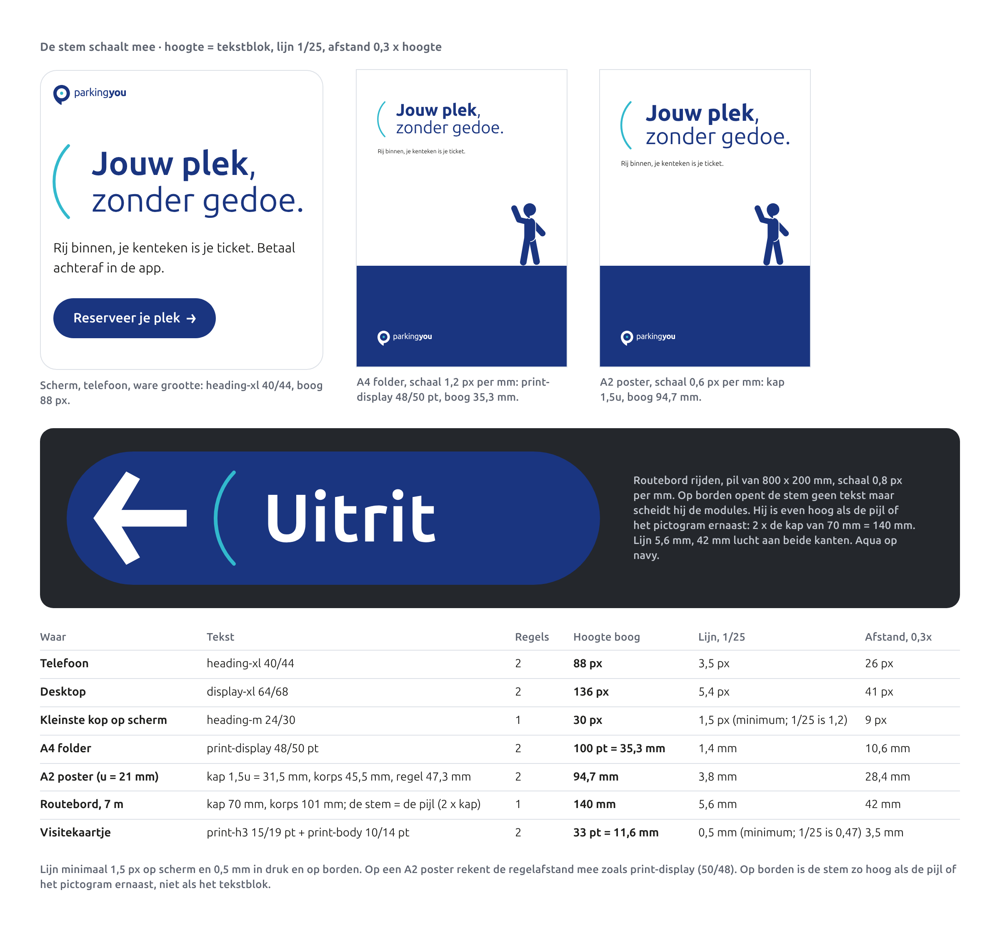
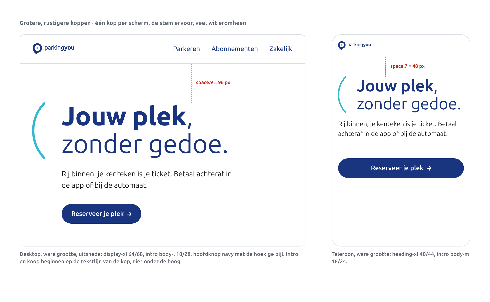

# Typografie

We gebruiken één letter: Ubuntu Sans. Op een reel, een factuur en een bord van drie meter breed. En we hebben één typografisch gebaar dat alleen van ons is: de stem, de halve boog die een boodschap opent. Dit hoofdstuk zegt welke gewichten je wanneer gebruikt, hoe groot tekst moet zijn op scherm, in druk en in de garage, hoe de stem met de tekst meegroeit, en hoe we cijfers, prijzen en tijden schrijven.

## Ubuntu Sans

Ubuntu Sans is de opvolger van Ubuntu, de letter die ParkingYou al gebruikt. De vormen zijn dezelfde familie: rond, open, vriendelijk en goed leesbaar op afstand. Wat erbij komt:

- **Variabel.** Eén bestand met twee assen: gewicht (wght 100 tot 800) en breedte (wdth 75 tot 100). Er is dus een echte ExtraBold voor koppen en cijfers en een smalle versie voor lange namen op borden.
- **Tabelcijfers.** Alle cijfers kunnen even breed staan, zodat prijzen en tijden in kolommen netjes onder elkaar vallen.
- **Maten die we gebruiken.** Kapitaalhoogte 0,693 em, x-hoogte 0,518 em. Daarmee rekenen we lettergroottes op borden uit.

Ontwerp: Dalton Maag, in opdracht van Canonical, versie 1.006. Licentie: Ubuntu Font Licence 1.0. Gratis voor drukwerk, web, apps, e-mail en borden; je mag de bestanden delen met drukkers en bureaus zolang de licentietekst erbij zit. De letter staat ook op [Google Fonts](https://fonts.google.com/specimen/Ubuntu+Sans) en in de bron van Canonical ([Ubuntu-Sans-fonts](https://github.com/canonical/Ubuntu-Sans-fonts)).

Bestanden: `brand-2027/fonts/UbuntuSans[wdth,wght].ttf`, met de licentie in `brand-2027/fonts/UBUNTU-FONT-LICENCE.txt`. Daar staat ook een cursieve variant; die gebruiken we niet.

## Het logo blijft getekend

Het woordmerk is getekend uit de oude Ubuntu: "parking" in Regular, "you" in Bold. Het staat als contouren in de logobestanden. Je typt het nooit na, ook niet in Ubuntu Sans.

Het oude handboek zegt dat "parking" in Ubuntu Medium staat. Gemeten op de contouren is het Regular. Dat verschil lossen we op door niets te veranderen: het logo blijft zoals het getekend is, en het handboek klopt voortaan met de bestanden.

## Gewichten en wanneer

| Gewicht | Waarvoor |
|---|---|
| Regular 400 | lopende tekst, het niet-vette deel van een kop, de Engelse regel op borden |
| Medium 500 | alleen op schermen, voor UI-elementen |
| SemiBold 600 | labels en knoppen |
| Bold 700 | koppen, het sleutelwoord, namen en woorden op borden |
| ExtraBold 800 | het sleutelwoord in display-koppen, cijfers in de bubbel, cijfers op borden |

Light en Thin gebruiken we niet. Ze worden te dun in een donkere garage en op kleine schermen.

**Smal (wdth 75).** Alleen voor namen op borden die op normale breedte niet passen, zoals een lange straat- of locatienaam. Nooit in lopende tekst, nooit in marketing, nooit op schermen. Eerst kijken of de naam korter kan.

## Reserveletters

Op het web laden we Ubuntu Sans zelf. Valt die weg, dan pakt de browser de volgende:

`"Ubuntu Sans", Ubuntu, system-ui, -apple-system, "Segoe UI", Roboto, Arial, sans-serif`

In Word, PowerPoint, Outlook en de e-mailhandtekening gebruiken we **Arial**. Dan ziet de ontvanger wat jij ziet, ook als die Ubuntu Sans niet heeft. Je mag Ubuntu Sans op je eigen computer zetten om te ontwerpen, maar bestanden die je deelt als Office-document zet je in Arial.

De HTML-nieuwsbrief laadt Ubuntu Sans als webletter, met Arial als reserve. Mailprogramma's die geen webletters tonen, laten dan Arial zien.

## De stem

De stem is de halve boog uit het oude handboek, zonder de slogan die er vroeger bij stond. Hij staat links van een kop en opent de boodschap, zoals iemand die begint te praten. Samen met het sleutelwoord vet is dat onze stem: "**Jouw plek**, zonder gedoe."

- **Waar.** Links van een kop of een kernzin van één tot drie regels. Nooit rechts, nooit gesloten met een tweede boog, nooit naast lopende tekst.
- **Hoogte.** Gelijk aan het tekstblok dat hij opent: aantal regels maal de regelhoogte. De boog begint aan de bovenkant van de eerste regel en eindigt aan de onderkant van de laatste.
- **Lijn.** 1/25 van de hoogte, met ronde einden. Minimaal 1,5 px op scherm en 0,5 mm in druk en op borden.
- **Afstand.** 0,3 maal de hoogte, van de open kant van de boog tot de eerste letter.
- **Kleur.** PY-Aqua op wit en op PY-Blauw (`voice.arc`), PY-Blauw op PY-Aqua. Op oranje betaalborden in de garage is de stem PY-Diep, net als de pijl. De stem zelf is nooit oranje.
- **Aantal.** Eén per vlak in een layout. Op borden zoveel als er modules te scheiden zijn.
- **Op borden** is de stem geen opener maar een scheiding tussen modules, bijvoorbeeld tussen pijl en tekst of pictogram en pijl. Daar is hij zo hoog als de pijl of het pictogram ernaast: 2 keer de kapitaalhoogte. Op een portaal is hij zo hoog als het beeldmerk. Lijn 1/25, afstand 0,3 maal de hoogte aan beide kanten.
- **In beweging** tekent de boog zich van boven naar beneden (`duration.slow`, `easing.enter`); daarna komt de tekst in beeld, samen 440 ms. Bij beperkte beweging komen boog en tekst samen in beeld. Details in hoofdstuk 8, Beweging.

De stem is een van onze vier eigen elementen, naast de parkeerders, de bubbel en de hoekige pijl. Per vlak staan het logo en hooguit twee daarvan: de stem met een parkeerder, of de stem met de hoekige pijl in de knop, maar niet ook nog een bubbel.

## De stem op elke maat

Omdat de boog uit de tekst wordt afgeleid, groeit hij vanzelf mee. Je hoeft geen maten te onthouden, alleen drie verhoudingen. Op borden reken je vanuit de pijl in plaats van de tekst.

| Waar | Tekst | Regels | Hoogte boog | Lijn, 1/25 | Afstand, 0,3x |
|---|---|---|---|---|---|
| Telefoon | heading-xl 40/44 | 2 | 88 px | 3,5 px | 26 px |
| Desktop | display-xl 64/68 | 2 | 136 px | 5,4 px | 41 px |
| Kleinste kop op scherm | heading-m 24/30 | 1 | 30 px | 1,5 px (minimum; 1/25 is 1,2) | 9 px |
| A4 folder | print-display 48/50 pt | 2 | 100 pt = 35,3 mm | 1,4 mm | 10,6 mm |
| A2 poster (u = 21 mm) | kap 1,5u = 31,5 mm, korps 45,5 mm, regel 47,3 mm | 2 | 94,7 mm | 3,8 mm | 28,4 mm |
| Visitekaartje | print-h3 15/19 pt en print-body 10/14 pt | 2 | 33 pt = 11,6 mm | 0,5 mm (minimum; 1/25 is 0,47) | 3,5 mm |
| Routebord, 7 m | kap 70 mm, korps 101 mm; de stem is zo hoog als de pijl (2 x kap) | 1 | 140 mm | 5,6 mm | 42 mm |

Rekenvoorbeeld A2: kapitaalhoogte 1,5u = 31,5 mm, korps 31,5 / 0,693 = 45,5 mm (129 pt), regelafstand 45,5 x 50/48 = 47,3 mm, twee regels 94,7 mm. Lijn 94,7 / 25 = 3,8 mm, afstand 94,7 x 0,3 = 28,4 mm.

## Grotere, rustigere koppen

De koppen zijn groter en rustiger dan voorheen. Dat zit niet in nieuwe maten, maar in hoe we de bestaande schaal gebruiken:

- **Eén kop per scherm of vlak.** De paginakop is de grootste stap die past: desktop display-xl (64/68), tablet display-l (48/52), telefoon heading-xl (40/44). Op posters een kapitaalhoogte van 1,5u tot 2u.
- **De stem ervoor.** Een paginakop of campagnekop opent met de stem. Sectiekoppen niet.
- **Sleutelwoord vet, de rest Regular.** In display-koppen is het sleutelwoord ExtraBold 800, in heading-koppen Bold 700. De rest staat in Regular 400. Zo is een grote kop toch licht.
- **Hooguit drie regels.** Breek na het sleutelwoord: "**Jouw plek**," op de eerste regel, "zonder gedoe." op de tweede.
- **Veel wit eromheen.** Boven de paginakop op desktop `space.9` (96 px), op telefoon `space.7` (48 px). Intro en knop beginnen op de tekstlijn van de kop, niet onder de boog.
- **Navy op wit.** Koppen zijn PY-Blauw op wit of papier, of wit op PY-Blauw. Nooit aqua of oranje.

## Schermschaal

Waarden in px: grootte / regelhoogte en gewicht. Minimum 12 px voor labels, 16 px voor lopende tekst en invoervelden.

| Token | Grootte | Regel | Gewicht | Waar |
|---|---|---|---|---|
| display-xl | 64 | 68 | 800 | paginakop desktop |
| display-l | 48 | 52 | 800 | paginakop tablet |
| heading-xl | 40 | 44 | 700 | paginakop telefoon |
| heading-l | 32 | 38 | 700 | sectiekop desktop |
| heading-m | 24 | 30 | 700 | sectiekop telefoon, kaartkop |
| heading-s | 20 | 26 | 700 | kleine kop, lijstkop |
| body-l | 18 | 28 | 400 | intro onder de paginakop |
| body-m | 16 | 24 | 400 | lopende tekst, invoervelden |
| body-s | 14 | 20 | 400 | hulptekst |
| label-l | 16 | 24 | 600 | knoplabel |
| label-m | 14 | 20 | 600 | veldlabel |
| label-s | 12 | 16 | 600 | tag, klein label |
| numeric-xl | 56 | 60 | 800, tabelcijfers | bedrag in een overzicht |
| numeric-m | 20 | 26 | 700, tabelcijfers | tijden en bedragen in lijsten |

## Drukwerkschaal

| Token | Korps / interlinie (pt) | Gewicht |
|---|---|---|
| print-display | 48 / 50 | 800 |
| print-h1 | 32 / 36 | 700 |
| print-h2 | 22 / 26 | 700 |
| print-h3 | 15 / 19 | 700 |
| print-body | 10 / 14 | 400 |
| print-small | 8 / 11 | 400 |
| print-legal | 7 / 9 | 400, het minimum |

Posters en social schalen mee met het formaat. u is de korte zijde gedeeld door 20. Een kop heeft een kapitaalhoogte van 1u tot 2u, tekst van 0,3u tot 0,5u. De regelafstand van zo'n kop is het korps x 50/48, net als bij print-display. Op een A2 (u = 21 mm) is een kop dus 86 tot 172 pt. Voor de rustige, grote koppen kies je het bovenste deel: 1,5u tot 2u. Visitekaartjes en kleiner gebruiken de drukwerkschaal, niet de u-regel.

## Bewegwijzering: hoe groot

Eén regel: **10 mm kapitaalhoogte per meter leesafstand**. Het korps is de kapitaalhoogte gedeeld door 0,693.

| Leesafstand | Kapitaalhoogte | Korps |
|---|---|---|
| 1 m (detail op pyloon, terminal) | 12 mm, minimum op elk bord | 17 mm |
| 2,5 m | 25 mm | 36 mm |
| 5 m | 50 mm | 72 mm |
| 10 m | 100 mm | 144 mm |
| 20 m | 200 mm | 289 mm |
| 30 m | 300 mm | 433 mm |

Op borden: Bold 700 voor woorden, ExtraBold 800 voor cijfers, letterafstand 0,01 em, links uitgelijnd, nooit uitgevuld. Weinig woorden: wie met 20 km/u rijdt, heeft een bord dat op 20 m leesbaar is ongeveer 3,6 seconden in beeld. Dat zijn een paar woorden. De hoekige pijl staat los op het bord, twee keer de kapitaalhoogte hoog. De stem scheidt pijl en tekst en is net zo hoog als de pijl of het pictogram ernaast. Een routebord is een pil van 200 mm hoog met een kapitaalhoogte van 70 mm, leesbaar op 7 m: pijl en stem zijn dan 140 mm. Routeborden zijn alleen Nederlands. De maten van de borden zelf staan in hoofdstuk 12, Toepassingen.

## Zo schrijven we het

**Het sleutelwoord vet.** Het belangrijkste woord of de kortste groep vet, de rest regular, in één zin: "**Jouw plek**, zonder gedoe." of "**Reserveer** je plek." Past de zin niet op één regel, dan breek je na het sleutelwoord. Niet alles vet, dan valt niets op.

**De stem opent, niet de tekst.** Geen aanhalingstekens, streep of icoon voor een kop; dat doet de boog.

**Geen hoofdletters, geen cursief.** Zinnen beginnen met een hoofdletter, de rest is klein. Hoofdletters alleen in een kort label boven een kop: maximaal drie woorden, letterafstand 0,08 em. Het cursieve accentwoord van de huidige website verdwijnt.

## Cijfers, prijzen en tijden

- Prijzen, tijden en niveaus staan altijd in tabelcijfers.
- Prijs: "€ 12,50". Euroteken, spatie, decimale komma. Niet "€12,50", niet "€ 12,-".
- Een prijs is PY-Blauw, of wit op navy. Nooit oranje, behalve op een tariefbord in de garage.
- Tijd: "18:00 tot 23:00". Dubbele punt, en "tot" in plaats van een streepje.
- Niveau: "−1", "0", "2", met een echt minteken, geen streepje. In een bubbel in ExtraBold 800.
- Concrete getallen in plaats van vage woorden: "€ 12,50 per dag", niet "voordelig".

## Tweetalig

Nederlands eerst. Engels eronder, op dezelfde grootte, in Regular. Beide regels met een regelhoogte gelijk aan het korps, en 0,5u wit tussen de twee regels. "**Uitgang** / Exit", "**Betaal hier** / Pay here". Dat geldt voor borden waar je stilstaat, zoals de pyloon en stickers. Routeborden zijn alleen Nederlands, met pictogrammen: twee regels passen niet op een pil van 200 mm.

## Licenties van alle genoemde letters

| Letter | Waar | Licentie | Kosten |
|---|---|---|---|
| Ubuntu Sans | alles | Ubuntu Font Licence 1.0 | geen |
| Ubuntu | alleen in het logo, als contouren | Ubuntu Font Licence 1.0 | geen |
| Arial | Office, e-mailhandtekening, reserveletter in de nieuwsbrief | meegeleverd met Windows, macOS en Office | geen extra kosten; de bestanden niet zelf verspreiden |
| system-ui, -apple-system, Segoe UI | reserveletter op het web, letter van het apparaat | systeemletters van Apple en Microsoft | geen; we leveren ze niet mee |
| Roboto | reserveletter op het web, Android | open licentie (Google Fonts) | geen |
| RVV-cijfers op portalen en pylonen | verkeersborden van derden | de bordenleverancier levert ze als contouren | geen voor ParkingYou |

Er zijn geen licentiekosten. Leveranciers krijgen contouren, of de officiële statische bestanden van Ubuntu Sans (Regular, Bold, ExtraBold, Condensed Bold) zoals Canonical en Google Fonts ze uitgeven. Maak zelf geen statische versies uit het variabele bestand: een eigen versie is volgens de licentie een afgeleide letter en mag dan de naam Ubuntu niet meer dragen. De stem gaat als contour mee, nooit als letterteken.

## Voorgestelde waarden

Goedgekeurd en verwerkt: besluiten D25 en D39 in de core spec.

| Onderwerp | Voorstel | Waarom |
|---|---|---|
| Meten van de stem | Hoogte tekstblok = aantal regels x regelhoogte. Afstand 0,3x gemeten van de open kant van de boog (de punten) tot de eerste letter. | De core spec zegt "hoogte = tekstblok" en "afstand 0,3x", maar niet vanaf waar. Zo is het op elke maat meetbaar. De referentiefiguur bij de eigen elementen staat iets krapper (ongeveer 0,2x); die zou mee moeten. |
| De stem als scheiding op borden | Afstand 0,3x de hoogte aan beide kanten van de boog; hoogte gelijk aan het tekstblok naast de boog. | De core spec geeft de lijn voor borden, maar geen afstand en hoogte. |
| Paginakop per scherm | Desktop display-xl, tablet display-l, telefoon heading-xl. Boven de paginakop `space.9` (96 px) op desktop, `space.7` (48 px) op telefoon. | Maakt "grotere, rustigere koppen" toetsbaar, met bestaande tokens. |
| Regelafstand van u-koppen | Korps x 50/48, zoals print-display. | De core spec geeft voor posters en social alleen de kapitaalhoogte; de hoogte van de stem hangt van de regelafstand af. |
| Gewicht van het sleutelwoord | ExtraBold 800 in display-koppen, Bold 700 in heading-koppen; de rest altijd Regular 400. | Volgt de schaal; voorkomt een kop die helemaal vet is. |

## Do's en don'ts

- **Wel:** Ubuntu Sans in alles wat we zelf maken.
- **Wel:** de stem links van één paginakop, even hoog als het tekstblok.
- **Wel:** lijn 1/25 en afstand 0,3x, uitgerekend uit de tekst.
- **Wel:** één grote kop per vlak, veel wit eromheen.
- **Wel:** het sleutelwoord vet, de rest regular, breken na het sleutelwoord.
- **Wel:** koppen en prijzen in PY-Blauw of wit.
- **Wel:** tabelcijfers voor prijzen, tijden en niveaus, en een echt minteken: "−1".
- **Wel:** op borden 10 mm kap per meter, minimaal 12 mm; de stem even hoog als de pijl of het pictogram ernaast.
- **Wel:** smal alleen voor een naam op een bord die anders niet past.
- **Wel:** Arial in Office-bestanden en de e-mailhandtekening; Ubuntu Sans als webletter in de nieuwsbrief.
- **Wel:** het logo als bestand plaatsen.
- **Niet:** een tweede letter "voor de afwisseling".
- **Niet:** een boog rechts, twee bogen eromheen, of een boog naast lopende tekst.
- **Niet:** een boog op het oog schalen.
- **Niet:** drie koppen die om aandacht vechten.
- **Niet:** alles vet, of een cursief accentwoord.
- **Niet:** oranje prijzen of koppen buiten de garage.
- **Niet:** "€12,-" of "18.00-23.00 uur".
- **Niet:** een kleinere letter omdat het bord vol is.
- **Niet:** smal in lopende tekst of op schermen.
- **Niet:** Ubuntu Sans in een Word-bestand dat je deelt.
- **Niet:** het woordmerk natypen.
