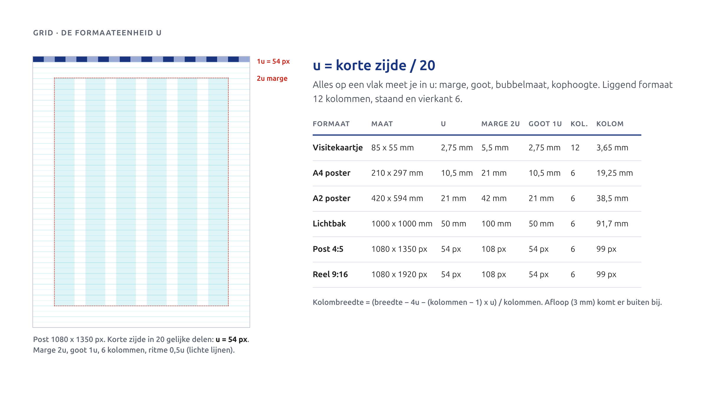
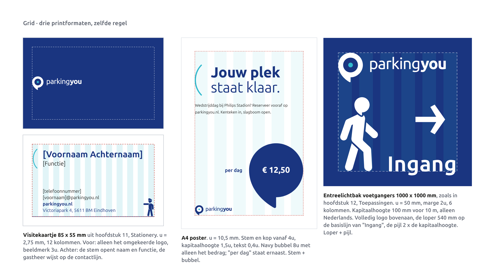
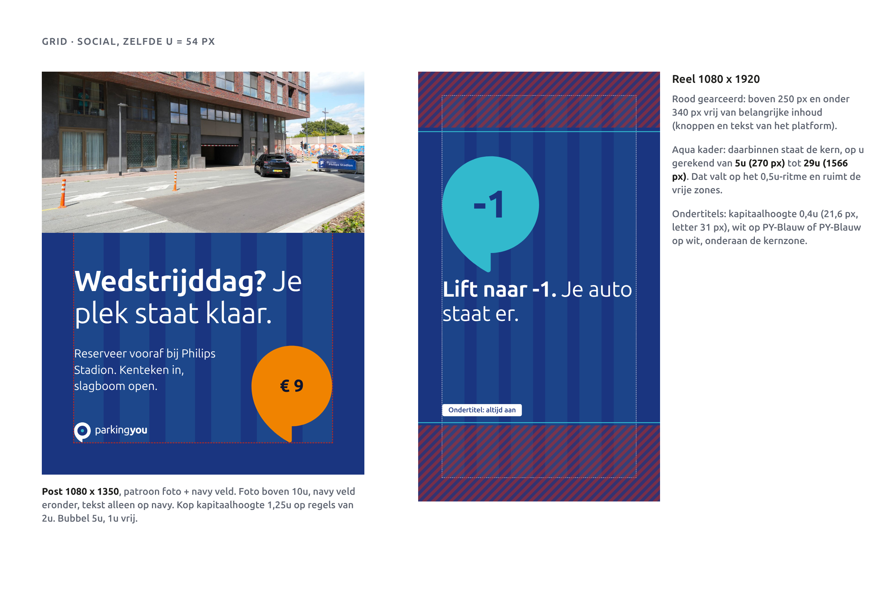
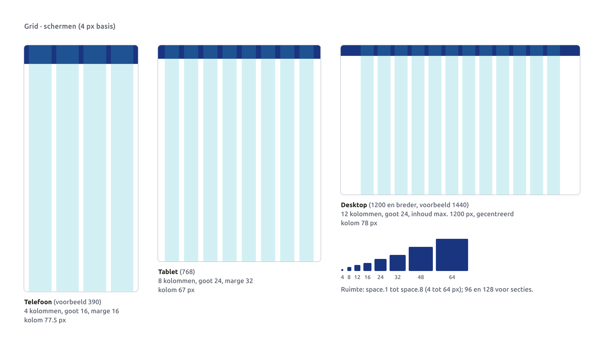
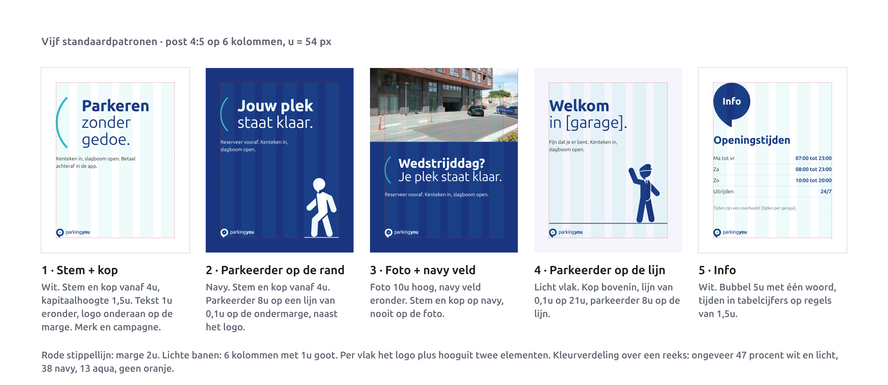

# Grid en layout

Eén maat voor alles: van visitekaartje tot lichtbak, van post tot reel. Die maat heet u. Op schermen werken we met een vast 4 px-raster. Dit hoofdstuk legt beide uit en geeft vier standaardpatronen waar je bijna elke uiting mee bouwt.

## De formaateenheid u

u is de korte zijde van het formaat gedeeld door 20. Meer hoef je niet te onthouden. Een post van 1080 x 1350 px heeft een korte zijde van 1080, dus u = 54 px. Een A4 heeft een korte zijde van 210 mm, dus u = 10,5 mm.

Alles op het vlak meet je in u:

- **Marge** 2u aan alle kanten. Afloop (3 mm bij print) komt er buiten bij.
- **Goot** 1u tussen de kolommen.
- **Kolommen**: 6 op staande en vierkante formaten, 12 op liggende formaten.
- **Ritme**: elementen staan op veelvouden van 0,5u. Bovenkant van een kop, onderkant van een logo, regelafstand: allemaal op dat ritme.
- **Bubbel**: 3u, 5u, 8u of 13u breed (zie Patronen).
- **Tekst op posters en social**: kop met een kapitaalhoogte van 1u tot 2u, lopende tekst 0,3u tot 0,5u.

Kolombreedte reken je zo uit: breedte min 4u, min (kolommen − 1) keer u, gedeeld door het aantal kolommen.

## Vijf echte formaten

| Formaat | u | Marge | Kolommen | Kolom |
|---|---|---|---|---|
| Visitekaartje 85 x 55 mm | 2,75 mm | 5,5 mm | 12 | 3,65 mm |
| A4 poster | 10,5 mm | 21 mm | 6 | 19,25 mm |
| Lichtbak 1000 x 1000 mm | 50 mm | 100 mm | 6 | 91,7 mm |
| Post 1080 x 1350 px | 54 px | 108 px | 6 | 99 px |
| Reel 1080 x 1920 px | 54 px | 108 px | 6 | 99 px |

A2 volgt dezelfde regel: u = 21 mm.

**Visitekaartje.** Liggend, dus 12 kolommen. Het logo staat linksboven op de marge, 3u hoog; de beeldmerkhoogte is dan 8,25 mm en ligt boven het minimum van 7 mm. Let op: op zo'n klein formaat zou de u-regel voor tekst te kleine letters geven. Op het kaartje volgt de tekst daarom de printschaal (print-h3 voor de naam, print-body of print-small voor de gegevens). De hoeken volgen ID-1: 3,18 mm.

**A4 poster.** Bubbel 8u linksboven, kop met kapitaalhoogte 1,5u, tekst 0,4u, logo onderaan op de marge.

**Lichtbak.** Het vlak blijft navy; de taakkleur zit in de bubbel. Tekst op borden rekent met de leesafstand uit de typografie (10 mm kapitaalhoogte per meter), niet met de u-regel. In het voorbeeld 75 mm voor 7,5 m. Het beeldmerk staat rechtsboven en is minstens 2 keer de grootste kapitaalhoogte hoog.

**Post en reel.** Zelfde u (54 px), zelfde 6 kolommen. In een reel liggen boven 250 px en onder 340 px knoppen en tekst van het platform. Daar komt niets belangrijks. Op het u-raster betekent dat: kern tussen 5u (270 px) en 29u (1566 px). Ondertitels staan onderaan die kernzone.

## Schermen

Op schermen rekenen we niet in u maar in pixels, met een basis van 4 px. Ruimte komt uit de tokens `space.0` tot `space.10`: 0, 4, 8, 12, 16, 24, 32, 48, 64, 96, 128 px.

| Scherm | Kolommen | Goot | Marge |
|---|---|---|---|
| Telefoon | 4 | 16 px | 16 px |
| Tablet (768) | 8 | 24 px | 32 px |
| Desktop (1200 en breder) | 12 | 24 px | inhoud max. 1200 px, gecentreerd |

Raakvlakken zijn minstens 44 x 44 px. Kaarten hebben `radius.l` (16), invoervelden `radius.m` (8), knoppen en chips `radius.pill`.

## Vier standaardpatronen

Bijna elke marketinguiting past in een van deze vier. Begin daar, en wijk alleen af met een reden.

1. **Bubbel + kop.** Bubbel 8u linksboven op de marge, kop eronder, logo onderaan. Voor merk en campagne.
2. **Foto + navy veld.** Foto vol afgeloopen bovenin, navy veld eronder met de tekst. Tekst staat nooit op de foto en we leggen geen donkere laag over een foto.
3. **Prijs.** Een oranje bubbel draagt alleen de prijs. Kop erboven, plaats en actie eronder. Eén prijs per vlak.
4. **Info.** Wit vlak, tekst in PY-Blauw, tijden en prijzen in tabelcijfers. Een kleine navy bubbel met één woord.

De maten in de voorbeelden (kop op 13u, foto 10u of 13u hoog) zijn een startpunt, geen vaste regel. Wat vast is: marge, kolommen, 0,5u-ritme, bubbelmaten en de kleurverdeling (ongeveer 60 procent navy, 30 wit, 6 aqua, 4 oranje).

## Do's en don'ts

- **Do:** reken eerst u uit en zet marge, goot en kolommen neer voordat je iets plaatst.
- **Do:** zet alles op 0,5u. Twijfel je, schuif naar het dichtstbijzijnde halve u.
- **Do:** houd in reels de bovenste 250 en onderste 340 px vrij van belangrijke inhoud.
- **Do:** gebruik op borden de leesafstand voor de letterhoogte, niet de u-regel.
- **Don't:** marges kleiner dan 2u, ook niet "omdat het net niet past". Maak de tekst korter.
- **Don't:** tekst op een foto of een donkere laag over een foto. Gebruik een navy veld.
- **Don't:** losse pixelwaarden op schermen. Alleen `space`-tokens.
- **Don't:** een vijfde patroon bedenken voordat je zeker weet dat de vier niet werken.

## Voorgestelde waarden

Goedgekeurd door de creative director: zie besluiten D15 tot en met D17 in de core spec. Waar de core spec iets anders zegt, geldt de core spec.

Niet gebruiken in finals tot de creative director ze goedkeurt.

| Waarde | Voorstel | Reden |
|---|---|---|
| Desktopmarge | minstens 32 px (`space.6`) aan beide kanten | Core-spec geeft voor desktop alleen de maximale breedte. Zonder marge raakt de inhoud bij 1200 tot 1264 px de rand. |
| Bereik per scherm | telefoon tot 767 px, tablet 768 tot 1199 px, desktop vanaf 1200 px | Core-spec noemt drie punten maar geen bereik. |
| Kernzone reel in u | 5u (270 px) tot 29u (1566 px) | Afgeleid van de vrije zones 250 en 340 px, afgerond op het 0,5u-ritme. Makkelijker in een template. |
| Tekst op visitekaartje en ander klein drukwerk | printschaal (print-h3, print-body, print-small) in plaats van de u-regel | 0,3u op een kaartje is 0,8 mm kapitaalhoogte, onleesbaar. |
