# Patronen en designelementen

ParkingYou heeft vijf eigen elementen. Elk heeft één taak, en samen maken ze een vlak herkenbaar als ParkingYou, ook zonder logo. Het hart is de parkeerder: een poppetje uit ons eigen handboek, met een hoofd in de vorm van het beeldmerk. Zo wordt het logo een mens.

De vuistregel voor alles in dit hoofdstuk: **per vlak het logo plus hooguit twee elementen.** Meer is druk, minder mag altijd.

| Element | Taak | Bron |
|---|---|---|
| De parkeerders | het gezicht van het merk: mensen, welkom, momenten | `kit/assets/figure-*-navy.svg`, `figure-*-white.svg` |
| De stem | opent een boodschap; scheidt modules op borden | `kit/assets/arc.svg` |
| Het vak | achtergrond: een parkeerdek van bovenaf, één vak is van jou | getekend volgens de regels hieronder |
| De bubbel | prijs, niveau, beschikbaarheid | `kit/assets/bubble.svg` |
| De hoekige pijl | richting | `kit/assets/arrow-plain-*.svg`, `arrow-downleft-*.svg` |

Alles is vlak. Geen verloop, geen schaduw, geen 3D. Oranje zie je alleen waar je in de garage betaalt.

## De parkeerders

### De negen

De negen figuren uit het handboek komen terug, met een onveranderde tekening. Hun hoofd heeft de vorm van de bubbel uit het beeldmerk. Ze zijn altijd één kleur. Elke figuur heeft een rol. Kies de figuur bij de boodschap, niet andersom.

| Naam | Bestand | Rol |
|---|---|---|
| Loper | `figure-walk` | looproutes, ingangen, de uitgang naar straat |
| Zwaaier | `figure-wave` | welkom en tot ziens |
| Wijzer | `figure-point` | naast een pijl of contactgegevens |
| Danser | `figure-dance` | alleen voor evenementen (GLOW, wedstrijddagen) |
| Springer | `figure-jump` | bevestigingen en deals |
| Shopper | `figure-bags-walk` | campagnes voor stad en evenement |
| Juicher | `figure-bags-cheer` | bevestigingen en deals |
| Gastheer wijst | `figure-cap-point` | naast een pijl of contactgegevens |
| Gastheer zwaait | `figure-cap-wave` | welkom waar onze mensen staan |

Zet ze altijd op dezelfde schaal naast elkaar. Dan is het hoofd overal even groot en blijven ze één familie.

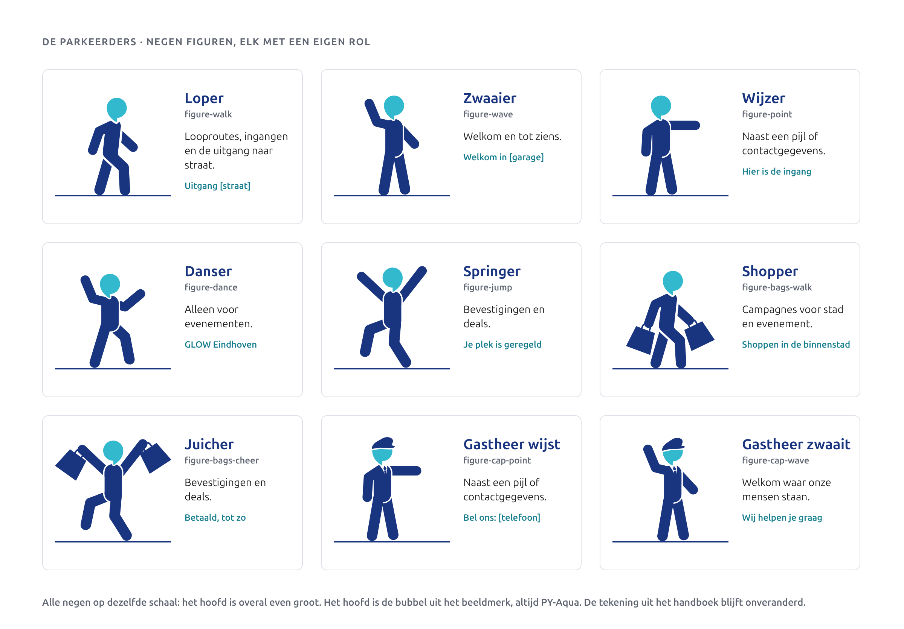

### Eén kleur per grond

Een parkeerder is altijd één kleur, hoofd en lijf samen. De kleur volgt de grond:

- **Wit en licht** (wit, `blue.50`): PY-Blauw. Bestand `figure-*-navy.svg`.
- **PY-Blauw**: wit. Bestand `figure-*-white.svg`.
- **PY-Aqua**: PY-Blauw. Bestand `figure-*-navy.svg`.

Het hoofd krijgt nooit een eigen kleur. Geen parkeerder op een oranje betaalvlak. Dezelfde bestanden werken voor snijfolie, gravure en laser.

### Altijd op een lijn

Een parkeerder staat altijd ergens op. Dat maakt hem een mens en geen sticker. Er zijn vier lijnen:

1. **De basislijn van een kop.** De voeten staan op dezelfde lijn als de letters.
2. **Een lijn van 0,1u**, in de kleur van de tekst.
3. **De rand van het formaat**, bijvoorbeeld de onderrand van een bord of van jouw vak.
4. **De vloerlijn van een scène**, over de hele breedte, in reels en illustraties.

Nooit zwevend, nooit gekanteld, nooit afgesneden. De springer staat op één voet; die voet staat op de lijn.

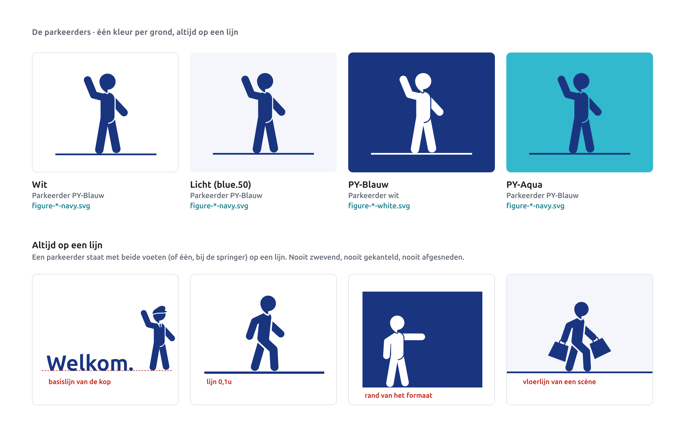

### Maat, richting en aantal

- **Maat in layouts:** 3u tot 8u hoog, gemeten van voet tot bovenkant hoofd of pet. Op scherm 48 tot 160 px. Kleiner wordt het hoofd een stip: laat de parkeerder dan weg.
- **Op een voetgangersbord:** hooguit 60 procent van de hoogte van het vlak, op de onderrand.
- **Richting:** een parkeerder kijkt naar de route of naar de tekst. Daarvoor mag je hem spiegelen. Spiegel alleen het lijf. Het hoofd heeft de vorm van de bubbel en die spiegelt nooit: de punt blijft naar linksonder wijzen, zoals in het logo. In de figuren hieronder is dat zo gebouwd.
- **Aantal:** één parkeerder per vlak. Een volgend vlak (de achterkant, de volgende slide, de volgende scène) mag een andere pose hebben. Wissel van pose met een harde knip tussen twee bestaande figuren, nooit met bewegende armen of benen.

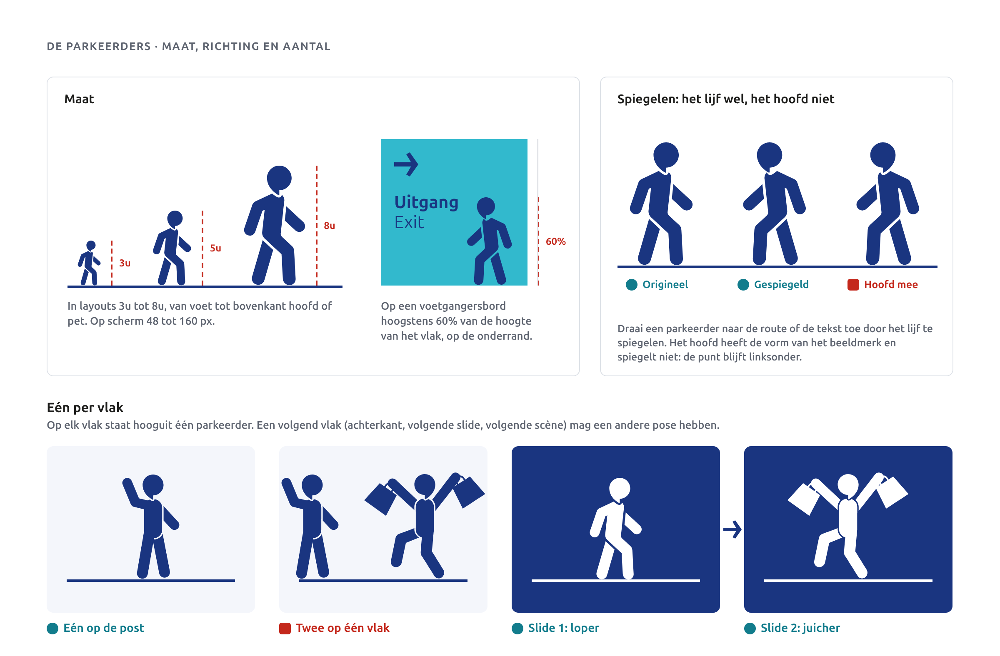

### Samen met tekst en pijl

Hier gaat het merk leven. Een parkeerder doet iets met wat er naast hem staat.

- **Gastheer wijst naar je contactgegevens.** Zijn hand staat op de hoogte van de eerste regel, met 0,5u tussen hand en tekst. Hij staat op dezelfde lijn als het tekstblok. Spiegel het lijf als de tekst links staat.
- **Wijzer naast de pijl.** Arm en pijl wijzen dezelfde kant op. De pijl staat op armhoogte, 0,5u voor de hand, en is zo hoog als de kapitaalhoogte van de tekst ernaast. De hand raakt de pijl nooit.
- **Loper op het voetgangersbord.** Geprint bord (Dibond of folie) in aqua. De loper staat op de onderrand en loopt de kant van de pijl op. Hij is geen routepictogram: het pictogram voor lopen, lift of trap komt uit de pictogramset.
- **Juicher in de bevestiging.** Na betalen of reserveren, op een lijn boven de kop. Nooit naast een foutmelding.
- **Zwaaier op een welkomstbanner**, met de stem voor de kop (zie Combineren).

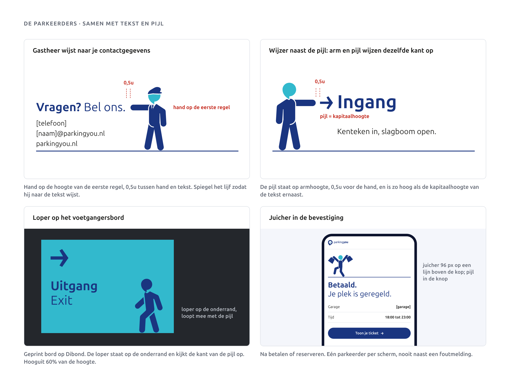

### Wat nooit

Niet kantelen of draaien. Niet laten zweven. Niet afsnijden. Niet vervormen. Geen ander hoofd dan de bubbelvorm, en geen tweede kleur, ook niet voor het hoofd. Niet in een bubbel. Geen tekstballon of tekst die hij "zegt". Nooit in veiligheids-, RVV- of ISO 7010-borden. Niet als routepictogram. Geen nieuwe poses tekenen.

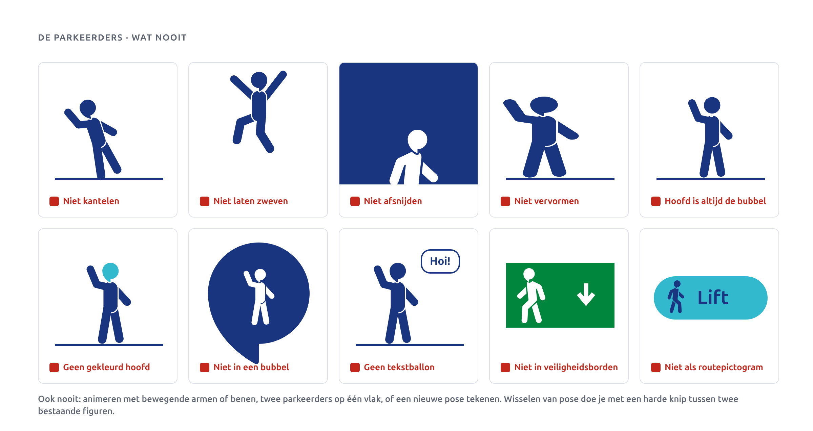

## De stem

De halve boog uit het handboek, zonder de slogan. Hij opent een boodschap, zoals iemand die begint te praten. Hij staat links van een kop of kernzin en wordt nooit gesloten.

- **Hoogte h** = het tekstblok dat hij opent: aantal regels x regelafstand. Eén tot drie regels.
- **Lijndikte** h/25, minstens 1,5 px of 0,5 mm.
- **Afstand** 0,3h, gemeten van de punten van de boog tot de eerste letter.
- **De kop mag breken** na de vette kernwoorden: "**Welkom**" op de eerste regel, "in [garage]." op de tweede. Het vette deel is ExtraBold 800 in grote koppen en Bold 700 in kleinere koppen, de rest Regular.
- **Kleur:** PY-Aqua op wit en op PY-Blauw; PY-Blauw op PY-Aqua.
- **Aantal:** één per vlak in layouts.
- **Op borden** scheidt de stem de modules: pijl, pictogram, tekst. Even hoog als de modules, zelfde lijndikte (1/25), aan beide kanten 0,3h ruimte. Aqua op navy en PY-Blauw op aqua. Zoveel als er overgangen zijn.
- **In beweging** tekent de stem zich van boven naar beneden; daarna komt de tekst.

Nooit een tweede boog rechts om de tekst te sluiten. Nooit rechts van de tekst. Nooit dikker dan h/25. Geen cursieve slogan in de boog.

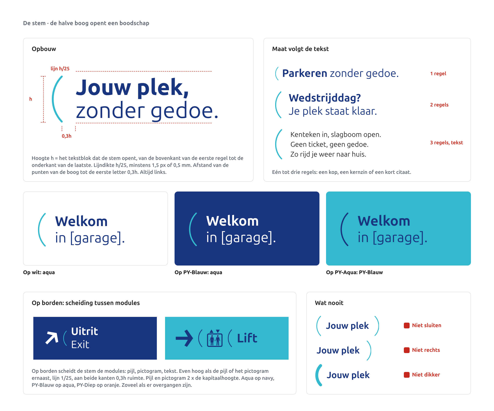

## Het vak

Een parkeerdek van bovenaf, met één vak dat van jou is. Het vak zegt "jouw plek" zonder één woord. Het is de achtergrond van het merk en neemt de rol over van de oude grote achtergrondbubbel.

**Opbouw in u**

| Onderdeel | Op formaat | Op scherm |
|---|---|---|
| Steek tussen de vaklijnen | 4u | 72 px |
| Lijndikte | 0,05u | 2 px |
| Lengte van de vaklijnen, vanaf de boven- of onderrand | 6u tot 8u | 144 tot 192 px |
| Jouw vak: zijlijnen en stoplijn | PY-Aqua, 0,1u | PY-Aqua, 4 px |
| Rijbaan (mag weg): streep en tussenruimte | 0,3u en 0,25u | 14 en 12 px |

- **Over de hele breedte.** De lijnen lopen van rand tot rand en staan op de steek, met één lijn op de marge.
- **Precies één jouw vak**, gevuld met `vak.mine`, zijlijnen in aqua op dubbele dikte. Aan de open kant sluit een stoplijn het vak af, in dezelfde dikte en kleur.
- **Kleuren op PY-Blauw:** lijnen `blue.400`, jouw vak `blue.600`.
- **Kleuren op wit:** lijnen `neutral.200`, jouw vak `aqua.100`.
- **Inhoud van jouw vak:** één parkeerder of één bubbel, verder niets, in het midden van het vak. De parkeerder staat op de stoplijn; dat kan dus alleen in een dek vanaf de bovenrand. Een bubbel mag in elk dek. Kies de maat zo dat de inhoud binnen het vak blijft: een bubbel van 3u, een parkeerder van 3u tot 5u hoog (scherm: bubbel 40 px, parkeerder 48 tot 64 px).

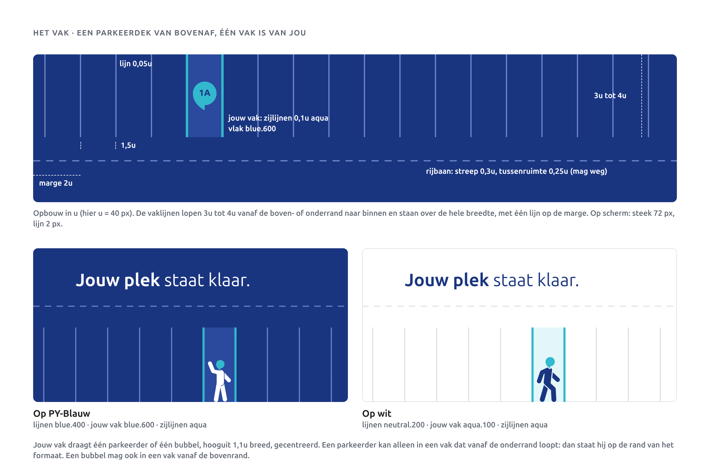

**Waar je het gebruikt:** social posts, de nieuwsbriefkop, de achterkant van visitekaartjes en passen, posters, schermkoppen in de app en lege staten ("Nog geen reserveringen").

**Waar nooit:** op bewegwijzering, achter tekst, met twee jouw vakken.

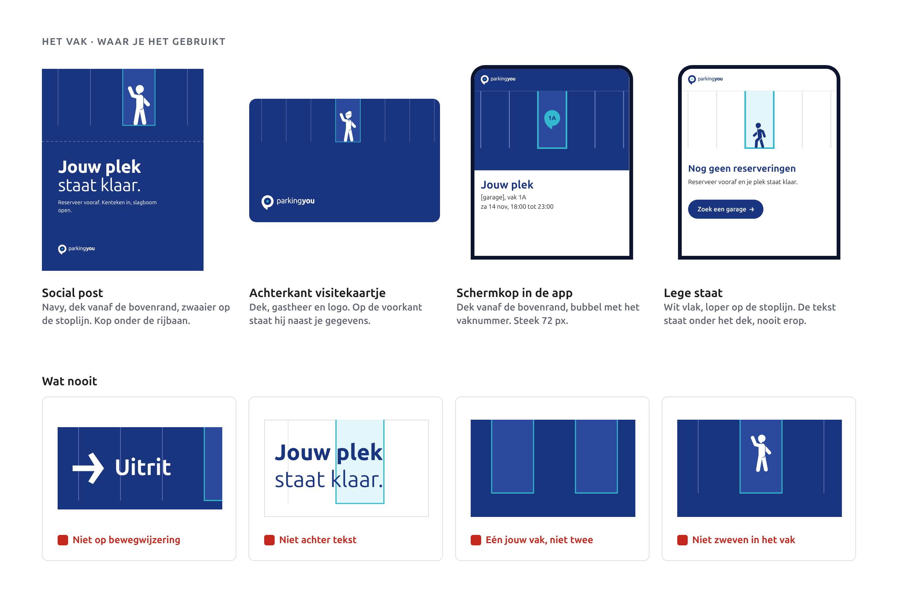

## De bubbel

De bubbel is het silhouet van het beeldmerk. Je tekent hem nooit opnieuw en vervormt hem nooit; je schaalt hem alleen in zijn geheel. Het bronbestand is `kit/assets/bubble.svg`.

- **Vier maten.** 3u, 5u, 8u of 13u breed; op scherm 24, 40, 64 of 104 px. Alleen een fotobubbel in een desktopkop mag 240 px zijn.
- **Vullingen.** Navy met witte inhoud. Aqua met PY-Blauw. Wit met PY-Blauw (op wit met een rand van 1/30 van de breedte in PY-Blauw). Oranje met PY-Diep, alleen op betaalborden en automaten in de garage. Een fotobubbel draagt geen tekst.
- **Eén ding erin.** Een niveau (-1, 0, 2), een sectie (1A), een prijs, één pictogram of één woord van hooguit 6 tekens (Vrij, Info). De inhoud staat in een vierkant van 60 procent van de breedte, in het midden van de cirkel. Cijfers in ExtraBold 800, tabelcijfers. **Nooit een pijl in een bubbel.**
- **Altijd rechtop.** De bubbel draait en spiegelt nooit, net als het logo. De punt wijst altijd naar linksonder. Richting geef je met de hoekige pijl ernaast.
- **Vrije ruimte.** 1u rondom. Op scherm 8 px bij 24 en 40 px, 16 px bij grotere bubbels.
- **Aantal.** Eén bubbel per vlak. Twee mag op vlakken van 1 meter of meer, of op een bord met meerdere panelen (pyloon, overzichtsbord). Ze raken elkaar nooit. Op een kaart is de navy bubbel van 24 px de pin, één per locatie.

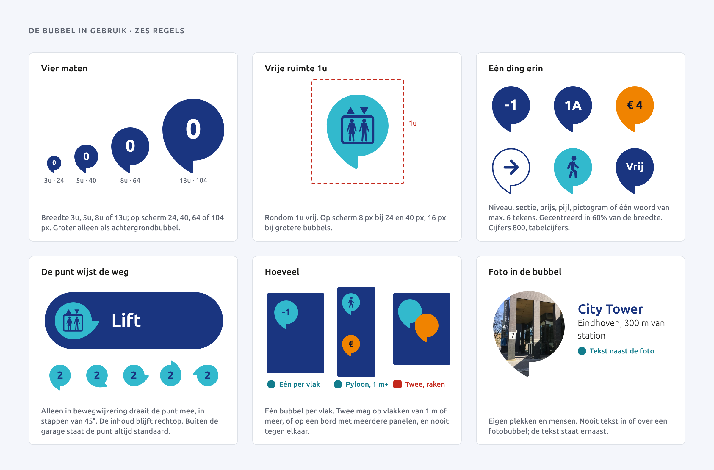

Nooit draaien of spiegelen, geen pijl erin, geen verloop, geen schaduw of 3D, niet vervormen, geen tekst langer dan 6 tekens, nooit het logo erin, nooit twee bubbels over elkaar, geen tekst op een fotobubbel, geen grote achtergrondbubbel en nooit een bubbel in een veiligheids- of RVV-bord.

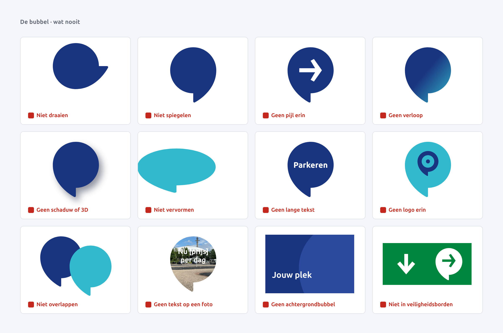

## De hoekige pijl

De pijl uit het handboek is de enige pijl. Op borden, in knoppen, in links, op social.

- **Richting** in stappen van 45 graden. Schuin is even lang als recht. Een externe link wijst 45 graden naar rechtsboven.
- **Kleur** = de inhoudskleur van de grond: PY-Blauw op wit en aqua, wit op PY-Blauw, PY-Diep op oranje (alleen betalen in de garage).
- **Maat.** In knoppen en links zo hoog als de kapitaalhoogte van het label: bij een label van 16 px is de pijl 11 px, 8 px na het label (in een link 4 px). Op borden 2 x de kapitaalhoogte, net als het pictogram.
- **Los.** Nooit in een cirkel, nooit in een bubbel. Geen chevron, geen lijnpijl en geen Tabler-pijl. Geen tussenhoeken.

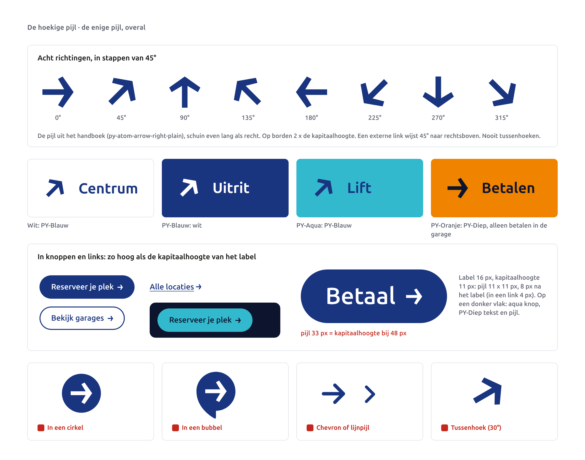

## Combineren: het logo plus hooguit twee

Elk vlak krijgt het logo en hooguit twee van de vijf elementen. Het logo telt niet mee. Dat houdt het rustig en laat elk element zijn werk doen.

**Combinaties die werken**

| Combinatie | Wanneer |
|---|---|
| Stem + parkeerder | welkom, campagne, de nieuwsbrief: de stem opent de kop, de parkeerder staat op de lijn |
| Vak + bubbel | jouw plek, je reservering, het vaknummer in de app |
| Vak + parkeerder | social, kaartachterkant, lege staat |
| Parkeerder + pijl | ingang, route, "kijk hier": de wijzer of gastheer wijst, de pijl leidt verder |
| Stem + bubbel | prijs of tijd bij een kop, bijvoorbeeld een poster voor een evenement |
| Pijl + bubbel of pijl + stem | borden in de garage |

**Wat niet werkt:** alles tegelijk, twee parkeerders op één vlak, het vak achter de tekst, een pijl in de bubbel.

Op borden geldt dezelfde regel. Een bord met een pijl en een bubbel scheidt de modules met ruimte, niet met de stem.

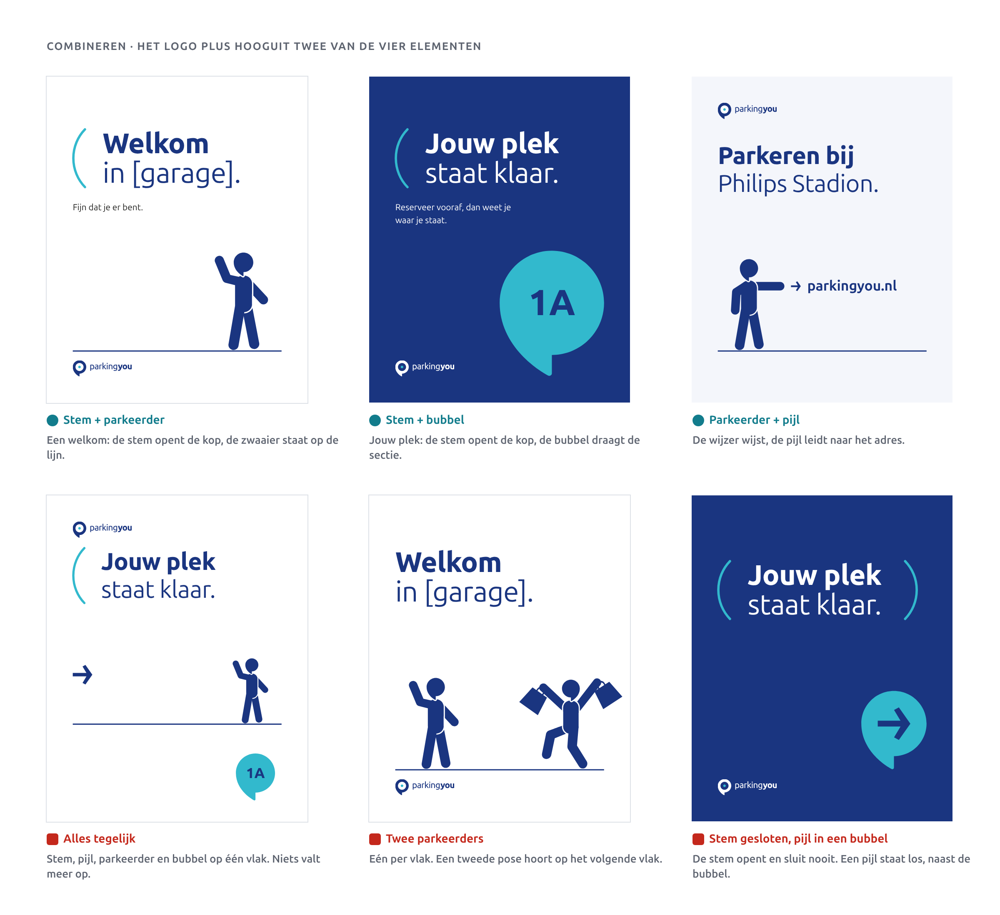

## Taakkleuren in de garage

In de garage betekent kleur iets. De elementen dragen die betekenis.

| Taak | Grond | Inhoud | Contrast | Waar |
|---|---|---|---|---|
| Rijden | PY-Blauw | wit | 11,26:1 | merk, portalen, entree, autoroute, niveaus |
| Lopen | PY-Aqua | PY-Blauw | 4,80:1 | voetgangers, lift, trap, uitgang naar straat |
| Betalen | PY-Oranje | PY-Diep | 6,87:1 | alleen in de garage: betaalautomaat, tarieven, storing |

- Lichtbakken en portalen blijven navy; daar draagt de bubbel de taakkleur. Een volledig aqua of oranje lichtvlak doen we niet.
- Geprinte borden (Dibond, folie) mogen de taakkleur als hele grond hebben.
- Op navy: witte pijl en aqua stem. Op aqua: PY-Blauw pijl, stem en loper. Op oranje: pijl en tekst in PY-Diep, geen parkeerder en geen stem.
- Buiten de garage is aqua het merkaccent. Binnen de garage betekent aqua altijd lopen.
- Veiligheids- en RVV-borden krijgen nooit merkkleur en geen element.
- Status krijgt altijd een woord naast de kleur: Vrij, Vol, Gesloten.

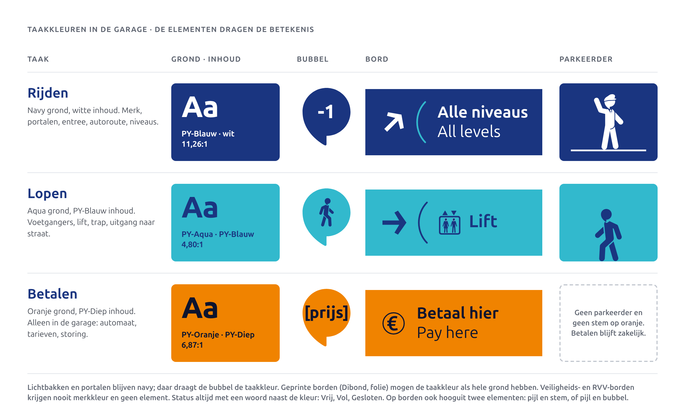

## Oude vormen: blijft, wordt, komt terug of vervalt

| Vorm uit handboek 1.4 | Besluit | Wat het wordt |
|---|---|---|
| Volvlak (bubbel) | Blijft | De bubbel, vier vaste vullingen, altijd rechtop. |
| Afbeeldingsmasker | Blijft | De fotobubbel, zonder tekst. |
| Pil, vol | Blijft | Routeborden, knoppen en chips. |
| P met dak | Blijft | Parkeerteken op entree en portaal. Geen merkvorm in marketing. |
| Niveaububbel op verloop ("0") | Wordt | Vlakke navy bubbel met wit cijfer. Wit op de aqua kant haalde maar 2,34:1. |
| Sectielabel "1A" | Wordt | De sectie wordt inhoud van de bubbel. |
| Kolomband met "1A" op verloop | Wordt | Vlakke navy band. |
| Beugelboog met slogan | Komt terug | De stem: de boog zonder slogan, links van de kop. Geen cursief. |
| Scheidingsboog | Komt terug | Gaat op in de stem: scheiding tussen modules op borden. |
| Stokfiguren (9) | Komen terug | De parkeerders, in één kleur. Het hoofd heeft de vorm van het beeldmerk. |
| Bubbel met verloop | Vervalt | Geen verloop meer. |
| Cirkel | Vervalt | Een ronde blauwe vorm met pijl lijkt op een RVV-gebodsbord. De bubbel neemt zijn taken over. |
| Pil op verloop | Vervalt | Knoppen staan op een vlakke grond. |
| Watermerk beeldmerk 5% | Vervalt | Verdwijnt in druk en in de garage. Het vak neemt die rol over. |
| Grote achtergrondbubbel | Vervalt | Groot beeld komt nu van het vak. |
| Verloop blauw naar aqua | Vervalt | Alles is vlak. Bestaande borden worden bij vervanging vlak PY-Blauw. |

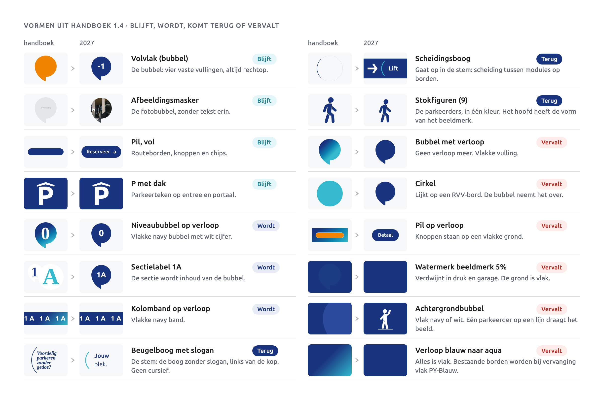

## Voorgestelde waarden

Goedgekeurd: zie besluit D43 in de core spec.

| Waarde | Voorstel | Reden |
|---|---|---|
| Plaats van de rijbaan | op 2u van het einde van de vaklijnen (scherm 48 px) | De core spec geeft de streep, niet de plek. Op 2u leest het als rijbaan en blijft er ruimte voor de kop eronder. |
| Gastheer en wijzer: afstand | 0,5u tussen hand en tekst of pijl; hand op de hoogte van de eerste regel | Dichterbij lijkt het of hij de tekst vastpakt; verder weg valt het verband weg. |
| Gespiegelde parkeerder | alleen het lijf spiegelen, het hoofd niet; als kitbestanden `figure-*-navy-flip.svg` en `figure-*-white-flip.svg` | De core spec staat spiegelen toe, maar het hoofd heeft de vorm van de bubbel en die spiegelt nooit. In de figuren is het hoofd terug op zijn plek gezet. |

## Open vragen

- Gespiegelde figuren: mogen we `-flip`-versies (lijf gespiegeld, hoofd zoals in het logo) in de kit zetten, zodat niemand zelf gaat knippen?
- Borden met een pijl, een bubbel en scheidingen: wij lezen "hooguit twee elementen" ook voor borden, dus dan scheiden met ruimte en niet met de stem. Klopt dat?
- Mag jouw vak leeg blijven (bijvoorbeeld op een kaartachterkant)? Wij nemen aan van wel.
- Prijzen in de figuren zijn € 12,50 (Parking Philips Stadion, dagtarief met reservering) of [prijs], geen verzonnen tarieven.

## Do's en don'ts

- **Do:** kies per vlak het logo plus hooguit twee elementen. Begin met één.
- **Do:** kies de parkeerder bij de rol: loper bij lopen, zwaaier bij welkom, juicher bij een bevestiging.
- **Do:** zet elke parkeerder op een lijn, en laat hem naar de tekst of de route kijken.
- **Do:** laat de stem een kop openen, links, even hoog als het tekstblok.
- **Do:** gebruik het vak als achtergrond, met precies één jouw vak, afgesloten met de stoplijn.
- **Do:** geef richting met de hoekige pijl, los naast de bubbel of de tekst.
- **Don't:** een parkeerder draaien, laten zweven, afsnijden of twee op één vlak.
- **Don't:** de bubbel draaien of spiegelen, of er een pijl in zetten.
- **Don't:** het vak achter tekst of op bewegwijzering.
- **Don't:** oranje buiten de garage, en verloop nergens.
- **Don't:** merkkleuren of elementen in of naast veiligheids- en RVV-borden.
