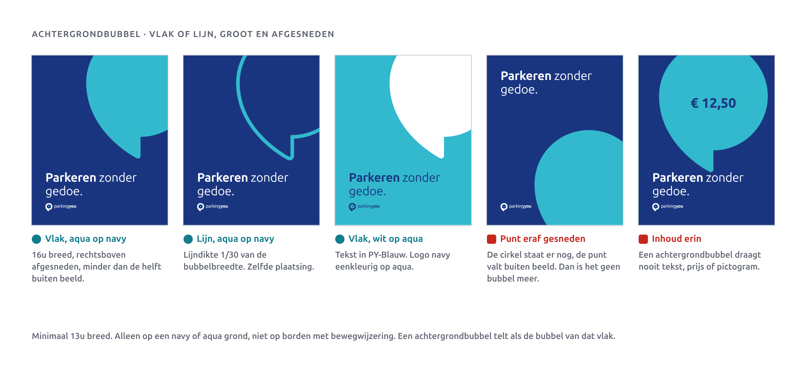
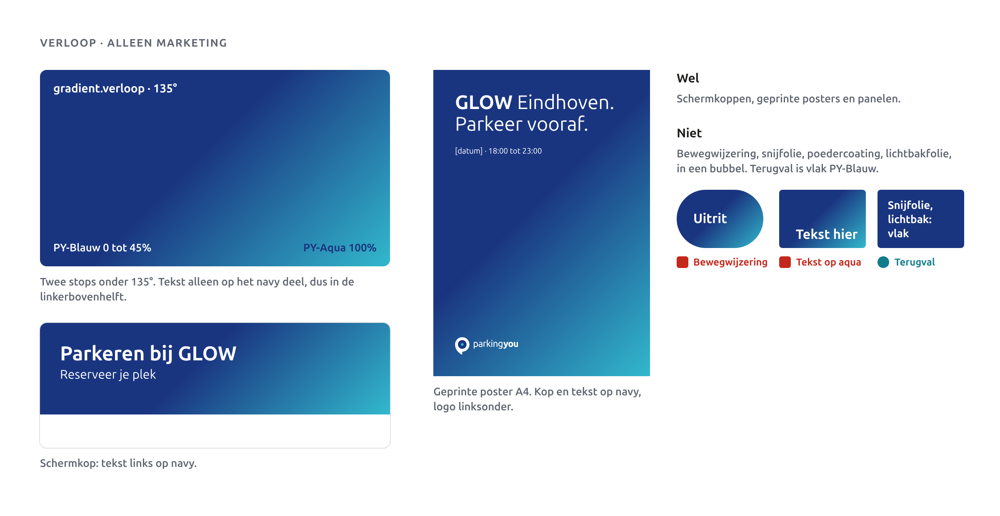
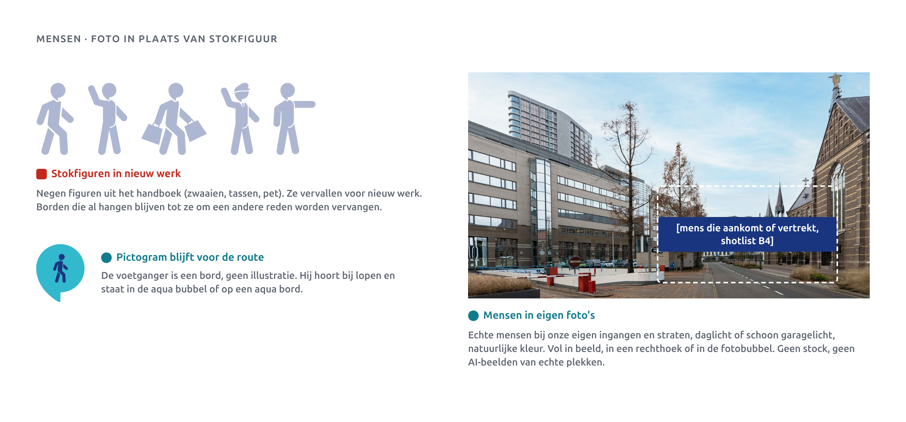

# Patronen en designelementen

ParkingYou heeft één vorm die alles draagt: de bubbel uit het beeldmerk. Daarnaast zijn er drie taakkleuren die iets betekenen, en een verloop voor marketing. Meer is er niet. Dit hoofdstuk laat zien hoe je ze gebruikt en welke oude vormen uit het handboek verdwijnen.

## De bubbel in gebruik

De bubbel is het silhouet van het beeldmerk. Je tekent hem nooit opnieuw en je vervormt hem nooit; je schaalt hem alleen in zijn geheel. Het bronbestand is `kit/assets/bubble.svg`.

- **Vier maten.** 3u, 5u, 8u of 13u breed. Op scherm 24, 40, 64 of 104 px. Groter mag alleen als achtergrondbubbel.
- **Vier vullingen plus foto.** Navy met witte inhoud, aqua met PY-Blauw, oranje met PY-Diep, wit met PY-Blauw. Een witte bubbel op een witte grond krijgt een rand van 1/30 van de breedte in PY-Blauw. Een fotobubbel draagt geen tekst.
- **Eén ding erin.** Een niveau (-1, 0, 2), een sectie (1A), een prijs, een pijl, één pictogram of één woord van hoogstens 6 tekens (Vrij, Info). De inhoud staat gecentreerd in een vierkant van 60 procent van de breedte. Cijfers in ExtraBold 800, tabelcijfers.
- **Vrije ruimte.** 1u rondom. Op scherm 8 px bij 24 en 40 px, 16 px bij grotere bubbels.
- **De punt.** Staat standaard zoals in het beeldmerk. Alleen in bewegwijzering mag de punt de weg wijzen, in stappen van 45 graden. De inhoud blijft altijd rechtop.
- **Aantal.** Eén bubbel per vlak. Twee mag op vlakken van 1 meter of meer, of op een bord met meerdere panelen (pyloon, overzichtsbord). Ze raken elkaar nooit. Kaartmarkers zijn de uitzondering (besluit D13): op een kaart is de navy bubbel van 24 px de pin, één per locatie.

### Wat nooit

Geen verloop in de bubbel, geen schaduw of 3D, niet vervormen, geen tekst langer dan 6 tekens, nooit het logo erin, nooit twee bubbels over elkaar, geen tekst over een fotobubbel, en nooit een bubbel in een veiligheids- of RVV-bord.

## Achtergrondbubbel

Op een navy of aqua grond mag één grote bubbel als beeld staan. Hij is minstens 13u breed en wordt afgesneden door de rand van het formaat.

- **Vlak**: aqua op navy, of wit op aqua.
- **Lijn**: aqua op navy, lijndikte 1/30 van de bubbelbreedte.
- Hoogstens de helft valt buiten beeld. De punt blijft altijd zichtbaar; snijd je alleen de punt eraf, dan staat er een cirkel en geen bubbel.
- Er staat nooit inhoud in: geen tekst, prijs of pictogram.
- Niet op borden met bewegwijzering.

Wij lezen "één bubbel per vlak" zo dat een achtergrondbubbel meetelt. Een post met een achtergrondbubbel heeft dus geen tweede inhoudsbubbel, behalve op formaten van 1 meter of meer.

## Taakkleuren als systeem

Kleur betekent iets. Elke taak heeft een vaste grond en een vaste inhoudskleur, en die combinatie haalt WCAG AA.

| Taak | Grond | Inhoud | Contrast | Waar |
|---|---|---|---|---|
| Rijden | PY-Blauw | wit | 11,26:1 | merk, portalen, entree, autoroute, niveaus |
| Lopen | PY-Aqua | PY-Blauw | 4,80:1 | voetgangers, lift, trap, uitgang naar straat |
| Betalen en let op | PY-Oranje | PY-Diep | 6,87:1 | betaalautomaat, tarieven, storing, hoofdknop |

Dezelfde logica werkt op elke drager. In de bubbel: navy, aqua of oranje. Op een geprint bord (Dibond, folie): de taakkleur als hele grond. Op een lichtbak of portaal blijft het vlak navy en draagt de bubbel de taakkleur; een volledig aqua of oranje lichtvlak doen we niet. Op scherm: de chip, de knop, het icoon.

Buiten de garage is aqua het merkaccent. Binnen de garage betekent aqua altijd lopen. Oranje verschijnt alleen bij geld of aandacht. Status krijgt altijd een woord naast de kleur: Vrij, Vol, Gesloten.

## Verloop

Twee stops onder 135 graden: PY-Blauw van 0 tot 45 procent, PY-Aqua op 100 procent (`gradient.verloop`). Alleen voor marketing: schermkoppen, geprinte posters en panelen. Tekst staat alleen op het navy deel, dus linksboven.

Nooit in bewegwijzering, snijfolie, poedercoating, lichtbakfolie of in een bubbel. Daar is de terugval vlak PY-Blauw. De oude tussenkleur #097BAE is vervallen.

## Mensen: foto in plaats van stokfiguur

De negen stokfiguren uit het handboek (zwaaien, tassen, pet) gebruiken we niet meer in nieuw werk. Borden die al hangen, blijven hangen tot ze om een andere reden worden vervangen. Mensen tonen we alleen in eigen foto's: echte mensen bij onze eigen ingangen en straten, natuurlijke kleur, geen stock. De shotlist komt uit het fotografiehoofdstuk (B4).

De voetganger als pictogram blijft. Dat is een bord, geen illustratie.

## Oude vormen: blijft, wordt of vervalt

| Vorm uit handboek 1.4 | Besluit | Waarom |
|---|---|---|
| Volvlak (bubbel) | Blijft | Wordt de bubbel, met vier vaste vullingen. |
| Afbeeldingsmasker | Blijft | Wordt de fotobubbel, zonder tekst. |
| Pil, vol | Blijft | Alleen voor routeborden, knoppen en chips. |
| P met dak | Blijft | Parkeerteken op entree en portaal. Geen merkvorm in marketing. Uitwerking bij bewegwijzering. |
| Niveaububbel op verloop ("0") | Wordt | Vlakke navy bubbel met wit cijfer. Wit op de aqua kant haalde maar 2,34:1. |
| Sectielabel "1A" | Wordt | De sectie wordt inhoud van de bubbel. |
| Kolomband met "1A" op verloop | Wordt | Vlakke navy band. Geen verloop in de garage. |
| Bubbel met verloop | Vervalt | De bubbel heeft nooit een verloop. |
| Cirkel | Vervalt | Een ronde blauwe vorm met pijl lijkt op een RVV-gebodsbord. De bubbel neemt zijn taken over. |
| Pil op verloop | Vervalt | Oranje is actie, geen versiering. Knoppen staan op een vlakke grond. |
| Scheidingsboog | Vervalt | Een tweede ronde vorm naast de bubbel. We scheiden met ruimte en het 0,5u-ritme. |
| Beugelboog met slogan | Vervalt | Cursief en decoratief. Onze stem is vet plus regular op één regel. |
| Watermerk beeldmerk 5% | Vervalt | Verdwijnt in druk en in de garage. Het logo is geen bubbel; gebruik de achtergrondbubbel. |
| Stokfiguren (9) | Vervalt | Besluit Gate 1. Mensen alleen in foto. |

## Open vragen

- Telt de achtergrondbubbel mee als "de" bubbel van een vlak? Wij nemen aan van wel.
- P met dak en de kolomband: bevestigen bij het hoofdstuk bewegwijzering (B6).

## Do's en don'ts

- **Do:** kies eerst de taak, dan de kleur. Geen taak, dan navy en wit.
- **Do:** één bubbel per vlak, met één ding erin.
- **Do:** laat de punt alleen in bewegwijzering draaien.
- **Do:** gebruik het verloop alleen op geprinte marketing en schermkoppen, met tekst op het navy deel.
- **Don't:** aqua als versiering in de garage. Daar betekent het lopen.
- **Don't:** oranje zonder geld of aandacht.
- **Don't:** witte tekst op aqua of oranje (2,34 en 2,64:1).
- **Don't:** stokfiguren, cirkels, bogen of een pil op verloop in nieuw werk.
- **Don't:** merkkleuren in of naast veiligheids- en RVV-borden als decoratie.
