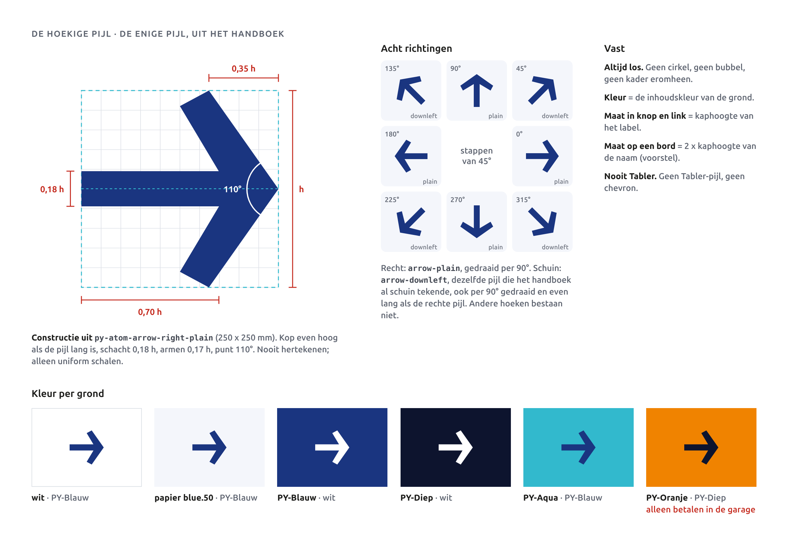
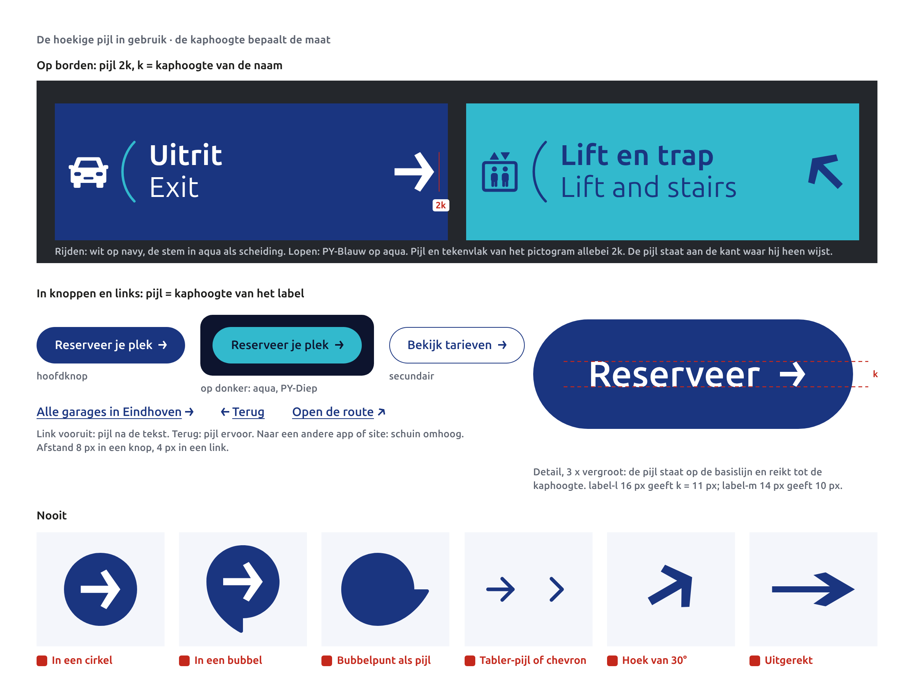
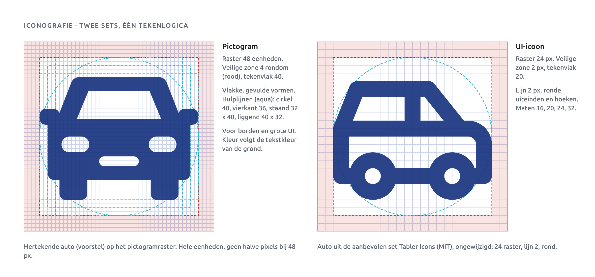
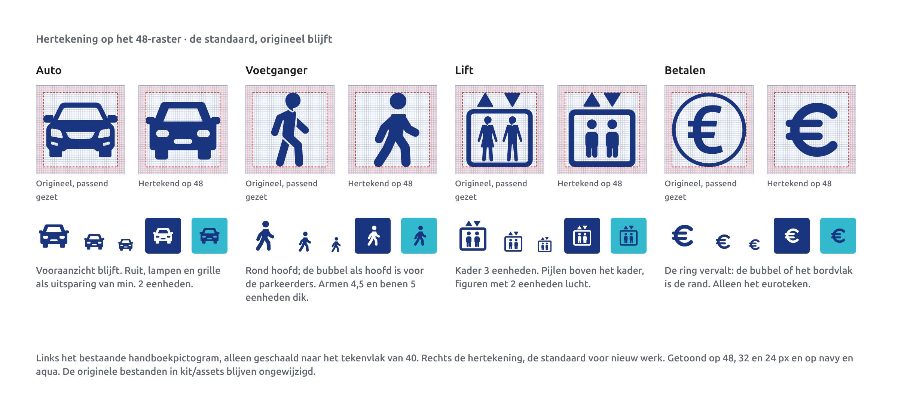
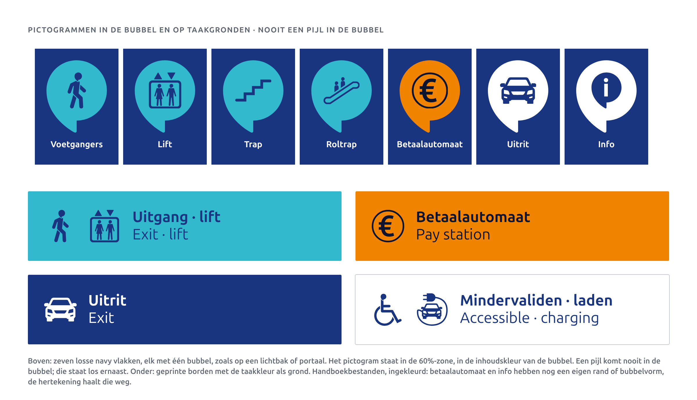
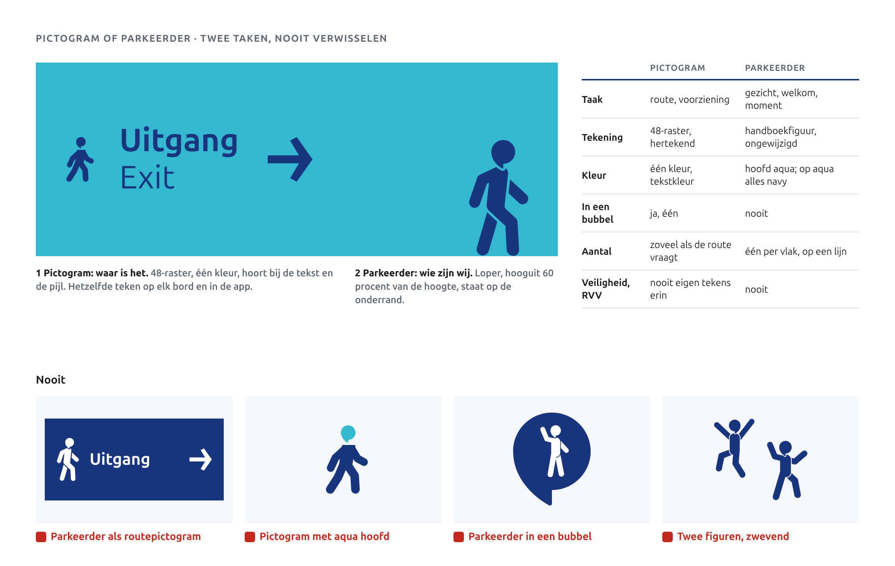
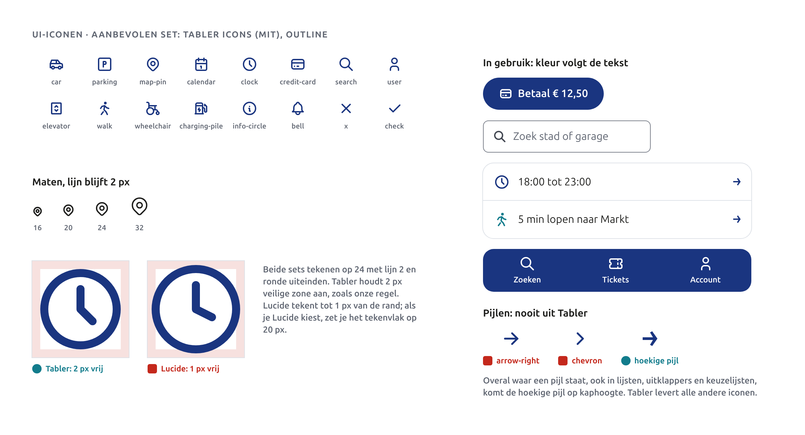
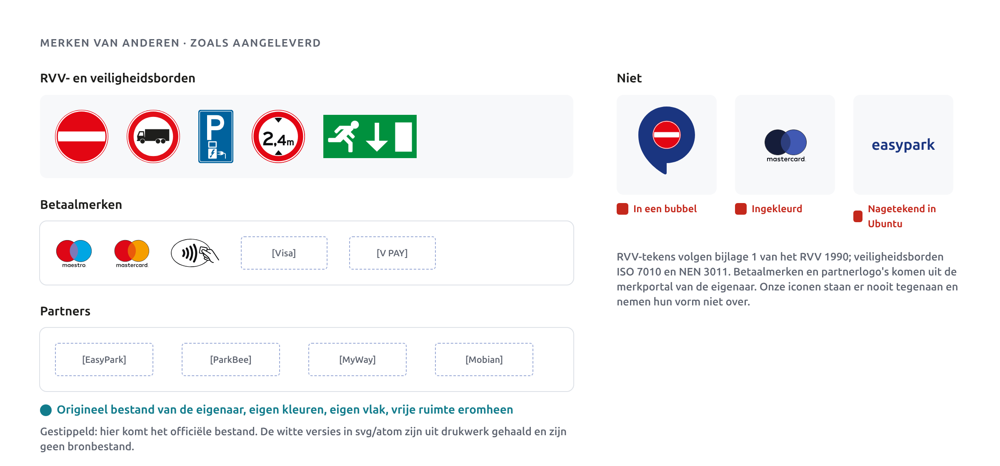

# Iconografie

In dit hoofdstuk staan vier soorten tekens, elk met één taak. **De hoekige pijl** wijst de richting. **Pictogrammen** zeggen waar iets is: lift, trap, betaalautomaat. **UI-iconen** helpen je op het scherm. **De parkeerders** zijn geen teken maar ons gezicht; ze staan hier omdat ze op een pictogram lijken en dat nooit mogen worden.

Voor alle tekens geldt: de kleur is de tekstkleur van de grond, en ze staan los. Geen cirkel, geen kader, geen bubbel eromheen, behalve het ene pictogram dat in een bubbel mag.

## De hoekige pijl

Er is één pijl: de hoekige pijl uit het handboek (`svg/atom/py-atom-arrow-right-plain.svg`, in de kit `arrow-plain-navy.svg` en `arrow-plain-white.svg`). Hij staat op borden, in knoppen, in links, in lijsten en op social. Een andere pijl bestaat niet.

**Constructie.** We hertekenen de pijl niet; we schalen hem alleen gelijkmatig. Gemeten aan het bestand (250 x 250 mm), met h als hoogte van de pijl:

- De kop is even hoog als de pijl lang is: h.
- De schacht is 0,18 h dik en loopt tot 0,70 h; de kop is 0,35 h diep.
- De armen zijn 0,17 h dik en maken een punt van 110 graden.

**Acht richtingen, stappen van 45 graden.** Recht (links, rechts, omhoog, omlaag) is `arrow-plain`, gedraaid per 90 graden. Schuin is `arrow-downleft`: dezelfde pijl, die het handboek al schuin uittekende. Die draai je ook per 90 graden en je zet hem even lang als de rechte pijl. Op een scherm mag je `arrow-plain` ook 45 graden draaien; dat geeft dezelfde vorm. Andere hoeken dan stappen van 45 graden bestaan niet.

**Kleur per grond.** De pijl krijgt de inhoudskleur van zijn grond:

| Grond | Pijl |
|---|---|
| Wit, papier (`blue.50`) | PY-Blauw |
| PY-Blauw, PY-Diep | wit |
| PY-Aqua | PY-Blauw |
| PY-Oranje (alleen betalen in de garage) | PY-Diep |
| Knop PY-Blauw | wit |
| Knop PY-Aqua op donker | PY-Diep |
| Secundaire knop en link | PY-Blauw (`text.link`) |

### De pijl in gebruik

**In knoppen en links** staat de pijl op de basislijn en reikt hij tot de kaphoogte van het label. Bij `label-l` (16 px) is dat 11 px, bij `label-m` (14 px) 10 px. Tussen label en pijl zit 8 px (`space.2`) in een knop en 4 px (`space.1`) in een link. Vooruit: de pijl na de tekst. Terug: de pijl ervoor, naar links. Naar een andere site of app: schuin rechtsomhoog. Eén pijl per knop. In een knop zonder label, zoals terug in de bovenbalk, is de pijl 16 px in een vlak van minstens 44 x 44 px, met een toegankelijke naam.

**Op borden** is de pijl twee keer de kaphoogte van de naam ernaast (2k). Het tekenvlak van een pictogram op hetzelfde bord is ook 2k, zodat pijl en pictogram even zwaar staan. De pijl staat aan de kant waar hij heen wijst: rechts voor rechtsaf en rechtdoor, links voor linksaf. Tussen modules staat de stem als scheiding.

**Nooit:** de pijl in een cirkel, in een bubbel of in een kader. Nooit de punt van de bubbel als pijl gebruiken; de bubbel staat altijd rechtop. Nooit een Tabler-pijl, chevron of caret. Nooit uitgerekt of in een andere hoek dan 45 graden.

## Pictogrammen

Pictogrammen zeggen waar iets is. Ze staan op borden, op betaalautomaten en groot in de app.

- **Raster** 48 eenheden in het vierkant.
- **Veilige zone** 4 eenheden rondom. Het tekenvlak is dus 40 x 40.
- **Vorm**: gevuld en vlak. Geen lijnen, geen verloop, geen schaduw.
- **Kleur**: de tekstkleur van de grond. Wit op navy, PY-Blauw op aqua, PY-Diep op oranje. In een bubbel de inhoudskleur van die bubbel.
- **In een bubbel**: het pictogram past in het inhoudsvierkant van 60 procent van de bubbelbreedte. Eén pictogram per bubbel, nooit een pijl.

Voor de constructie gebruiken we hulplijnen, zodat pictogrammen even zwaar ogen: een cirkel van 40, een vierkant van 36, staand 32 x 40 en liggend 40 x 32. Een auto vult het liggende vlak, een voetganger het staande. De kleinste uitsparing is 2 eenheden, armen zijn 4,5, benen 5 en de romp 6,5 eenheden, kaders 3 eenheden. Deze waarden zijn goedgekeurd.

### Hertekening: vier voorbeelden

De twaalf handboekpictogrammen zijn op verschillende formaten getekend, met wisselende lijndiktes en soms een eigen rand. We hertekenen ze op het 48-raster. Als voorstel staan er vier klaar: auto, voetganger, lift en betalen. De originelen in `kit/assets/` blijven ongewijzigd; de voorstellen staan in `06-iconografie/voorstel/`.

- **Auto.** Vooraanzicht blijft. Ruit, lampen en grille als uitsparing.
- **Voetganger.** Het hoofd blijft de bubbel, rechtop en uniform geschaald, in dezelfde kleur als het lijf.
- **Lift.** Kader 3 eenheden dik, driehoekjes erboven, figuren met lucht eromheen. De driehoekjes horen bij het liftteken; het is geen richtingpijl.
- **Betalen.** De ring om het euroteken vervalt. In een bubbel of op een bordvlak is de ring dubbel: de bubbel of het bord is al de rand.

De voetganger en de lift zijn nu nog opgebouwd uit ronde lijnen; voor productie zetten we ze om naar gesloten contouren.

### Plan voor de andere acht

| Pictogram | Actie |
|---|---|
| Trap | Op raster zetten, treden 4 eenheden. |
| Roltrap | Vereenvoudigen: figuren weg of groter, nu te fijn op 24 px. |
| Mindervaliden | Hertekenen; de witte scheidingslijn wordt een echte uitsparing. |
| Elektrisch laden | Ring weg, auto plus stekker. |
| Gezin | Hertekenen met dezelfde lijfmaten als de voetganger. |
| Info | Wordt een losse "i". Het huidige pictogram is zelf een bubbel; in een bubbel wordt dat een bubbel in een bubbel. Op borden kan ook het woord "Info". |
| Motor | Op raster, wielen als uitsparing. |
| Toilet | Ring weg. |

Volgorde: eerst de pictogrammen die op lichtbakken en betaalautomaten staan (voetganger, lift, trap, betalen, auto, info), daarna de rest.

### In de bubbel en op taakgronden

Op een lichtbak of portaal blijft het vlak navy en draagt de bubbel de taak: aqua voor lopen, oranje alleen bij betalen, wit voor de rest (zoals de uitrit). Op een geprint bord mag de taakkleur de hele grond zijn. In de bubbel staat één pictogram; de pijl staat altijd los ernaast. Het voorbeeld hieronder gebruikt nog de handboekbestanden. Je ziet daar ook waarom de ring van betalen en de bubbelvorm van info weg moeten.

## Pictogram of parkeerder

De voetganger en de loper lijken op elkaar: allebei een poppetje met de bubbel als hoofd. Toch doen ze iets heel anders.

- **Een pictogram zegt waar iets is.** Het hoort bij de tekst en de pijl, op het 48-raster, in één kleur. Hetzelfde teken op elk bord en in de app, zo vaak als de route vraagt. Het mag in een bubbel.
- **Een parkeerder zegt wie wij zijn.** Het is een van de negen handboekfiguren, ongewijzigd en in één kleur: navy op licht en op aqua, wit op navy. Eén per vlak, altijd op een lijn: een tekstbasislijn, een rand van het vlak of een vloerlijn. Nooit in een bubbel, nooit als routeteken, nooit op een veiligheids-, RVV- of ISO 7010-bord.

Op een voetgangersbord mogen ze samen staan. Het pictogram zit in de module met de naam en de pijl; de loper staat groot op de onderrand, hooguit 60 procent van de hoogte, en kijkt de route op. Het bord heeft dan twee eigen elementen: de pijl en de parkeerder. Een stem als scheiding past er dan niet meer bij.

## UI-iconen

Voor alles op het scherm dat geen pijl is, gebruiken we **Tabler Icons** (tabler.io/icons, versie 3.50, MIT-licentie).

- **Raster** 24 px, **veilige zone** 2 px, tekenvlak 20 x 20.
- **Lijn** 2 px op elke maat, ronde uiteinden, ronde hoeken. Geen vulling.
- **Maten** 16, 20, 24 en 32 px. 24 is de standaard.
- **Kleur** volgt de tekst: wit op navy en in de hoofdknop, PY-Blauw op wit, `text.aqua` voor lopen.
- Een icoon staat nooit alleen voor een actie zonder label, behalve in vaste patronen (sluiten, zoeken) met een toegankelijke naam.

Waarom Tabler:

- Zelfde tekenlogica als onze regel: raster 24, lijn 2, ronde uiteinden en hoeken.
- Tabler houdt 2 px vrij van de rand. Dat is precies onze veilige zone.
- Er zitten iconen in die wij echt nodig hebben: car, parking, elevator, stairs, walk, wheelchair, charging-pile, ticket, credit-card.
- MIT is gratis voor commercieel gebruik. Voorwaarde: de licentietekst meeleveren in de app en de website (bijvoorbeeld op de pagina met open-sourcelicenties).

Regels voor de set: alleen de outline-variant, nooit de filled-variant. Nooit de merkiconen uit de set (de `brand-`-iconen); dat zijn merken van anderen. **Nooit de pijlen uit de set**: geen `arrow-*`, `chevron-*`, `chevrons-*`, `caret-*` of `circle-arrow-*`. Een lijst die doorlinkt, een terugknop, een uitklapper en een keuzelijst krijgen de hoekige pijl op kaphoogte. Ontbreekt een icoon, teken het dan zelf op het 24-raster met dezelfde lijn.

Het alternatief Lucide (ISC-licentie) tekent tot 1 px van de rand en is daardoor op hetzelfde formaat iets groter. Gebruik nooit twee sets door elkaar.

## Merken van anderen

RVV-verkeerstekens, veiligheidsborden (ISO 7010, NEN 3011), betaalmerken en partnerlogo's gebruiken we zoals de eigenaar ze aanlevert. Nooit hertekend in onze stijl, nooit ingekleurd, nooit in een bubbel, nooit met een parkeerder of een pijl van ons erbij. Ze krijgen hun eigen vlak met vrije ruimte, en onze tekens staan er niet tegenaan.

Let op: de witte partner- en betaalmerken in `svg/atom/` zijn uit drukwerk gehaald. Voor nieuw werk vraag je het officiële bestand op bij de eigenaar.

## Voorgestelde waarden

Goedgekeurd: zie besluit D37 in de core spec.

| Waarde | Voorstel | Reden |
|---|---|---|
| Pijl op borden | hoogte 2 x de kaphoogte van de naam (2k); tekenvlak van een pictogram op hetzelfde bord ook 2k | De core spec geeft de pijl alleen een maat in knoppen. 2k is dezelfde regel als het beeldmerk op borden, past binnen de marge van 2u op een routebord (kaphoogte 70 mm, pijl 140 mm, bord 200 mm) en houdt pijl en pictogram even zwaar. |
| Afstand pijl en label | 8 px (`space.2`) in een knop, 4 px (`space.1`) in een link | Bestaande tokens; zonder vaste afstand plakt de pijl in een link aan het woord of zweeft hij in een knop. |
| Schuine pijl | `arrow-downleft`, gedraaid per 90 graden, geschaald tot dezelfde pijllengte als de rechte pijl (vak 0,875 h) | Het handboekbestand is op 199 mm getekend tegen 250 mm voor de rechte pijl, waardoor hij op hetzelfde vak 9 procent kleiner oogt. Zo is elke richting even zwaar. |
| Pijl naar buiten | schuin rechtsomhoog (45 graden) na de linktekst | Geeft "opent een andere site of app" zonder extra icoon, binnen de stappen van 45 graden. |

## Do's en don'ts

- **Do:** de hoekige pijl voor elke richting, los, in de inhoudskleur van de grond.
- **Do:** in knoppen en links de pijl op kaphoogte van het label; op borden 2k.
- **Do:** pictogrammen gevuld, op het 48-raster, binnen het tekenvlak van 40.
- **Do:** UI-iconen uit Tabler, outline, lijn 2 px.
- **Do:** de parkeerder als gezicht naast de route-informatie, op een lijn, één per vlak.
- **Do:** merken van anderen uit het originele bestand, in hun eigen kleuren.
- **Don't:** een pijl in een cirkel, bubbel of kader, of de punt van de bubbel als pijl.
- **Don't:** een Tabler-pijl, chevron of caret, ook niet in een lijst of keuzelijst.
- **Don't:** de pijl draaien in een andere hoek dan 45 graden, uitrekken of hertekenen.
- **Don't:** een parkeerder als routepictogram, in een bubbel of met een tekstballon.
- **Don't:** een parkeerder als routepictogram, of een parkeerder in twee kleuren.
- **Don't:** een pictogram met een eigen rand of bubbelvorm in een bubbel zetten.
- **Don't:** twee sets door elkaar (Tabler en Lucide, of handboek en hertekend) op één vlak.
- **Don't:** RVV-tekens, betaalmerken of partnerlogo's natekenen, inkleuren of in een bubbel zetten.
