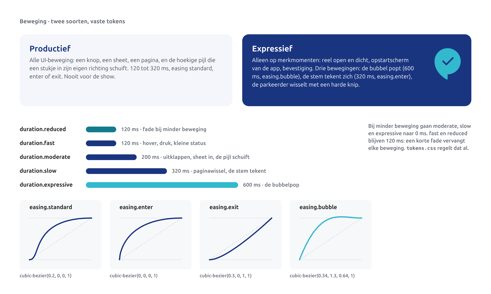
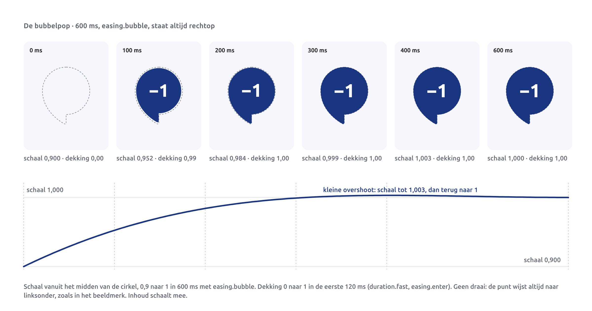
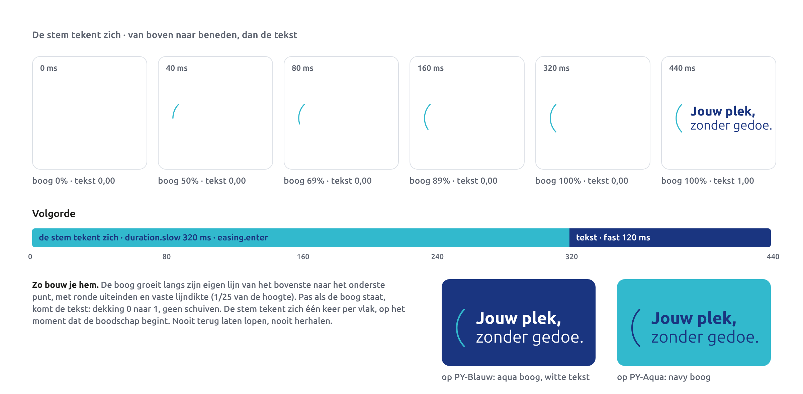
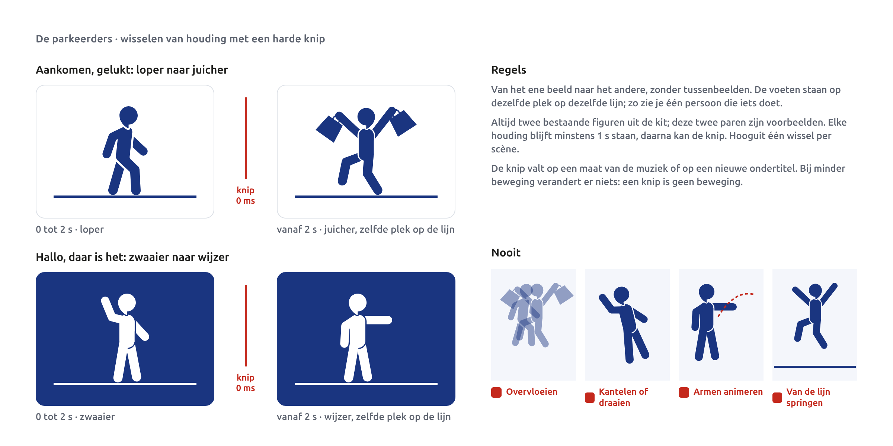
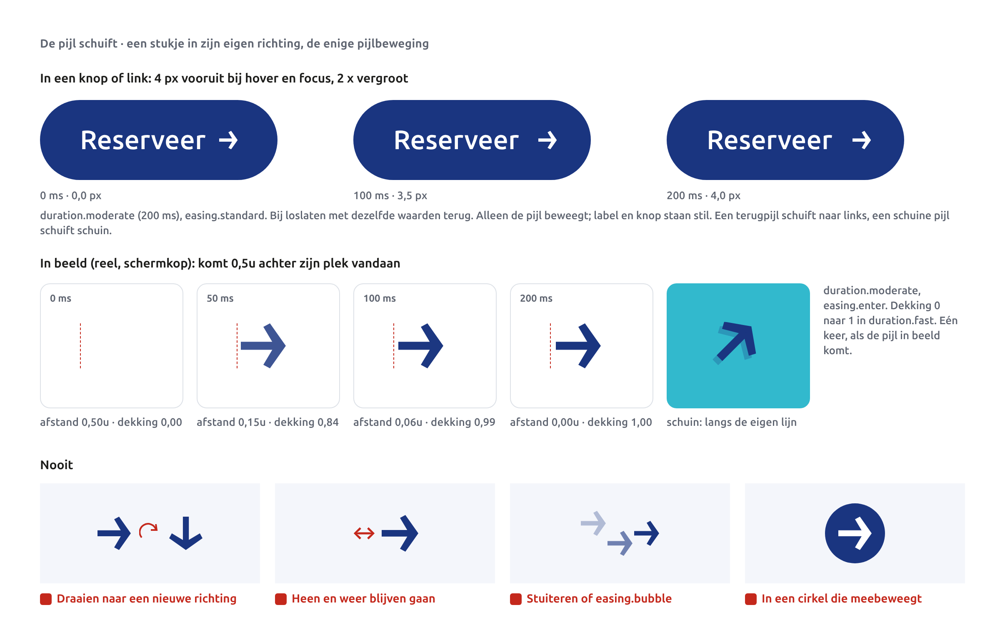
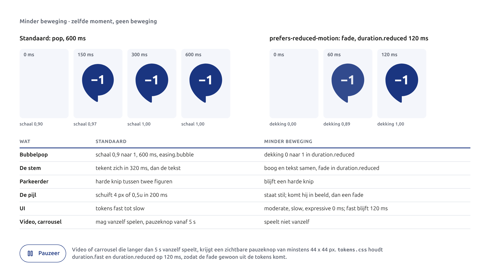
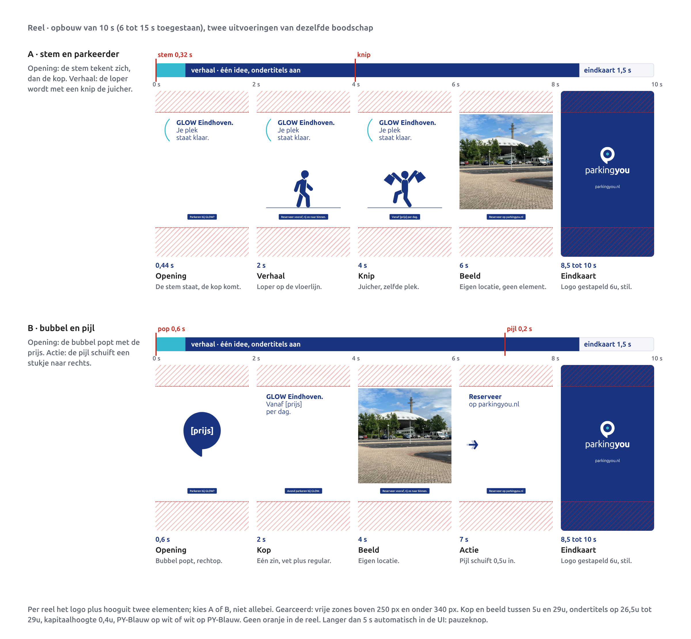
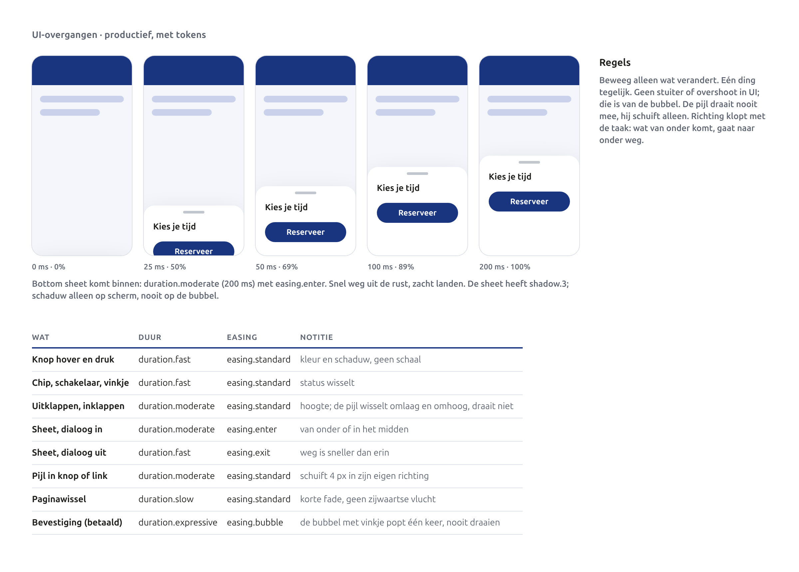

# Beweging

Beweging helpt je zien wat er verandert. Meer hoeft het niet te doen. We hebben twee soorten: productief voor alles in de interface, en expressief voor een paar merkmomenten. Alle waarden komen uit de tokens. Dit hoofdstuk laat beweging zien als storyboard: losse beelden op vaste tijden, geen video.

Eén regel geldt overal: **het logo en de bubbel draaien nooit.** De punt van de bubbel wijst altijd naar linksonder, zoals in het beeldmerk. Richting komt van de hoekige pijl.

## Twee soorten beweging

**Productief.** Alle UI-beweging: een knop die je indrukt, een sheet die opent, een pagina die wisselt, en de hoekige pijl die een stukje in zijn eigen richting schuift. Kort en rustig, 120 tot 320 ms, met `easing.standard`, `easing.enter` of `easing.exit`. Geen stuiter, geen overshoot.

**Expressief.** Alleen op merkmomenten: de opening en het einde van een reel, het opstartscherm van de app en een bevestiging (betaald, gereserveerd). Er zijn drie expressieve bewegingen:

1. **De bubbel popt** in, 600 ms met `easing.bubble`.
2. **De stem tekent zich** van boven naar beneden, 320 ms met `easing.enter`.
3. **De parkeerder wisselt van houding** met een harde knip tussen twee figuren.

Expressief is zeldzaam; daardoor valt het op. Per vlak gebruik je het logo plus hooguit twee eigen elementen, dus ook hooguit twee van deze momenten.

## De tokens

| Token | Waarde | Gebruik |
|---|---|---|
| `duration.reduced` | 120 ms | de fade die beweging vervangt bij minder beweging |
| `duration.fast` | 120 ms | hover, druk, kleine statuswissel, dekking bij een pop |
| `duration.moderate` | 200 ms | uitklappen, sheet in, de pijl schuift |
| `duration.slow` | 320 ms | paginawissel, de stem tekent zich |
| `duration.expressive` | 600 ms | de bubbelpop |
| `easing.standard` | cubic-bezier(0.2, 0, 0, 1) | standaard voor UI |
| `easing.enter` | cubic-bezier(0, 0, 0, 1) | iets komt binnen |
| `easing.exit` | cubic-bezier(0.3, 0, 1, 1) | iets gaat weg |
| `easing.bubble` | cubic-bezier(0.34, 1.3, 0.64, 1) | de bubbelpop |

## De bubbelpop

De bubbel popt in: hij schaalt van 0,9 naar 1 in 600 ms met `easing.bubble`. Hij draait niet; de punt wijst van het eerste tot het laatste beeld naar linksonder.

1. **Schaal** van 0,9 naar 1, vanuit het midden van de cirkel, 600 ms, `easing.bubble`.
2. **Dekking** van 0 naar 1 in de eerste 120 ms (`duration.fast`, `easing.enter`). Anders staat de bubbel op 0 ms al zichtbaar op 0,9.
3. **Inhoud** (cijfer, prijs, pictogram) schaalt mee. Er staat nooit een pijl in.

Bij 300 ms is de bubbel praktisch op maat, bij 400 ms is hij heel even 1,003, bij 600 ms staat hij stil. Die kleine overshoot geeft de pop; meer is er niet.

De bubbel popt één keer per moment. Nooit herhalen, nooit laten knipperen of kantelen.

## De stem tekent zich

De stem opent een boodschap, en in beweging doet hij dat letterlijk: eerst de boog, dan de woorden.

1. **De boog** groeit langs zijn eigen lijn van het bovenste naar het onderste punt, in 320 ms (`duration.slow`) met `easing.enter`. Lijndikte en ronde uiteinden blijven vast; alleen de lengte groeit.
2. **De tekst** komt als de boog staat: dekking 0 naar 1 in 120 ms (`duration.fast`, `easing.enter`). De tekst schuift niet.

Samen duurt het 440 ms. Door `easing.enter` staat de boog na 80 ms al voor tweederde; het oog ziet een snelle haal en een rustige landing. De stem tekent zich één keer per vlak, op het moment dat de boodschap begint. Nooit terug laten lopen, nooit opnieuw tekenen bij elke regel.

De kleuren zijn die van de stem in hoofdstuk 6, Patronen en designelementen: aqua op wit en op PY-Blauw, PY-Blauw op aqua.

## De parkeerders wisselen van houding

Een parkeerder beweegt niet zoals een tekenfilm. Hij wisselt van houding met een **harde knip**: het ene beeld, dan meteen het andere, zonder tussenbeelden.

- **Twee bestaande figuren.** Altijd uit de kit, ongewijzigd. Je kiest het paar bij het moment. Bijvoorbeeld: **loper naar juicher** (aankomen, gelukt), **loper naar springer** (je reservering is bevestigd), **zwaaier naar wijzer** (hallo, daar is het) of **shopper naar juicher**, zoals in Remotion-verhaal 2.
- **Zelfde plek.** De voeten staan voor en na de knip op dezelfde plek op dezelfde lijn. Zo zie je één persoon die iets doet, niet twee personen.
- **Tijd.** Elke houding blijft minstens 1 s staan. De knip valt op een nieuwe ondertitel of een maat van de muziek. Hooguit één wissel per scène.
- **Nooit:** armen of benen animeren, kantelen, draaien, overvloeien, laten springen of van de lijn laten zweven. Ook geen loopje over het beeld.

Een knip is geen beweging. Bij minder beweging verandert er dus niets.

## De pijl schuift

De hoekige pijl heeft één beweging: hij schuift een klein stukje in zijn eigen richting. Dat is productieve beweging, `duration.moderate` (200 ms).

- **In een knop of link**, bij hover en focus: de pijl schuift 4 px (`space.1`) vooruit met `easing.standard`, en bij loslaten met dezelfde waarden terug. Alleen de pijl beweegt; label en knop staan stil.
- **In beeld**, in een reel of een schermkop: de pijl komt 0,5u achter zijn plek vandaan en schuift in met `easing.enter`, terwijl de dekking in 120 ms van 0 naar 1 gaat. Eén keer.
- **Richting.** Een terugpijl schuift naar links, een schuine pijl schuift schuin langs zijn eigen lijn.
- **Nooit:** draaien naar een nieuwe richting (een andere richting is een andere pijl), heen en weer blijven bewegen, stuiteren met `easing.bubble`, of bewegen in een cirkel of bubbel.

Op schermen en borden in de garage beweegt de pijl nooit; daar leidt beweging bestuurders af.

## Minder beweging

Als iemand in zijn systeem minder beweging heeft gekozen (de instelling reduced motion, in code `prefers-reduced-motion`), dan:

- **UI**: `duration.moderate`, `slow` en `expressive` worden 0 ms. `duration.fast` en `duration.reduced` blijven 120 ms, zodat een korte fade de beweging vervangt. Dat regelt `tokens.css` al. Laadindicatoren mogen blijven draaien; dat is informatie.
- **Bubbel**: geen schaal, alleen dekking van 0 naar 1 in `duration.reduced`.
- **De stem**: boog en tekst verschijnen samen met dezelfde fade.
- **Parkeerder**: blijft een harde knip.
- **De pijl**: schuift niet. Komt hij in beeld, dan met de fade.
- **Video en carrousels** spelen niet vanzelf.

Los van die instelling geldt: alles wat langer dan 5 seconden vanzelf beweegt (video, carrousel, geanimeerde banner) krijgt een zichtbare pauzeknop van minstens 44 x 44 px.

## Reels

- **Eén idee per reel.** Niet drie aanbiedingen achter elkaar.
- **Lengte** 6 tot 15 seconden.
- **Elementen.** Het logo plus hooguit twee eigen elementen per reel. Kies een paar en houd het vast, bijvoorbeeld stem en parkeerder, of bubbel en pijl.
- **Opening** (eerste 0,6 s): één merkmoment. De bubbel popt in met de prijs of het niveau, of de stem tekent zich en de kop verschijnt.
- **Verhaal**: de boodschap in beeld en tekst. Hier zit de knip van de parkeerder of het moment dat de pijl inschuift naar de actie. Eigen locaties in beeld, nooit tekst over een drukke plek.
- **Eindkaart** 1,5 seconde: logo gestapeld, 6u hoog, stil, op PY-Blauw, met het webadres eronder in regular.
- **Ondertitels** altijd aan. Kapitaalhoogte 0,4u (21,6 px op 1080 breed), wit op PY-Blauw of PY-Blauw op wit, op 26,5u tot 29u.
- **Vrije zones**: boven 250 px en onder 340 px geen belangrijke inhoud (zie hoofdstuk 5, Grid en layout). Kop en beeld tussen 5u en 29u.
- **Kleur**: veel wit, PY-Blauw en aqua als accent. Geen oranje, geen verloop.

De bestaande Remotion-verhalen in `remotion/` gebruiken nog het oude tokenbestand, het verloop, een grote achtergrondbubbel, een figuur in een bubbel en een figuur die huppelt. Bij de volgende versie gaan ze over op `tokens.json` van 2027, deze opbouw en de eindkaart. De knip van shopper naar juicher in verhaal 2 blijft; het huppelen en de bubbel eromheen vervallen.

## Overgangen in de interface

| Wat | Duur | Easing |
|---|---|---|
| Knop hover en druk | `duration.fast` | `easing.standard` |
| Chip, schakelaar, vinkje | `duration.fast` | `easing.standard` |
| Uitklappen en inklappen | `duration.moderate` | `easing.standard` |
| Sheet of dialoog in | `duration.moderate` | `easing.enter` |
| Sheet of dialoog uit | `duration.fast` | `easing.exit` |
| Pijl in knop of link | `duration.moderate` | `easing.standard` |
| Paginawissel | `duration.slow` | `easing.standard` |
| Bevestiging (betaald) | `duration.expressive` | `easing.bubble` |

Beweeg alleen wat verandert, één ding tegelijk. Wat van onder komt, gaat naar onder weg. Een knop verandert van kleur bij hover en druk, niet van maat. Bij uitklappen wisselt de pijl van omlaag naar omhoog zonder te draaien. Schaduw (`shadow.1` tot `shadow.3`) mag op schermlagen, nooit op de bubbel.

## Voorgestelde waarden

Goedgekeurd: zie besluit D38 in de core spec.

| Waarde | Voorstel | Reden |
|---|---|---|
| Pijl schuift in knop en link | 4 px (`space.1`), `duration.moderate`, `easing.standard`, heen en terug | De core spec noemt de beweging en de duur, niet de afstand. 4 px is een bestaand token en blijft binnen de 8 px tussen label en pijl. |
| Pijl schuift in beeld | 0,5u achter de eindplek, `duration.moderate`, `easing.enter`, dekking 0 naar 1 in `duration.fast` | 0,5u is de kleinste stap van het verticale ritme; zichtbaar in een reel (27 px) zonder dat de pijl door het beeld vliegt. |
| Tekst na de stem | dekking 0 naar 1 in `duration.fast`, `easing.enter`, direct na de 320 ms van de boog; samen 440 ms | De stem opent de boodschap; de tekst moet dus na de boog komen, met een bestaand token. |
| Houding parkeerder | elke houding minstens 1 s in beeld; hooguit één knip per scène | Korter leest als een haperende animatie; meer knippen maakt van de parkeerder een tekenfilm. |
| Opening reel | de bubbelpop (0,6 s) of de stem met de kop (0,44 s); beide binnen de eerste 0,6 s | Uitbreiding van de bestaande regel "bubbelpop in de eerste 0,6 s", zodat een reel met stem en parkeerder geen derde element nodig heeft. |
| Reduced motion voor stem en pijl | stem en tekst samen in een fade van `duration.reduced`; de pijl schuift niet | Zelfde aanpak als de bubbel: het moment blijft, de beweging gaat weg. |

## Do's en don'ts

- **Wel:** UI-beweging altijd uit de tokens, nooit een losse waarde in code.
- **Wel:** de bubbelpop, de stem en de knip alleen op merkmomenten: reel open en dicht, opstartscherm, bevestiging.
- **Wel:** de parkeerder met een harde knip tussen twee kitfiguren, voeten op dezelfde plek.
- **Wel:** de pijl een klein stukje laten schuiven in zijn eigen richting, één keer of op hover.
- **Wel:** test elke animatie met minder beweging aan.
- **Wel:** ondertitels in elke reel, ook als er geen gesproken tekst is.
- **Niet:** de bubbel of het logo draaien, kantelen, knipperen of steeds opnieuw laten poppen.
- **Niet:** een pijl draaien naar een nieuwe richting, laten stuiteren of in een cirkel laten bewegen.
- **Niet:** armen of benen van een parkeerder animeren, of figuren laten overvloeien of springen.
- **Niet:** de stem terug laten lopen of bij elke regel opnieuw tekenen.
- **Niet:** overshoot of stuiter in de UI. Die hoort alleen bij de bubbel.
- **Niet:** autoplay langer dan 5 s zonder pauzeknop.
- **Niet:** beweging in bewegwijzering of op schermen in de garage die de aandacht van bestuurders trekt.
- **Niet:** reels langer dan 15 s, met meer dan één boodschap of met meer dan twee eigen elementen.
