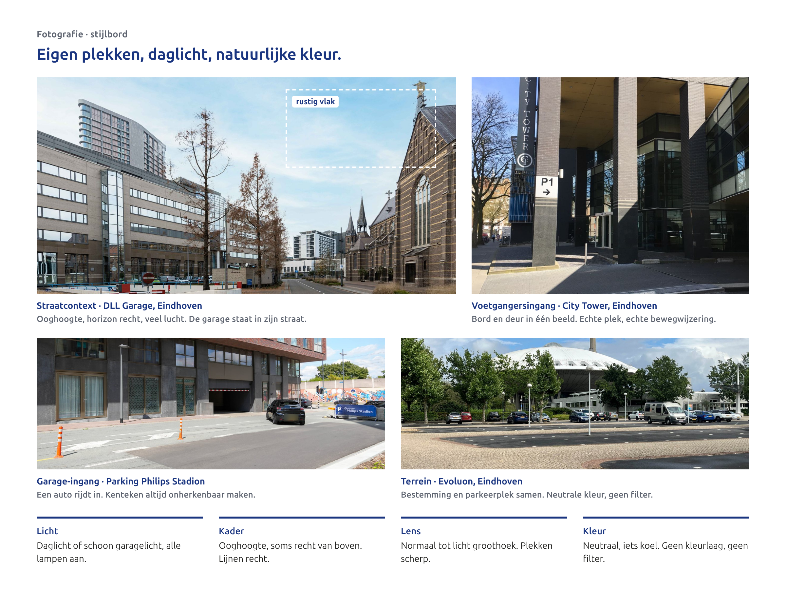
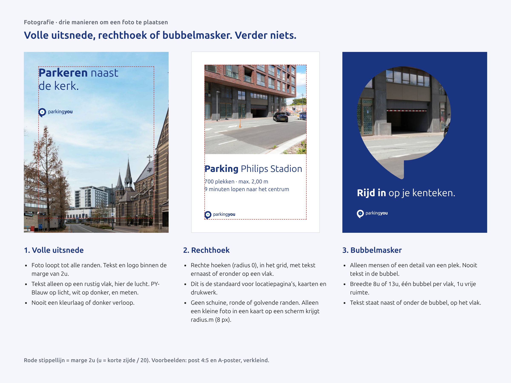
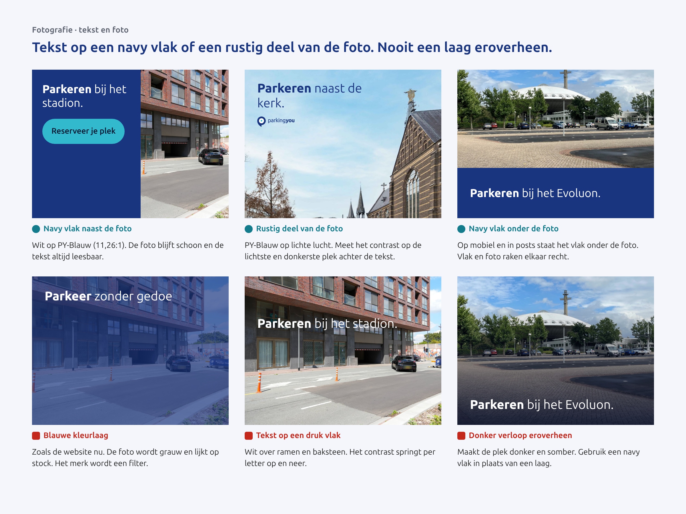
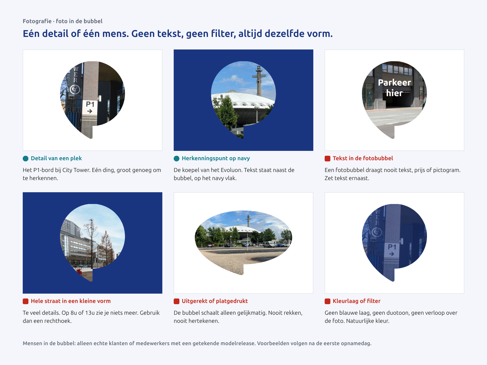
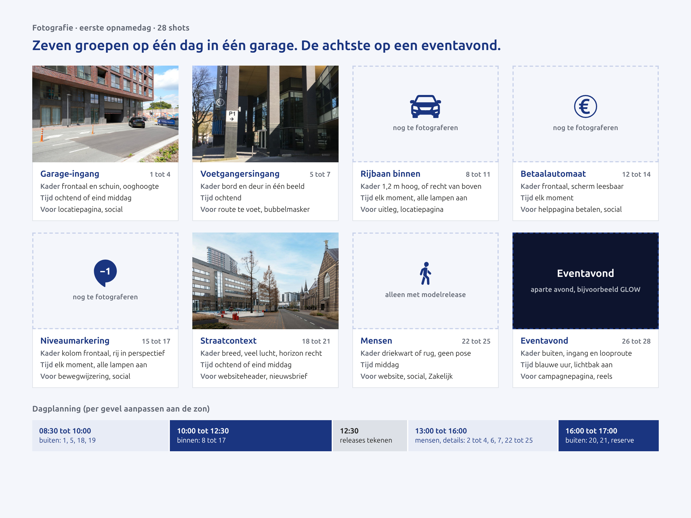

# Fotografie en beeld

## Onze houding

We laten zien waar je echt parkeert. Onze eigen garages, ingangen en straten, en mensen die aankomen of weggaan. In daglicht of in schoon garagelicht, met natuurlijke kleur. Geen kleurlaag eroverheen, geen stockfoto's van lachende mensen in een cabrio, geen AI-beeld van onze eigen locaties. Een foto moet je helpen: je ziet de ingang, je herkent de straat. Dat is principe 5, **Echt**, in beeld (hoofdstuk 1, Introductie en merkprincipes).

Vandaag is dat nog niet zo. Op de website staan stockfoto's onder een blauwe kleurlaag, de nieuwsfoto's komen van iStock en één beeld in de carrousel op de homepage is met AI gemaakt. Alleen de locatiepagina's tonen echte garages. Dit hoofdstuk zet dat recht.



## Stijl

### Licht

- Buiten: daglicht. Liefst ochtend of eind middag met de zon schuin, of een heldere bewolkte dag voor zacht licht. Vermijd de middagzon recht van boven: die geeft harde schaduwen over de stoep.
- Binnen: alle lampen aan, kapotte lampen eerst vervangen. Het licht moet schoon en gelijkmatig zijn. Een donkere, sombere garage gebruiken we niet in marketing.
- Avond alleen buiten en alleen bij events, zoals GLOW. Kies het blauwe uur kort na zonsondergang, als de lucht nog kleur heeft en de lichtbak aan is.

### Compositie

- Meestal op ooghoogte: zoals je de plek zelf ziet, lopend of vanuit de auto. Af en toe recht van boven, voor belijning, pijlen en vloermarkering.
- Verticale lijnen recht, horizon recht. Geen schuine camera voor effect.
- Eén onderwerp per foto. Afvalbakken, pallets en tijdelijke borden gaan uit beeld.
- Laat een rustig vlak vrij als er tekst bij komt: lucht, een lege muur of schoon asfalt.

### Lens en scherptediepte

- Plekken: normaal tot licht groothoek, alles scherp van voor tot achter. Geen fisheye en geen vervorming die de garage groter laat lijken.
- Mensen en details: normale lens, het onderwerp scherp en de achtergrond iets zachter.

### Kleur en nabewerking

Neutraal en iets koel, zoals beton en daglicht echt zijn. We corrigeren witbalans, belichting en rechte lijnen, verder niets: geen filter, geen duotoon, geen extra verzadiging. Het merkblauw zit in het vlak naast de foto, niet in de foto.

### Vaste waarden

| Wat | Waarde |
|---|---|
| Brandpunt plekken | 24 tot 35 mm (kleinbeeld): breed genoeg voor een ingang, zonder vervorming |
| Brandpunt mensen en details | 50 mm, natuurlijk perspectief |
| Diafragma | plekken f/8, alles scherp; mensen f/2.8 tot f/4, los van de achtergrond |
| Camerahoogte rijbaan | 1,2 m, de ooghoogte van een bestuurder |
| Kleurtemperatuur | daglicht 5200 tot 5600 K; in de nabewerking hooguit 200 K koeler |
| Rustig vlak voor tekst | minstens een derde van het beeld |
| Beeldverhouding | 3:2, 16:9, 1:1, 4:5 en 9:16 |
| Bestandsformaat en maat | JPEG in sRGB, lange zijde 3000 px voor scherm |
| Resolutie voor druk | minstens 300 ppi op het eindformaat |

## Mensen en plekken

Plekken eerst. Mensen alleen als ze iets laten zien: aankomen, uitstappen, de weg zoeken, betalen, iemand helpen.

- **Wie.** Echte klanten en eigen medewerkers. Geen modellen uit een bureau en geen stockmensen.
- **Hoe.** In een echt moment: driekwart of op de rug, lopend, bezig. Niet in de lens kijken, niet poseren.
- **Toestemming.** Iedereen die herkenbaar in beeld is, tekent vooraf een modelrelease. Zonder release geen gebruik. Voor kinderen tekent een ouder, en een kind is nooit het hoofdonderwerp.
- **Voorbijgangers en auto's.** Wie geen release heeft, staat onherkenbaar in beeld of gaat eruit. Een kenteken is een persoonsgegeven: maak het altijd onherkenbaar, ook bij onze eigen auto's. Hetzelfde geldt voor schermen met namen of reserveringen.

## Wat we niet doen

- Stockfoto's: lachende mensen met koffie, handen met een telefoon, een glimmende auto in een lege straat.
- Een kleurlaag over de foto, in blauw of welke kleur dan ook.
- Donkere, sombere garages in marketing.
- AI-beeld van een echte ParkingYou-locatie, of AI-mensen die doen alsof ze klant zijn.
- Emoji en clip-art bij een foto, en parkeerders op een foto. Onze parkeerders staan op een vlak naast de foto, nooit erin of eroverheen.
- Andere merken en logo's prominent in beeld, behalve partners en officiële verkeersborden als context.

## Uitsnede en plaatsing

Een foto staat op één van drie manieren in een ontwerp:

1. **Volle uitsnede.** De foto loopt tot de rand. Tekst en logo staan binnen de marge van 2u, op een rustig vlak.
2. **Rechthoek.** Rechte hoeken (`radius.none`), in het grid, met tekst ernaast of eronder op een vlak. Dit is de standaard voor locatiepagina's, kaarten en drukwerk. Eén uitzondering: een kleine foto in een kaart op een scherm, zoals in de lijst met locaties, krijgt `radius.m` (8 px). Overal anders hebben foto's rechte hoeken.
3. **Bubbelmasker.** Zie hieronder.

Geen schuine, golvende of ronde randen (behalve die 8 px in een schermkaart), geen cirkels en geen andere vormen.



### Tekst op een foto

Tekst staat nooit op een druk deel van de foto. Er zijn twee manieren:

- **Navy vlak.** Zet de tekst op een vlak in PY-Blauw naast of onder de foto. Wit op PY-Blauw haalt 11,26:1. Dit is de standaard en vervangt elke donkere laag of elk donker verloop.
- **Rustig deel van de foto.** PY-Blauw op een lichte lucht of muur, wit op een donker en egaal vlak. Meet het contrast op de lichtste en de donkerste plek achter de tekst. Beide moeten 4,5:1 halen, of 3:1 bij grote tekst. Haalt het dat niet, dan wordt het een navy vlak.

Het logo volgt de basisregels van deze gids (hoofdstuk 2, Logo): kleurenlogo op een lichte foto met rustig vlak, reverse logo op een donkere foto.



## Foto in de bubbel

De bubbel met foto is een bubbel zonder inhoud. Er staat geen tekst, prijs, pijl of pictogram in.

- Alleen mensen of een detail van een plek: een bord, een deur, een koepel, een hand bij de automaat. Een hele straat wordt in een kleine vorm onleesbaar; gebruik dan een rechthoek.
- Breedte 8u of 13u (64 of 104 px op scherm). Op desktop mag de fotobubbel in een kop 240 px breed zijn; op 104 px herken je daar een detail niet goed. Eén bubbel per vlak, 1u vrije ruimte eromheen.
- De punt staat zoals in het beeldmerk: naar linksonder. Nooit uitrekken, nooit hertekenen, geen rand, geen schaduw, geen kleurlaag.
- Tekst staat naast of onder de bubbel, op het vlak.



## Shotlijst eerste opnamedag

Eén garage, één dag en één eventavond: 28 shots in acht groepen. Zeven groepen (shot 1 tot 25) maak je overdag, de achtste (shot 26 tot 28) op de eventavond. Kies een garage met een duidelijke ingang en schone binnenruimte. Parking Philips Stadion of DLL Garage liggen voor de hand, omdat we daar al beeld van hebben. Neem blanco modelreleases mee en een collega die mensen aanspreekt.



| # | Plek | Shot | Kader | Tijd | Gebruik |
|---|---|---|---|---|---|
| 1 | Garage-ingang | Ingang frontaal vanaf de overkant, portaal, bord en gevel | ooghoogte, liggend 3:2, lucht vrij | ochtend | locatiepagina, Google-profiel |
| 2 | Garage-ingang | Auto rijdt in, kenteken onherkenbaar | schuin, staand 4:5 | middag | social, uitleg kenteken |
| 3 | Garage-ingang | Detail lichtbak of portaal met beeldmerk | vierkant | bewolkt, lichtbak aan | bubbelmasker, nieuwsbrief |
| 4 | Garage-ingang | Kentekencamera en slagboom | ooghoogte, vierkant | elk moment | FAQ, "zo werkt het" |
| 5 | Voetgangersingang | Ingang vanaf de stoep, bord en deur in één beeld | ooghoogte, staand 4:5 | ochtend | locatiepagina, route te voet |
| 6 | Voetgangersingang | Iemand loopt naar buiten, de straat in | rug of driekwart, staand 9:16 | middag | reels |
| 7 | Voetgangersingang | Liftknop, deur of aqua looproutebord | detail, vierkant | elk moment | bubbelmasker |
| 8 | Rijbaan binnen | Rijbaan in centraal perspectief | 1,2 m hoog, liggend 16:9 | lampen aan | website, uitleg |
| 9 | Rijbaan binnen | Lege parkeerplek met belijning | recht van boven, vierkant | lampen aan | social, rechthoek met tekst |
| 10 | Rijbaan binnen | Hoogtebalk bij de inrit | ooghoogte, liggend 3:2 | elk moment | locatiepagina, max. hoogte |
| 11 | Rijbaan binnen | Laadpaal of gehandicaptenplek, als de garage die heeft | staand 4:5 | elk moment | locatiepagina, voorzieningen |
| 12 | Betaalautomaat | Automaat frontaal, scherm en sticker leesbaar | ooghoogte, staand 4:5 | elk moment | helppagina betalen |
| 13 | Betaalautomaat | Hand met pas of telefoon bij de automaat | close, vierkant | elk moment | bubbelmasker, social |
| 14 | Betaalautomaat | Automaat in zijn omgeving, met looproute | liggend 3:2 | elk moment | locatiepagina |
| 15 | Niveaumarkering | Kolom met niveaububbel | frontaal, staand 4:5 | lampen aan | bewegwijzering, social |
| 16 | Niveaumarkering | Rij kolommen met sectie | perspectief, liggend 16:9 | lampen aan | website, Zakelijk |
| 17 | Niveaumarkering | Vloerpijl of vloermarkering | recht van boven, vierkant | lampen aan | rechthoek met tekst |
| 18 | Straatcontext | Garage in zijn straat, veel lucht | breed, liggend 16:9 | ochtend | websiteheader, nieuwsbrief |
| 19 | Straatcontext | Bestemming en garage in één beeld (stadion, centrum) | liggend 3:2 | ochtend | locatie- en eventpagina |
| 20 | Straatcontext | Looproute van garage naar bestemming | voetganger, staand 9:16 | eind middag | reels |
| 21 | Straatcontext | Overzicht vanaf een hoger punt (dak, parkeerdek) | van boven, vierkant | eind middag | locatiepagina, Zakelijk |
| 22 | Mensen | Bestuurder stapt uit | driekwart, staand 4:5 | middag | social, website |
| 23 | Mensen | Klant loopt met tas of koffer naar de uitgang | liggend 3:2 | middag | website, campagne |
| 24 | Mensen | Medewerker helpt een klant bij de automaat | liggend 3:2 | middag | over ons, Zakelijk |
| 25 | Mensen | Klant opent de reservering bij de ingang, echt scherm | over de schouder, staand 4:5 | middag | app, social |
| 26 | Eventavond | Ingang met lichtbak aan, bezoekers vertrekken | liggend 3:2 | blauwe uur | campagnepagina |
| 27 | Eventavond | Looproute naar het event, licht op de achtergrond | staand 9:16 | blauwe uur | reels |
| 28 | Eventavond | Bezoekers lopen terug naar de garage | rug, liggend 3:2 | na afloop | nieuwsbrief na het event |

Maak van elk shot waar het kan ook een staande en een liggende variant.

## Bestandsnaam, metadata en opslag

**Bestandsnaam** (Engels, kleine letters, koppeltekens):

```
py-photo-{city}-{location}-{subject}-{yyyymmdd}-{nnn}.jpg
py-photo-eindhoven-philips-stadion-entrance-20270312-004.jpg

py-ai-{subject}-{yyyymmdd}-{nnn}.jpg
py-ai-concrete-texture-20270312-001.jpg
```

**Metadata** (IPTC, in het bestand zelf):

| Veld | IPTC-veld | Inhoud |
|---|---|---|
| Maker | Creator | naam van de fotograaf |
| Copyright | Copyright Notice | © ParkingYou B.V. |
| Opnamedatum | Date Created | opnamedatum |
| Plaats en locatie | City, Sublocation | stad en garage, bijvoorbeeld Eindhoven, Parking Philips Stadion |
| Beschrijving | Description | korte beschrijving, basis voor de alt-tekst |
| Status modelrelease | Model Release Status | geen mensen, release aanwezig, of geen release |
| Nummer modelrelease | Model Release ID | nummer van de getekende release |
| Soort bron | Digital Source Type | `digitalCapture` voor foto's, `trainedAlgorithmicMedia` voor AI-beeld |

**Opslag.** Masters en bewerkte versies staan in één gedeelde beeldbank, per jaar en per locatie. De getekende releases staan apart, met beperkte toegang, omdat ze persoonsgegevens bevatten. In `kit/photos/` staan alleen uitsneden voor de figuren in deze gids.

## Toegankelijkheid: alt-tekst

Elke foto met betekenis krijgt een alt-tekst in het Nederlands.

- Zeg wat je ziet en waarom het ertoe doet. Noem de plek bij naam.
- Begin niet met "Foto van" of "Afbeelding van".
- Kort: één zin, liefst onder de 125 tekens.
- Staat er tekst in de foto die je nodig hebt, zoals een bord, neem die dan op.
- Een foto die alleen sfeer geeft, krijgt een lege alt (`alt=""`).
- Noem geen namen van mensen, tenzij het een medewerker is die dat wil.

Voorbeelden:

- `Ingang van Parking Philips Stadion met slagboom, een auto rijdt naar binnen.`
- `Voetgangersingang van City Tower in Eindhoven met het bord P1 en een pijl naar rechts.`
- `Straat met DLL Garage links en een kerk rechts, op een heldere ochtend.`

## AI-beeld

AI mag alleen voor sfeer en algemene texturen: beton, asfalt, lucht, licht. Altijd onder deze regels:

- **Nooit** een echte ParkingYou-locatie, ook niet "in de stijl van".
- **Nooit** mensen die als klant of medewerker worden getoond.
- **Nooit** tekst, logo's, borden of kentekens in het beeld.
- **Altijd** intern gelabeld: bestandsnaam `py-ai-`, Digital Source Type `trainedAlgorithmicMedia`, en de prompt, de tool en de datum in de beeldbank.
- Het AI-beeld op de huidige homepage wordt vervangen door een eigen foto.

### Prompttemplate

```
Photograph of {generic subject}, no recognisable building or location.
Light: {natural daylight | soft overcast daylight | clean even LED light}.
Viewpoint: {eye level | straight top-down}, {lens: 35mm | 50mm} look, straight verticals.
Colour: neutral, slightly cool, natural, low saturation, no colour cast, no filter.
Composition: calm, one subject, {large empty area left | right | top} for text.
Format: {3:2 | 4:5 | 9:16 | 16:9 | 1:1}.
Exclude: people, faces, hands, text, letters, logos, signs, licence plates,
brand colours, lens flare, dramatic shadows, night, neon, HDR look, illustration.
```

### Drie voorbeelden

```
1. Nieuwsbriefheader, textuur
Photograph of a smooth grey concrete wall with fine formwork lines, no recognisable
building or location. Light: soft overcast daylight. Viewpoint: eye level, 50mm look,
straight verticals. Colour: neutral, slightly cool, natural, low saturation, no filter.
Composition: calm, one subject, large empty area left for text. Format: 16:9.
Exclude: people, faces, hands, text, letters, logos, signs, licence plates, brand
colours, lens flare, dramatic shadows, night, neon, HDR look, illustration.

2. Social achtergrond achter een rechthoek, asfalt
Photograph of fresh dark asphalt with one straight white painted line, no recognisable
location. Light: natural daylight. Viewpoint: straight top-down, 35mm look.
Colour: neutral, slightly cool, natural, low saturation, no filter.
Composition: calm, one subject, large empty area top for text. Format: 4:5.
Exclude: people, faces, hands, text, letters, numbers, arrows, logos, signs, licence
plates, brand colours, cars, lens flare, HDR look, illustration.

3. Sfeer voor een seizoensactie, lucht
Photograph of a clear pale blue sky with a few thin clouds, no buildings, no trees.
Light: natural morning daylight. Viewpoint: eye level, 35mm look.
Colour: neutral, slightly cool, natural, low saturation, no filter.
Composition: calm, large empty area in the middle for text. Format: 9:16.
Exclude: people, birds, planes, sun flare, text, logos, brand colours, dramatic
sunset colours, HDR look, illustration.
```

## Check voor publicatie

- [ ] Eigen foto van een echte plek, of een gelabeld AI-beeld volgens de regels.
- [ ] Daglicht of schoon garagelicht, natuurlijke kleur, geen kleurlaag of filter.
- [ ] Verticale lijnen en horizon recht.
- [ ] Iedereen die herkenbaar is, heeft een getekende release. Release-ID staat in de metadata.
- [ ] Kentekens en schermen met persoonsgegevens zijn onherkenbaar.
- [ ] Volle uitsnede, rechthoek of bubbelmasker. Geen andere vorm.
- [ ] Tekst op een navy vlak, of op een rustig deel met gemeten contrast van 4,5:1 (groot 3:1).
- [ ] Bubbelmasker zonder tekst, alleen een mens of een detail.
- [ ] Bestandsnaam en metadata kloppen.
- [ ] Alt-tekst geschreven, of bewust leeg bij een sfeerbeeld.

## Do's en don'ts

- **Wel:** fotografeer onze eigen garages, ingangen en straten.
- **Wel:** werk met daglicht of schoon garagelicht, alle lampen aan.
- **Wel:** houd ooghoogte aan en zet lijnen recht.
- **Wel:** laat een rustig vlak vrij voor tekst.
- **Wel:** zet tekst op een navy vlak als de foto druk is.
- **Wel:** laat echte klanten en medewerkers zien, met een release.
- **Wel:** gebruik de bubbel voor één mens of één detail.
- **Niet:** stockfoto's of een gemaakte glimlach.
- **Niet:** een blauwe of andere kleurlaag, of een donker verloop.
- **Niet:** donkere, sombere garages in marketing.
- **Niet:** AI-beeld van onze locaties of AI-mensen als klant.
- **Niet:** tekst, prijs of pictogram in een fotobubbel.
- **Niet:** emoji of clip-art bij een foto, of een parkeerder op de foto zelf.
- **Niet:** leesbare kentekens.
