# 09 UI/UX

Dit hoofdstuk zegt hoe ParkingYou eruitziet en werkt op een scherm: de website, de boekflow en de PWA met je ticket. Alles komt uit de core spec en `tokens.json`. De componentmaten staan in de core spec (besluiten D4 tot en met D13) en in het tokenbestand. De hoofdknop is navy (besluit D33).

## Principes voor schermen

1. **Eén hoofdknop per scherm.** Er is altijd één ding dat je hier het liefst doet. Dat is de hoofdknop: PY-Blauw met witte tekst, op elk scherm, of het nu zoeken, reserveren, betalen of je ticket bekijken is. De tweede keus is een omlijnde knop of een link.
2. **Geen oranje op het scherm.** Oranje betekent betalen in de garage: de automaat, het tarievenbord, de storingssticker. Op de website en in de app komt het niet voor. De enige uitzondering is tekst die waarschuwt (`feedback.warning`) en de status Vol (`status.full`), allebei oranje.700 als tekst of icoon, nooit als vlak.
3. **Het merk helpt je verder.** Onze eigen elementen staan alleen waar ze iets doen: de stem opent een belangrijke kop, een parkeerder viert of wijst, het vak zegt "jouw plek", de bubbel toont een prijs of een geldig ticket, de hoekige pijl wijst naar de volgende stap. Per scherm het logo plus hooguit twee van de vijf.
4. **De bubbel op een moment dat telt.** Een prijs, een niveau, beschikbaarheid of een geldig ticket. Eén bubbel per scherm, altijd rechtop, nooit als knop of avatar. De kaartpin is de uitzondering: de navy bubbel van 24 px met een witte P.
5. **Kleur nooit alleen.** Vrij, Vol en Gesloten staan altijd als woord, met kleur en een icoon erbij. Een fout staat in woorden onder het veld.
6. **Rustig en vlak.** Veel wit, grote koppen, `surface.subtle` als tweede ondergrond, kaarten met radius 16. Schaduw alleen op kaarten en vaste balken, nooit op de bubbel, een parkeerder of het logo. Geen verloop.

## Eigen elementen op het scherm

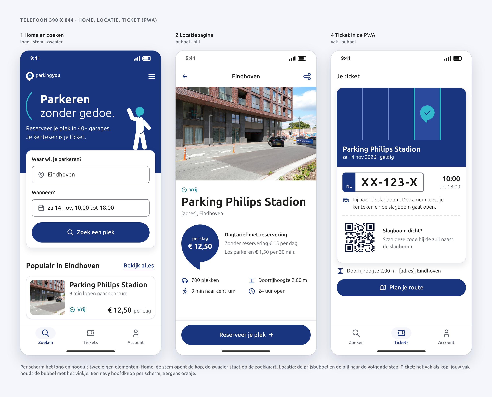

Rick vroeg om meer eigen identiteit. Op een scherm betekent dat: het product voelt als ParkingYou op de momenten die ertoe doen, en verder blijft het rustig. Deze tabel zegt welk element waar staat.

| Scherm | Logo | Elementen | Waarom |
|---|---|---|---|
| Home | ja | stem, zwaaier | De stem geeft "**Parkeren** zonder gedoe." een stem. De zwaaier staat op de zoekkaart en heet je welkom. |
| Locatiepagina | nee | bubbel, pijl | De prijs in de navy bubbel, de pijl in "Reserveer je plek" en in de terugknop. |
| Boekflow stap 1 tot 3 | nee | pijl | Alleen de pijl in "Ga verder" en terug. Hier wil je doorlopen, niet kijken. |
| Bevestiging | nee | stem, springer | De stem opent "Je plek is gereserveerd.", de springer staat op de rand van de knoppenbalk. |
| Ticket (PWA) | nee | vak, bubbel | Het vak is de kop van het ticket. Jouw vak houdt de aqua bubbel met een vinkje: dit ticket is geldig. |
| Lege staat | nee | vak, bubbel | Jouw vak houdt de navy bubbel met P: hier komt jouw plek. |
| Foutscherm | ja | gastheer wijst | De gastheer wijst naar het contact. Hij maakt een doodlopende pagina vriendelijk. |
| Desktop locatiepagina | ja | bubbel, pijl | Zoals op de telefoon. |

**De stem.** De halve boog uit het handboek (`kit/assets/arc.svg`) staat links van een kop van één tot drie regels. Hoogte = het tekstblok, lijn = 1/25 van die hoogte (minstens 1,5 px), afstand tot de tekst = 0,3 x de hoogte. Bij een kop `heading-l` over twee regels is dat 76 px hoog, 3 px lijn, 23 px afstand. Kleur `voice.arc` (aqua.500), op wit en op navy. Alleen op home en de bevestiging; niet op elke paginakop, want dan zegt hij niets meer.

**De parkeerders.** Eén per scherm, 48 tot 160 px hoog, altijd staand op een lijn: de rand van een kaart, de bovenrand van de knoppenbalk, of een lijn van 2 px in de kleur van het lijf. Altijd één kleur: navy op wit, wit op navy. Rollen op het scherm: zwaaier op home, springer of juichende shopper bij een bevestiging, gastheer wijst op een foutscherm of de contactpagina. Een parkeerder is decoratie: `alt=""`, de tekst zegt alles. Nooit bij een betaalfout of een veldfout: daar is iemand geld of tijd kwijt.

**Het vak.** Een parkeerdek van boven, als kop van het ticket of van een lege staat. Lijnen om de 72 px, 2 px dik, van de bovenrand naar beneden. Precies één vak is jouw vak: gevuld met `vak.mine`, randen 4 px in `vak.mine-edge`. Jouw vak houdt één bubbel van 40 of één parkeerder, verder niets. Op navy: lijnen `vak.line-on-brand`, jouw vak `vak.mine-on-brand`. Tekst staat altijd onder de lijnen, nooit ertussen.

**De bubbel.** Zie Beschikbaarheid, prijs en de bubbel. Altijd rechtop, de punt omlaag.

**De hoekige pijl.** De pijl uit het handboek (`kit/assets/arrow-plain-navy.svg`), in stappen van 45 graden. In knoppen en links achter het label, op de basislijn, zo hoog als een hoofdletter (0,693 em: 11 px bij een label van 16 px), 8 px na het label, in de tekstkleur van de knop. In de terugknop zo hoog als een hoofdletter van de titel. Alleen bij een richting of een volgende stap: "Ga verder", "Reserveer je plek", "Bekijk alles", terug, de pijl omlaag in een keuzelijst. Nooit een chevron, nooit een pijl uit de iconenset, nooit in een cirkel.

## Tokenarchitectuur

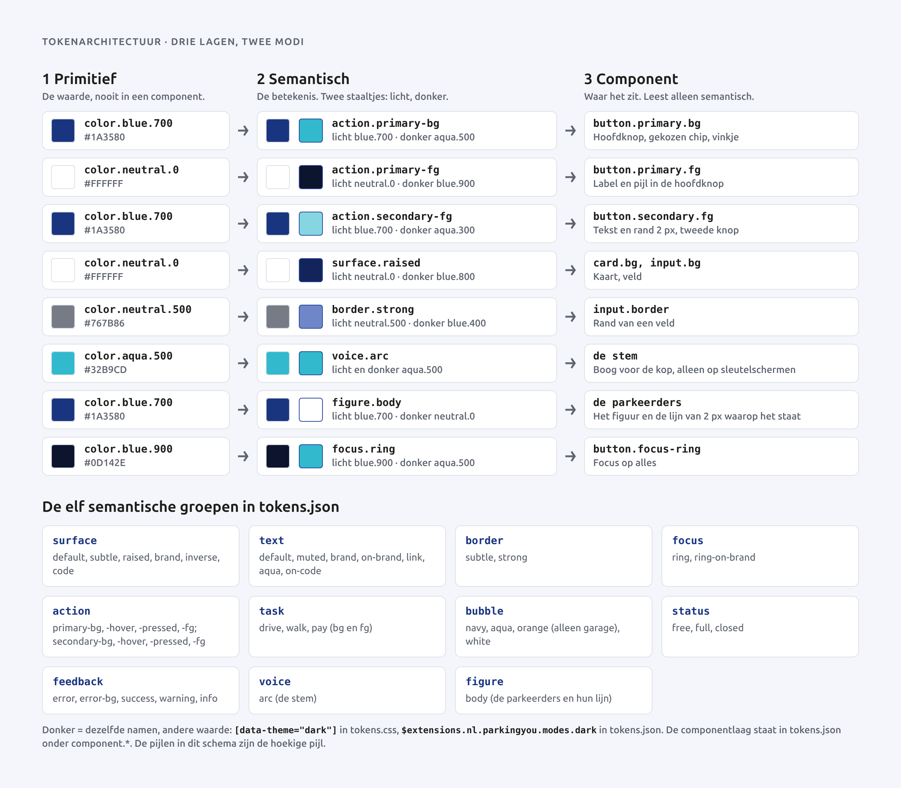

We werken in drie lagen.

| Laag | Wat | Voorbeeld | Wie gebruikt het |
|---|---|---|---|
| Primitief | De kleurwaarde zelf | `color.blue.700` #1A3580 | Alleen de semantische laag |
| Semantisch | De betekenis, met een waarde voor licht en donker | `action.primary-bg` | Componenten |
| Component | Waar het zit | `button.primary.bg` | Code en Figma |

Een component leest alleen semantische tokens, nooit een primitief. Daardoor werkt donkere modus vanzelf: dezelfde naam krijgt in `[data-theme="dark"]` een andere waarde. Spacing, radius, type, schaduw en motion zijn al tokens in `tokens.json` en worden direct gebruikt.

De twaalf semantische groepen en hoe componenten ze lezen:

| Groep | Tokens | Gelezen door |
|---|---|---|
| `surface` | default, subtle, raised, brand, inverse, code | pagina, kaart, veld, navy kop, toast, QR-code |
| `text` | default, muted, brand, on-brand, link, aqua, on-code | alle tekst, hulptekst, links |
| `border` | subtle, strong | kaartrand (decoratief), veldrand |
| `focus` | ring, ring-on-brand | focusring op licht en op navy |
| `action` | primary-bg/-hover/-pressed/-fg, secondary-bg/-hover/-pressed/-fg | knoppen, gekozen chip, vinkje, voortgangsbalk |
| `task` | drive, walk, pay (bg en fg) | inhoud van de bubbel |
| `voice` | arc | de stem |
| `vak` | line, line-on-brand, mine, mine-on-brand, mine-edge | het vak in ticketkop en lege staat |
| `figure` | head, body | de parkeerders en de lijn waarop ze staan |
| `bubble` | navy, aqua, orange, white | de bubbel; orange alleen in de garage, nooit op een scherm |
| `status` | free, full, closed | beschikbaarheid |
| `feedback` | error, error-bg, success, warning, info | meldingen en foutteksten |

In donkere modus is de pagina PY-Diep (`blue.900`), zijn kaarten `blue.800` en vlakken `blue.850`. `text.brand` en `text.link` worden aqua.300. De hoofdknop wordt aqua met PY-Diep tekst, de tweede knop krijgt een aqua.300 rand en tekst. Navy is op donker nooit tekst, rand of bubbel (1,61:1).

## Componenten

Alle componenten zijn gebouwd met echte `<button>`, `<input>`, `<label>` en `<select>`. Iconen zijn outline, 24-raster, 2 px lijn (Tabler Icons, zie het hoofdstuk Iconografie). Pijlen zijn altijd de hoekige pijl.

### Knoppen

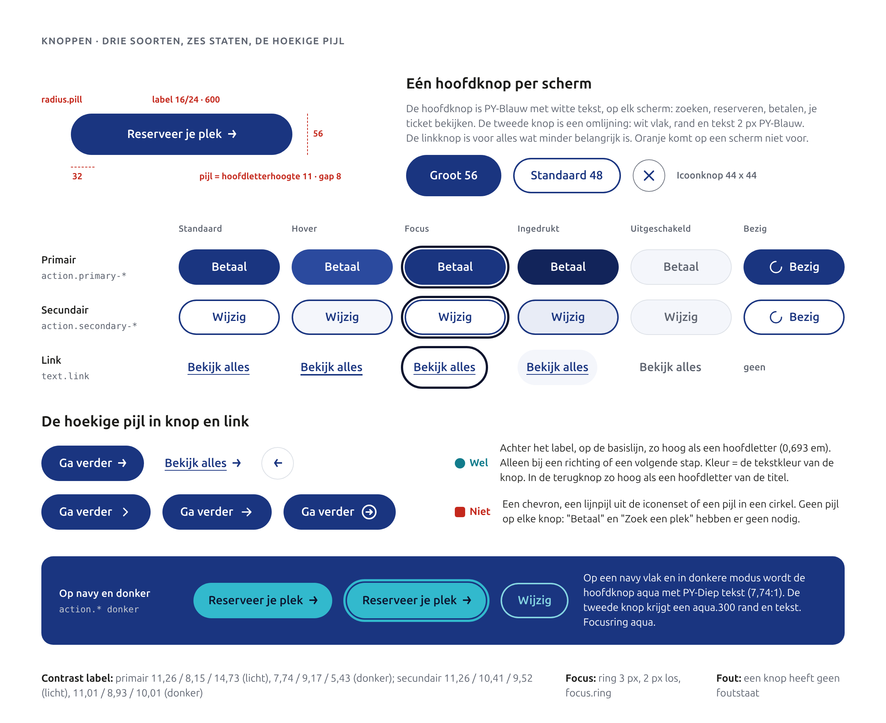

| Soort | Tokens | Gebruik |
|---|---|---|
| Primair | `action.primary-bg`, `-hover`, `-pressed`, `-fg` | Eén per scherm: Zoek een plek, Reserveer je plek, Betaal, Bekijk je ticket, Plan je route |
| Secundair (omlijnd) | `action.secondary-bg`, `-hover`, `-pressed`, `-fg`; rand 2 px in `action.secondary-fg` | Tweede keus naast de hoofdknop: Wijzig, Andere tijd |
| Link | `text.link` | Bekijk alles, Buitenlands kenteken?, Naar de homepagina |
| Icoonknop | `text.brand` of `text.on-brand` | Terug, Sluiten, Menu; altijd met `aria-label` |

Vorm: pil (`radius.pill`). Maten: 48 standaard, 56 voor de hoofdknop onderaan een telefoonscherm. Padding 24 of 32, icoon 20 met 8 ruimte, pijl op hoofdletterhoogte met 8 ruimte. Een knop heeft óf een icoon vooraan, óf een pijl achteraan, nooit allebei. Een knop heeft geen foutstaat: de fout staat bij het veld.

**Op een navy vlak** gebruik je de donkere waarden van de action-tokens (zet het vlak in `data-theme="dark"`): de hoofdknop wordt aqua met PY-Diep tekst, de focusring aqua. Een navy knop op navy bestaat niet.

### Staten

| Staat | Knop primair | Knop secundair | Veld | Vinkje en rondje |
|---|---|---|---|---|
| Standaard | `action.primary-bg` (blue.700) | wit, rand en tekst 2 px blue.700 | rand 1 px `border.strong` op `surface.raised` | rand 2 px `border.strong` |
| Hover | `-bg-hover` (blue.600) | `-bg-hover` (blue.50) | rand 2 px `border.strong` | idem |
| Focus | ring 3 px `focus.ring`, 2 px los | idem | rand 2 px `focus.ring` plus ring | ring |
| Ingedrukt | `-bg-pressed` (blue.800) | `-bg-pressed` (blue.100) | n.v.t. | n.v.t. |
| Gekozen | n.v.t. | n.v.t. | n.v.t. | vlak `action.primary-bg`, vinkje `action.primary-fg` |
| Uitgeschakeld | `surface.subtle`, `text.muted`, rand `border.subtle` | idem | idem | idem |
| Fout | geen | geen | rand 2 px `feedback.error`, tekst eronder | rand `feedback.error` |
| Bezig | label plus draaiend icoon, `aria-busy` | idem | n.v.t. | n.v.t. |

Donker: primair aqua.500, hover aqua.400, ingedrukt aqua.600, tekst blue.900; secundair blue.900, hover blue.800, ingedrukt blue.850, rand en tekst aqua.300.

### Invoervelden

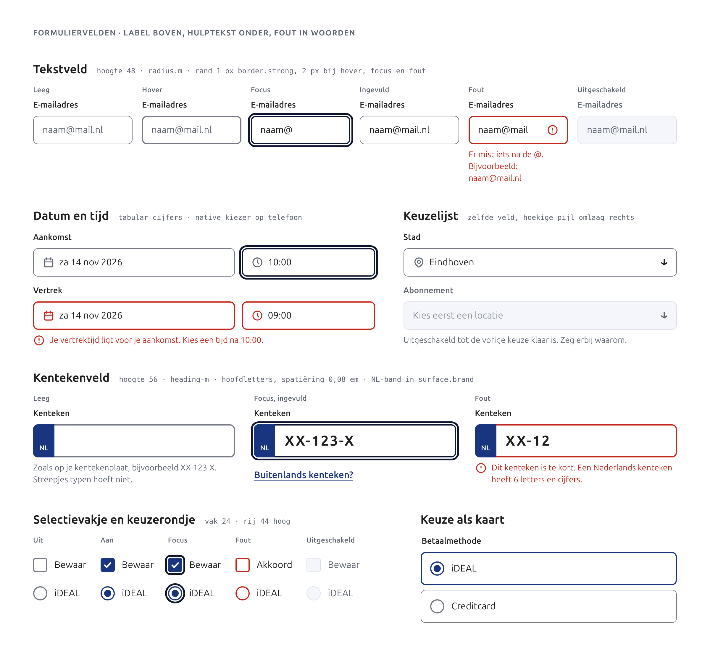

- **Tekstveld.** Label boven (`label-m`), veld 48 hoog, `radius.m`, tekst `body-m` 16 px. Hulptekst onder in `body-s`, `text.muted`. Een placeholder is een voorbeeld, nooit het label.
- **Datum en tijd.** Twee velden naast elkaar, tabular cijfers. Op een telefoon opent de eigen kiezer van het toestel. Notatie: "za 14 nov 2026" en "10:00".
- **Kentekenveld.** 56 hoog, `heading-m`, hoofdletters, spatiëring 0,08 em, een NL-band in `surface.brand`. Je mag typen met of zonder streepjes; we zetten ze zelf goed volgens de Nederlandse indeling (6 tekens, bijvoorbeeld XX-123-X). `autocomplete="off"`, `spellcheck="false"`. Een link "Buitenlands kenteken?" opent een vrij veld. We imiteren de gele plaat niet: geel is geen merkkleur.
- **Keuzelijst.** Zelfde veld met de hoekige pijl omlaag rechts, op hoofdletterhoogte van de veldtekst.
- **Vinkje en rondje.** Vak 24, rij minstens 44 hoog, het hele label is klikbaar. Gekozen in `action.primary-bg`. Betaalmethodes staan als keuze op een kaart; de gekozen kaart krijgt een rand van 2 px in `action.primary-bg`.

### Locatiekaart

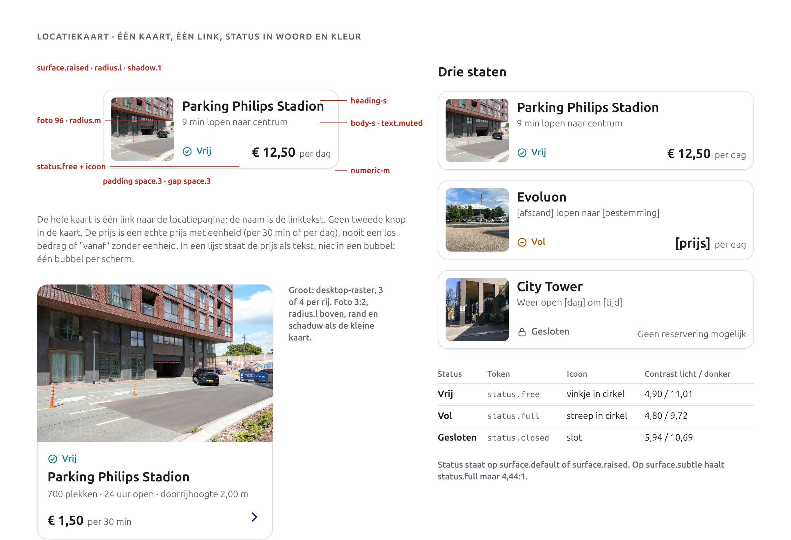

De hele kaart is één link; de naam is de linktekst. Foto 96 x 96 (`radius.m`), naam `heading-s`, afstand of openingstijd in `body-s` `text.muted`, onderaan status en prijs. Kaart: `surface.raised`, `radius.l`, `shadow.1`, rand `border.subtle`. Op desktop een grote variant met foto 3:2 bovenaan en de hoekige pijl rechtsonder. In een lijst staat de prijs als tekst, niet in een bubbel.

### Beschikbaarheid, prijs en de bubbel

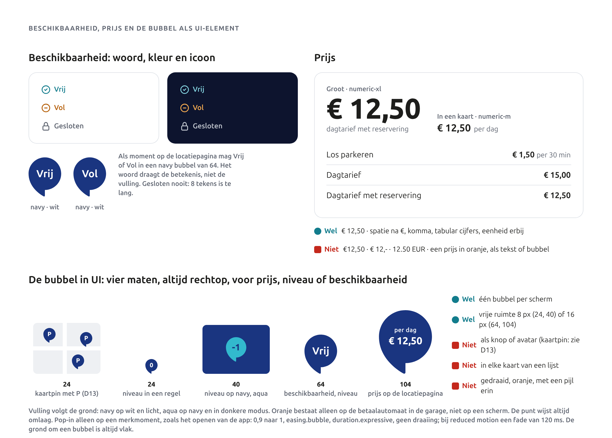

- **Status.** Vrij (`status.free`, vinkje), Vol (`status.full`, streep), Gesloten (`status.closed`, slot). Altijd woord, kleur en icoon. Alleen op `surface.default` of `surface.raised`.
- **Prijs.** "€ 12,50" met spatie, komma en tabular cijfers, altijd met eenheid ("per dag", "per 30 min"). Groot in `numeric-xl`, in een kaart `numeric-m`. Nooit in oranje, niet als tekst en niet als bubbel.
- **Bubbel als UI-element.**

| Maat | Inhoud | Voorbeeld |
|---|---|---|
| 24 | P of één cijfer | kaartpin (navy, witte P), niveau "0" in een regel |
| 40 | icoon 24 | geldig ticket, in jouw vak op navy (aqua, navy vinkje) |
| 64 | woord tot 6 tekens of niveau | Vrij, Vol (navy, wit) |
| 104 | prijs met eenheid | "per dag € 12,50" op de locatiepagina (navy, wit) |

De vulling volgt de grond: navy op wit en licht, aqua op navy en in donkere modus. Gesloten past niet in een bubbel. Vrije ruimte 8 px (24, 40) of 16 px (64, 104). De bubbel draait nooit en heeft nooit een pijl erin. De pop-in (0,9 naar 1, `easing.bubble`, `duration.expressive`, zonder draaiing) alleen als het ticket geldig wordt; bij reduced motion een fade van 120 ms.

**Kaart.** Elke locatie op de kaart is een navy bubbel van 24 px met een witte P, rechtop, de punt op de locatie (besluit D13). De regel van één bubbel per scherm geldt niet voor kaartdata.

### Meldingen, toast, chips

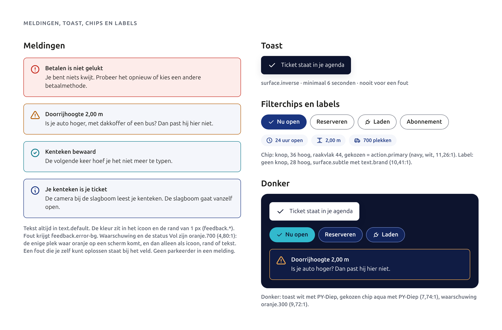

Meldingen: tekst in `text.default`, kleur in het icoon en een rand van 1 px rondom (besluit D10). Fout krijgt `feedback.error-bg`. Een fout die je zelf oplost staat bij het veld. Een toast (`surface.inverse`) is voor een bevestiging, nooit voor een fout, en blijft minstens 6 seconden staan (besluit D12). Filterchips zijn knoppen met `aria-pressed`; gekozen is `action.primary`. Labels zijn geen knoppen.

### Lege staat en foutscherm

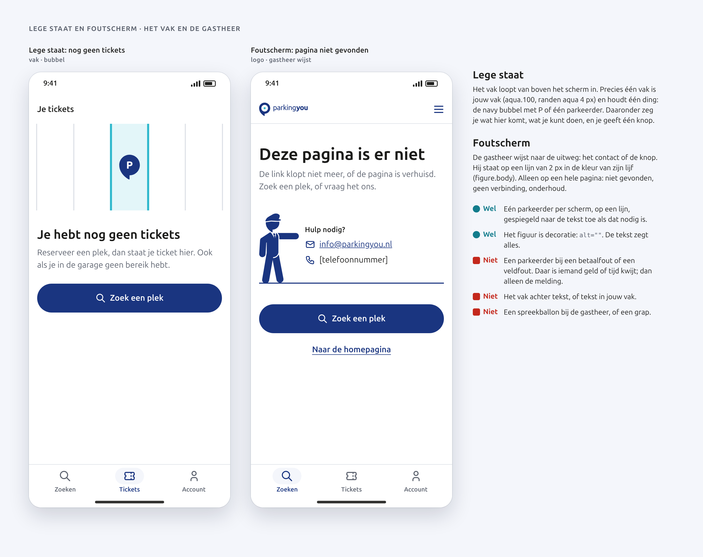

- **Lege staat.** Het vak loopt van boven in; jouw vak houdt de navy bubbel met P. Daaronder: wat komt hier ("Je hebt nog geen tickets"), wat kun je doen, en één knop.
- **Foutscherm.** Voor een hele pagina die niet bestaat, geen verbinding of onderhoud. De gastheer wijst naar het contact (info@parkingyou.nl, [telefoonnummer]) en staat op een lijn. Daaronder één hoofdknop en een link naar home.
- **Geen figuur bij een fout in een formulier of bij betalen.** Daar staat alleen de melding, rustig en concreet.

### Navigatie

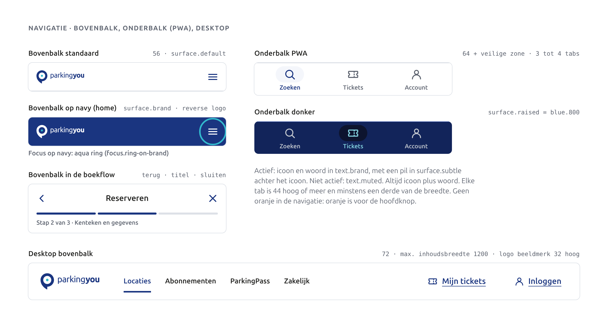

Telefoon: bovenbalk 56 met logo (beeldmerk minstens 24 hoog) en menu; in de boekflow de hoekige pijl terug, titel, sluiten en een voortgangsbalk in `action.primary-bg` met "Stap 2 van 3". De PWA heeft een onderbalk met drie tabs: Zoeken, Tickets, Account, altijd icoon plus woord. Desktop: balk 72, inhoud maximaal 1200 breed, de actieve link onderstreept in `text.brand`. Geen oranje in de navigatie.

## Hoofdschermen

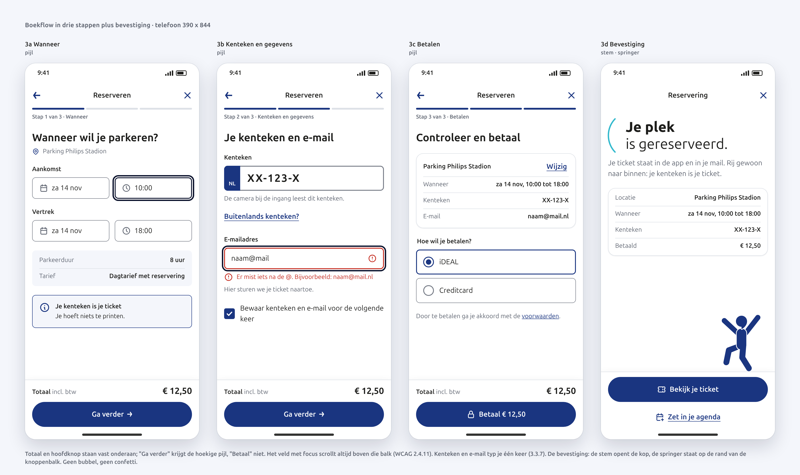

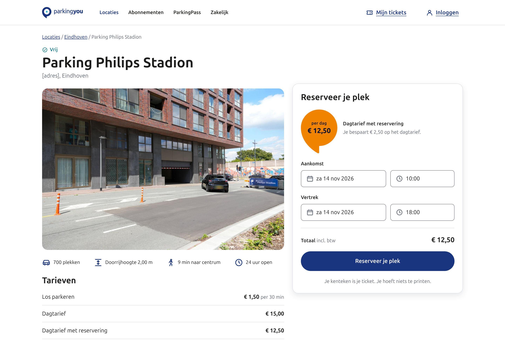

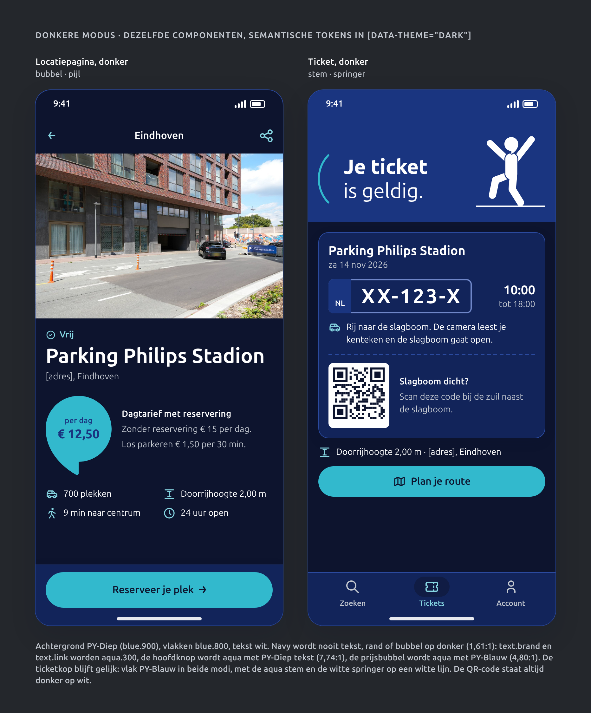

- **Home.** Navy kop met het logo, de stem voor "**Parkeren** zonder gedoe." en de zwaaier op de zoekkaart. Zoekkaart met waar en wanneer, navy knop "Zoek een plek", daaronder locatiekaarten.
- **Locatiepagina.** Foto, status, naam, adres, de navy prijsbubbel (dagtarief met reservering € 12,50), feiten (700 plekken, doorrijhoogte 2,00 m, 9 min naar centrum, 24 uur open), vaste knop "Reserveer je plek" met de pijl. Op desktop staat de boekkaart rechts in 5 van de 12 kolommen.
- **Boekflow.** Drie stappen: wanneer, kenteken en gegevens, betalen. Totaal en hoofdknop staan vast onderaan. "Ga verder" heeft de pijl, "Betaal € 12,50" een slotje.
- **Bevestiging.** De stem voor "**Je plek** is gereserveerd.", een korte samenvatting, de springer op de rand van de knoppenbalk, hoofdknop "Bekijk je ticket". In beweging: een harde knip van de loper naar de springer, geen bewegende armen; bij reduced motion staat de springer er meteen.
- **Ticket (PWA).** Een tab, dus zonder terugknop. Het vak als kop met de aqua bubbel in jouw vak, dan locatie en datum, kenteken groot, geldig van 10:00 tot 18:00, hoe je binnenkomt, een QR-code als reserve, doorrijhoogte en adres, navy knop "Plan je route". Het ticket moet zonder bereik werken: in de garage is vaak geen signaal.
- **Donkere modus.** Dezelfde schermen, alleen de semantische waarden wisselen. De prijsbubbel wordt aqua, de hoofdknop aqua. De ticketkop blijft PY-Blauw met het vak. De QR-code blijft donker op wit.

## Toegankelijkheid

Doel: WCAG 2.2 AA op elk scherm. Alle verhoudingen zijn doorgerekend met de WCAG-formule op de waarden in `tokens.json`.

| Criterium | Wat wij doen |
|---|---|
| 1.4.3 Contrast tekst | Alle semantische tekstparen halen 4,5:1 (`tokens/contrast.md`). Hoofdknop wit op blue.700 11,26:1, hover 8,15, ingedrukt 14,73; donker blue.900 op aqua.500 7,74, hover 9,17, ingedrukt 5,43. Tweede knop blue.700 op wit 11,26, hover 10,41, ingedrukt 9,52; donker aqua.300 op blue.900 11,01, hover 8,93, ingedrukt 10,01. Prijsbubbel wit op navy 11,26; donker blue.700 op aqua 4,80. Waarschuwing en Vol oranje.700 op wit 4,80. Status alleen op `surface.default` of `raised`: `status.full` op `surface.subtle` is 4,44:1 en faalt. |
| 1.4.11 Contrast UI | Veldrand `border.strong` 4,24:1 (licht) en 5,12:1 (donker). Rand van de tweede knop 11,26 (licht) en 11,01 (donker). Gekozen vinkje en voortgangsbalk navy op wit 11,26. Aqua bubbel in jouw vak op navy 3,48 tegen blue.600 en 4,80 tegen blue.700. Kaartpin navy 9,86 tegen een lichte kaartgrond (neutral.100), 11,26 tegen wit. `border.subtle` (1,31:1) en de lijnen van het vak (1,31:1 op wit) zijn decoratie, nooit de enige rand van iets dat je moet zien. |
| 1.1.1 Niet-tekstuele inhoud | De stem, de parkeerders en het vak zijn decoratie: `alt=""` of `aria-hidden`. De bubbel met een vinkje of prijs heeft een label ("Geldig", "per dag € 12,50"). De pijl in een knop is `aria-hidden`; de knop met alleen een pijl heeft `aria-label="Terug"`. |
| 2.4.7 Focus zichtbaar | Ring 3 px `focus.ring`, 2 px los; op navy en donker aqua. Nooit `outline: none` zonder vervanging. |
| 2.4.11 Focus niet bedekt | De vaste balk onderaan en een cookiebalk bedekken nooit het veld met focus: `scroll-padding-bottom` gelijk aan de balkhoogte. |
| 2.5.8 Doelgrootte | Wij gebruiken 44 x 44, ook voor icoonknoppen, de terugpijl, tabs en chips (chip 36 zichtbaar, raakvlak 44). Alleen een link in lopende tekst is uitgezonderd. |
| 2.3.3 Animatie (AAA, doen we toch) | De bubbel pop en de knip van de parkeerder volgen `prefers-reduced-motion`: dan een fade van 120 ms of geen beweging. |
| 3.3.7 Dubbele invoer | Kenteken en e-mail typ je één keer. Stap 3, de bevestiging en het ticket nemen ze over. Met jouw akkoord bewaren we ze voor de volgende keer. |
| 3.3.8 Toegankelijk inloggen | Geen puzzel of overtypen van tekens. Inloggen met een link in je mail of een passkey. Plakken en wachtwoordmanagers werken; `autocomplete="email"` en `one-time-code`. |

Verder: een fout heeft `aria-invalid` en `aria-describedby`, de toast `role="status"`, de pagina werkt bij 320 px breed en 200 procent tekst.

**EAA.** Sinds 28 juni 2025 houdt de ACM toezicht op de Europese toegankelijkheidsregels voor websites en apps waarmee je een dienst koopt of reserveert, bij bedrijven met meer dan 10 medewerkers of meer dan € 2 miljoen omzet ([ACM](https://www.acm.nl/en/publications/acm-calls-businesses-prepare-themselves-new-rules-regarding-accessibility-websites-and-apps)). Boeken en betalen van parkeren valt daaronder (aanname, juridisch te bevestigen). EN 301 549 v4.1.1 neemt WCAG 2.2 AA over ([Deque](https://www.deque.com/blog/en-301-549-v4-1-1-is-final-what-changed-what-it-means-and-what-you-should-do/)). Dit geldt ook voor de boekschermen van Aeroparker: wie dat deel bouwt, moet aan dezelfde lat voldoen. Publiceer een toegankelijkheidsverklaring.

## UX-tekst

Altijd je en jij, korte zinnen, geen uitroeptekens bij fouten, geen emoji.

| Soort | Regel | Wel | Niet |
|---|---|---|---|
| Knop | Werkwoord eerst, zeg wat er gebeurt | Reserveer je plek · Betaal € 12,50 · Plan je route | Verzenden · OK · Klik hier · Doorgaan naar betaalpagina |
| Fout | Wat is er mis, en hoe los je het op | Je vertrektijd ligt voor je aankomst. Kies een tijd na 10:00. | Ongeldige invoer! · Fout 422 |
| Fout kenteken | Concreet, met voorbeeld | Dit kenteken is te kort. Een Nederlands kenteken heeft 6 letters en cijfers. | Kenteken onjuist |
| Betaalfout | Geruststellen, dan de stap | Betalen is niet gelukt. Je bent niets kwijt. Probeer het opnieuw. | Transactie mislukt |
| Bevestiging | Zeg wat er nu geregeld is | Je plek is gereserveerd. Rij gewoon naar binnen: je kenteken is je ticket. | Gefeliciteerd! · Bestelling geplaatst |
| Lege staat | Wat komt hier, wat kun je doen, één knop | Je hebt nog geen tickets. Reserveer een plek, dan staat je ticket hier. | Geen data gevonden |
| Foutscherm | Wat is er, en waar kun je heen | Deze pagina is er niet. Zoek een plek, of vraag het ons. | 404 Not Found · Oeps! |
| Geen resultaat | Geef een uitweg | Geen plek vrij op deze tijd. Kies een andere tijd of kijk in de buurt. | 0 resultaten |

Prijzen als "€ 12,50", tijden als "10:00 tot 18:00", datums als "za 14 nov 2026".

## Open punten

- Adres van Parking Philips Stadion, live beschikbaarheid, servicekosten en het algemene telefoonnummer zijn nog onbekend en staan als [placeholder].
- `status.full` is oranje.700, dezelfde waarde als `feedback.warning`. Wij houden het als tekst en icoon, zoals een waarschuwing. Als oranje op het scherm helemaal weg moet, kan Vol `text.default` met het streep-icoon worden (16,88:1); dat is een keuze voor de core spec.
- Welke schermen van Aeroparker kunnen we stylen, en ondersteunt de PWA een ticket zonder bereik?
- De terugpijl op hoofdletterhoogte van de titel is 11 px. Dat volgt de regel, maar is klein naast iconen van 24. Testen met gebruikers; zie Voorgestelde waarden.

## Voorgestelde waarden

Goedgekeurd: zie besluiten D4 tot en met D14 en D35 in de core spec. De tabel blijft als uitleg.

| Waarde | Voorstel | Reden |
|---|---|---|
| Het vak op scherm | u = 48 px (de steek van 72 px is 1,5u); lijnen 144 tot 192 px lang (3u tot 4u); jouw vak randen 4 px (dubbele lijn); streep van de rijbaan 14 px, tussenruimte 12 px | De core spec geeft voor scherm alleen de steek en de lijndikte. Zonder u is de lengte van de lijnen niet te bepalen. |
| Lijn onder een parkeerder op scherm | 2 px (`size.border-width-strong`) in `figure.body` | "Een lijn van 0,1u" geeft op scherm 4,8 px; dat wordt een balk. 2 px past bij de randen van de UI en volgt de kleur van het lijf, licht en donker. |
| `action.secondary-border` | Nieuw semantisch token, gelijk aan `action.secondary-fg` (licht blue.700, donker aqua.300) | De tweede knop is nu een omlijning. Een eigen naam voorkomt dat code de tekstkleur als rand leest en houdt de rand los aanpasbaar. |
| Terugpijl in een icoonknop | 16 px (icoonmaat uit de core spec) in plaats van 11 px | Een pijl zonder label heeft geen hoofdletter naast zich. 16 px weegt even zwaar als de iconen van 24 met hun veilige zone. |

## Do's en don'ts

| Do | Don't |
|---|---|
| Eén navy hoofdknop per scherm, met witte tekst | Twee hoofdknoppen, of een oranje knop, prijs of bubbel op een scherm |
| Tweede knop omlijnd: wit, rand en tekst 2 px PY-Blauw | Een navy knop op een navy vlak; gebruik daar de donkere action-waarden |
| De hoekige pijl op hoofdletterhoogte bij een volgende stap of richting | Een chevron, een pijl uit de iconenset, een pijl in een cirkel of bubbel |
| De stem voor de kop van home en de bevestiging | De stem voor elke kop, of rechts van de tekst |
| Eén parkeerder per scherm, staand op een lijn, bij welkom, bevestiging of een foutscherm | Een parkeerder bij een betaalfout, zwevend, gedraaid of met een spreekballon |
| Het vak als kop van ticket of lege staat, één jouw vak met één bubbel of figuur | Het vak achter tekst, of meer dan één jouw vak |
| Per scherm het logo plus hooguit twee eigen elementen | Alle vijf elementen op één scherm |
| Eén bubbel per scherm, rechtop, voor prijs, niveau, beschikbaarheid of een geldig ticket | De bubbel als knop, avatar of in elke kaart (de kaartpin is de enige uitzondering) |
| Status als woord, kleur en icoon | Een gekleurde stip zonder woord |
| Label boven het veld, fout eronder in woorden | Alleen een rode rand, of een placeholder als label |
| Componenten lezen semantische tokens | Hexwaarden of primitieven in een component |
| Raakvlak 44 x 44 | Icoonknoppen of chips kleiner dan 44 |
| QR-code donker op wit, ook in donkere modus | QR-code in aqua of op navy |
