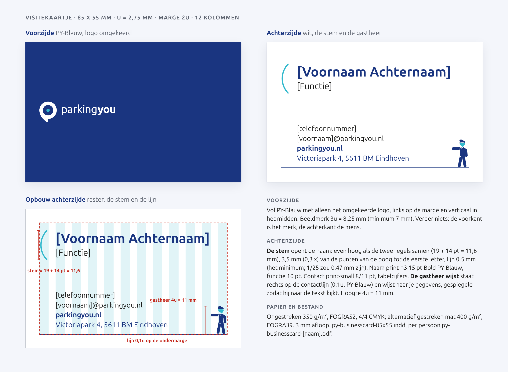
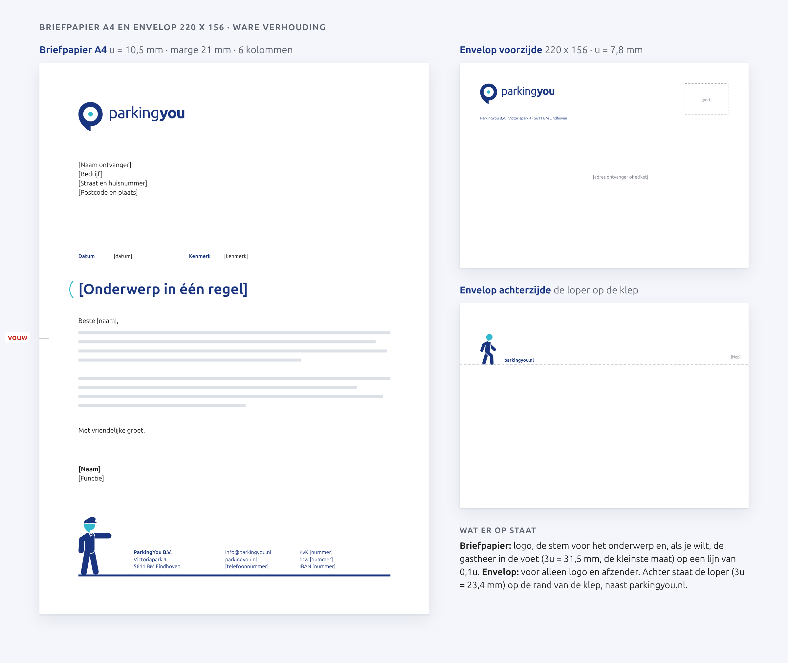
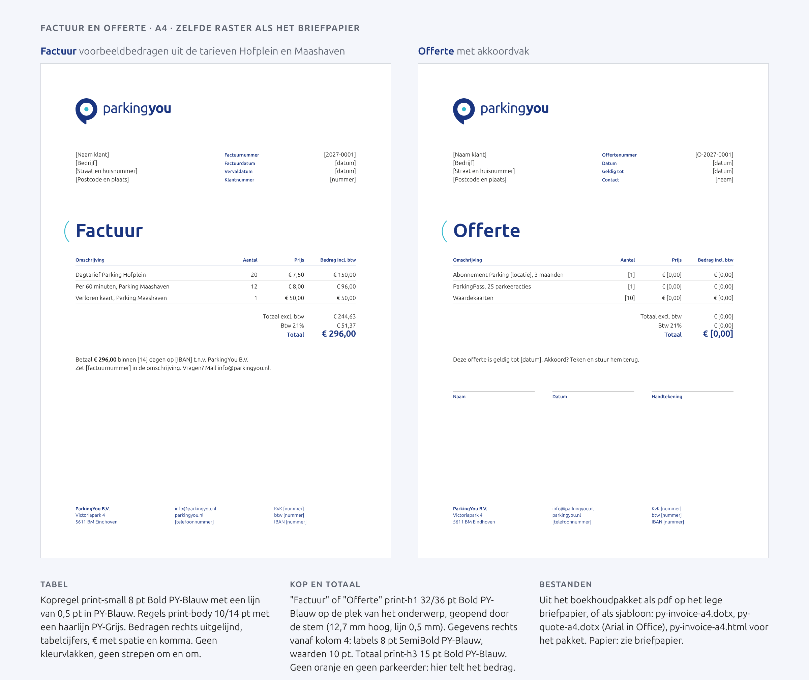
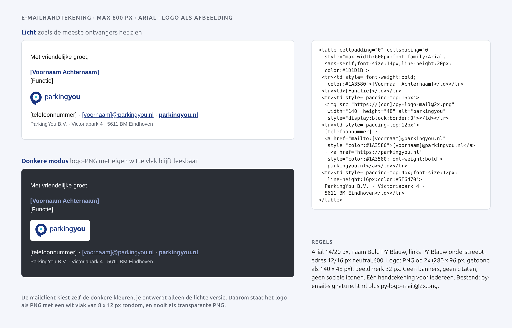

# Drukwerk en kantoor

Dit hoofdstuk gaat over alles wat we op papier en in de mail meesturen: visitekaartje, briefpapier, factuur, offerte, envelop en e-mailhandtekening. Het zijn kleine dingen, maar klanten, garage-eigenaren en leveranciers zien ze elke week. Ze moeten er net zo rustig en herkenbaar uitzien als een bord in de garage, en net zo duidelijk van ons zijn.

De basis is kort. Wit papier, PY-Blauw voor het merk en de koppen, Ubuntu Sans uit de printschaal, en het raster van de format unit u (korte zijde gedeeld door 20). Oranje komt in dit hoofdstuk niet voor: oranje is voor betalen in de garage, en een factuur is geen automaat.

Wat het drukwerk van ons maakt, zijn twee van onze eigen elementen:

- **De stem.** De halve boog opent een boodschap: je naam op het visitekaartje, het onderwerp van een brief, het woord "Factuur". Hij staat links van de tekst, is zo hoog als de regels die hij opent en staat op 0,3 x zijn hoogte van de eerste letter, gemeten vanaf de punten van de boog.
- **De gastheer.** Een parkeerder met pet, die naar je gegevens wijst. Hij staat op de achterkant van het visitekaartje en, als je wilt, in de voet van het briefpapier. Altijd op een lijn, nooit zwevend.

Per vlak gebruiken we het logo plus hooguit deze twee. Geen bubbel, geen vak en geen pijl op kantoordrukwerk.

## De set in één tabel

| Onderdeel | Formaat | u | Marge | Elementen | Papier | Profiel |
|---|---|---|---|---|---|---|
| Visitekaartje | 85 x 55 mm | 2,75 mm | 5,5 mm | voor: logo; achter: de stem en de gastheer | ongestreken 350 g/m² (voorkeur) of gestreken mat 400 g/m² | FOGRA52 of FOGRA39 |
| Briefpapier | A4, 210 x 297 mm | 10,5 mm | 21 mm | logo, de stem, de gastheer in de voet (mag) | ongestreken houtvrij 100 tot 120 g/m², laserbestendig | FOGRA52 |
| Factuur en offerte | A4 | 10,5 mm | 21 mm | logo, de stem | als briefpapier, of pdf | FOGRA52 |
| Envelop | 220 x 156 mm (bestaand) | 7,8 mm | 15,6 mm | voor: logo; achter: de loper | ongestreken 100 tot 120 g/m² | FOGRA52 |
| E-mailhandtekening | max 600 px | n.v.t. | n.v.t. | logo, de stem | n.v.t. | sRGB |

Alle drukwerk in CMYK met 3 mm afloop. Logo's en figuren als bestand, nooit nagetekend.

## Kleur in drukwerk

| Kleur | HEX | CMYK | Gebruik in dit hoofdstuk |
|---|---|---|---|
| PY-Blauw | #1A3580 | 100 83 0 17 | logo, namen, koppen, voet, de lijn onder de gastheer, het lijf van de parkeerder, vol vlak op de voorkant van het kaartje |
| PY-Aqua | #32B9CD | 69 0 21 0 | de stem, het hoofd van de parkeerder, de stip in het logo |
| PY-Zwart | #1D1D1B | 0 0 0 100 | lopende tekst |
| PY-Grijs | #AEAEAE | 0 0 0 42 | haarlijnen in tabellen, vouwteken |
| Wit | #FFFFFF | papier | grond |

PY-Aqua is hier nooit tekst: aqua op wit haalt het contrast niet. Als lijn en als hoofd van de parkeerder is het een accent, en zo gebruiken we het.

Op ongestreken papier (FOGRA52) zakt PY-Blauw in en wordt het iets doffer. Dezelfde CMYK-waarde geeft op gestreken papier (FOGRA39) een vollere navy. Kies per product één papier en laat de drukker een proef draaien naast de huidige visitekaartjes.

## Visitekaartje

85 x 55 mm, liggend, 12 kolommen. u = 2,75 mm, marge 2u = 5,5 mm, tussenruimte 1u.

**Voorzijde.** Vol PY-Blauw met alleen het omgekeerde logo, links op de marge en verticaal in het midden. Het beeldmerk is 3u = 8,25 mm hoog, boven het minimum van 7 mm. Verder niets. De voorkant is het merk.

**Achterzijde.** Wit. De achterkant is de mens.

- **Naam en functie.** Naam in print-h3 15/19 pt Bold PY-Blauw, functie in print-body 10/14 pt PY-Zwart, links op kolom 2.
- **De stem** opent naam en functie. Hoogte = de twee regels samen, 19 + 14 pt = 11,6 mm. Afstand van de punten van de boog tot de eerste letter 0,3 x 11,6 = 3,5 mm. De lijn is 1/25 van de hoogte, maar nooit dunner dan 0,5 mm; hier dus 0,5 mm. De stem hangt in kolom 1, de tekst begint op kolom 2.
- **Contact** in print-small 8/11 pt: telefoon, e-mail, site (Bold PY-Blauw) en adres (PY-Blauw). Tabelcijfers in telefoonnummers.
- **De contactlijn.** Op de ondermarge loopt een lijn van 0,1u (0,28 mm) in PY-Blauw over de volle breedte.
- **De gastheer wijst** staat rechts op die lijn, 4u = 11 mm hoog, gespiegeld zodat hij naar je gegevens wijst. Navy lijf, aqua hoofd.

Vaste gegevens uit de repository: ParkingYou B.V., Victoriapark 4, 5611 BM Eindhoven, info@parkingyou.nl, parkingyou.nl. Naam, functie, telefoonnummer en persoonlijk e-mailadres zijn velden: [Voornaam Achternaam], [Functie], [telefoonnummer], [voornaam]@parkingyou.nl.

## Briefpapier en envelop

A4 staand, 6 kolommen van 19,25 mm met 10,5 mm tussenruimte, marge 21 mm.

- **Logo** in kleur linksboven, beeldmerk 1,5u = 15,75 mm hoog.
- **Adresvak** op 4,5u (47,25 mm) van boven, 84 x 42 mm. Zo past de brief later ook in een vensterenvelop.
- **Datum en kenmerk** op 10u van boven: labels print-small 8 pt SemiBold PY-Blauw, waarden 8 pt.
- **Onderwerp** in print-h2 22/26 pt Bold PY-Blauw, één regel. **De stem** opent het onderwerp: 26 pt = 9,2 mm hoog, lijn 0,5 mm, 2,8 mm tot de eerste letter. De stem hangt in de marge, zodat de tekst op de marge blijft.
- **Lopende tekst** in print-body 10/14 pt, PY-Zwart, links uitgelijnd, nooit uitgevuld.
- **Voet** in print-small 8/11 pt PY-Blauw, drie blokken: adres, contact, en KvK, btw en IBAN. Daaronder een voetlijn van 0,1u (1,05 mm) in PY-Blauw op de ondermarge.
- **De gastheer in de voet** mag, hoeft niet. Hij staat links op de voetlijn, 3u = 31,5 mm hoog (de kleinste maat), en wijst naar de gegevens. Gebruik hem op brieven aan klanten; laat hem weg op juridische en financiële brieven.
- **Vouwteken** op 148,5 mm in PY-Grijs. De brief gaat één keer dubbelgevouwen in de envelop van 220 x 156.

In Word werkt het briefpapier met Arial: 10 pt tekst, 22 pt Bold onderwerp. Logo, stem, voet en gastheer staan vast in de kop- en voettekst van het sjabloon, zodat niemand ze kan verschuiven. De stem staat in het sjabloon als vaste afbeelding naast de onderwerpregel.

**Envelop.** De envelop van 220 x 156 mm blijft, het is een bestaand formaat. u = 7,8 mm, marge 15,6 mm. Voorzijde: linksboven het logo in kleur met beeldmerk 2u = 15,6 mm, daaronder de afzender op één regel in print-small PY-Blauw. Rechtsboven blijft het portvak vrij, rechtsonder het vak voor adres of etiket; daar komt niets van ons. Achterzijde: op de rand van de klep loopt de loper, 3u = 23,4 mm, met parkingyou.nl ernaast. Zo zie je ook aan de achterkant van wie de brief komt.

Het huidige bestand is RGB en zegt PDF/X-1a te zijn. Het nieuwe bestand is echt CMYK, PDF/X-4 of X-1a, zonder snijtekens; die zet de drukker.

## Factuur en offerte

Zelfde raster, logo en voet als het briefpapier, zonder gastheer: op een factuur telt het bedrag.

**Kop.** "Factuur" of "Offerte" in print-h1 32/36 pt Bold PY-Blauw, op de plek van het onderwerp, geopend door de stem (36 pt = 12,7 mm hoog, lijn 0,5 mm).

**Gegevensblok.** Klantadres links in het adresvak. Rechts, vanaf kolom 4, de labels in 8 pt SemiBold PY-Blauw (Factuurnummer, Factuurdatum, Vervaldatum, Klantnummer) met de waarden rechts uitgelijnd in 10 pt. Voor de offerte: Offertenummer, Datum, Geldig tot, Contact.

**Tabel.** Kolommen Omschrijving, Aantal, Prijs, Bedrag incl. btw. Kopregel in print-small 8 pt Bold PY-Blauw met een lijn van 0,5 pt in PY-Blauw eronder. Regels in print-body 10/14 pt met een haarlijn van 0,25 pt in PY-Grijs. Getallen rechts uitgelijnd met tabelcijfers, zodat de komma's onder elkaar staan. Bedragen als € 50,00: spatie na het euroteken, komma, nooit ",-". Geen gekleurde rijen, geen oranje bedragen.

**Totaal.** Totaal excl. btw en btw in 10 pt, het totaal in print-h3 15 pt Bold PY-Blauw. Daaronder één betaalzin: "Betaal € [bedrag] binnen [14] dagen op [IBAN] t.n.v. ParkingYou B.V. Zet [factuurnummer] in de omschrijving."

De voorbeeldfactuur rekent met echte tarieven: dagtarief Parking Hofplein € 7,50, per 60 minuten Parking Maashaven € 8,00 en verloren kaart € 50,00. De offerte laat de producten zien (Abonnement, ParkingPass, Waardekaarten) met bedragen als [placeholder]. Onder de offerte staat een akkoordvak met Naam, Datum en Handtekening.

Komt de factuur uit een boekhoudpakket, dan leveren we een html- of Word-sjabloon met dezelfde maten en de stem als vaste afbeelding. Kan het pakket geen eigen letter, dan Arial.

## E-mailhandtekening

Eén handtekening voor iedereen, gebouwd als html-tabel met inline stijl, maximaal 600 px breed.

- Arial 14/20 px. Naam Bold in PY-Blauw, functie in PY-Zwart.
- **De stem** opent naam en functie: 2 x 20 px = 40 px hoog, 12 px tot de eerste letter, lijn 1,6 px. Hij staat als PNG op 2x (18 x 80 px, getoond als 9 x 40 px) in PY-Aqua op een transparante grond; aqua blijft zichtbaar in lichte en donkere modus.
- Logo als PNG op 2x (280 x 96 px, getoond als 140 x 48 px) met een eigen wit vlak van 8 x 12 px rondom het logo. Een transparante logo-PNG verdwijnt in donkere modus.
- Daaronder telefoon, e-mail en site op één regel; links in PY-Blauw, onderstreept, de site Bold.
- Bedrijfsregel in 12/16 px, neutral.600 (5,94:1 op wit).
- Geen banners, geen citaten, geen sociale iconen, geen parkeerder, geen tweede logo. Alt-tekst van het logo: "parkingyou"; de stem heeft een lege alt-tekst.

Logo en stem staan op een vaste url (de site of een cdn), niet als bijlage.

## Bestanden en sjablonen

| Bestand | Wat |
|---|---|
| py-businesscard-85x55.indd en .idml | sjabloon visitekaartje, voor en achter, met velden, stem en gastheer vast |
| py-businesscard-[naam].pdf | drukbestand per persoon, CMYK, 3 mm afloop |
| py-letterhead-a4.indd en py-letterhead-a4-print.pdf | voorbedrukt briefpapier, met en zonder gastheer |
| py-letterhead-a4.dotx | Word-sjabloon met Arial, logo, stem en voet vast |
| py-invoice-a4.dotx en py-invoice-a4.html | factuur, voor Word en voor het boekhoudpakket |
| py-quote-a4.dotx | offerte met akkoordvak |
| py-envelope-220x156.pdf | envelop voor en achter, CMYK |
| py-email-signature.html | handtekening, inline stijl |
| py-logo-mail@2x.png | logo voor mail, 280 x 96 px met wit vlak |
| py-stem-mail@2x.png | de stem voor mail, 18 x 80 px, PY-Aqua, transparant |
| py-figure-cap-point-duo.svg | de gastheer wijst, uit de kit, voor kaartje en briefpapier |

De maten van adresvak, vouwteken, gegevensblok, mail-logo en papier zijn eerder goedgekeurd (besluit D28) en blijven staan.

## Open vragen

- KvK-nummer, btw-nummer, IBAN en een algemeen telefoonnummer staan niet in de repository. Nu staan ze als [placeholder].
- De bedrijfsnaam staat als "ParkingYou BV" op het oude briefpapier en als "ParkingYou B.V." elders. Wij gebruiken ParkingYou B.V.; graag bevestigen.
- CMYK van PY-Blauw voor ongestreken papier (FOGRA52): de drukker converteert; tot die tijd 100 83 0 17 en beoordelen op een proef.
- Willen we de gastheer standaard in de voet van het briefpapier, of alleen op brieven aan klanten?
- Gaat de brief ooit in een vensterenvelop? Dan maken we een tweede envelop, het adresvak staat al goed.

## Do's en don'ts

**Doen**
- Gebruik het logo uit de bestanden, in kleur op wit en omgekeerd op PY-Blauw.
- Open de naam, het onderwerp of het woord "Factuur" met de stem, zo hoog als de regels die hij opent, met 0,3 x die hoogte tot de eerste letter.
- Zet de gastheer altijd op een lijn: de contactlijn op het kaartje, de voetlijn op de brief. Laat hem naar de gegevens wijzen.
- Zet tekst in PY-Zwart of PY-Blauw. Koppen en namen in PY-Blauw.
- Gebruik tabelcijfers en rechts uitgelijnde bedragen in elke tabel. Schrijf bedragen als € 12,50.
- Houd de marge van 2u aan, ook in Word. Laat een drukproef maken op het gekozen papier.

**Niet doen**
- Geen oranje op briefpapier, factuur, offerte, envelop of handtekening.
- Geen stem rechts van de tekst, geen tweede stem die de zin afsluit, geen stem dunner dan 0,5 mm.
- Geen zwevende of afgesneden parkeerder, en nooit meer dan één per vlak. Geen parkeerder op factuur, offerte of in de mail.
- Geen bubbel, geen vak en geen pijl op kantoordrukwerk.
- Geen verloop, schaduw of foto op het briefpapier.
- Geen tekst in PY-Aqua op wit, geen tweede blauw: de oude adresregel in CMYK 100 85,5 22,3 4 vervalt.
- Geen eigen lettertype in Word of mail: Ubuntu Sans in drukwerk, Arial in Office en mail.
