# Toepassingen

Dit hoofdstuk laat zien hoe het systeem werkt waar klanten ons tegenkomen: in de garage, op de automaat, op de pas, in hun feed en mailbox, en op de bus en de jas van onze mensen. Alles komt uit dezelfde bouwstenen: PY-Blauw, de drie taakkleuren, Ubuntu Sans, de format unit u en de bubbel.

Twee regels sturen bijna elke beslissing hieronder:

- **Kleur betekent iets.** Navy is rijden en het merk, aqua is lopen, oranje is betalen en let op.
- **Letterhoogte volgt de leesafstand.** Op borden is de kaphoogte 10 mm per meter leesafstand, met 12 mm als minimum. Fontgrootte = kaphoogte / 0,693.

Alle borden hebben een **mat** laminaat of een matte afwerking. Geen verloop in de garage, geen schaduw op merkvormen.

## De bordenfamilie

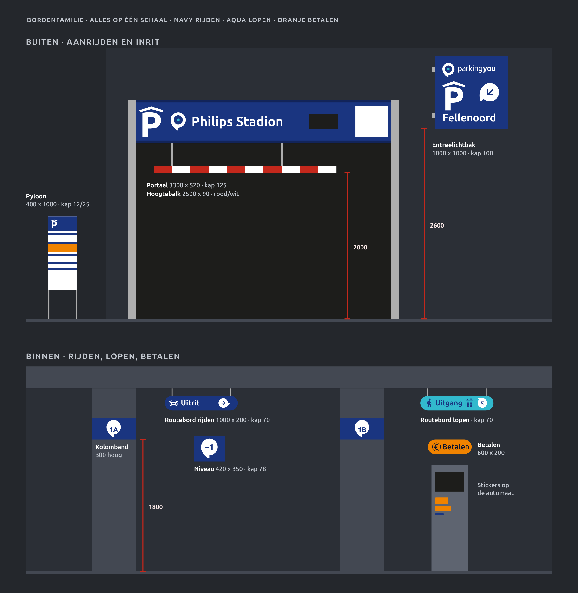

Buiten werken de P met dak en de locatienaam op afstand. Binnen wijzen navy borden de auto de weg, aqua borden de voetganger, en oranje staat alleen bij de automaat en de tarieven. Maten komen uit het handboek, tenzij anders vermeld.

| Bord | Maat (mm) | u (mm) | Kaphoogte grootste tekst | Leesafstand | Overige maten | Materiaal en afwerking | Kleur |
|---|---|---|---|---|---|---|---|
| Entreelichtbak | 1000 x 1000 x 100 | 50 | 100 (font 144) | 10 m | beeldmerk 200, P met dak 400, bubbel 5u | opaal beeldplaat met blockoutfolie, LED, profiel RAL 5002, mat | navy front, wit, witte bubbel |
| Portaal 1-baans | plaat 520 (luxe) of 500 (standaard) x breedte rijstrook | 26 | 125 (font 180) | 12,5 m | beeldmerk 250, P met dak 416 | aluminium 2 mm met folie en mat laminaat, of heldere plaat met blockout en LED | navy, wit |
| Hoogtebalk | 2000, 2500 of 3000 x 90 | 4,5 | 40 (font 58) | 4 m | banden 250 | aluminium RAL 9010, rode folie 3M 580-72, zwarte retroreflecterende letters | rood en wit, geen merkkleur |
| Routebord rijden | 200 x 600, 800 of 1000, radius 100 | 10 | 70 (font 101) | 7 m | pictogram 120, bubbel 13u (8u bij pijl omhoog of omlaag) | sandwichpaneel, full colour folie, mat laminaat | PY-Blauw, wit |
| Routebord lopen | 200 x 1000 | 10 | 70 (font 101) | 7 m | als rijden | als rijden | PY-Aqua, PY-Blauw, witte bubbel |
| Bord betaalautomaat | 200 x 600 | 10 | 70 (font 101) | 7 m | pictogram 120 | als rijden | PY-Oranje, PY-Diep |
| Niveauaanduiding | 420 x 350 | 17,5 | 78 (font 112) | 7,8 m | bubbel 13u = 227,5 | sandwichpaneel op kern RAL 9006, mat | navy, witte bubbel, cijfer PY-Blauw |
| Kolomband sectie | 300 x omtrek kolom | 15 | 66 (font 95) | 6,5 m | bubbel 13u = 195, één per vlak | muurfolie, UV-print, mat laminaat | navy, witte bubbel |
| Pyloon voorzijde | 400 x 1000 | 20 | 25 (font 36) naam, 12 (font 17) rest | 2,5 m en 1 m | P met dak 120, kopbalken 30 | sandwichpaneel, folie, mat; RVS staanders RAL 9006 | navy, wit, oranje strook |
| Tariefstrook (deelfolie) | 110 x 400 | 5,5 | 12 (font 17) | 1 m | vier regels, steek 22 | folie, mat laminaat | PY-Oranje, PY-Diep |

## Entreelichtbak

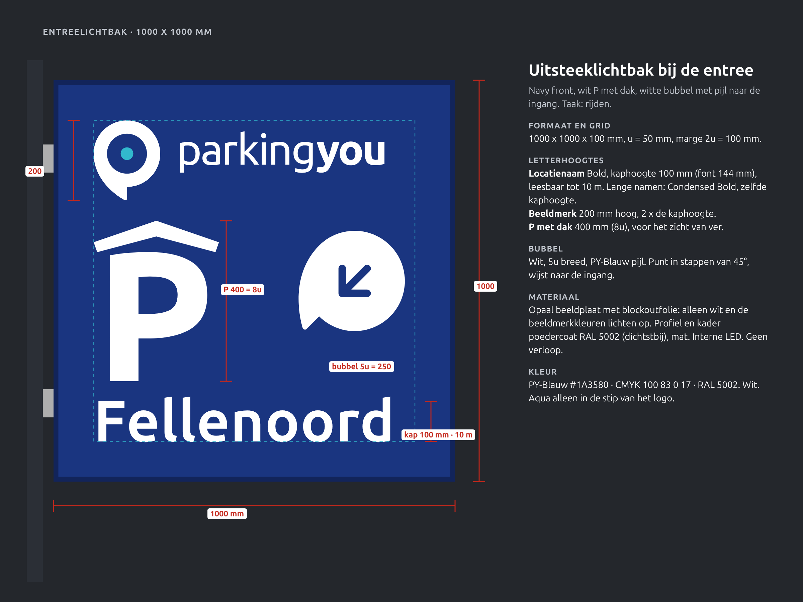

De lichtbak bij de entree is het eerste dat je van ons ziet. Het front blijft navy; alleen wit en de kleuren van het beeldmerk lichten op. Bovenaan het omgekeerde logo, met een beeldmerk van 200 mm: twee keer de kaphoogte van de locatienaam. In het midden de P met dak, 400 mm hoog, voor het zicht van ver. Daarnaast een witte bubbel van 5u met een pijl in PY-Blauw; de punt wijst in stappen van 45° naar de ingang, de pijl wijst mee. Onderaan de locatienaam in Bold met een kaphoogte van 100 mm, leesbaar tot 10 m. Past een naam niet binnen de marge van 2u, gebruik dan Condensed Bold met dezelfde kaphoogte.

De lichtbak hangt haaks op de gevel, onderkant minimaal 2500 mm boven de grond.

## Portaal en hoogtebalk

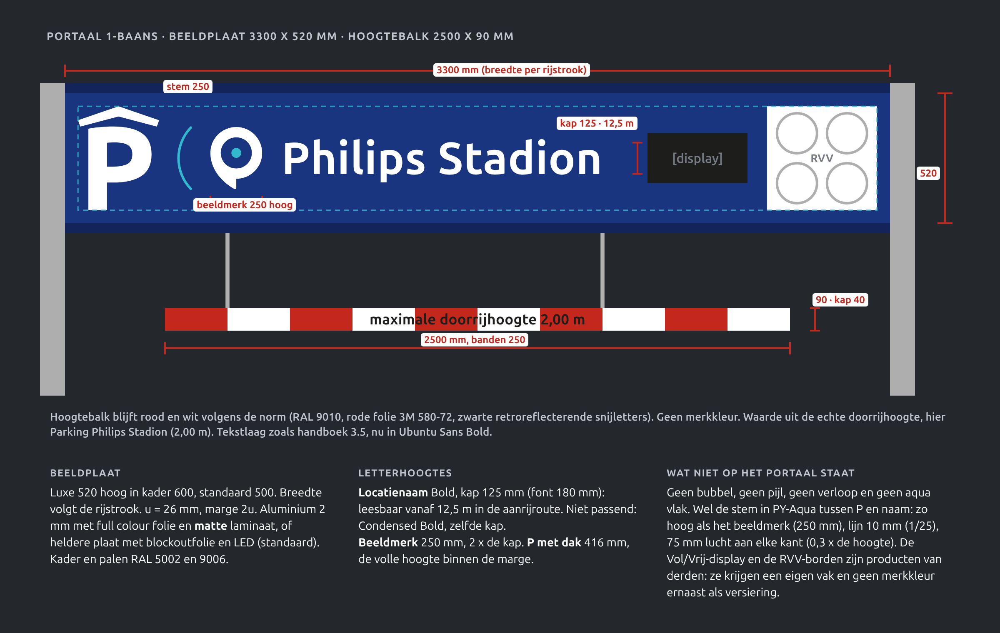

Het portaal leest de bestuurder in de aanrijroute, dus van verder weg: kaphoogte 125 mm, 12,5 m. Het beeldmerk staat los, 250 mm hoog; het volledige logo staat al op de lichtbak. Het oude aqua P-blok met de gebogen rand verdwijnt: het portaal is helemaal navy met een witte P met dak. De Vol/Vrij-display en de RVV-borden zijn producten van derden. Ze krijgen een eigen vak en nooit een merkkleur ernaast als versiering.

De hoogtebalk blijft rood en wit zoals de norm vraagt, met de echte doorrijhoogte van de garage, hier Parking Philips Stadion met 2,00 m. Alleen de letter wordt Ubuntu Sans Bold.

## Routeborden

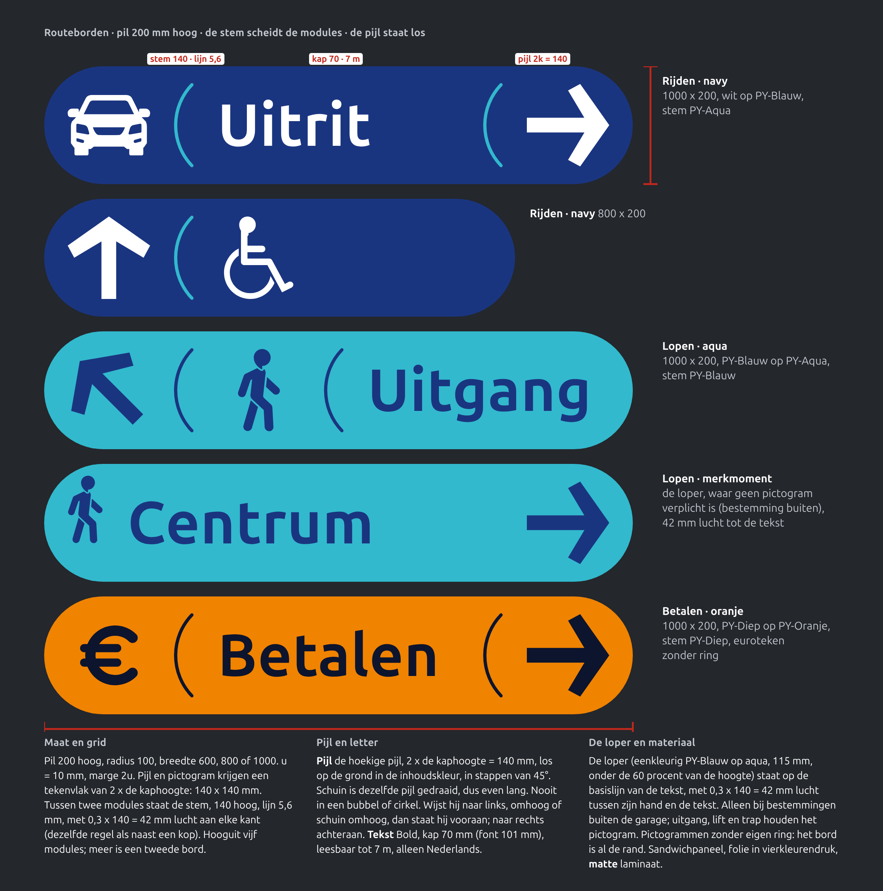

Het routebord blijft een pil van 200 mm hoog. Nieuw is dat de kleur de taak draagt: navy voor de auto, aqua voor de voetganger, oranje bij de automaat. Tekst en pictogrammen staan in de vaste kleurparen: wit op navy, PY-Blauw op aqua, PY-Diep op oranje. De pijl zit in een witte bubbel van 13u, met de punt in de looprichting. Voor een pijl omhoog of omlaag gebruik je 8u, anders valt de punt buiten de marge.

Een tweetalige tekst past niet op 200 mm bij 70 mm kaphoogte. Routeborden zijn daarom Nederlands met pictogrammen; Engels staat op pyloon, stickers en de borden waar je stilstaat.

## Niveau en sectie

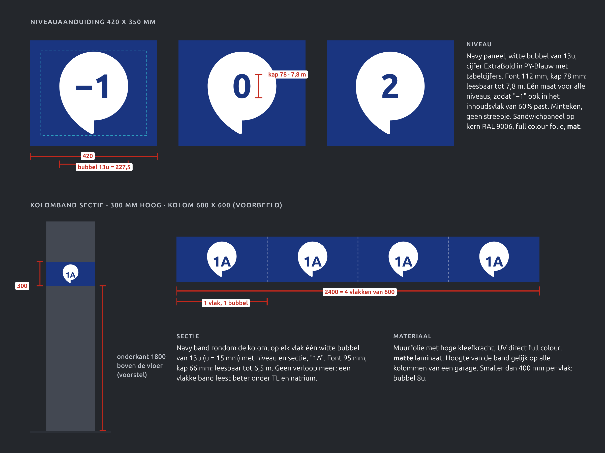

Het niveau staat in een witte bubbel van 13u op een navy paneel. Eén maat voor alle niveaus (font 112 mm, kap 78 mm), zodat ook "−1" in het inhoudsvlak van 60 procent past. Gebruik een minteken, geen streepje.

De kolomband wordt een vlakke navy band met op elk kolomvlak één witte bubbel met niveau en sectie, "1A". Het oude verloop met wit op aqua verdwijnt.

## Pyloon en tariefstrook

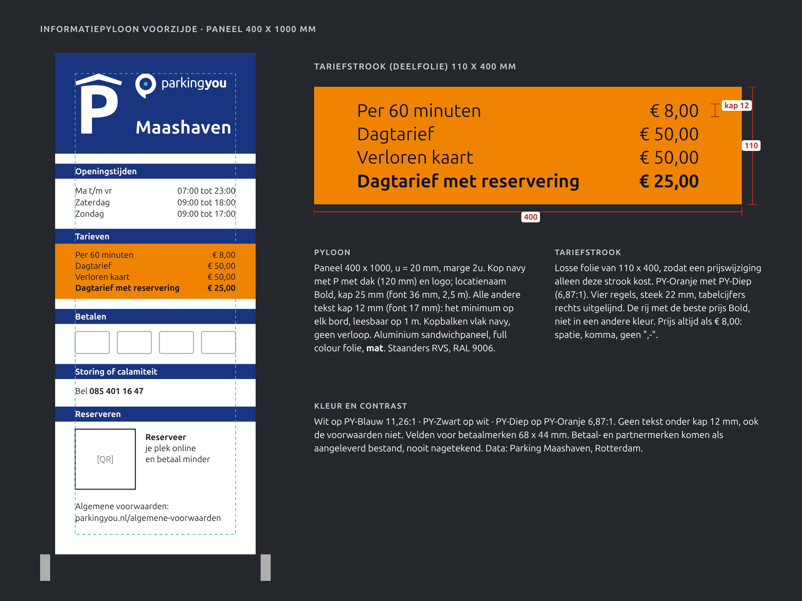

Alles op de pyloon staat op het minimum van 12 mm kaphoogte, behalve de locatienaam. De kopbalken zijn vlak navy. De tarieven staan op een losse oranje folie van 110 x 400 mm: verandert een prijs, dan vervang je alleen die strook. De rij met de beste prijs is Bold, niet in een andere kleur. Betaal- en partnermerken komen als aangeleverd bestand in vakken van 68 x 44 mm.

Voorbeelddata: Parking Maashaven, Rotterdam (openingstijden, tarieven en de QR naar de locatiepagina).

## Betalen: automaat en stickers

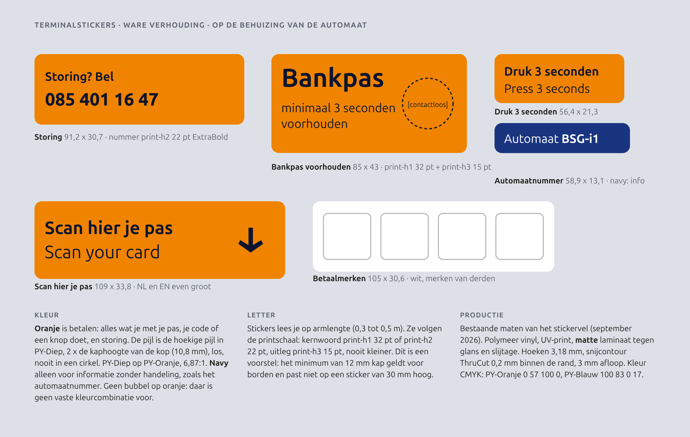

Op de automaat is oranje de kleur van alles wat je doet: pas voorhouden, code scannen, knop indrukken, en storing. Het automaatnummer is informatie en blijft navy. De stickers houden hun bestaande maten van het stickervel. Op oranje staat geen bubbel: daar is geen vaste kleurcombinatie voor.

Stickers lees je op armlengte. Ze volgen de printschaal (32, 22 en 15 pt) in plaats van het bordminimum van 12 mm. Dat is een voorstel, zie hieronder.

## Posters en stickers

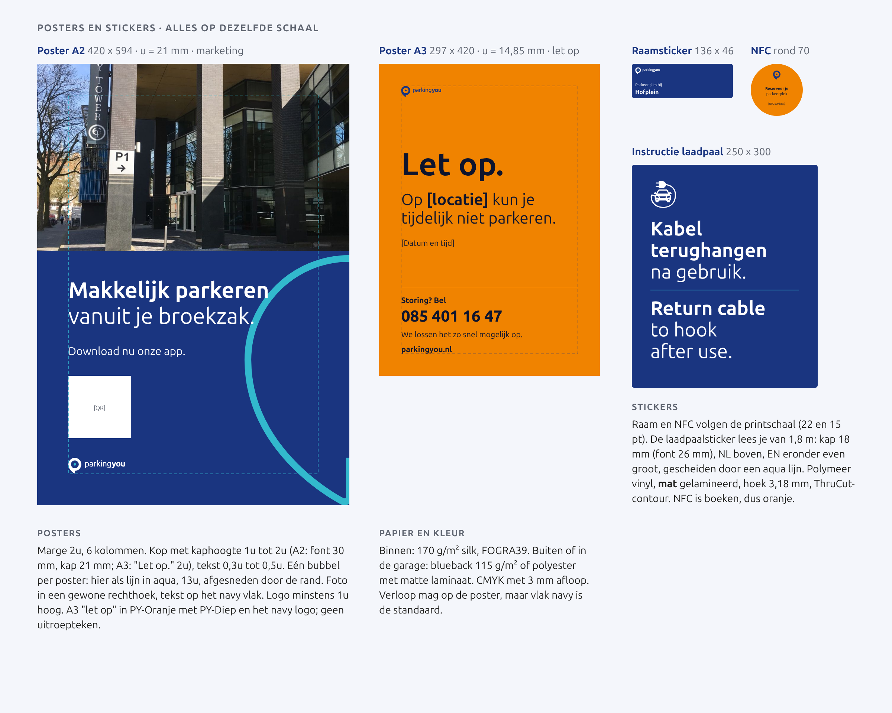

**Posters.** Marge 2u, 6 kolommen. Kop met kaphoogte 1u tot 2u, tekst 0,3u tot 0,5u. Eén bubbel per poster. De A2 (u = 21 mm) gebruikt de foto in de bubbel, met de tekst op het navy vlak eronder. De A3 "let op" (u = 14,85 mm) staat op PY-Oranje met PY-Diep en het navy logo, zonder uitroepteken. QR altijd donker op wit.

**Stickers.** De raamsticker (136 x 46) en de NFC-sticker (rond 70) volgen de printschaal. NFC is boeken, dus oranje met PY-Diep. De laadpaalsticker (250 x 300) lees je van 1,8 m: kap 18 mm, Nederlands boven, Engels eronder even groot, gescheiden door een aqua lijn. Polymeer vinyl, mat gelamineerd, ThruCut-contour.

## Abonnementspas

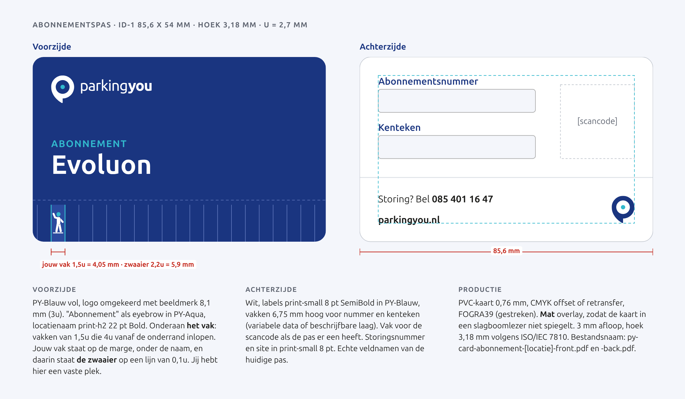

ID-1, 85,6 x 54 mm, hoek 3,18 mm, u = 2,7 mm. De voorkant is navy met het omgekeerde logo (beeldmerk 3u = 8,1 mm), een fotobubbel van de eigen locatie (13u) en de locatienaam in print-h2 22 pt Bold. De achterkant is wit met de velden van de huidige pas: Abonnementsnummer en Kenteken, plus een vak voor een scancode als de pas er een heeft, het storingsnummer en de site. PVC 0,76 mm, mat overlay, FOGRA39.

## Social

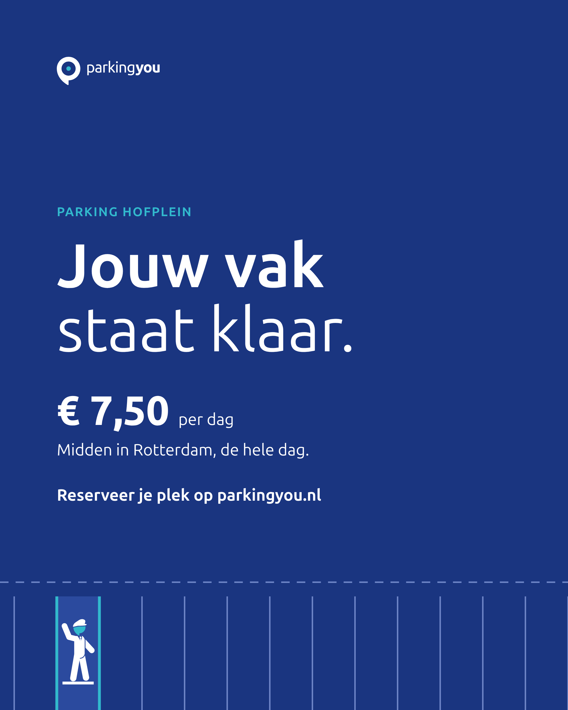

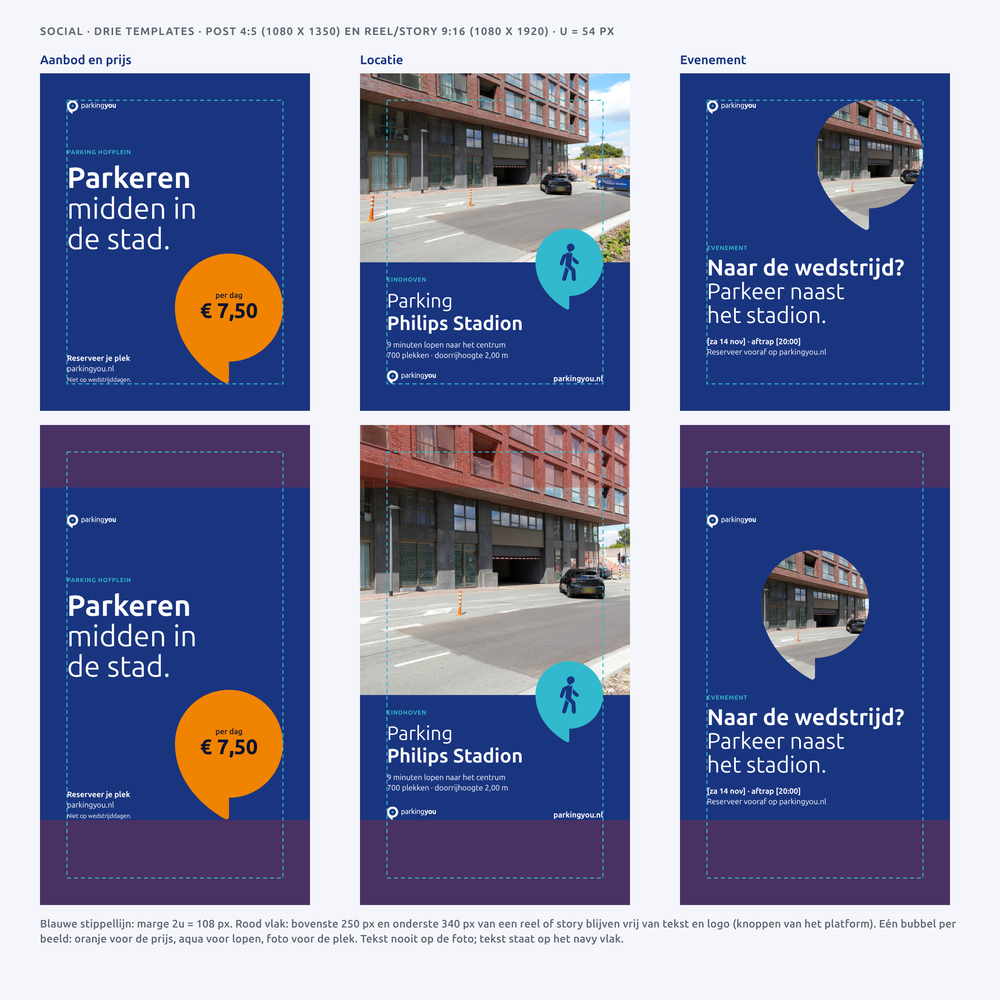

Post 4:5 (1080 x 1350) en reel of story 9:16 (1080 x 1920), beide u = 54 px, marge 108 px. In 9:16 blijven de bovenste 250 px en de onderste 340 px vrij van tekst en logo.

| Template | Grond | Bubbel | Kop | Tekst |
|---|---|---|---|---|
| Aanbod en prijs | PY-Blauw | oranje, 8u, prijs in PY-Diep | font 117 px (kap 1,5u) | 31 px (kap 0,4u) |
| Locatie | foto boven, PY-Blauw onder | aqua, 5u, pictogram lopen | font 78 px (kap 1u) | 31 px |
| Evenement | PY-Blauw | foto, 8u | font 90 px | 31 px |

De kernzin is Bold, de rest Regular. Tekst nooit op de foto en nooit in de fotobubbel. Eén bubbel per beeld. Voorbeelddata: Parking Hofplein € 7,50 per dag; Parking Philips Stadion, 700 plekken, 9 minuten lopen naar het centrum, doorrijhoogte 2,00 m.

## Nieuwsbrief

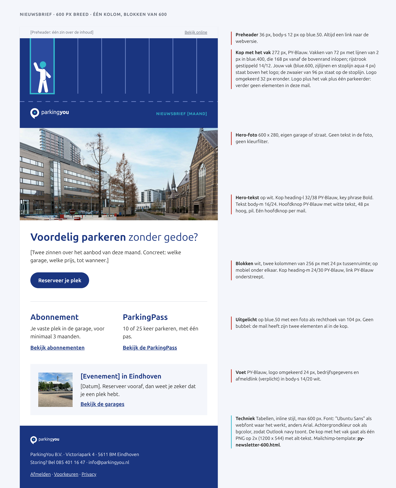

Eén kolom van 600 px, opgebouwd uit vaste blokken: preheader, kop met logo, hero-foto, hero-tekst op navy met de oranje hoofdknop, twee inhoudsblokken, één uitgelicht blok met een bubbel, en een navy voet met afmeldlink. Letter: heading-l 32/38, heading-m 24/30, body-m 16/24. Ubuntu Sans als webfont, Arial als terugval. Eén hoofdknop en één bubbel per mail.

## Campagne: GLOW Eindhoven

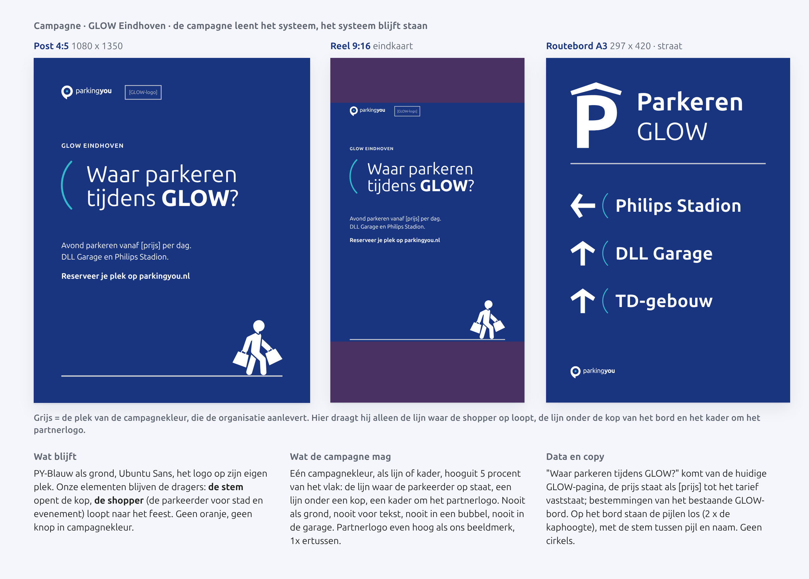

Een campagne leent ons systeem en laat het staan. De grond blijft PY-Blauw, de letter Ubuntu Sans, de bubbel blijft de enige vorm en oranje blijft de knop en de prijs. De campagne mag één accentkleur meebrengen: als streep onder de kop of als kader om het partnerlogo, nooit als grond, nooit voor tekst, nooit in de bubbel en nooit in de garage. Het partnerlogo staat los naast of onder het onze, even hoog als ons beeldmerk. Copy uit de huidige GLOW-pagina: "Waar parkeren tijdens GLOW?" en avond parkeren vanaf € 15,00 per dag. Het routebord houdt het bestaande A3-formaat met drie pijlen in cirkels.

## Servicebus en kleding

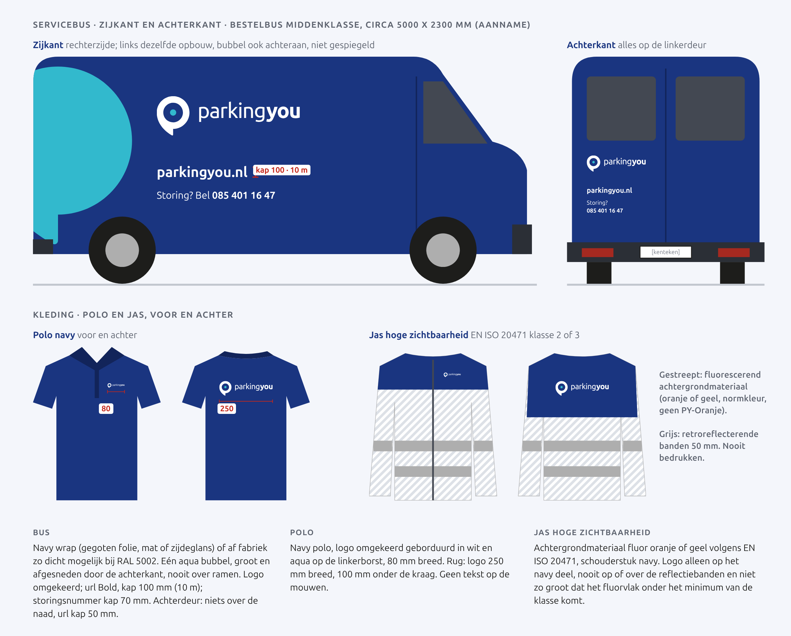

**Bus.** Navy wrap of af fabriek zo dicht mogelijk bij RAL 5002. Eén grote aqua bubbel, afgesneden door de achterkant, nooit over ramen of wielkasten. Logo omgekeerd met beeldmerk 400 mm, url Bold met kap 100 mm (10 m), storingsnummer kap 70 mm. Achterdeur: alles op de linkerdeur, niets over de naad.

**Kleding.** Navy polo met het omgekeerde logo geborduurd op de linkerborst en groot op de rug. Jas met hoge zichtbaarheid volgens EN ISO 20471 klasse 2 of 3: fluorescerend oranje of geel als achtergrondmateriaal (normkleur, geen PY-Oranje), schouderstuk navy. Het merk staat alleen op het navy deel, nooit op de reflecterende banden, en nooit zo groot dat het fluorvlak onder het minimum van de klasse komt.

## Do's en don'ts

**Doen**
- Reken elke kaphoogte uit de leesafstand: 10 mm per meter, minimaal 12 mm op een bord.
- Maak het beeldmerk op een bord minstens twee keer zo hoog als de grootste kaphoogte.
- Gebruik alleen wit op PY-Blauw, PY-Blauw op PY-Aqua en PY-Diep op PY-Oranje op borden.
- Laat de punt van de bubbel de weg wijzen in stappen van 45°; houd inhoud rechtop.
- Werk mat af. Test een set proefborden in een echte garage onder het eigen licht.
- Zet echte prijzen, tijden en nummers neer, met tabelcijfers.

**Niet doen**
- Geen verloop in de garage, op folie, poedercoat of lichtbakfilm.
- Geen witte tekst op aqua of oranje.
- Geen volledig aqua of oranje lichtbakfront: de taakkleur zit in de bubbel.
- Geen merkkleur op of naast RVV- en veiligheidsborden, en geen merk op reflecterende banden.
- Niet meer dan één bubbel per vlak onder 1 m, nooit tekst in een fotobubbel, nooit het logo in een bubbel.
- Geen campagnekleur als grond of tekstkleur.
- Geen stoktekeningen in nieuw werk.

## Voorgestelde waarden

Goedgekeurd: zie besluiten D29 en D30 in de core spec. Waar de core spec iets anders zegt, geldt de core spec.

| Waarde | Voorstel | Reden |
|---|---|---|
| Letter op terminal- en partnerstickers | printschaal: kernwoord 32 of 22 pt, uitleg minimaal 15 pt, in plaats van kap 12 mm | Stickers zijn 13 tot 43 mm hoog en worden op armlengte gelezen; 12 mm kap past er niet op. |
| Hoekradius stickers | 3,18 mm (zoals de pas) | De stickers hadden negen verschillende radii. Eén waarde, al in de spec voor passen. |
| Kolomband hoogte | onderkant 1800 mm boven de vloer, gelijk in de hele garage | Boven de autodaken, onder lage plafonds; nu is de hoogte niet vastgelegd. |
| Pyloon betaalvakken | 68 x 44 mm per merk, vier per rij | Merken van derden krijgen een vast, gelijk vak. |
| Pyloon tariefregels | steek 22 mm, vier regels op 110 mm | Volgt uit het minimum van 12 mm kap. |
| Hoogtebalk letter | kap 40 mm (font 58 mm), Ubuntu Sans Bold | De huidige letter is onbekend; 40 mm volgt uit 4 m leesafstand. |
| Hoogtebalk tekstvlak | tekst op een wit middenvlak van vijf banden breed | Zwarte letters over rode banden zijn slecht leesbaar. Alleen na check met de norm. |
| Laadpaalsticker | kap 18 mm, NL en EN, aqua scheidingslijn 1 mm | Leesbaar op 1,8 m, past op 250 x 300. |
| Nieuwsbrief blokmaten | preheader 36, kop 88, hero 600 x 280, knop 48 px hoog | Vaste blokken maken het template herbruikbaar; knop boven 44 px. |
| Campagne-accent | één accentkleur, alleen als lijn of kader, hooguit 5 procent van het vlak, contrast gecontroleerd | Een campagne mag herkenbaar zijn zonder ons systeem te breken. |
| Co-branding | partnerlogo even hoog als ons beeldmerk, vrije ruimte 1x ertussen, geen scheidingslijn | Gelijkwaardig maar los van elkaar. |
| Bus | beeldmerk 400 mm, url kap 100 mm, nummer kap 70 mm, achterdeur url kap 50 mm | Leesbaar in het verkeer; busmaat 5000 x 2300 is een aanname. |
| Kleding | borstlogo 80 mm breed, ruglogo 250 mm breed op 100 mm onder de kraag | Gangbare maten voor borduur- en transferwerk. |
| Posterpapier | binnen 170 g/m² silk FOGRA39, garage blueback 115 g/m² of polyester met mat laminaat | Vocht en licht in de garage. |

**Open vragen**
- Er zijn twee storingsnummers: 085 401 16 47 (automaat, pyloon, posters) en 085 21 30 422 (spandoek). Wij gebruiken het eerste. Welk nummer is juist?
- Is er een algemeen telefoonnummer voor de bus, naast het storingsnummer?
- Heeft de abonnementspas een scancode, en zo ja welk type?
- Welke Vol/Vrij-display komt in het portaal, en in welke ledkleur?
- Welk busmodel rijdt er; daarna maken we de wrap op ware maat.
- Fluor oranje of fluor geel voor de jassen? Oranje botst minder met PY-Oranje als het naast elkaar komt.
- GLOW-logo en campagnekleur moeten van de organisatie komen.
- PY-Diep is CMYK 100 83 0 80 en RAL 5004 (besluit D23). Kleine tekst onder 12 pt op oranje drukwerk zet je in K 100 (besluit D24).
