# ParkingYou huisstijl 2027

Versie 1.0 · november 2026 · bron: `brand-2027/02-build/core-spec.md` en `brand-2027/tokens/tokens.json`

## 1. Introductie en merkprincipes

### Waarom deze gids
ParkingYou zit op veel plekken tegelijk: op de website en in de boekingsflow, in de app, in reels, in de nieuwsbrief, op betaalautomaten, op abonnementspassen en op borden in donkere betonnen garages. Tot nu toe had elk van die plekken een eigen versie van ons merk. De website gebruikt een ander blauw dan de borden, Canva weer een ander, en in ons drukwerk zitten vijftien verschillende blauwen.

Deze gids maakt daar één taal van. Hij is gemaakt voor 2027 en verder, en hij werkt van een reel van 9:16 tot een bord van drie meter boven een inrit.

We zijn niet opnieuw begonnen. Het logo, het beeldmerk, ons blauw, de hoekige pijl, de halve boog en de poppetjes uit het handboek blijven. Wat verandert: we geven ze elk één duidelijke taak, we maken het rustiger en moderner, en we leggen alles vast in één bron.

### Een merk met een gezicht
Kijk naar de poppetjes uit ons handboek: hun hoofd heeft dezelfde vorm als ons beeldmerk. Dat is ons gezicht. Zo wordt het logo een mens: de loper bij de voetgangersingang, de zwaaier die je welkom heet, de gastheer met pet die je de weg wijst.

Daaromheen staan drie andere eigen elementen. Samen zijn het er vier, en elk heeft één taak.

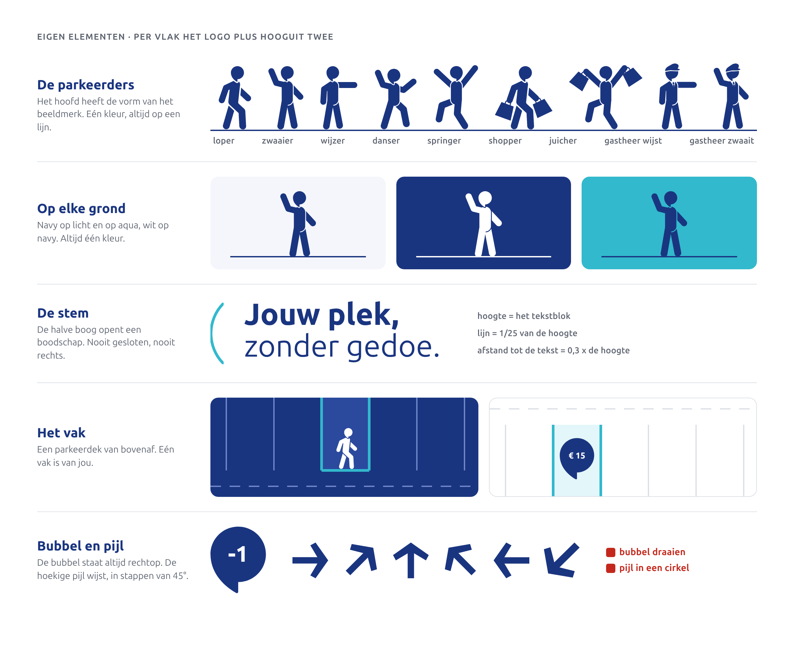

| Element | Taak |
|---|---|
| De parkeerders | ons gezicht: mensen, welkom, momenten |
| De stem | de halve boog opent wat we zeggen; op borden scheidt hij de onderdelen |
| De bubbel | draagt een prijs, een niveau of beschikbaarheid |
| De hoekige pijl | wijst de weg |

Per vlak gebruik je het logo en hooguit twee van deze elementen. Dan blijft het rustig, en herken je ons toch meteen.

### Wat er verandert
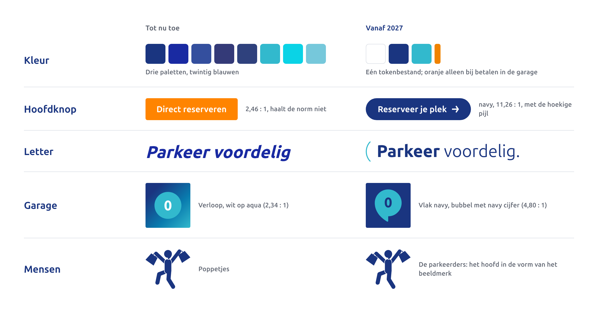

- **Eén kleurbron.** Alle kleuren staan in één tokenbestand, met de waarden voor scherm, drukwerk en bewegwijzering erbij. De oude website- en Canva-kleuren vervallen.
- **Minder oranje.** Oranje zie je alleen nog waar je betaalt in de garage: de automaat, het tarief, een storing. De hoofdknop op het scherm is navy.
- **Rustiger.** Meer wit, grotere letters, één accent per vlak. Geen verloop meer, alles is vlak.
- **Leesbaar voor iedereen.** Geen witte tekst meer op aqua of oranje. Elke tekstkleur haalt WCAG 2.2 AA.
- **Ubuntu Sans.** De nieuwe, variabele versie van de letter die we al gebruiken. Gratis, zelfde licentie.
- **Het logo draait nooit.** Ook de bubbel niet: de richting komt van de hoekige pijl.

### Onze merkprincipes
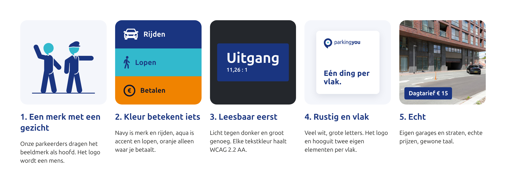

**1. Een merk met een gezicht.**
Onze parkeerders dragen het beeldmerk als hoofd: het logo wordt een mens. We praten met je, niet over je.

**2. Kleur betekent iets.**
Navy is het merk en rijden. Aqua is ons accent en lopen. Oranje zie je alleen waar je betaalt. We gebruiken kleur niet als versiering.

**3. Leesbaar eerst.**
Licht tegen donker, groot genoeg, in elke garage en op elk scherm. Elke tekstkleur haalt WCAG 2.2 AA. Op borden rekenen we de letterhoogte uit de leesafstand.

**4. Rustig en vlak.**
Veel wit, grote letters, vlakke kleur. Per vlak het logo en hooguit twee van onze elementen. Geen verloop, geen schaduw op merkvormen.

**5. Echt.**
Eigen garages en straten, echte prijzen, gewone taal. Geen stockgevoel en geen beloftes die we niet waarmaken.

### Hoe we praten
We praten zoals we parkeren: zonder gedoe. Kort, concreet en vriendelijk. En als we iets belangrijks zeggen, opent de stem de zin.

- Je en jij, overal. Ook in de boekingsflow.
- Korte zinnen. Eén boodschap per zin.
- Cijfers in plaats van bijvoeglijke naamwoorden: "9 minuten lopen naar het centrum", niet "centraal gelegen".
- Prijzen als € 12,50, tijden als 18:00 tot 23:00.
- Knoppen beginnen met een werkwoord: "Reserveer je plek", "Betaal".
- Geen emoji, geen uitroeptekens op borden, geen gedachtestreepjes.
- De kernzin vet, de rest gewoon: **Jouw plek**, zonder gedoe.

### Hoe je deze gids gebruikt
De hoofdstukken volgen de volgorde waarin je een ontwerp opbouwt: logo, kleur, letter, grid, de eigen elementen, iconen, beweging, beeld, en daarna de toepassingen. Achterin staan de tokens, de bestanden en wie je kunt bellen.

Alle waarden in deze gids komen uit één bron: de core spec en het tokenbestand in de repository PY-ASSETS (map `brand-2027/`). Twijfel je, dan wint dat bestand. Mis je iets of wil je een nieuwe waarde, vraag het dan aan wie het merk beheert. Verzin geen eigen kleur of maat.

## 2. Logo

### Wat het logo is
Het logo is het beeldmerk (een bubbel met ring en aqua stip) plus het woordmerk "parkingyou", getekend, niet getypt. Het blijft zoals het is: mensen kennen het van de lichtbak, de pas en de site. Nieuw is alleen dat de reverse versie officieel wordt en dat er een navy versie bijkomt voor aqua en oranje. Het logo draait nooit, en de bubbel ook niet.

We meten alles in **x**: de breedte van het beeldmerk in de lockup die je gebruikt.

### Lockups
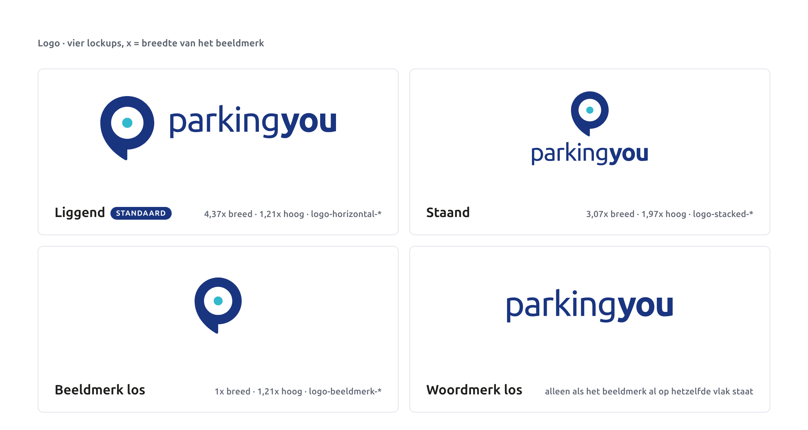

- **Liggend** is de standaard. Gebruik deze als je niet zeker weet welke.
- **Staand** voor smalle, hoge vlakken: een pyloon, een story, een sticker.
- **Beeldmerk los** voor app-icoon, avatar en favicon.
- **Woordmerk los** alleen als het beeldmerk al op hetzelfde vlak staat.

Stel de delen nooit zelf samen; gebruik de bestanden.

### Vijf versies, elk op zijn eigen ondergrond
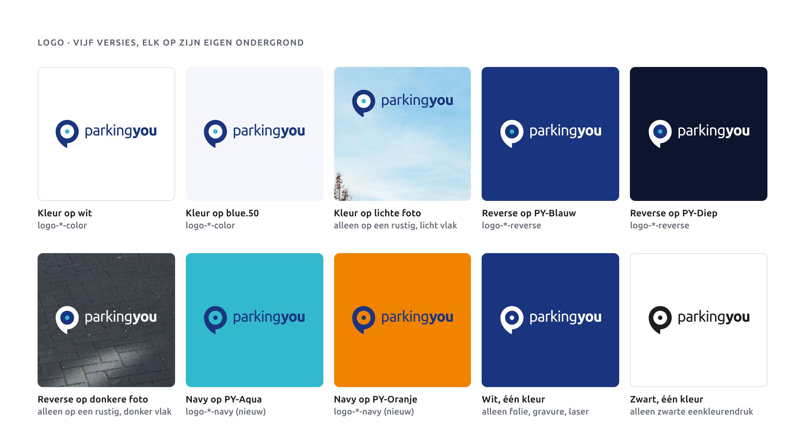

| Versie | Ondergrond | Bestand |
|---|---|---|
| Kleur (navy, aqua stip) | wit, blue.50, lichte foto met rustig vlak | `logo-*-color.svg` |
| Reverse (witte bubbel, navy ring, aqua stip) | PY-Blauw, PY-Diep, donkere foto | `logo-*-reverse.svg` |
| Wit, één kleur | alleen eenkleurige productie op donker: folie, gravure, laser | `logo-*-white.svg` |
| Navy, één kleur (nieuw) | PY-Aqua, PY-Oranje, eenkleurige navy druk | `logo-*-navy.svg` |
| Zwart, één kleur | alleen eenkleurige zwarte druk | `logo-*-black.svg` |

Op een foto zoek je een rustig vlak. Licht: kleurversie. Donker: reverse. Is de foto overal druk, zet het logo dan op een navy vlak naast de foto, niet op een donkere laag erover.

### Vrije ruimte
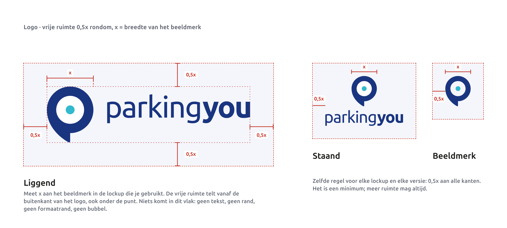

Rond elke lockup blijft 0,5x vrij, ook onder de punt. Daar staat niets: geen tekst, geen bubbel, geen rand van het formaat. In een hoek van een poster of pas is de marge 2u of 0,5x, wat het grootst is.

### Minimale maten
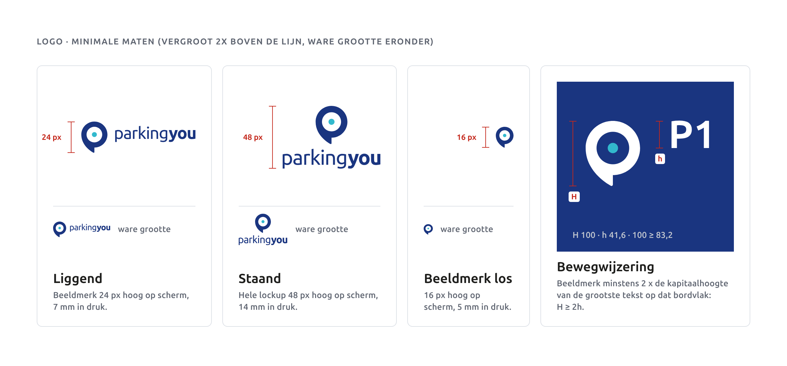

| Lockup | Scherm | Druk |
|---|---|---|
| Liggend (hoogte beeldmerk) | 24 px | 7 mm |
| Staand (hele hoogte) | 48 px | 14 mm |
| Beeldmerk los | 16 px | 5 mm |

Op borden geldt één regel: het beeldmerk is minstens 2 keer zo hoog als de kapitaalhoogte van de grootste tekst op dat bordvlak. Een bord met "P1" in 50 mm kapitaalhoogte vraagt dus een beeldmerk van minstens 100 mm hoog.

### Locatielockups
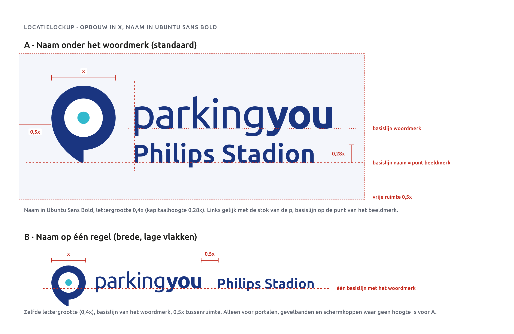

Het logo blijft het originele bestand; alleen de naam is tekst.

**A, naam onder het woordmerk (standaard).**
- Liggend logo, ongewijzigd.
- Naam in Ubuntu Sans Bold, lettergrootte 0,4x, spatiëring 0,01 em. De kapitaalhoogte is dan 0,28x.
- Naam links gelijk met de stok van de p van "parking".
- Basislijn van de naam op de punt van het beeldmerk.
- Vrije ruimte 0,5x om het geheel.

**B, naam op één regel.** Voor portalen, gevelbanden en de kop van een webpagina. Zelfde letter, op de basislijn van het woordmerk, 0,5x na "you".

De naam heeft de kleur van het woordmerk, nooit aqua of oranje. Schrijf alleen de plaatsnaam: "Philips Stadion", niet "Parking Philips Stadion". Past hij op een bord niet, gebruik dan Condensed Bold; geen tweede regel, geen kleinere letter. De staande lockup krijgt geen naam.

Maat kiezen: begin bij de naam. x = 2,5 keer de lettergrootte van de naam.
- Scherm: naam 16 px geeft x = 40 px, het beeldmerk wordt 48 px hoog.
- Druk: naam in print-h2 (22 pt) geeft x = 55 pt, ongeveer 19 mm.
- Borden: de naam volgt de leesafstand. Op 5 meter is de letter 72 mm, dus x = 180 mm. De bordregel klopt dan vanzelf.

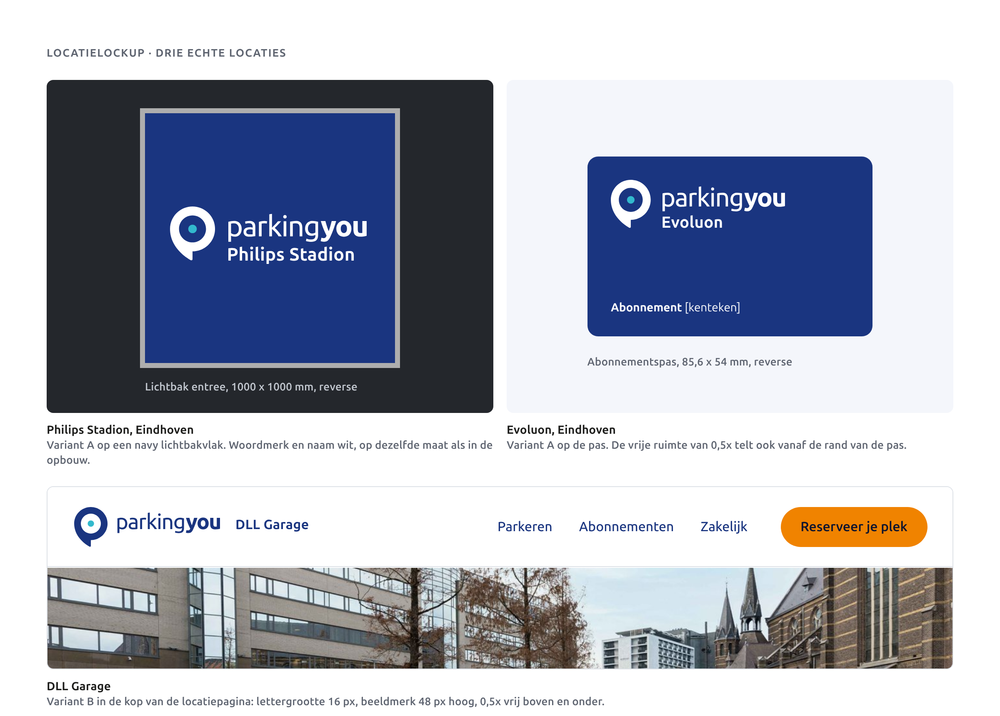

De huidige Maashaven-lockup heeft een kleiner woordmerk dan het echte logo. Bij de volgende druk vervangen we die door deze opbouw.

### Het logo en de parkeerders
Het hoofd van onze parkeerders heeft de vorm van het beeldmerk. Dat is bewust: zo wordt het logo een mens. Een parkeerder is altijd één kleur, het hoofd dus ook. Twee regels houden het logo heel:

- Een parkeerder krijgt nooit het hele logo als hoofd, geen ring en geen stip. Alleen de bubbelvorm.
- Een parkeerder staat nooit tegen het logo aan. Houd de vrije ruimte van 0,5x aan, ook naar het poppetje toe.

Meer over de parkeerders staat in het hoofdstuk Patronen en designelementen.

### Tagline "The other way of parking"
**Advies: stoppen met de tagline als lockup.**
1. Hij is Engels; al onze teksten zijn Nederlands.
2. De kleurversie is aqua op wit: 2,34:1, dat haalt WCAG niet.
3. Hij staat op 0,158 keer de hoogte van het beeldmerk. Bij een logo van 24 px is dat minder dan 4 px.
4. Hij belooft iets zonder het te laten zien. "**Parkeren** zonder gedoe." als kop zegt meer.

Bestaand drukwerk mag op. Wil Rick hem houden, dan als losse regel in de layout, niet vast aan het logo.

### App-icoon en favicon
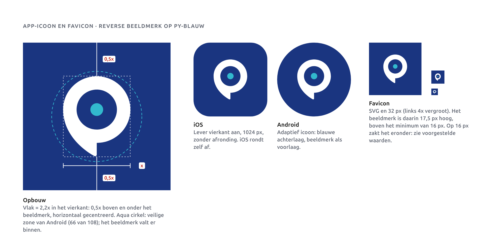

- Reverse beeldmerk op PY-Blauw.
- Vierkant vlak met 0,5x boven en onder het beeldmerk, horizontaal gecentreerd. Het beeldmerk is dan 45 procent van de breedte en valt binnen de veilige zone van Android.
- iOS: lever 1024 x 1024 px aan, vierkant, zonder afronding. iOS rondt zelf af.
- Android: adaptief icoon met PY-Blauw als achterlaag en het beeldmerk als voorlaag.
- Favicon: SVG plus 32 px. Het beeldmerk is daarin 17,5 px hoog.

### Zo niet
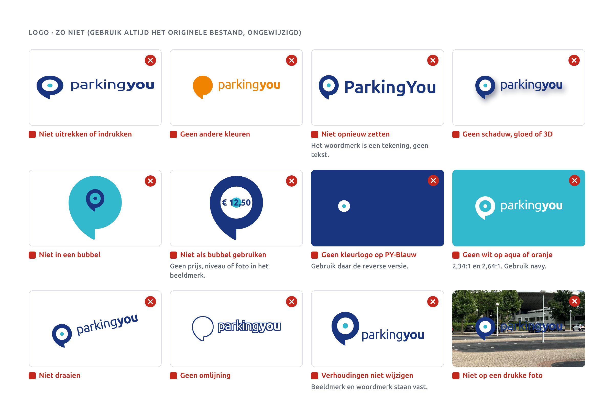

## 3. Kleur

Kleur betekent bij ParkingYou iets. Navy is het merk en rijden. Aqua is ons accent en lopen. Oranje zie je alleen waar je betaalt in de garage. Daaromheen veel wit, zodat elke kleur opvalt waar hij staat. Zo herken je ons van ver, en zo weet je in de garage waar je heen moet. Dit hoofdstuk legt vast welke kleuren er zijn, wat ze doen, hoeveel je ervan ziet, welke combinaties mogen en hoe je ze maakt in druk, folie en lak.

### Onze kleuren
De waarden van PY-Blauw, PY-Aqua en PY-Oranje veranderen niet. Nieuw is de naam PY-Diep voor de donkerste navy. De oude websitekleuren (#192AA2, #0AD3E6, #FF8400), de Canva-kleuren (#344F9E, #76C8DB) en de middenstop #097BAE van het oude verloop vervallen.

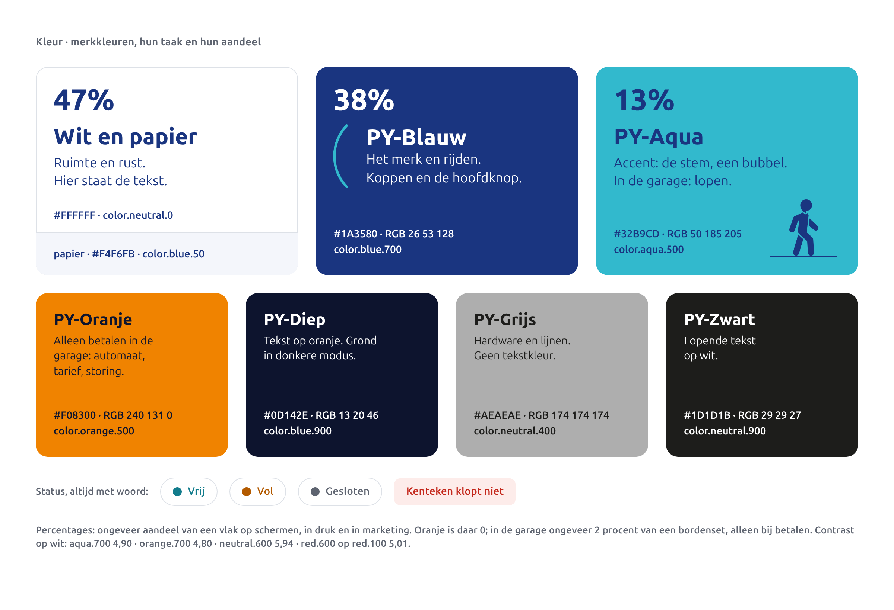

| Naam | HEX | RGB | CMYK | Token | Rol |
|---|---|---|---|---|---|
| Wit | #FFFFFF | 255 255 255 | 0 0 0 0 | `color.neutral.0` | ruimte, de grond onder de tekst |
| Papier | #F4F6FB | 244 246 251 | 5 3 2 0 | `color.blue.50` | rustige vlakken, tweede grond |
| PY-Blauw | #1A3580 | 26 53 128 | 100 83 0 17 | `color.blue.700` | het merk, rijden, koppen, de hoofdknop |
| PY-Aqua | #32B9CD | 50 185 205 | 69 0 21 0 | `color.aqua.500` | ons accent; in de garage lopen |
| PY-Oranje | #F08300 | 240 131 0 | 0 57 100 0 | `color.orange.500` | alleen betalen in de garage |
| PY-Diep | #0D142E | 13 20 46 | 100 83 0 80 | `color.blue.900` | tekst op oranje, grond in donkere modus |
| PY-Grijs | #AEAEAE | 174 174 174 | 0 0 0 42 | `color.neutral.400` | hardware, lijnen; geen tekstkleur |
| PY-Zwart | #1D1D1B | 29 29 27 | 0 0 0 100 | `color.neutral.900` | lopende tekst |

### Rustig en wit: de verhouding
Op schermen, in druk, in marketing en op social is de verhouding ongeveer: wit en papier 47, PY-Blauw 38, PY-Aqua 13 procent. Oranje is daar 0. In de garage is oranje ongeveer 2 procent van een bordenset, en dan alleen bij betalen.

Dat is een richtwaarde over een reeks vlakken, geen rekensom per vlak. Een poster is vooral wit met een navy voet, een post op social mag vooral navy zijn. Samen geven ze het beeld. Per vlak staat er één accent. De grond is altijd vlak: wit, papier of PY-Blauw, zonder patroon of versiering.

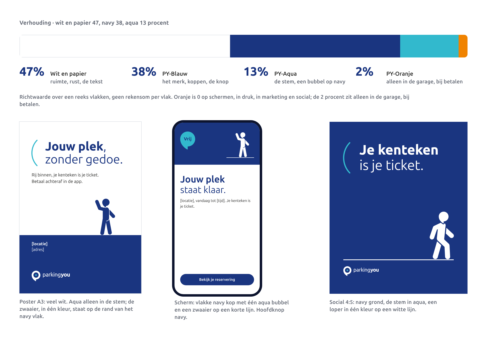

### Aqua: ons accent, en lopen
Buiten de garage is aqua het accent van het merk. Je ziet het op drie manieren, en nergens anders als vlak:

- **De stem**: de halve boog die een kop opent. Aqua op wit en op navy, navy op aqua (`voice.arc`).
- **Een aqua bubbel** op een navy vlak, met PY-Blauw erin (4,80:1).
- **Kleine accenten**: de stip in het logo, en op een navy vlak de hoofdknop in aqua met PY-Diep (7,74:1) en de focusring (4,80:1).

In de garage betekent aqua altijd lopen: voetgangersroutes, lift, trap, uitgang naar de straat. Daar is aqua wel een vlak, met PY-Blauw als inhoud.

Aqua is nooit tekstkleur op wit (2,34:1); gebruik dan aqua.700 (4,90:1). Wit op aqua mag ook niet (2,34:1). Op een licht scherm is de hoofdknop navy, niet aqua.

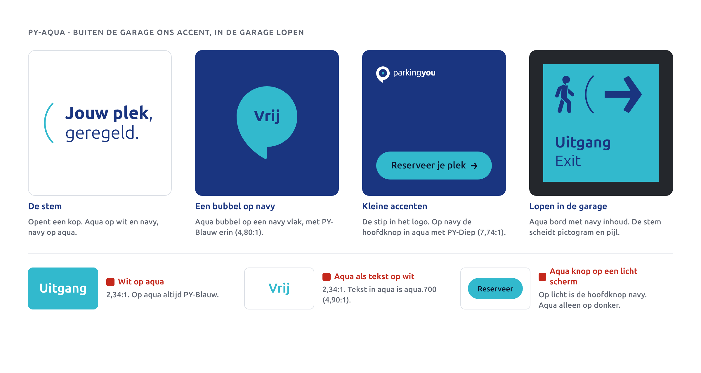

### Oranje: alleen waar je betaalt
Oranje staat alleen in de garage, op de plek waar je betaalt:

- stickers en vlakken op betaalautomaten ("Betaal hier"),
- tariefborden,
- storingen en meldingen bij de betaalplek ("Buiten gebruik").

Op een navy pyloon of lichtbak zit het oranje alleen in de bubbel bij de betaalplek. Tekst op oranje is altijd PY-Diep (6,87:1).

Oranje staat **niet** op schermen, in druk, in marketing, op social, in nieuwsbrieven of op kaarten. Wat daar vroeger oranje was, wordt:

| Was oranje | Wordt |
|---|---|
| de hoofdknop | PY-Blauw met witte tekst (11,26:1); op donker aqua met PY-Diep (7,74:1) |
| een prijs of deal in een bubbel | een navy bubbel met witte cijfers, of een witte bubbel met navy op een navy vlak |
| een accentstreep of -vlak in druk en social | de stem in aqua |
| oranje tekst bij een actie | gewoon PY-Blauw, met het sleutelwoord vet |

Op schermen blijft orange.700 (#B35A00) alleen als tekst- of icoonkleur voor de status "Vol" en voor waarschuwingen, altijd met het woord erbij (4,80:1 op wit; besluit D36). Dat is een statuskleur, geen merkoranje, en nooit een vlak of knop.

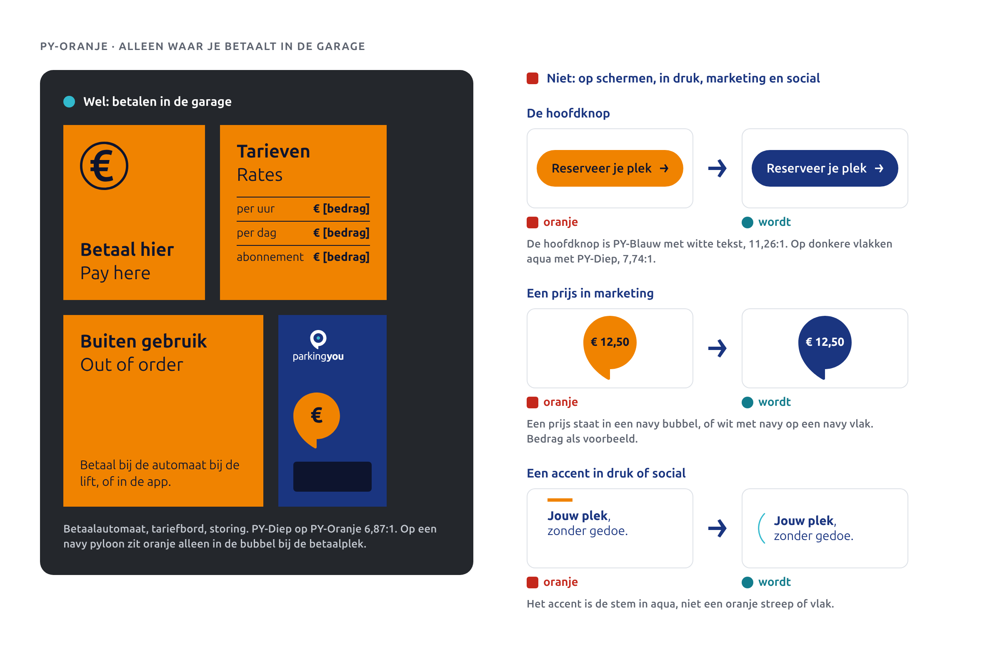

### Kleur draagt een taak in de garage
In de garage heeft elke kleur één taak. We gebruiken kleur niet als versiering.

| Taak | Ondergrond | Inhoud | Waar |
|---|---|---|---|
| Rijden | PY-Blauw | wit | portalen, in- en uitrit, lichtbakken, routeborden voor auto's, niveaus |
| Lopen | PY-Aqua | PY-Blauw | voetgangersroutes, lift, trap, uitgang naar de straat |
| Betalen | PY-Oranje | PY-Diep | betaalautomaten, tariefborden, storingen bij de betaalplek |

- Lichtbakken en portalen blijven navy. Op een verlicht vlak zit de taakkleur in de bubbel, nooit in een volledig aqua of oranje vlak.
- Geprinte borden (Dibond, wandfolie) mogen de taakkleur als hele ondergrond hebben.
- Op borden scheidt de stem de modules, bijvoorbeeld pictogram en pijl. Hij heeft de inhoudskleur van het bord: aqua op navy, PY-Blauw op aqua.
- De pijl is altijd de hoekige pijl uit het handboek, los, nooit in een cirkel of bubbel.
- Hoogtebalken houden rood en wit. Vluchtwegborden (ISO 7010, NEN 3011) en verkeersborden (RVV) krijgen nooit merkkleur, en merkkleur staat er ook niet als versiering naast.

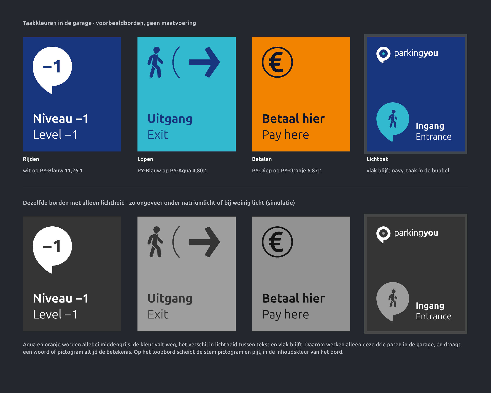

### Knoppen
De hoofdknop is PY-Blauw met witte tekst. Op donkere vlakken wordt hij aqua met PY-Diep. De tweede knop is een witte knop met een rand van 2 px in PY-Blauw (`action.secondary-border`); in donkere modus zijn rand en tekst aqua.300. Oranje knoppen bestaan niet meer. De hoekige pijl in een knop staat op de kapitaalhoogte van het label, 8 px na het label, in de kleur van het label.

| Token | Licht | Donker | Contrast licht / donker |
|---|---|---|---|
| `action.primary-bg` / `-fg` | blue.700 / wit | aqua.500 / blue.900 | 11,26 / 7,74 |
| `action.primary-bg-hover` | blue.600 | aqua.400 | 8,15 / 9,17 |
| `action.primary-bg-pressed` | blue.800 | aqua.600 | 14,73 / 5,43 |
| `action.secondary-bg` / `-fg` | wit / blue.700 | blue.900 / aqua.300 | 11,26 / 11,01 |
| `action.secondary-bg-hover` | blue.50 | blue.800 | 10,41 / 8,93 |
| `action.secondary-bg-pressed` | blue.100 | blue.850 | 9,52 / 10,01 |
| `action.secondary-border` | blue.700 | aqua.300 | rand van 2 px |

Alle verhoudingen zijn de tekstkleur van de knop op de grond van de knop, opnieuw berekend.

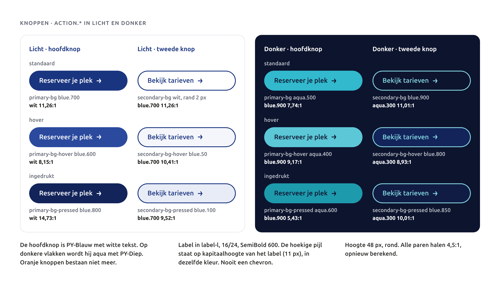

### Kleur voor de eigen elementen
De stem en de parkeerders hebben hun eigen semantische tokens. Componenten en templates lezen deze tokens, nooit de schaalwaarden.

| Token | Licht | Donker | Waarvoor |
|---|---|---|---|
| `voice.arc` | aqua.500 | aqua.500 | de stem; op een aqua grond blue.700 |
| `figure.body` | blue.700 | wit | lijf van een parkeerder |

De stem is vorm, geen informatie. Hij hoeft geen 3:1 te halen en draagt nooit alleen betekenis. Aqua op wit is 2,34:1, aqua op navy 4,80:1, aqua op PY-Diep 7,74:1. Een parkeerder in blue.700 op wit haalt 11,26:1, wit op PY-Diep 18,16:1. Hij staat altijd op een lijn: op schermen 2 px in `figure.body` (besluit D35), in druk 0,1u. De grond eronder is vlak: wit, papier, PY-Blauw, of in donkere modus PY-Diep.

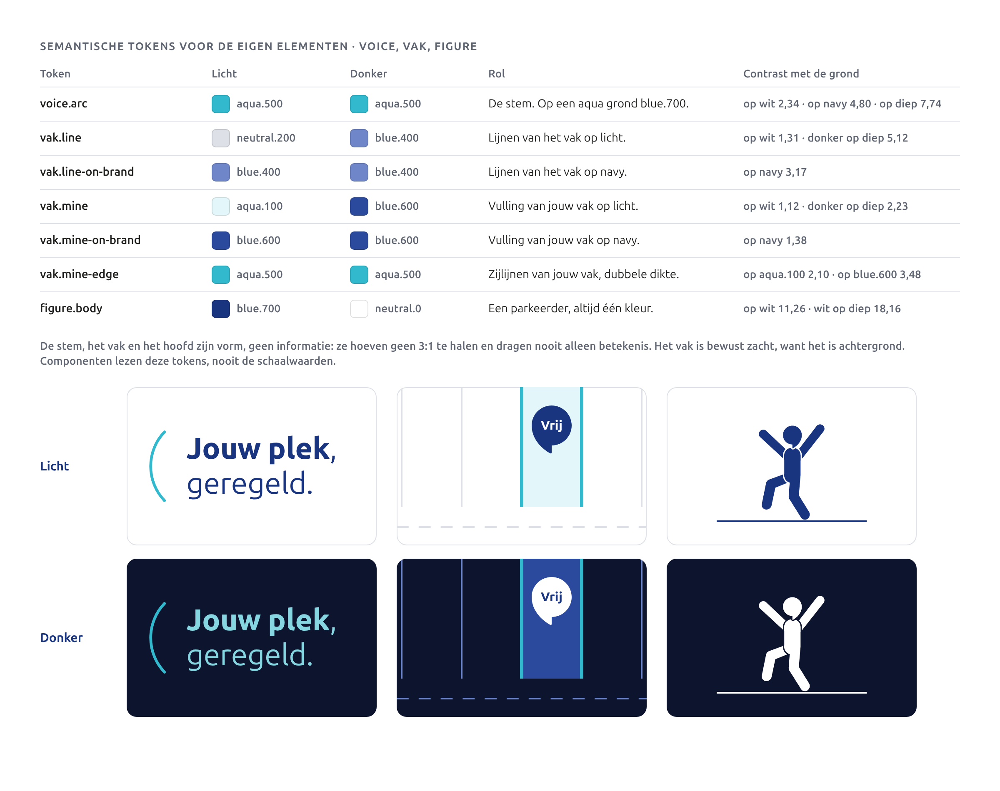

### Geen verloop meer
Het verloop van blauw naar aqua vervalt. Alle kleur is vlak. Bestaande borden en vlakken met verloop worden bij de volgende vervanging vlak PY-Blauw: niveaububbels, kolombanden, het bord voor mindervaliden en koppen op scherm en poster. Op het oude verloop stond witte tekst vaak op het aqua deel (2,34:1); vlak navy haalt 11,26:1. De rol van het verloop, het merk in één oogopslag, neemt een navy vlak met de stem in aqua over.

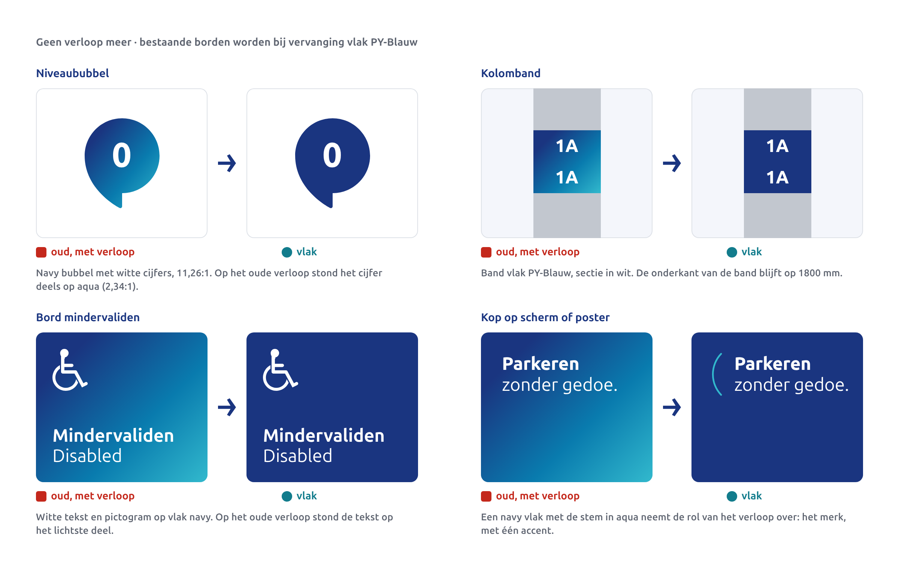

### Status en meldingen
Status heeft altijd een woord naast de kleur: Vrij, Vol, Gesloten. Kleur alleen draagt nooit betekenis, ook niet voor kleurenblinden of onder slecht licht. Statuskleuren staan alleen op `surface.default` of `surface.raised`.

| Token | Licht | Donker | Contrast op wit |
|---|---|---|---|
| `status.free` (Vrij) | aqua.700 #127C8C | aqua.300 | 4,90:1 |
| `status.full` (Vol) | orange.700 #B35A00 | orange.300 | 4,80:1 |
| `status.closed` (Gesloten) | neutral.600 #5E6470 | neutral.300 | 5,94:1 |
| `feedback.error` op `error-bg` | red.600 op red.100 | red.100 op red.700 | 5,01:1 |

### De volledige schalen
Blauw, aqua, oranje en neutraal lopen van 50 tot 900, rood heeft 100, 600 en 700. Schermen gebruiken de hele schaal via de semantische tokens; componenten lezen nooit direct een schaalwaarde. Drukwerk gebruikt alleen de merkkleuren en hun lichte tinten 50 tot 300.

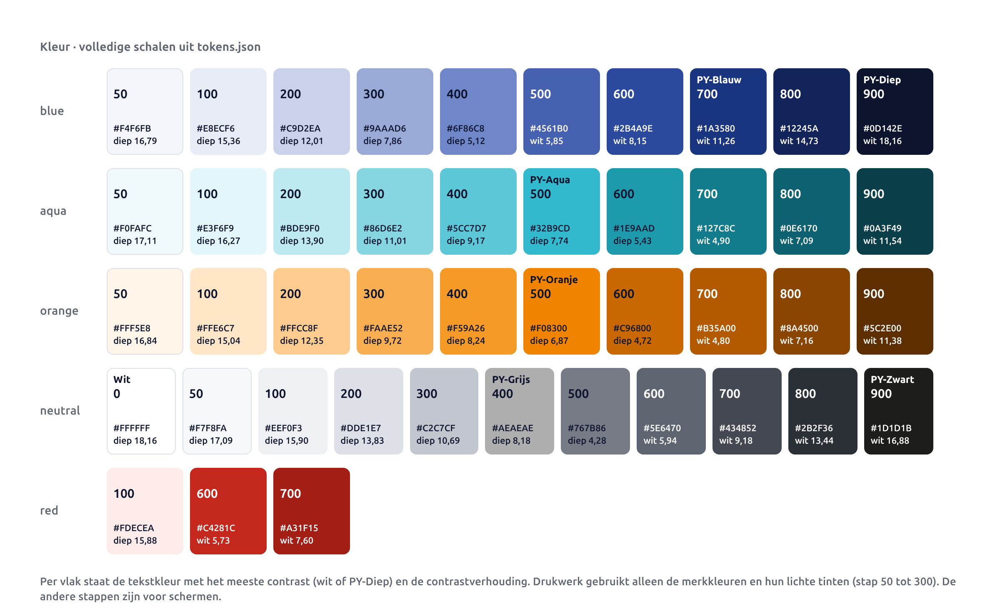

### Welke combinaties mogen
Tekst heeft 4,5:1 nodig. Grote tekst (24 px, of 19 px vet; in druk 18 pt, of 14 pt vet) en UI-grafiek hebben 3:1 nodig. Alle verhoudingen in dit hoofdstuk zijn opnieuw berekend met de WCAG 2.x-formule (relatieve luminantie, sRGB) en vergeleken met `tokens/contrast.md`: 33 paren in licht en donker, grootste afwijking 0,005. Alles komt overeen.

| Paar | Verhouding | Gebruik |
|---|---|---|
| wit op PY-Blauw | 11,26:1 | alle tekst op navy, de hoofdknop, borden voor rijden |
| PY-Blauw op PY-Aqua | 4,80:1 | loopborden, aqua bubbel |
| PY-Diep op PY-Oranje | 6,87:1 | betaalborden en automaten in de garage |
| PY-Blauw op wit | 11,26:1 | koppen en tekst in druk en op scherm |
| PY-Diep op PY-Aqua | 7,74:1 | de hoofdknop in donkere modus |
| aqua.700 op wit | 4,90:1 | aqua als tekstkleur, status Vrij |
| orange.700 op wit | 4,80:1 | status Vol en waarschuwingen op schermen, altijd met woord |

Op borden gebruiken we alleen wit op PY-Blauw, PY-Blauw op PY-Aqua en PY-Diep op PY-Oranje, altijd mat.

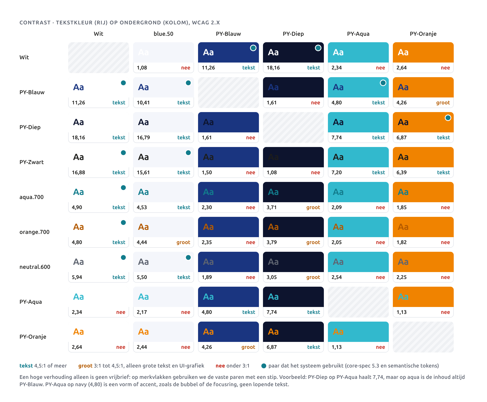

### Niet toegestaan
- Wit op aqua (2,34:1) en wit op oranje (2,64:1).
- Aqua of oranje als tekstkleur op wit (2,34 en 2,64:1). Gebruik aqua.700 of orange.700.
- PY-Blauw op oranje onder grote tekst (4,26:1).
- PY-Blauw op PY-Diep (1,61:1), bijvoorbeeld in donkere modus.
- PY-Grijs als tekst op wit (2,22:1).
- Oranje buiten de betaalplek in de garage: geen oranje knop, prijs, accent of vlak op schermen, in druk, in marketing of op social.
- Een verloop, waar dan ook.
- Kleur zonder woord, en een volledig aqua of oranje lichtbakvlak.

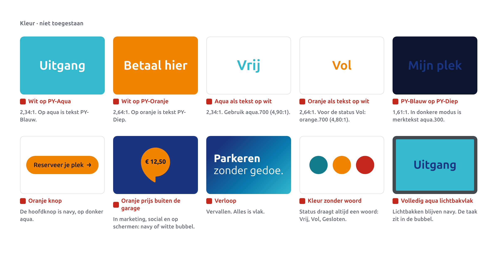

### Kleur onder garagelicht
Uit het onderzoek naar de garage: NEN 2443 vraagt gemiddeld 75 lux, oudere garages zijn op 40 lux of minder gebouwd. Op een navy bord is dat zo weinig licht dat het oog kleuren slecht scheidt. Natriumlicht maakt het erger: navy en aqua worden allebei donker, oranje bijna wit. Alleen het verschil in lichtheid tussen tekst en vlak blijft over. Daarom:

- Op borden alleen de drie paren hierboven; elk heeft een groot lichtheidsverschil.
- Een woord of pictogram draagt de betekenis, de kleur helpt alleen.
- Elke bordface krijgt mat laminaat, tegen spiegelingen van lampen.
- Geprinte lichtbakfolie wordt vaak dubbel geprint en oogt overdag donkerder.
- Voor de kleuren definitief zijn, testen we één set proefborden in een echte garage, onder het eigen licht (LED, TL en waar het nog hangt natrium).

### Donkere modus
In donkere modus is PY-Diep de ondergrond en is tekst wit (18,16:1). Navy werkt daar niet als tekst of rand (1,61:1); merktekst en links worden aqua.300 (11,01:1). De hoofdknop wordt aqua met PY-Diep (7,74:1), de tweede knop krijgt een rand en tekst in aqua.300. De stem blijft aqua (7,74:1 op PY-Diep). Parkeerders worden helemaal wit, in één kleur. Alle waarden staan in `tokens.json` onder `modes.dark`; de schermen zelf komen uit het hoofdstuk digitaal.

### Productie
Druk in CMYK (FOGRA39 gestreken of FOGRA52 ongestreken) met 3 mm afloop. Drukwerk gebruikt alleen de merkkleuren en hun lichte tinten; zo voorkomen we de 15 blauwen en 5 aqua's die nu in omloop zijn. Borden gaan via de RIP van de leverancier met de RAL- en foliereferenties hieronder. Oranje produceren we alleen nog voor betaalborden, tariefborden en automaten. De referenties zijn gekozen in besluit D23 van de core spec; elke keuze wordt nog bevestigd op een fysiek staal en een proefbord.

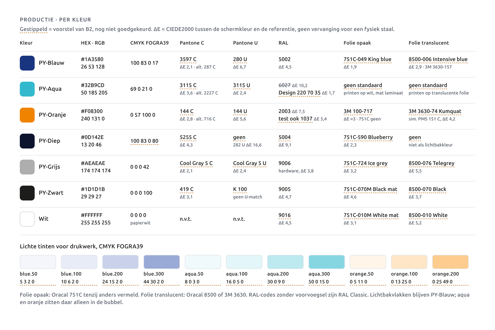

**Methode.** ΔE is CIEDE2000, zelf berekend. Voor RAL en folie: merkkleur van sRGB naar CIELab D65 en vergeleken met de gepubliceerde Lab- of sRGB-waarde. Voor Pantone: merkkleur naar CIELab D50 (Bradford) en vergeleken met de Lab-waarden uit de PANTONE+ Solid Coated en Uncoated V3 kleurboeken (X-Rite 2014). Waar de nieuwere Pantone-waarden ook te vinden waren (colorxs.com) staat de tweede ΔE erbij. Een ΔE uit schermdata vervangt nooit een fysiek staal: elke keuze wordt gecontroleerd met de Pantone-waaiers, de RAL K7 en de folie-stalen.

**CMYK.** Omgerekend met het ICC-profiel Coated FOGRA39 (ISO 12647-2:2004), uit de output intent van `source/print/15728501-1.pdf`, via LittleCMS (Pillow ImageCms), relatief colorimetrisch met zwartpuntcompensatie. De ΔE is de terugrekening via hetzelfde profiel.

| Kleur | CMYK | ΔE | Toelichting |
|---|---|---|---|
| PY-Diep | 100 83 0 80 | 4,8 | PY-Blauw plus 80 K, totaal 263 procent inkt. Valt buiten FOGRA39; het beste haalbare is 4,5. Directe ICC-omrekening geeft 100 93 47 66 (ΔE 7,7). |
| PY-Diep, tekst kleiner dan 12 pt op oranje | K 100 | n.v.t. | Drie platen op kleine tekst geven pasproblemen. PY-Zwart op oranje haalt 6,39:1. Komt alleen nog voor op betaalstickers. |
| blue.50 / 100 / 200 / 300 | 5 3 2 0 / 10 6 2 0 / 24 15 2 0 / 44 30 2 0 | 1,0 / 1,0 / 0,5 / 1,0 | ICC-omrekening |
| aqua.50 / 100 / 200 / 300 | 8 0 3 0 / 16 0 5 0 / 30 0 9 0 / 50 0 15 0 | 0,4 / 1,2 / 2,0 / 2,1 | raster van PY-Aqua (12, 23, 44, 72 procent); aqua.300 vervangt de vijf losse lichte aqua's in oud drukwerk |
| orange.50 / 100 / 200 | 0 5 11 0 / 0 13 25 0 / 0 25 49 0 | 0,0 / 0,7 / 0,8 | ICC-omrekening; in drukwerk nu niet meer nodig |

Ter controle: de handboekwaarden rekenen goed terug. PY-Blauw 100 83 0 17 geeft ΔE 2,9, PY-Aqua 69 0 21 0 geeft 0,5, PY-Oranje 0 57 100 0 geeft 1,3. Die blijven staan. FOGRA52 (ongestreken) is nog niet omgerekend, omdat het profiel niet te downloaden was; de drukker rekent dat om vanuit de sRGB- of Lab-waarden.

**Pantone.**

| Kleur | Coated | Uncoated |
|---|---|---|
| PY-Blauw | 3597 C (ΔE 2,1; nieuwere data 5,4). Alternatief 287 C (5,8; 4,8) | 280 U (6,7); ongestreken haalt dit blauw niet |
| PY-Aqua | 3115 C (3,6; nieuwere data 2,1). Alternatief 2227 C (2,4; 4,2) | 3115 U (2,4) |
| PY-Oranje | 144 C (2,8; 4,4). Alternatief 716 C (2,9; 3,9) | 144 U (5,6) |
| PY-Diep | 5255 C (4,3; 6,9) | geen bruikbare match (282 U 16,6) |
| PY-Grijs | Cool Gray 5 C (2,1) | Cool Gray 5 U (2,4) |
| PY-Zwart | 419 C (3,1); in de praktijk K 100 | K 100 |

**RAL.**

| Kleur | Was | Nu |
|---|---|---|
| PY-Aqua | RAL 6027 Lichtgrün, ΔE 10,2, te groen | RAL Design 220 70 35 Ferienblau, ΔE 1,7. Geen RAL Classic komt binnen ΔE 9. Voor borden met aqua liever geprinte folie met mat laminaat op Dibond; poedercoat in aqua alleen waar het echt moet, in RAL Design. |
| PY-Oranje | RAL 2003, ΔE 7,5 | RAL 2003 houden, maar RAL 1037 Sonnengelb (ΔE 5,4) meenemen in de proefborden. Alleen voor automaten en betaalborden. |
| PY-Diep | geen | RAL 5004 Schwarzblau, ΔE 9,1; alleen als het echt gelakt moet worden |
| Wit | geen | RAL 9016 Verkehrsweiß, ΔE 4,5, hoogste lichtreflectie (LRV 87) van de witten |
| PY-Blauw | RAL 5002, ΔE 4,5 | houden; nog steeds de beste RAL Classic |

**Folie.** Oracal 751C is glanzend, behalve wit en zwart, die ook mat bestaan (010M, 070M). Voor matte borden is printen met mat laminaat de standaard; snijfolie alleen voor één kleur op een vlak.

| Kleur | Opaak | Translucent (lichtbak) |
|---|---|---|
| PY-Blauw | Oracal 751C-049 King blue (ΔE 1,9) | Oracal 8500-006 Intensive blue (2,9) of 3M 3630-157 Sultan Blue |
| PY-Aqua | geen standaardkleur (beste: 751C-599 Pastel turquoise, 8,6). Printen, of maatkleur aanvragen | geen standaardkleur in 8500 of 3630. Printen op translucente printfolie (3M IJ3630-20), of maatkleur (3M levert 3630 op kleur) |
| PY-Oranje | 751C heeft niets binnen ΔE 9. 3M Scotchcal 100-717 Light Orange (ongeveer 3, hexwaarde niet officieel) | 3M 3630-74 Kumquat Orange (simuleert Pantone 151 C, ΔE 4,2); alleen voor de bubbel bij de betaalplek |
| PY-Diep | Oracal 751C-590 Blueberry (2,3) | geen; geen lichtbakkleur |
| PY-Grijs | Oracal 751C-724 Ice grey (3,2) | Oracal 8500-076 Telegrey (5,5) |
| PY-Zwart | Oracal 751C-070M Black mat (4,6) | Oracal 8500-070 Black (3,7) |
| Wit | Oracal 751C-010M White mat (3,1) | Oracal 8500-010 White (5,2) |

Translucente folie oogt doorgelicht anders dan op het staal. Kies lichtbakkleur altijd op een proefvlak in de lichtbak, bij dag en bij nacht.

**Bronnen.**
- Pantone Lab: PANTONE+ Solid Coated en Uncoated V3, via [jacobbubu/color-books](https://github.com/jacobbubu/color-books); controle via [colorxs.com](https://www.colorxs.com/color/pantone-3115-c) en [Pantone color finder 3597 C](https://www.pantone.com/color-finder/3597-c).
- RAL Classic Lab: [List of RAL colours, Wikipedia](https://en.wikipedia.org/wiki/List_of_RAL_colours). RAL Design: [RAL 220 70 35](https://ralcolorchart.com/ral-design/ral-220-70-35).
- Oracal sRGB-waarden: [Orafol 751C](https://www.orafol.com/en/europe/products/oracal-751c-high-performance-cast), [Orafol 8500](https://orafol.com/en/europe/products/oracal-8500-translucent-cal).
- 3M: [productbulletin 3630/3730](https://www.wensco.com/customer/docs/skudocs/3M_3630_3730_productbulletin.pdf) (namen en Pantone-simulaties), [productkaart 3630](https://www.sirvisual.com/Attachment/100/Product%20Card%203630.pdf) (maatkleuren, IJ3630-20), [kleurkaart 100](https://multimedia.3m.com/mws/media/653312O/color-card-100.pdf). De hexwaarde van 100-717 komt uit [Colorly](https://github.com/jpederson/Colorly) (MIT) en is niet officieel.
- Garagelicht: `01-research/R4-physical-environment.md`. Drukdrift: `docs/print-rules.md` 1 en 7.1.

## 4. Typografie

We gebruiken één letter: Ubuntu Sans. Op een reel, een factuur en een bord van drie meter breed. En we hebben één typografisch gebaar dat alleen van ons is: de stem, de halve boog die een boodschap opent. Dit hoofdstuk zegt welke gewichten je wanneer gebruikt, hoe groot tekst moet zijn op scherm, in druk en in de garage, hoe de stem met de tekst meegroeit, en hoe we cijfers, prijzen en tijden schrijven.

### Ubuntu Sans
Ubuntu Sans is de opvolger van Ubuntu, de letter die ParkingYou al gebruikt. De vormen zijn dezelfde familie: rond, open, vriendelijk en goed leesbaar op afstand. Wat erbij komt:

- **Variabel.** Eén bestand met twee assen: gewicht (wght 100 tot 800) en breedte (wdth 75 tot 100). Er is dus een echte ExtraBold voor koppen en cijfers en een smalle versie voor lange namen op borden.
- **Tabelcijfers.** Alle cijfers kunnen even breed staan, zodat prijzen en tijden in kolommen netjes onder elkaar vallen.
- **Maten die we gebruiken.** Kapitaalhoogte 0,693 em, x-hoogte 0,518 em. Daarmee rekenen we lettergroottes op borden uit.

Ontwerp: Dalton Maag, in opdracht van Canonical, versie 1.006. Licentie: Ubuntu Font Licence 1.0. Gratis voor drukwerk, web, apps, e-mail en borden; je mag de bestanden delen met drukkers en bureaus zolang de licentietekst erbij zit. De letter staat ook op [Google Fonts](https://fonts.google.com/specimen/Ubuntu+Sans) en in de bron van Canonical ([Ubuntu-Sans-fonts](https://github.com/canonical/Ubuntu-Sans-fonts)).

Bestanden: `brand-2027/fonts/UbuntuSans[wdth,wght].ttf`, met de licentie in `brand-2027/fonts/UBUNTU-FONT-LICENCE.txt`. Daar staat ook een cursieve variant; die gebruiken we niet.

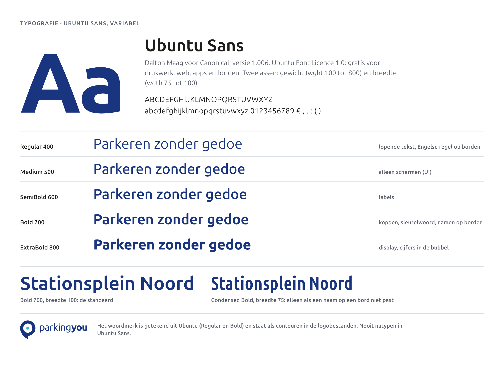

### Het logo blijft getekend
Het woordmerk is getekend uit de oude Ubuntu: "parking" in Regular, "you" in Bold. Het staat als contouren in de logobestanden. Je typt het nooit na, ook niet in Ubuntu Sans.

Het oude handboek zegt dat "parking" in Ubuntu Medium staat. Gemeten op de contouren is het Regular. Dat verschil lossen we op door niets te veranderen: het logo blijft zoals het getekend is, en het handboek klopt voortaan met de bestanden.

### Gewichten en wanneer
| Gewicht | Waarvoor |
|---|---|
| Regular 400 | lopende tekst, het niet-vette deel van een kop, de Engelse regel op borden |
| Medium 500 | alleen op schermen, voor UI-elementen |
| SemiBold 600 | labels en knoppen |
| Bold 700 | koppen, het sleutelwoord, namen en woorden op borden |
| ExtraBold 800 | het sleutelwoord in display-koppen, cijfers in de bubbel, cijfers op borden |

Light en Thin gebruiken we niet. Ze worden te dun in een donkere garage en op kleine schermen.

**Smal (wdth 75).** Alleen voor namen op borden die op normale breedte niet passen, zoals een lange straat- of locatienaam. Nooit in lopende tekst, nooit in marketing, nooit op schermen. Eerst kijken of de naam korter kan.

### Fallback
Op het web laden we Ubuntu Sans zelf. Valt die weg, dan pakt de browser de volgende:

`"Ubuntu Sans", Ubuntu, system-ui, -apple-system, "Segoe UI", Roboto, Arial, sans-serif`

In Word, PowerPoint, Outlook en nieuwsbrieven gebruiken we **Arial**. Dan ziet de ontvanger wat jij ziet, ook als die Ubuntu Sans niet heeft. Je mag Ubuntu Sans op je eigen computer zetten om te ontwerpen, maar bestanden die je deelt als Office-document zet je in Arial.

### De stem
De stem is de halve boog uit het oude handboek, zonder de slogan die er vroeger bij stond. Hij staat links van een kop en opent de boodschap, zoals iemand die begint te praten. Samen met het sleutelwoord vet is dat onze stem: "**Jouw plek**, zonder gedoe."

- **Waar.** Links van een kop of een kernzin van één tot drie regels. Nooit rechts, nooit gesloten met een tweede boog, nooit naast lopende tekst.
- **Hoogte.** Gelijk aan het tekstblok dat hij opent: aantal regels maal de regelhoogte. De boog begint aan de bovenkant van de eerste regel en eindigt aan de onderkant van de laatste.
- **Lijn.** 1/25 van de hoogte, met ronde einden. Minimaal 1,5 px op scherm en 0,5 mm in druk en op borden.
- **Afstand.** 0,3 maal de hoogte, van de open kant van de boog tot de eerste letter.
- **Kleur.** PY-Aqua op wit en op PY-Blauw (`voice.arc`), PY-Blauw op PY-Aqua. Nooit oranje.
- **Aantal.** Eén per vlak in een layout. Op borden zoveel als er modules te scheiden zijn.
- **Op borden** is de stem geen opener maar een scheiding tussen modules, bijvoorbeeld tussen pijl en tekst of pictogram en pijl. Zelfde regels: hoogte gelijk aan het tekstblok ernaast, lijn 1/25, afstand 0,3 maal de hoogte aan beide kanten.
- **In beweging** tekent de boog zich van boven naar beneden (`duration.slow`, `easing.enter`); daarna komt de tekst in beeld, samen 440 ms. Bij beperkte beweging komen boog en tekst samen in beeld. Details in het hoofdstuk beweging.

De stem is een van onze vier eigen elementen, naast de parkeerders, de bubbel en de hoekige pijl. Per vlak staan het logo en hooguit twee daarvan: de stem met een parkeerder, of de stem met de hoekige pijl in de knop, maar niet ook nog een bubbel.

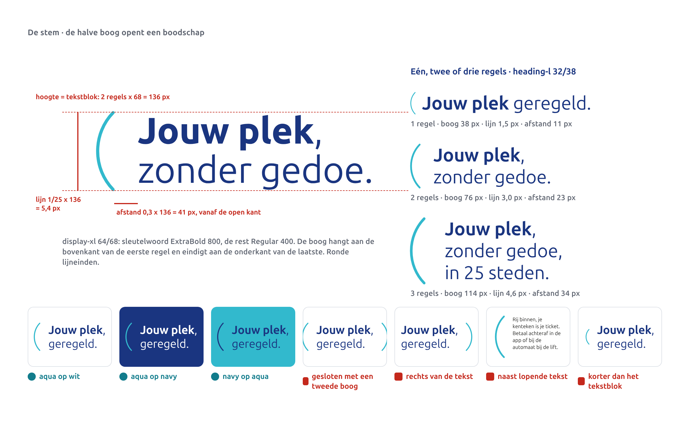

### De stem op elke maat
Omdat de boog uit de tekst wordt afgeleid, groeit hij vanzelf mee. Je hoeft geen maten te onthouden, alleen drie verhoudingen.

| Waar | Tekst | Regels | Hoogte boog | Lijn, 1/25 | Afstand, 0,3x |
|---|---|---|---|---|---|
| Telefoon | heading-xl 40/44 | 2 | 88 px | 3,5 px | 26 px |
| Desktop | display-xl 64/68 | 2 | 136 px | 5,4 px | 41 px |
| Kleinste kop op scherm | heading-m 24/30 | 1 | 30 px | 1,5 px (minimum; 1/25 is 1,2) | 9 px |
| A4 folder | print-display 48/50 pt | 2 | 100 pt = 35,3 mm | 1,4 mm | 10,6 mm |
| A2 poster (u = 21 mm) | kap 1,5u = 31,5 mm, korps 45,5 mm, regel 47,3 mm | 2 | 94,7 mm | 3,8 mm | 28,4 mm |
| Routebord, 10 m | korps 144 mm, regel gelijk aan korps, 0,5u = 10 mm ertussen | 2 | 298 mm | 11,9 mm | 89 mm |
| Detail op pyloon, 1 m | korps 17 mm | 1 | 17 mm | 0,7 mm | 5,1 mm |

Rekenvoorbeeld A2: kapitaalhoogte 1,5u = 31,5 mm, korps 31,5 / 0,693 = 45,5 mm (129 pt), regelafstand 45,5 x 50/48 = 47,3 mm, twee regels 94,7 mm. Lijn 94,7 / 25 = 3,8 mm, afstand 94,7 x 0,3 = 28,4 mm.

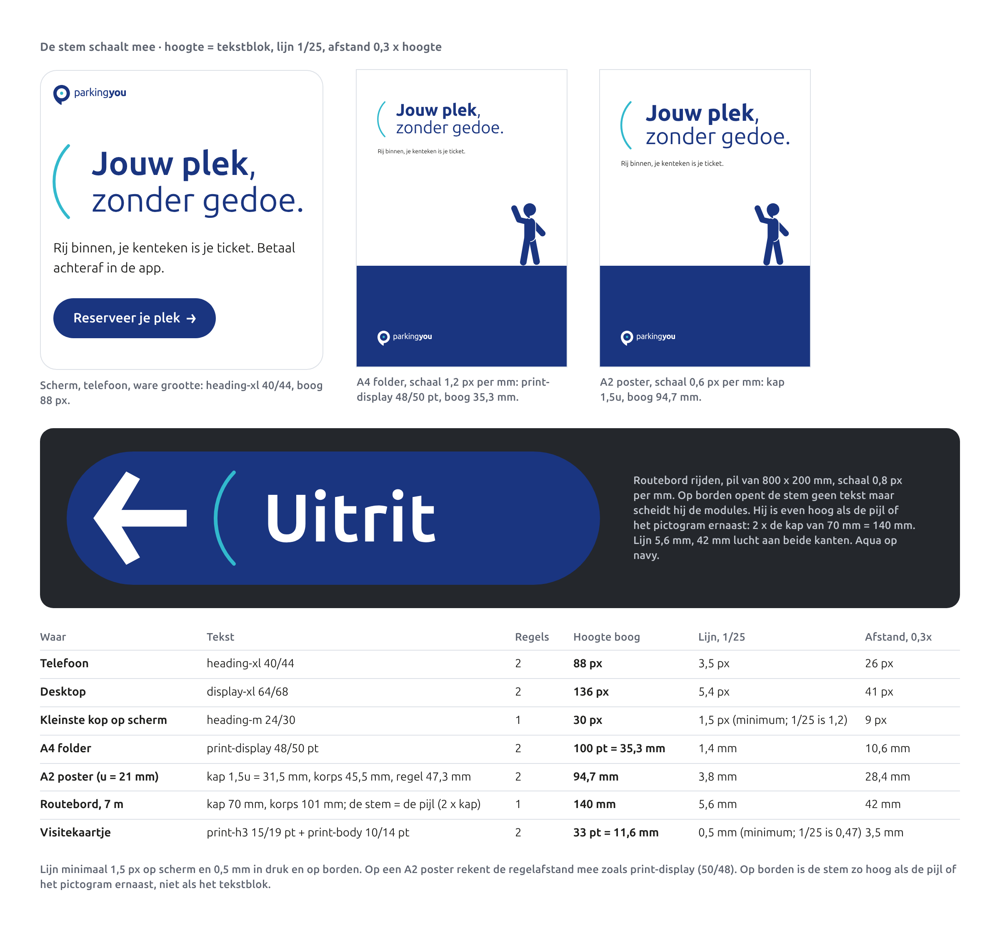

### Grotere, rustigere koppen
De koppen zijn groter en rustiger dan voorheen. Dat zit niet in nieuwe maten, maar in hoe we de bestaande schaal gebruiken:

- **Eén kop per scherm of vlak.** De paginakop is de grootste stap die past: desktop display-xl (64/68), tablet display-l (48/52), telefoon heading-xl (40/44). Op posters een kapitaalhoogte van 1,5u tot 2u.
- **De stem ervoor.** Een paginakop of campagnekop opent met de stem. Sectiekoppen niet.
- **Sleutelwoord vet, de rest Regular.** In display-koppen is het sleutelwoord ExtraBold 800, in heading-koppen Bold 700. De rest staat in Regular 400. Zo is een grote kop toch licht.
- **Hooguit drie regels.** Breek na het sleutelwoord: "**Jouw plek**," op de eerste regel, "zonder gedoe." op de tweede.
- **Veel wit eromheen.** Boven de paginakop op desktop `space.9` (96 px), op telefoon `space.7` (48 px). Intro en knop beginnen op de tekstlijn van de kop, niet onder de boog.
- **Navy op wit.** Koppen zijn PY-Blauw op wit of papier, of wit op PY-Blauw. Nooit aqua of oranje.

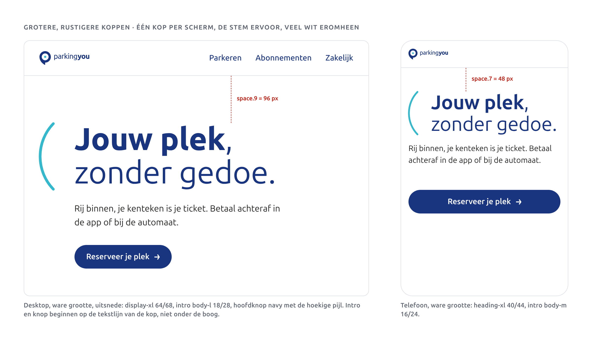

### Schermschaal
Waarden in px: grootte / regelhoogte en gewicht. Minimum 12 px voor labels, 16 px voor lopende tekst en invoervelden.

| Token | Grootte | Regel | Gewicht | Waar |
|---|---|---|---|---|
| display-xl | 64 | 68 | 800 | paginakop desktop |
| display-l | 48 | 52 | 800 | paginakop tablet |
| heading-xl | 40 | 44 | 700 | paginakop telefoon |
| heading-l | 32 | 38 | 700 | sectiekop desktop |
| heading-m | 24 | 30 | 700 | sectiekop telefoon, kaartkop |
| heading-s | 20 | 26 | 700 | kleine kop, lijstkop |
| body-l | 18 | 28 | 400 | intro onder de paginakop |
| body-m | 16 | 24 | 400 | lopende tekst, invoervelden |
| body-s | 14 | 20 | 400 | hulptekst |
| label-l | 16 | 24 | 600 | knoplabel |
| label-m | 14 | 20 | 600 | veldlabel |
| label-s | 12 | 16 | 600 | tag, klein label |
| numeric-xl | 56 | 60 | 800, tabelcijfers | bedrag in een overzicht |
| numeric-m | 20 | 26 | 700, tabelcijfers | tijden en bedragen in lijsten |

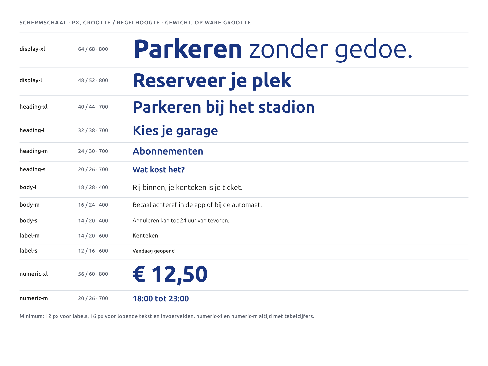

### Drukwerkschaal
| Token | Korps / interlinie (pt) | Gewicht |
|---|---|---|
| print-display | 48 / 50 | 800 |
| print-h1 | 32 / 36 | 700 |
| print-h2 | 22 / 26 | 700 |
| print-h3 | 15 / 19 | 700 |
| print-body | 10 / 14 | 400 |
| print-small | 8 / 11 | 400 |
| print-legal | 7 / 9 | 400, het minimum |

Posters en social schalen mee met het formaat. u is de korte zijde gedeeld door 20. Een kop heeft een kapitaalhoogte van 1u tot 2u, tekst van 0,3u tot 0,5u. Op een A2 (u = 21 mm) is een kop dus 86 tot 172 pt. Voor de rustige, grote koppen kies je het bovenste deel: 1,5u tot 2u. Visitekaartjes en kleiner gebruiken de drukwerkschaal, niet de u-regel.

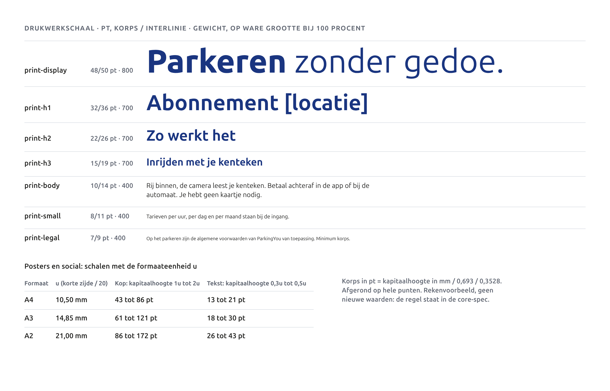

### Bewegwijzering: hoe groot
Eén regel: **10 mm kapitaalhoogte per meter leesafstand**. Het korps is de kapitaalhoogte gedeeld door 0,693.

| Leesafstand | Kapitaalhoogte | Korps |
|---|---|---|
| 1 m (detail op pyloon, terminal) | 12 mm, minimum op elk bord | 17 mm |
| 2,5 m | 25 mm | 36 mm |
| 5 m | 50 mm | 72 mm |
| 10 m | 100 mm | 144 mm |
| 20 m | 200 mm | 289 mm |
| 30 m | 300 mm | 433 mm |

Op borden: Bold 700 voor woorden, ExtraBold 800 voor cijfers, letterafstand 0,01 em, links uitgelijnd, nooit uitgevuld. Weinig woorden: wie met 20 km/u rijdt, heeft een bord dat op 20 m leesbaar is ongeveer 3,6 seconden in beeld. Dat zijn een paar woorden. De hoekige pijl staat los op het bord, twee keer de kapitaalhoogte hoog (op een bord voor 10 m dus 200 mm); de stem scheidt pijl en tekst, met dezelfde hoogte als het tekstblok. De maten van de borden zelf staan in het hoofdstuk bewegwijzering.

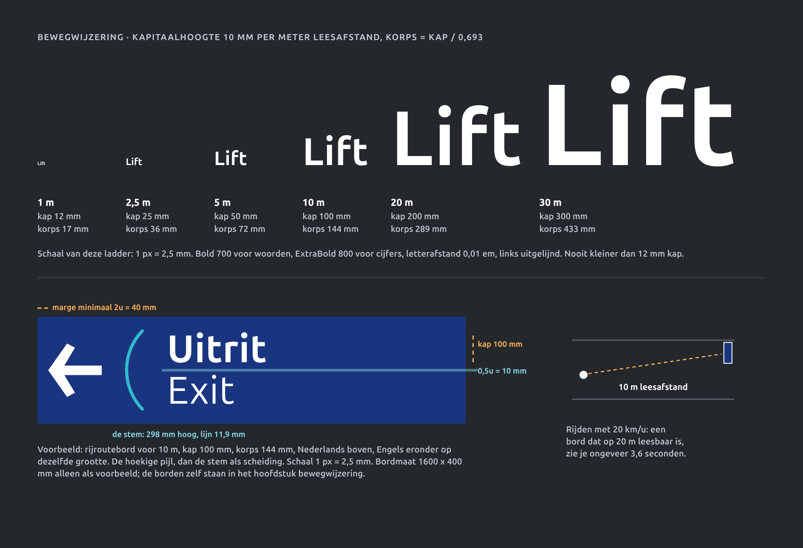

### Zo schrijven we het
**Het sleutelwoord vet.** Het belangrijkste woord of de kortste groep vet, de rest regular, in één zin: "**Jouw plek**, zonder gedoe." of "**Reserveer** je plek." Past de zin niet op één regel, dan breek je na het sleutelwoord. Niet alles vet, dan valt niets op.

**De stem opent, niet de tekst.** Geen aanhalingstekens, streep of icoon voor een kop; dat doet de boog.

**Geen hoofdletters, geen cursief.** Zinnen beginnen met een hoofdletter, de rest is klein. Hoofdletters alleen voor een eyebrow boven een kop: maximaal drie woorden, letterafstand 0,08 em. Het cursieve accentwoord van de huidige website verdwijnt.

### Cijfers, prijzen en tijden
- Prijzen, tijden en niveaus staan altijd in tabelcijfers.
- Prijs: "€ 12,50". Euroteken, spatie, decimale komma. Niet "€12,50", niet "€ 12,-".
- Een prijs is PY-Blauw, of wit op navy. Nooit oranje, behalve op een tariefbord in de garage.
- Tijd: "18:00 tot 23:00". Dubbele punt, en "tot" in plaats van een streepje.
- Niveau: "-1", "0", "2". In een bubbel in ExtraBold 800.
- Concrete getallen in plaats van vage woorden: "€ 12,50 per dag", niet "voordelig".

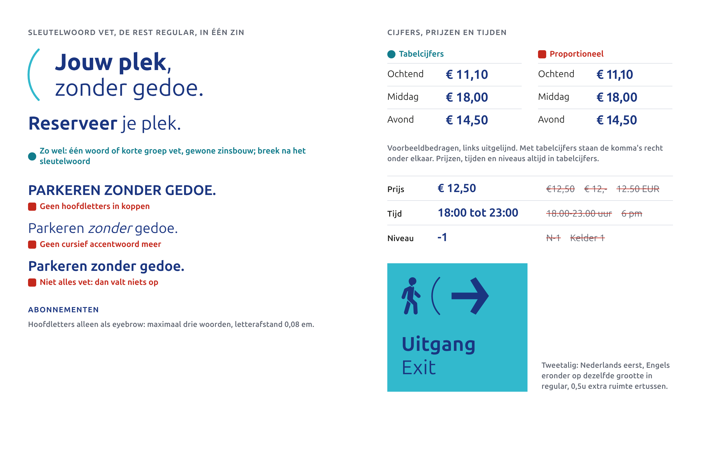

### Tweetalig
Nederlands eerst. Engels eronder, op dezelfde grootte, in Regular. Beide regels met een regelhoogte gelijk aan het korps, en 0,5u wit tussen de twee regels. "**Uitgang** / Exit", "**Betaal hier** / Pay here".

### Licenties van alle genoemde letters
| Letter | Waar | Licentie | Kosten |
|---|---|---|---|
| Ubuntu Sans | alles | Ubuntu Font Licence 1.0 | geen |
| Ubuntu | alleen in het logo, als contouren | Ubuntu Font Licence 1.0 | geen |
| Arial | Office en e-mail | meegeleverd met Windows, macOS en Office | geen extra kosten; de bestanden niet zelf verspreiden |
| system-ui, -apple-system, Segoe UI | web-fallback, letter van het apparaat | systeemletters van Apple en Microsoft | geen; we leveren ze niet mee |
| Roboto | web-fallback op Android | open licentie (Google Fonts) | geen |
| RVV-cijfers op portalen en pylonen | verkeersborden van derden | geleverd als contouren door de bordenleverancier **(aanname)** | geen voor ParkingYou **(aanname)** |

Er zijn geen licentiekosten. Leveranciers krijgen contouren of de benoemde statische versies: Regular, Bold, ExtraBold en Condensed Bold. De stem gaat als contour mee, nooit als letterteken.

## 5. Grid en layout

Eén maat voor alles: van visitekaartje tot lichtbak, van post tot reel. Die maat heet u. Op schermen werken we met een vast 4 px-raster. Dit hoofdstuk legt beide uit en geeft vijf standaardpatronen waar je bijna elke uiting mee bouwt.

De toon is rustig: veel wit, grote letters, één accent per vlak. Per vlak staat het logo plus hooguit twee van onze vier elementen (parkeerder, stem, bubbel, pijl). De grond is altijd vlak: PY-Blauw of wit, en `blue.50` voor rustige delen. Hoe die elementen zelf werken, staat in Patronen en designelementen.

### De formaateenheid u
u is de korte zijde van het formaat gedeeld door 20. Meer hoef je niet te onthouden. Een post van 1080 x 1350 px heeft een korte zijde van 1080, dus u = 54 px. Een A4 heeft een korte zijde van 210 mm, dus u = 10,5 mm.

Alles op het vlak meet je in u:

- **Marge** 2u aan alle kanten. Afloop (3 mm bij print) komt er buiten bij.
- **Goot** 1u tussen de kolommen.
- **Kolommen**: 6 op staande en vierkante formaten, 12 op liggende formaten.
- **Ritme**: elementen staan op veelvouden van 0,5u. Bovenkant van een kop, onderkant van een logo, een lijn onder een parkeerder: allemaal op dat ritme.
- **Kop op posters en social**: kapitaalhoogte 1u tot 2u. Regelafstand 50/48 van de lettergrootte. Het vette kernwoord in ExtraBold 800, de rest Regular.
- **Lopende tekst**: kapitaalhoogte 0,3u tot 0,5u.
- **Elementen**: bubbel 3u, 5u, 8u of 13u breed; parkeerder 3u tot 8u hoog, op een lijn van 0,1u; de stem zo hoog als het tekstblok dat hij opent.

Kolombreedte reken je zo uit: breedte min 4u, min (kolommen min 1) keer u, gedeeld door het aantal kolommen.

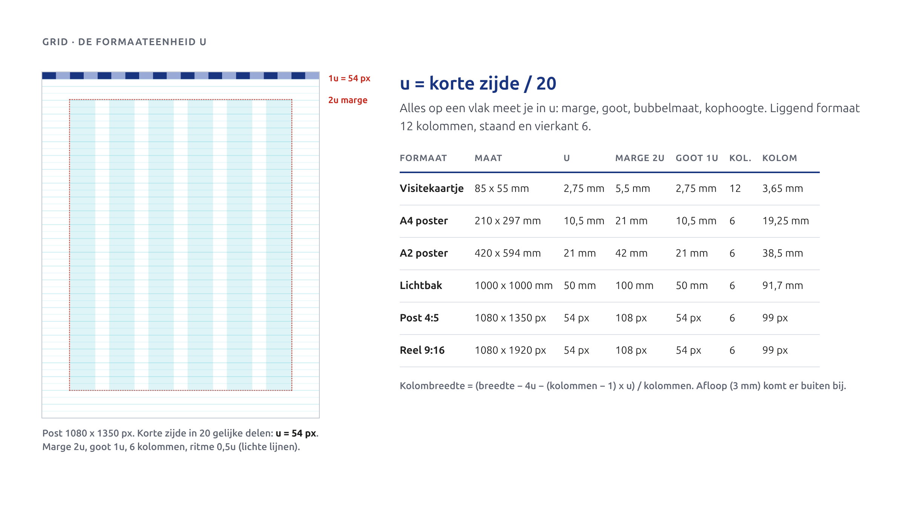

### Vijf echte formaten
| Formaat | u | Marge | Kolommen | Kolom |
|---|---|---|---|---|
| Visitekaartje 85 x 55 mm | 2,75 mm | 5,5 mm | 12 | 3,65 mm |
| A4 poster | 10,5 mm | 21 mm | 6 | 19,25 mm |
| Lichtbak 1000 x 1000 mm | 50 mm | 100 mm | 6 | 91,7 mm |
| Post 1080 x 1350 px | 54 px | 108 px | 6 | 99 px |
| Reel 1080 x 1920 px | 54 px | 108 px | 6 | 99 px |

A2 volgt dezelfde regel: u = 21 mm.

**Visitekaartje.** Liggend, dus 12 kolommen. Het logo staat linksboven op de marge, 3u hoog; de beeldmerkhoogte is dan 8,25 mm en ligt boven het minimum van 7 mm. Op zo'n klein formaat zou de u-regel voor tekst te kleine letters geven, dus de tekst volgt de printschaal: print-h3 voor de naam, print-small voor de gegevens. Op de voorkant staat de gastheer, 5u hoog, op de basislijn van de laatste regel; zijn hand wijst naar je telefoonnummer. De achterkant is vlak PY-Blauw. De stem opent de kop "**Parkeren** zonder gedoe." linksboven op de marge, in print-h3. Rechtsonder zwaait de gastheer, 8u hoog, op een witte lijn van 0,1u op de ondermarge; de lijn loopt over de drie kolommen die hij raakt. Het logo staat linksonder op dezelfde marge. Logo plus twee elementen: stem en parkeerder. De hoeken volgen ID-1: 3,18 mm.

**A4 poster.** Wit. De stem opent de kop vanaf 4u, kapitaalhoogte 1,25u. Tekst 0,4u, 1u onder de kop. Een navy bubbel van 8u met de prijs staat rechtsonder op de kolommen, het logo linksonder op de marge. Twee elementen: stem en bubbel. Geen oranje: buiten de garage is een prijs navy.

**Lichtbak.** Het vlak blijft navy; de taakkleur zit in de bubbel. Tekst op borden rekent met de leesafstand uit de typografie (10 mm kapitaalhoogte per meter), niet met de u-regel. In het voorbeeld 75 mm voor 7,5 m, Nederlands en Engels even groot, met 0,5u tussen de regels. De hoekige pijl is 2 x de kapitaalhoogte (150 mm). Het beeldmerk staat rechtsboven, 3u hoog: minstens 2 keer de grootste kapitaalhoogte. Twee elementen: bubbel en pijl.

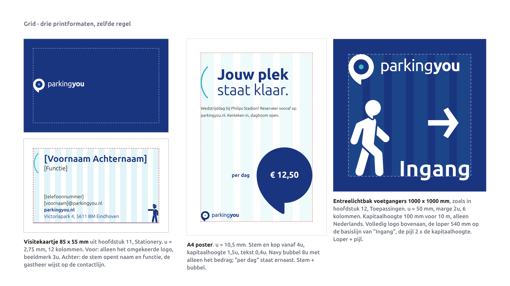

**Post en reel.** Zelfde u (54 px), zelfde 6 kolommen. In een reel liggen boven 250 px en onder 340 px knoppen en tekst van het platform. Daar komt niets belangrijks. Op het u-raster: de kern ligt tussen 5u (270 px) en 29u (1566 px). Ondertitels staan op 26,5u tot 29u, wit op PY-Blauw. Het logo staat op de eindkaart van 1,5 s.

In het voorbeeld is de post het patroon foto + navy veld met de stem voor de kop, en de reel het patroon parkeerder op de lijn: de loper loopt over een vloerlijn. Een volgende scène mag een andere pose hebben, met een harde knip.

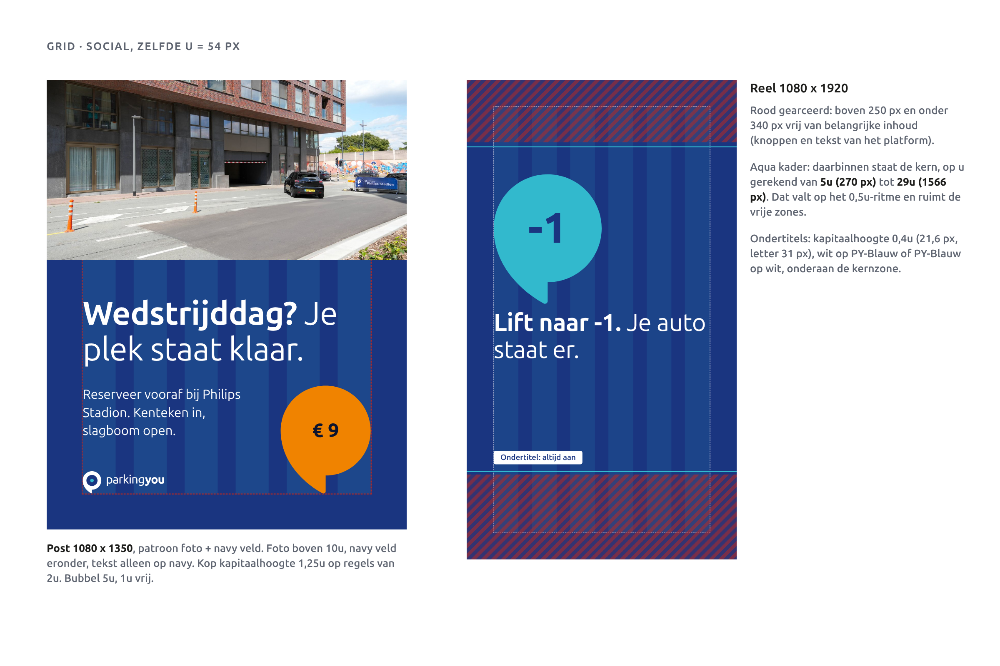

### Schermen
Op schermen rekenen we niet in u maar in pixels, met een basis van 4 px. Ruimte komt uit de tokens `space.0` tot `space.10`: 0, 4, 8, 12, 16, 24, 32, 48, 64, 96, 128 px.

| Scherm | Breedte | Kolommen | Goot | Marge |
|---|---|---|---|---|
| Telefoon | tot 767 px | 4 | 16 px | 16 px |
| Tablet | 768 tot 1199 px | 8 | 24 px | 32 px |
| Desktop | 1200 px en breder | 12 | 24 px | minstens 32 px; inhoud max. 1200 px, gecentreerd |

Raakvlakken zijn minstens 44 x 44 px. Kaarten hebben `radius.l` (16), invoervelden `radius.m` (8), knoppen en chips `radius.pill`. Een parkeerder op scherm is 48 tot 160 px hoog en staat op een lijn van 2 px in `figure.body`, die aan beide kanten 16 px (`space.4`) uitsteekt.

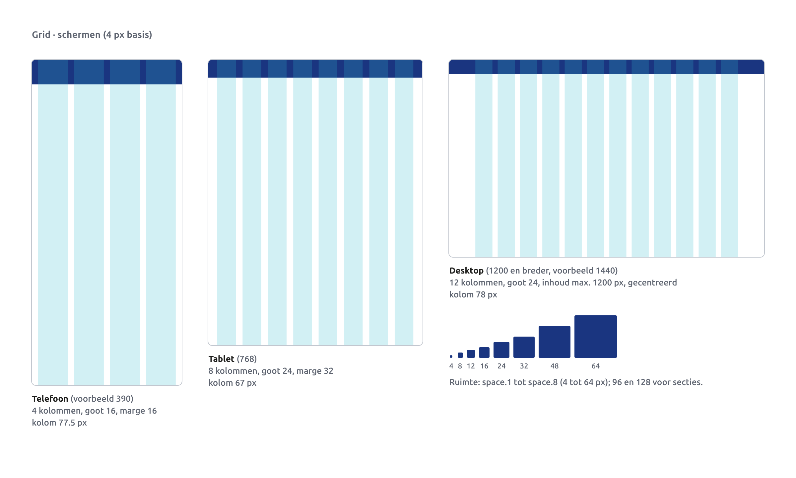

### Vijf standaardpatronen
Bijna elke uiting past in een van deze vijf. Begin daar, en wijk alleen af met een reden. De maten gelden voor een post van 1080 x 1350 px; op andere formaten reken je dezelfde u om.

1. **Stem + kop.** Wit. De stem opent de kop vanaf 4u, kapitaalhoogte 1,5u; de kop mag breken na het vette kernwoord. Tekst 1u eronder, logo onderaan op de marge. Voor merk en campagne.
2. **Parkeerder op de rand.** Navy. De stem opent de kop vanaf 4u, kapitaalhoogte 1,5u; tekst 1u eronder. Rechtsonder staat een witte parkeerder van 8u op een lijn van 0,1u op de ondermarge, dezelfde lijn waar het logo links op staat. De lijn loopt over de kolommen die de parkeerder raakt. Laat hem naar de kop kijken. Voor "jouw plek", reserveren en abonnementen.
3. **Foto + navy veld.** Eigen foto 10u hoog bovenin, navy veld eronder. De stem en de kop staan op navy. Nooit tekst op de foto en geen donkere laag over een foto.
4. **Parkeerder op de lijn.** Licht vlak (`blue.50`) of wit. Kop bovenin, een lijn van 0,1u op 21u, een parkeerder van 8u op die lijn. Kies de parkeerder bij de boodschap: zwaaier of gastheer bij welkom, juicher bij een deal, loper bij een route.
5. **Info.** Wit. Een navy bubbel van 5u met één woord (Info). Kop, dan tijden en prijzen in tabelcijfers op regels van 1,5u. Prijzen zijn navy, nooit oranje.

De maten in de patronen (kop op 4u, lijn op 21u of op de ondermarge) zijn een startpunt, geen vaste regel. Vast is: marge, kolommen, het 0,5u-ritme, de maten van de elementen, hooguit twee elementen per vlak en de kleurverdeling. Over een reeks uitingen is dat ongeveer 47 procent wit en licht (`blue.50`), 38 procent PY-Blauw en 13 procent aqua. Oranje komt in deze patronen niet voor; dat hoort alleen bij betalen in de garage. De grond is vlak: geen patroon, geen verloop, geen grote achtergrondbubbel.

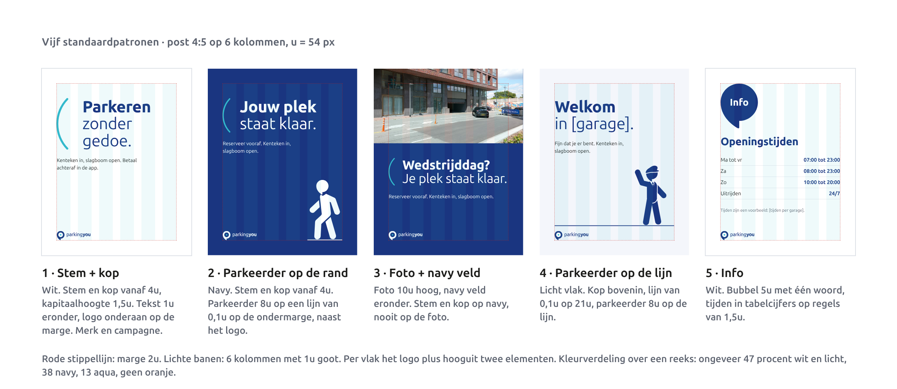

## 6. Patronen en designelementen

ParkingYou heeft vier eigen elementen: de parkeerders, de stem, de bubbel en de hoekige pijl. Elk heeft één taak, en samen maken ze een vlak herkenbaar als ParkingYou, ook zonder logo. Het hart is de parkeerder: een poppetje uit ons eigen handboek, met een hoofd in de vorm van het beeldmerk. Zo wordt het logo een mens.

De vuistregel voor alles in dit hoofdstuk: **per vlak het logo plus hooguit twee elementen.** Meer is druk, minder mag altijd.

| Element | Taak | Bron |
|---|---|---|
| De parkeerders | het gezicht van het merk: mensen, welkom, momenten | `kit/assets/figure-*-navy.svg`, `figure-*-white.svg` |
| De stem | opent een boodschap; scheidt modules op borden | `kit/assets/arc.svg` |
| De bubbel | prijs, niveau, beschikbaarheid | `kit/assets/bubble.svg` |
| De hoekige pijl | richting | `kit/assets/arrow-plain-*.svg`, `arrow-downleft-*.svg` |

Alles staat op een vlakke grond: PY-Blauw of wit, en papier (`blue.50`) voor rustige delen. Geen patroon, geen verloop, geen schaduw, geen 3D. Oranje zie je alleen waar je in de garage betaalt.

### De parkeerders
#### De negen

De negen figuren uit het handboek komen terug, met een onveranderde tekening. Hun hoofd heeft de vorm van de bubbel uit het beeldmerk. Ze zijn altijd één kleur. Elke figuur heeft een rol. Kies de figuur bij de boodschap, niet andersom.

| Naam | Bestand | Rol |
|---|---|---|
| Loper | `figure-walk` | looproutes, ingangen, de uitgang naar straat |
| Zwaaier | `figure-wave` | welkom en tot ziens |
| Wijzer | `figure-point` | naast een pijl of contactgegevens |
| Danser | `figure-dance` | alleen voor evenementen (GLOW, wedstrijddagen) |
| Springer | `figure-jump` | bevestigingen en deals |
| Shopper | `figure-bags-walk` | campagnes voor stad en evenement |
| Juicher | `figure-bags-cheer` | bevestigingen en deals |
| Gastheer wijst | `figure-cap-point` | naast een pijl of contactgegevens |
| Gastheer zwaait | `figure-cap-wave` | welkom waar onze mensen staan |

Zet ze altijd op dezelfde schaal naast elkaar. Dan is het hoofd overal even groot en blijven ze één familie.

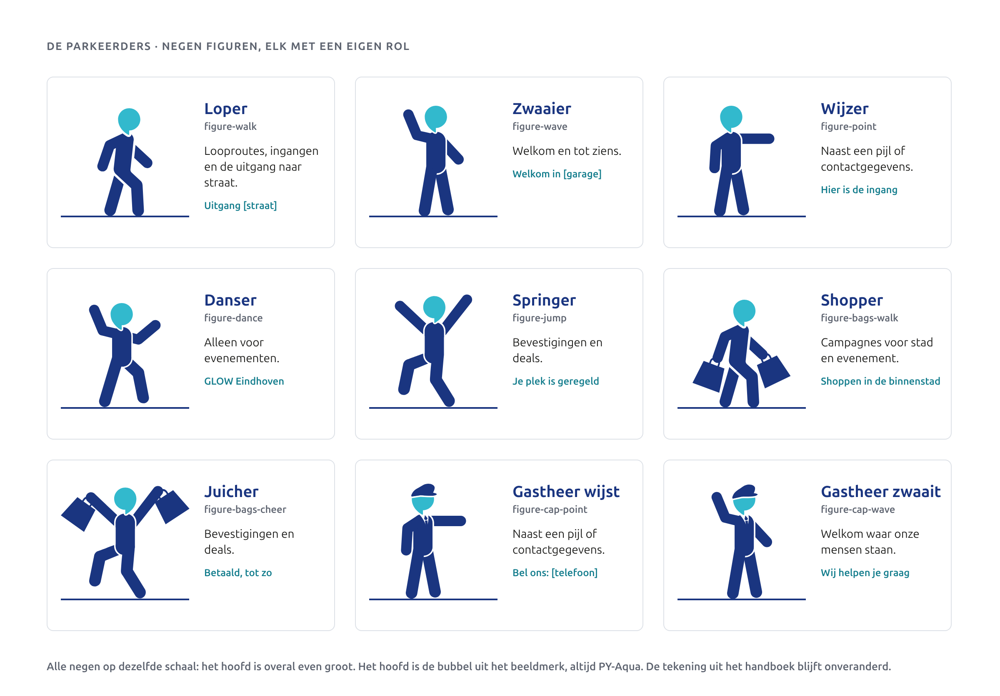

#### Eén kleur per grond

Een parkeerder is altijd één kleur, hoofd en lijf samen. De kleur volgt de grond:

- **Wit en licht** (wit, `blue.50`): PY-Blauw. Bestand `figure-*-navy.svg`.
- **PY-Blauw**: wit. Bestand `figure-*-white.svg`.
- **PY-Aqua**: PY-Blauw. Bestand `figure-*-navy.svg`.

Het hoofd krijgt nooit een eigen kleur. Geen parkeerder op een oranje betaalvlak. Dezelfde bestanden werken voor snijfolie, gravure en laser.

#### Altijd op een lijn

Een parkeerder staat altijd ergens op. Dat maakt hem een mens en geen sticker. Er zijn vier lijnen:

1. **De basislijn van een kop.** De voeten staan op dezelfde lijn als de letters.
2. **Een lijn van 0,1u**, in de kleur van de tekst.
3. **De rand van het formaat**, bijvoorbeeld de onderrand van een bord, of de ondermarge van een post of pas.
4. **De vloerlijn van een scène**, over de hele breedte, in reels en illustraties.

Nooit zwevend, nooit gekanteld, nooit afgesneden. De springer staat op één voet; die voet staat op de lijn.

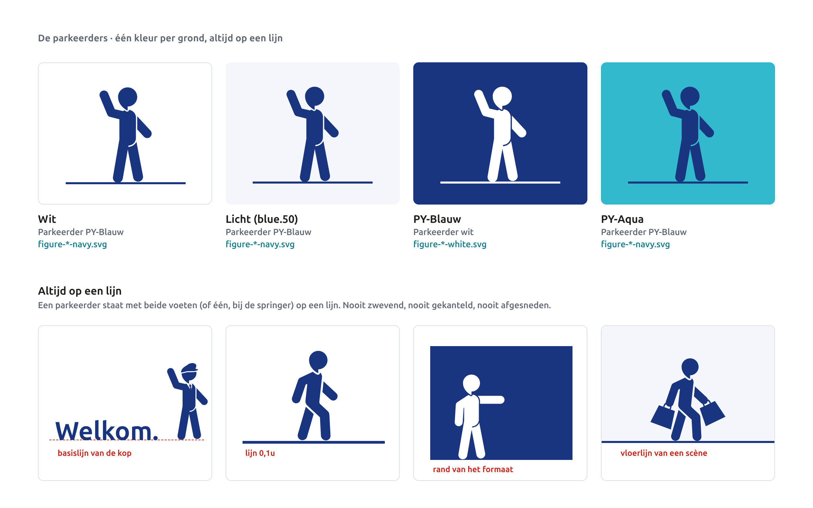

#### Maat, richting en aantal

- **Maat in layouts:** 3u tot 8u hoog, gemeten van voet tot bovenkant hoofd of pet. Op scherm 48 tot 160 px. Kleiner wordt het hoofd een stip: laat de parkeerder dan weg.
- **Op een voetgangersbord:** hooguit 60 procent van de hoogte van het vlak, op de onderrand.
- **Richting:** een parkeerder kijkt naar de route of naar de tekst. Daarvoor mag je hem spiegelen. Spiegel alleen het lijf. Het hoofd heeft de vorm van de bubbel en die spiegelt nooit: de punt blijft naar linksonder wijzen, zoals in het logo. In de figuren hieronder is dat zo gebouwd.
- **Aantal:** één parkeerder per vlak. Een volgend vlak (de achterkant, de volgende slide, de volgende scène) mag een andere pose hebben. Wissel van pose met een harde knip tussen twee bestaande figuren, nooit met bewegende armen of benen.

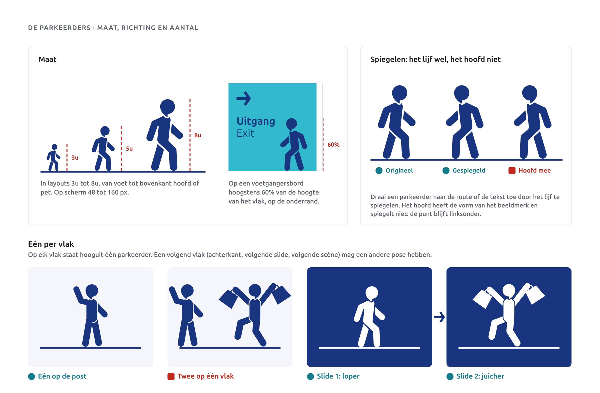

#### Samen met tekst en pijl

Hier gaat het merk leven. Een parkeerder doet iets met wat er naast hem staat.

- **Gastheer wijst naar je contactgegevens.** Zijn hand staat op de hoogte van de eerste regel, met 0,5u tussen hand en tekst. Hij staat op dezelfde lijn als het tekstblok. Spiegel het lijf als de tekst links staat.
- **Wijzer naast de pijl.** Arm en pijl wijzen dezelfde kant op. De pijl staat op armhoogte, 0,5u voor de hand, en is zo hoog als de kapitaalhoogte van de tekst ernaast. De hand raakt de pijl nooit.
- **Loper op het voetgangersbord.** Geprint bord (Dibond of folie) in aqua. De loper staat op de onderrand en loopt de kant van de pijl op. Hij is geen routepictogram: het pictogram voor lopen, lift of trap komt uit de pictogramset.
- **Juicher in de bevestiging.** Na betalen of reserveren, op een lijn boven de kop. Nooit naast een foutmelding.
- **Zwaaier op een welkomstbanner**, met de stem voor de kop (zie Combineren).

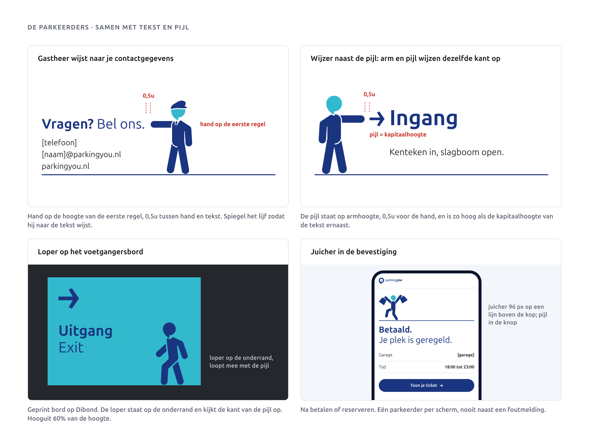

#### Wat nooit

Niet kantelen of draaien. Niet laten zweven. Niet afsnijden. Niet vervormen. Geen ander hoofd dan de bubbelvorm, en geen tweede kleur, ook niet voor het hoofd. Niet in een bubbel. Geen tekstballon of tekst die hij "zegt". Nooit in veiligheids-, RVV- of ISO 7010-borden. Niet als routepictogram. Geen nieuwe poses tekenen.

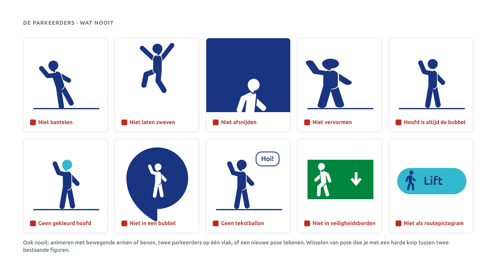

### De stem
De halve boog uit het handboek, zonder de slogan. Hij opent een boodschap, zoals iemand die begint te praten. Hij staat links van een kop of kernzin en wordt nooit gesloten.

- **Hoogte h** = het tekstblok dat hij opent: aantal regels x regelafstand. Eén tot drie regels.
- **Lijndikte** h/25, minstens 1,5 px of 0,5 mm.
- **Afstand** 0,3h, gemeten van de punten van de boog tot de eerste letter.
- **De kop mag breken** na de vette kernwoorden: "**Welkom**" op de eerste regel, "in [garage]." op de tweede. Het vette deel is ExtraBold 800 in grote koppen en Bold 700 in kleinere koppen, de rest Regular.
- **Kleur:** PY-Aqua op wit en op PY-Blauw; PY-Blauw op PY-Aqua.
- **Aantal:** één per vlak in layouts.
- **Op borden** scheidt de stem de modules: pijl, pictogram, tekst. Even hoog als de modules, zelfde lijndikte (1/25), aan beide kanten 0,3h ruimte. Aqua op navy en PY-Blauw op aqua. Zoveel als er overgangen zijn.
- **In beweging** tekent de stem zich van boven naar beneden; daarna komt de tekst.

Nooit een tweede boog rechts om de tekst te sluiten. Nooit rechts van de tekst. Nooit dikker dan h/25. Geen cursieve slogan in de boog.

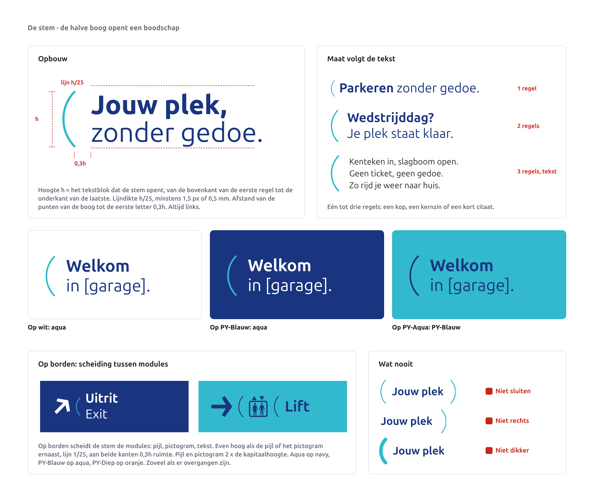

### De bubbel
De bubbel is het silhouet van het beeldmerk. Je tekent hem nooit opnieuw en vervormt hem nooit; je schaalt hem alleen in zijn geheel. Het bronbestand is `kit/assets/bubble.svg`.

- **Vier maten.** 3u, 5u, 8u of 13u breed; op scherm 24, 40, 64 of 104 px. Alleen een fotobubbel in een desktopkop mag 240 px zijn.
- **Vullingen.** Navy met witte inhoud. Aqua met PY-Blauw. Wit met PY-Blauw (op wit met een rand van 1/30 van de breedte in PY-Blauw). Oranje met PY-Diep, alleen op betaalborden en automaten in de garage. Een fotobubbel draagt geen tekst.
- **Eén ding erin.** Een niveau (-1, 0, 2), een sectie (1A), een prijs, één pictogram of één woord van hooguit 6 tekens (Vrij, Info). De inhoud staat in een vierkant van 60 procent van de breedte, in het midden van de cirkel. Cijfers in ExtraBold 800, tabelcijfers. **Nooit een pijl in een bubbel.**
- **Altijd rechtop.** De bubbel draait en spiegelt nooit, net als het logo. De punt wijst altijd naar linksonder. Richting geef je met de hoekige pijl ernaast.
- **Vrije ruimte.** 1u rondom. Op scherm 8 px bij 24 en 40 px, 16 px bij grotere bubbels.
- **Aantal.** Eén bubbel per vlak. Twee mag op vlakken van 1 meter of meer, of op een bord met meerdere panelen (pyloon, overzichtsbord). Ze raken elkaar nooit. Op een kaart is de navy bubbel van 24 px de pin, één per locatie.

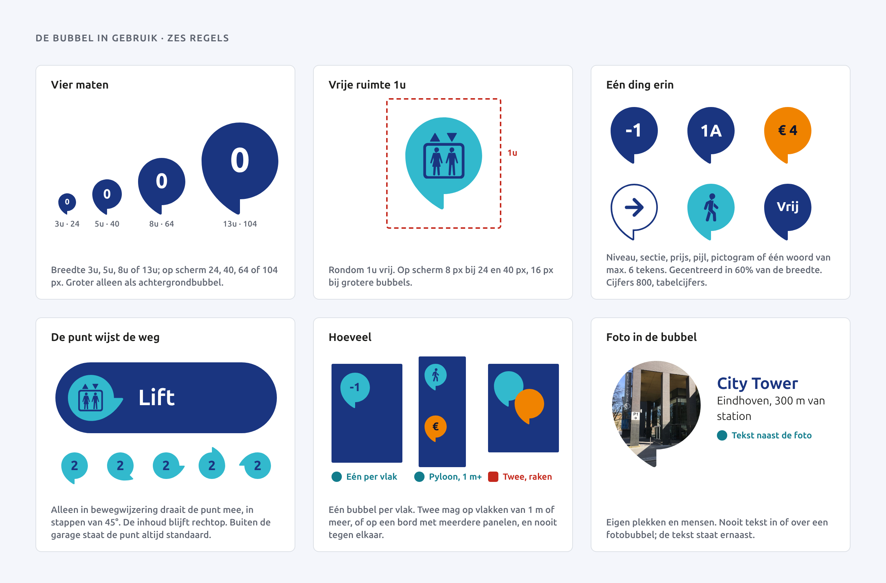

Nooit draaien of spiegelen, geen pijl erin, geen verloop, geen schaduw of 3D, niet vervormen, geen tekst langer dan 6 tekens, nooit het logo erin, nooit twee bubbels over elkaar, geen tekst op een fotobubbel, geen grote achtergrondbubbel en nooit een bubbel in een veiligheids- of RVV-bord.

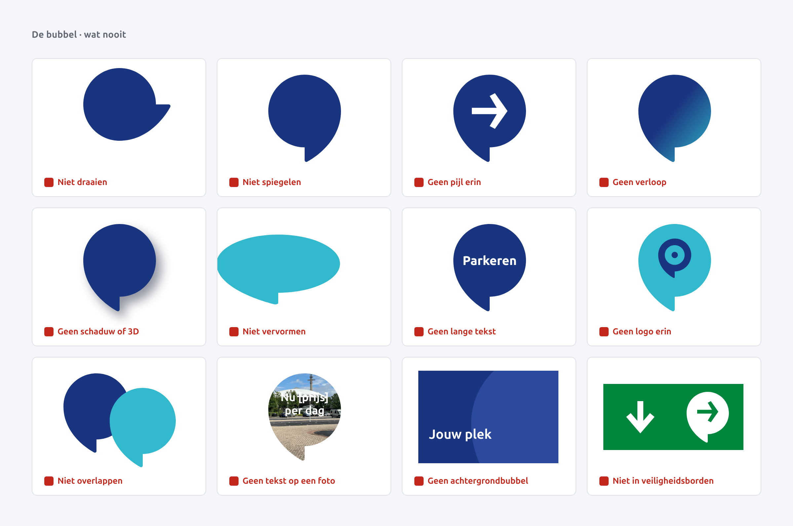

### De hoekige pijl
De pijl uit het handboek is de enige pijl. Op borden, in knoppen, in links, op social.

- **Richting** in stappen van 45 graden. Schuin is even lang als recht. Een externe link wijst 45 graden naar rechtsboven.
- **Kleur** = de inhoudskleur van de grond: PY-Blauw op wit en aqua, wit op PY-Blauw, PY-Diep op oranje (alleen betalen in de garage).
- **Maat.** In knoppen en links zo hoog als de kapitaalhoogte van het label: bij een label van 16 px is de pijl 11 px, 8 px na het label (in een link 4 px). Op borden 2 x de kapitaalhoogte, net als het pictogram.
- **Los.** Nooit in een cirkel, nooit in een bubbel. Geen chevron, geen lijnpijl en geen Tabler-pijl. Geen tussenhoeken.

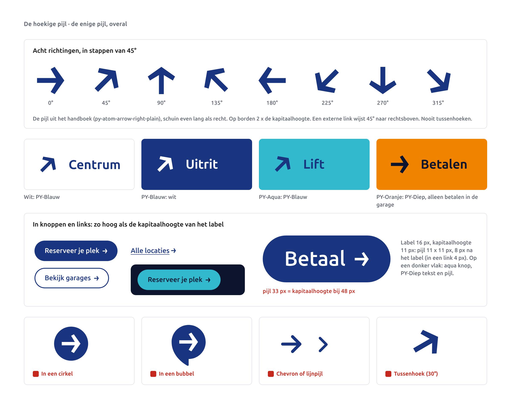

### Vlakke grond
De grond is altijd vlak: PY-Blauw of wit, en papier (`blue.50`) voor rustige delen. Er ligt niets achter de tekst: geen patroon, geen verloop, geen grote bubbel, geen decoratieve vorm. Het beeld komt van de elementen zelf.

- **De stem en één parkeerder dragen het merk.** De stem opent de kop, de parkeerder staat op een korte lijn en kijkt naar de tekst. Zo werkt het op social, de abonnementspas, de nieuwsbriefkop, de achterkant van kaarten, posters, schermkoppen en lege staten.
- **Een prijs, sectie of niveau staat in de bubbel.** Bijvoorbeeld "1A" bij je reservering of de prijs op een poster. Telt de stem al mee en staat er een parkeerder, dan komt het niveau in de tekst, niet in een derde element.
- **De korte lijn** heeft de kleur van de parkeerder. Op scherm is hij 2 px dik (`figure.body`) en steekt hij aan beide kanten 16 px (`space.4`) uit. In print en op u-formaten is hij 0,1u dik en loopt hij over de kolommen die de parkeerder raakt. Een lijn over de hele breedte mag ook: dat is de vloerlijn van een scène.
- **Navy of wit wissel je per vlak af.** Over een reeks is dat ongeveer 47 procent wit en licht, 38 procent PY-Blauw en 13 procent aqua.

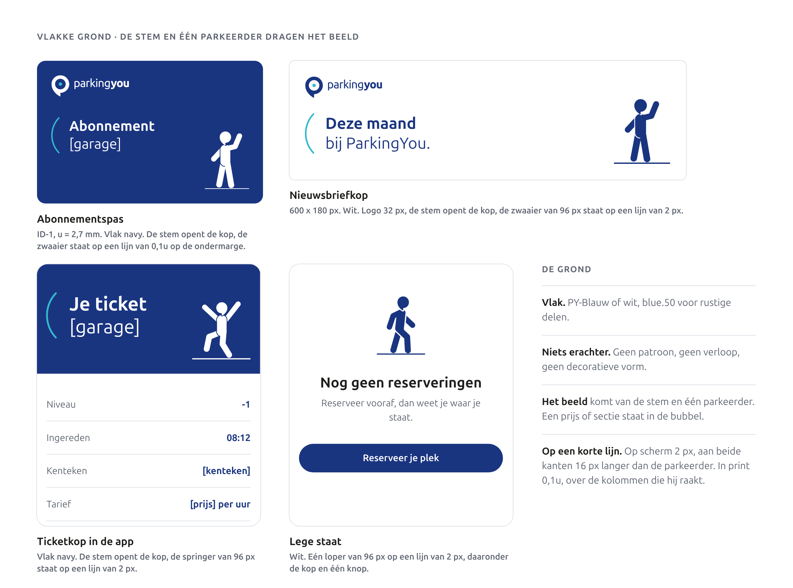

### Combineren: het logo plus hooguit twee
Elk vlak krijgt het logo en hooguit twee van de vier elementen. Het logo telt niet mee. Eén element mag altijd; twee is het maximum. Dat houdt het rustig en laat elk element zijn werk doen.

**Combinaties die werken**

| Combinatie | Wanneer |
|---|---|
| Stem + parkeerder | welkom, campagne, social, de nieuwsbrief, de achterkant van kaarten, lege staten: de stem opent de kop, de parkeerder staat op de lijn |
| Stem + bubbel | jouw plek, je reservering, een prijs of tijd bij een kop: de stem opent de kop, de bubbel draagt de sectie, het niveau of de prijs |
| Parkeerder + pijl | ingang, route, "kijk hier": de wijzer of gastheer wijst, de pijl leidt verder |
| Parkeerder + bubbel | een deal of bevestiging: de juicher staat op de lijn, de prijs staat in de bubbel ernaast |
| Pijl + bubbel of pijl + stem | borden in de garage |

**Wat niet werkt:** alles tegelijk, twee parkeerders op één vlak, een patroon of vorm achter de tekst, een gesloten stem, een pijl in de bubbel.

Op borden geldt dezelfde regel. Een bord met een pijl en een bubbel scheidt de modules met ruimte, niet met de stem.

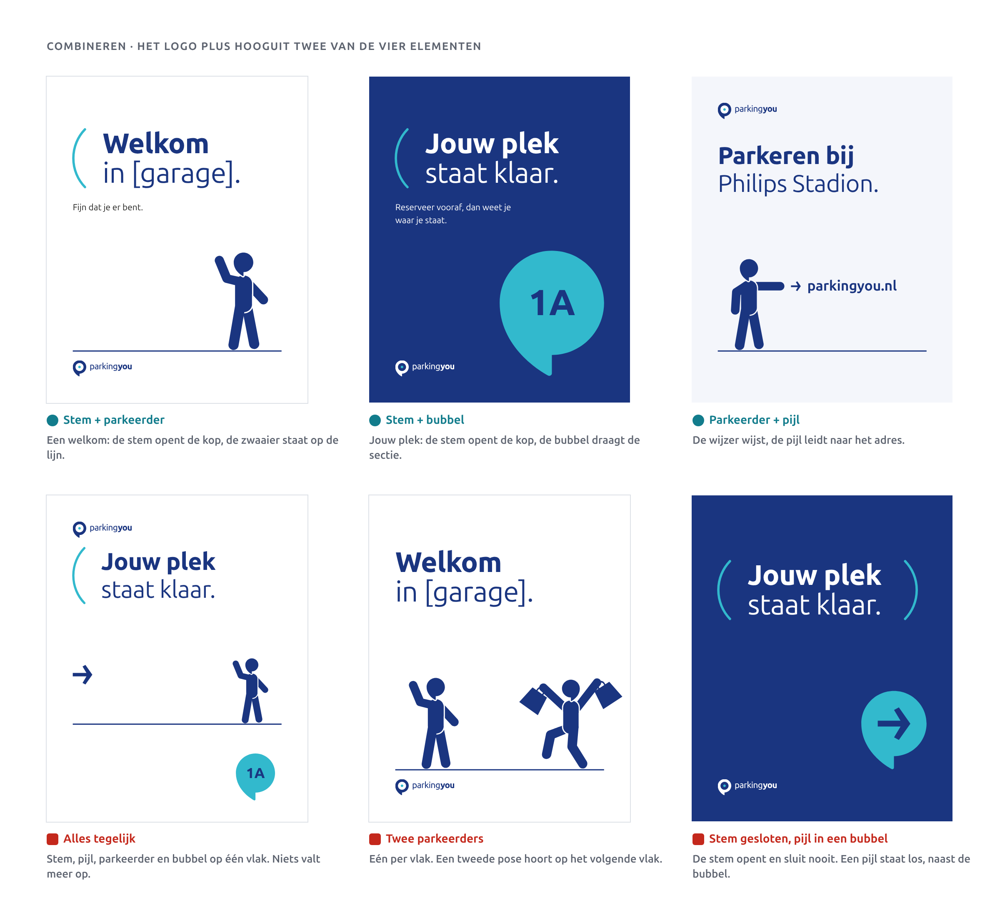

### Taakkleuren in de garage
In de garage betekent kleur iets. De elementen dragen die betekenis.

| Taak | Grond | Inhoud | Contrast | Waar |
|---|---|---|---|---|
| Rijden | PY-Blauw | wit | 11,26:1 | merk, portalen, entree, autoroute, niveaus |
| Lopen | PY-Aqua | PY-Blauw | 4,80:1 | voetgangers, lift, trap, uitgang naar straat |
| Betalen | PY-Oranje | PY-Diep | 6,87:1 | alleen in de garage: betaalautomaat, tarieven, storing |

- Lichtbakken en portalen blijven navy; daar draagt de bubbel de taakkleur. Een volledig aqua of oranje lichtvlak doen we niet.
- Geprinte borden (Dibond, folie) mogen de taakkleur als hele grond hebben.
- Op navy: witte pijl en aqua stem. Op aqua: PY-Blauw pijl, stem en loper. Op oranje: pijl en tekst in PY-Diep, geen parkeerder en geen stem.
- Buiten de garage is aqua het merkaccent. Binnen de garage betekent aqua altijd lopen.
- Veiligheids- en RVV-borden krijgen nooit merkkleur en geen element.
- Status krijgt altijd een woord naast de kleur: Vrij, Vol, Gesloten.

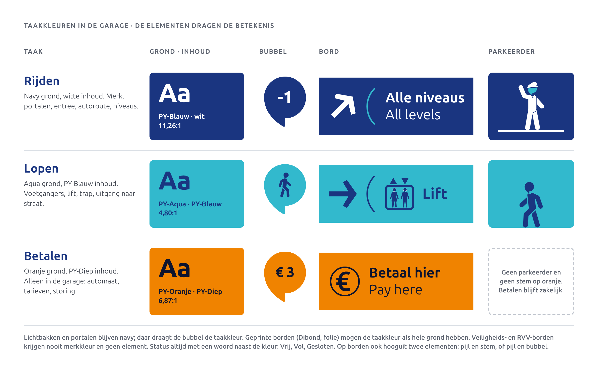

### Oude vormen: blijft, wordt, komt terug of vervalt
| Vorm uit handboek 1.4 | Besluit | Wat het wordt |
|---|---|---|
| Volvlak (bubbel) | Blijft | De bubbel, vier vaste vullingen, altijd rechtop. |
| Afbeeldingsmasker | Blijft | De fotobubbel, zonder tekst. |
| Pil, vol | Blijft | Routeborden, knoppen en chips. |
| P met dak | Blijft | Parkeerteken op entree en portaal. Geen merkvorm in marketing. |
| Niveaububbel op verloop ("0") | Wordt | Vlakke navy bubbel met wit cijfer. Wit op de aqua kant haalde maar 2,34:1. |
| Sectielabel "1A" | Wordt | De sectie wordt inhoud van de bubbel. |
| Kolomband met "1A" op verloop | Wordt | Vlakke navy band. |
| Beugelboog met slogan | Komt terug | De stem: de boog zonder slogan, links van de kop. Geen cursief. |
| Scheidingsboog | Komt terug | Gaat op in de stem: scheiding tussen modules op borden. |
| Stokfiguren (9) | Komen terug | De parkeerders, in één kleur. Het hoofd heeft de vorm van het beeldmerk. |
| Bubbel met verloop | Vervalt | Geen verloop meer. |
| Cirkel | Vervalt | Een ronde blauwe vorm met pijl lijkt op een RVV-gebodsbord. De bubbel neemt zijn taken over. |
| Pil op verloop | Vervalt | Knoppen staan op een vlakke grond. |
| Watermerk beeldmerk 5% | Vervalt | Verdwijnt in druk en in de garage. De grond is vlak. |
| Grote achtergrondbubbel | Vervalt | De grond is vlak navy of wit. Eén parkeerder op een lijn en de stem dragen het beeld. |
| Verloop blauw naar aqua | Vervalt | Alles is vlak. Bestaande borden worden bij vervanging vlak PY-Blauw. |

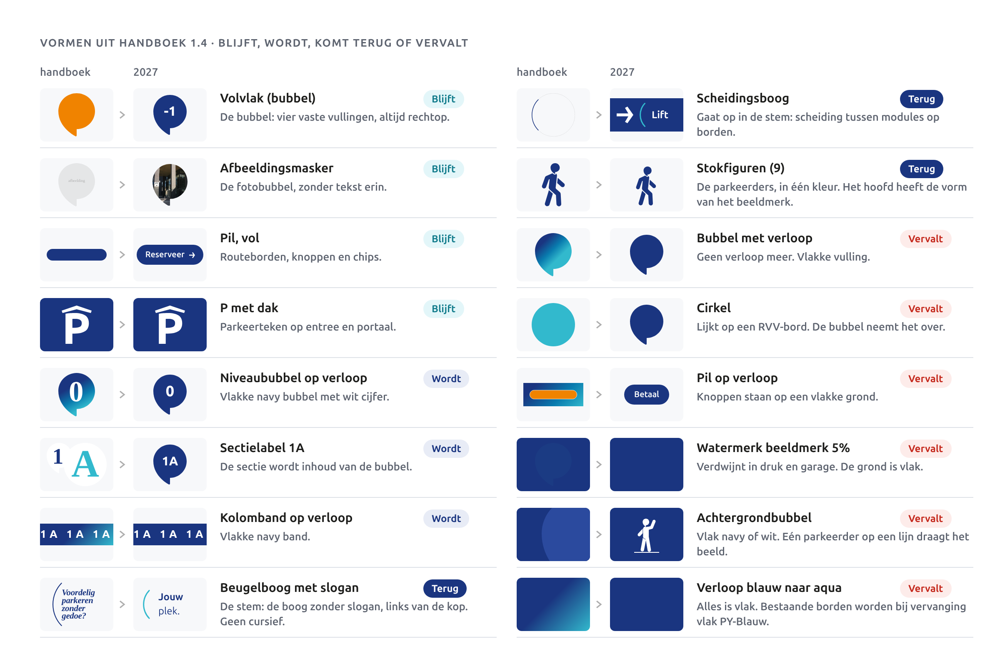

## 7. Iconografie

In dit hoofdstuk staan vier soorten tekens, elk met één taak. **De hoekige pijl** wijst de richting. **Pictogrammen** zeggen waar iets is: lift, trap, betaalautomaat. **UI-iconen** helpen je op het scherm. **De parkeerders** zijn geen teken maar ons gezicht; ze staan hier omdat ze op een pictogram lijken en dat nooit mogen worden.

Voor alle tekens geldt: de kleur is de tekstkleur van de grond, en ze staan los. Geen cirkel, geen kader, geen bubbel eromheen, behalve het ene pictogram dat in een bubbel mag.

### De hoekige pijl
Er is één pijl: de hoekige pijl uit het handboek (`svg/atom/py-atom-arrow-right-plain.svg`, in de kit `arrow-plain-navy.svg` en `arrow-plain-white.svg`). Hij staat op borden, in knoppen, in links, in lijsten en op social. Een andere pijl bestaat niet.

**Constructie.** We hertekenen de pijl niet; we schalen hem alleen gelijkmatig. Gemeten aan het bestand (250 x 250 mm), met h als hoogte van de pijl:

- De kop is even hoog als de pijl lang is: h.
- De schacht is 0,18 h dik en loopt tot 0,70 h; de kop is 0,35 h diep.
- De armen zijn 0,17 h dik en maken een punt van 110 graden.

**Acht richtingen, stappen van 45 graden.** Recht (links, rechts, omhoog, omlaag) is `arrow-plain`, gedraaid per 90 graden. Schuin is `arrow-downleft`: dezelfde pijl, die het handboek al schuin uittekende. Die draai je ook per 90 graden en je zet hem even lang als de rechte pijl. Op een scherm mag je `arrow-plain` ook 45 graden draaien; dat geeft dezelfde vorm. Andere hoeken dan stappen van 45 graden bestaan niet.

**Kleur per grond.** De pijl krijgt de inhoudskleur van zijn grond:

| Grond | Pijl |
|---|---|
| Wit, papier (`blue.50`) | PY-Blauw |
| PY-Blauw, PY-Diep | wit |
| PY-Aqua | PY-Blauw |
| PY-Oranje (alleen betalen in de garage) | PY-Diep |
| Knop PY-Blauw | wit |
| Knop PY-Aqua op donker | PY-Diep |
| Secundaire knop en link | PY-Blauw (`text.link`) |

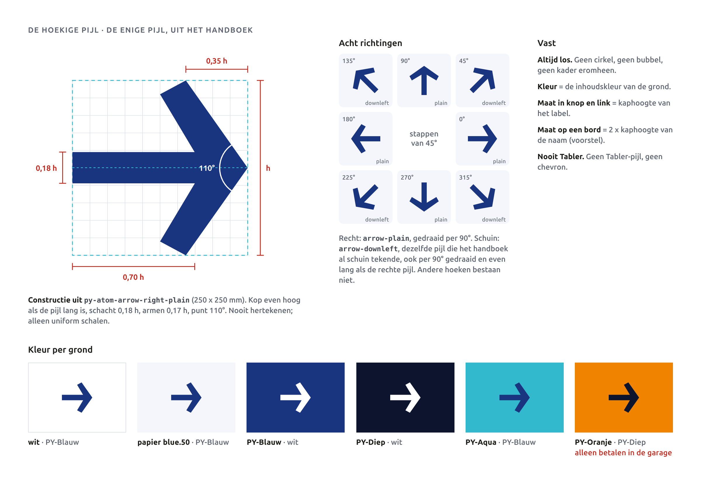

#### De pijl in gebruik

**In knoppen en links** staat de pijl op de basislijn en reikt hij tot de kaphoogte van het label. Bij `label-l` (16 px) is dat 11 px, bij `label-m` (14 px) 10 px. Tussen label en pijl zit 8 px (`space.2`) in een knop en 4 px (`space.1`) in een link. Vooruit: de pijl na de tekst. Terug: de pijl ervoor, naar links. Naar een andere site of app: schuin rechtsomhoog. Eén pijl per knop. In een knop zonder label, zoals terug in de bovenbalk, is de pijl 16 px in een vlak van minstens 44 x 44 px, met een toegankelijke naam.

**Op borden** is de pijl twee keer de kaphoogte van de naam ernaast (2k). Het tekenvlak van een pictogram op hetzelfde bord is ook 2k, zodat pijl en pictogram even zwaar staan. De pijl staat aan de kant waar hij heen wijst: rechts voor rechtsaf en rechtdoor, links voor linksaf. Tussen modules staat de stem als scheiding.

**Nooit:** de pijl in een cirkel, in een bubbel of in een kader. Nooit de punt van de bubbel als pijl gebruiken; de bubbel staat altijd rechtop. Nooit een Tabler-pijl, chevron of caret. Nooit uitgerekt of in een andere hoek dan 45 graden.


### Pictogrammen
Pictogrammen zeggen waar iets is. Ze staan op borden, op betaalautomaten en groot in de app.

- **Raster** 48 eenheden in het vierkant.
- **Veilige zone** 4 eenheden rondom. Het tekenvlak is dus 40 x 40.
- **Vorm**: gevuld en vlak. Geen lijnen, geen verloop, geen schaduw.
- **Kleur**: de tekstkleur van de grond. Wit op navy, PY-Blauw op aqua, PY-Diep op oranje. In een bubbel de inhoudskleur van die bubbel.
- **In een bubbel**: het pictogram past in het inhoudsvierkant van 60 procent van de bubbelbreedte. Eén pictogram per bubbel, nooit een pijl.

Voor de constructie gebruiken we hulplijnen, zodat pictogrammen even zwaar ogen: een cirkel van 40, een vierkant van 36, staand 32 x 40 en liggend 40 x 32. Een auto vult het liggende vlak, een voetganger het staande. De kleinste uitsparing is 2 eenheden, armen zijn 4,5, benen 5 en de romp 6,5 eenheden, kaders 3 eenheden. Deze waarden zijn goedgekeurd.


#### Hertekening: vier voorbeelden

De twaalf handboekpictogrammen zijn op verschillende formaten getekend, met wisselende lijndiktes en soms een eigen rand. We hertekenen ze op het 48-raster. Als voorstel staan er vier klaar: auto, voetganger, lift en betalen. De originelen in `kit/assets/` blijven ongewijzigd; de voorstellen staan in `06-iconografie/voorstel/`.

- **Auto.** Vooraanzicht blijft. Ruit, lampen en grille als uitsparing.
- **Voetganger.** Het hoofd blijft de bubbel, rechtop en uniform geschaald, in dezelfde kleur als het lijf.
- **Lift.** Kader 3 eenheden dik, driehoekjes erboven, figuren met lucht eromheen. De driehoekjes horen bij het liftteken; het is geen richtingpijl.
- **Betalen.** De ring om het euroteken vervalt. In een bubbel of op een bordvlak is de ring dubbel: de bubbel of het bord is al de rand.

De voetganger en de lift zijn nu nog opgebouwd uit ronde lijnen; voor productie zetten we ze om naar gesloten contouren.


#### Plan voor de andere acht

| Pictogram | Actie |
|---|---|
| Trap | Op raster zetten, treden 4 eenheden. |
| Roltrap | Vereenvoudigen: figuren weg of groter, nu te fijn op 24 px. |
| Mindervaliden | Hertekenen; de witte scheidingslijn wordt een echte uitsparing. |
| Elektrisch laden | Ring weg, auto plus stekker. |
| Gezin | Hertekenen met dezelfde lijfmaten als de voetganger. |
| Info | Wordt een losse "i". Het huidige pictogram is zelf een bubbel; in een bubbel wordt dat een bubbel in een bubbel. Op borden kan ook het woord "Info". |
| Motor | Op raster, wielen als uitsparing. |
| Toilet | Ring weg. |

Volgorde: eerst de pictogrammen die op lichtbakken en betaalautomaten staan (voetganger, lift, trap, betalen, auto, info), daarna de rest.

#### In de bubbel en op taakgronden

Op een lichtbak of portaal blijft het vlak navy en draagt de bubbel de taak: aqua voor lopen, oranje alleen bij betalen, wit voor de rest (zoals de uitrit). Op een geprint bord mag de taakkleur de hele grond zijn. In de bubbel staat één pictogram; de pijl staat altijd los ernaast. Het voorbeeld hieronder gebruikt nog de handboekbestanden. Je ziet daar ook waarom de ring van betalen en de bubbelvorm van info weg moeten.


### Pictogram of parkeerder
De voetganger en de loper lijken op elkaar: allebei een poppetje met de bubbel als hoofd. Toch doen ze iets heel anders.

- **Een pictogram zegt waar iets is.** Het hoort bij de tekst en de pijl, op het 48-raster, in één kleur. Hetzelfde teken op elk bord en in de app, zo vaak als de route vraagt. Het mag in een bubbel.
- **Een parkeerder zegt wie wij zijn.** Het is een van de negen handboekfiguren, ongewijzigd en in één kleur: navy op licht en op aqua, wit op navy. Eén per vlak, altijd op een lijn: een tekstbasislijn, een rand van het vlak of een vloerlijn. Nooit in een bubbel, nooit als routeteken, nooit op een veiligheids-, RVV- of ISO 7010-bord.

Op een voetgangersbord mogen ze samen staan. Het pictogram zit in de module met de naam en de pijl; de loper staat groot op de onderrand, hooguit 60 procent van de hoogte, en kijkt de route op. Het bord heeft dan twee eigen elementen: de pijl en de parkeerder. Een stem als scheiding past er dan niet meer bij.


### UI-iconen
Voor alles op het scherm dat geen pijl is, gebruiken we **Tabler Icons** (tabler.io/icons, versie 3.50, MIT-licentie).

- **Raster** 24 px, **veilige zone** 2 px, tekenvlak 20 x 20.
- **Lijn** 2 px op elke maat, ronde uiteinden, ronde hoeken. Geen vulling.
- **Maten** 16, 20, 24 en 32 px. 24 is de standaard.
- **Kleur** volgt de tekst: wit op navy en in de hoofdknop, PY-Blauw op wit, `text.aqua` voor lopen.
- Een icoon staat nooit alleen voor een actie zonder label, behalve in vaste patronen (sluiten, zoeken) met een toegankelijke naam.

Waarom Tabler:

- Zelfde tekenlogica als onze regel: raster 24, lijn 2, ronde uiteinden en hoeken.
- Tabler houdt 2 px vrij van de rand. Dat is precies onze veilige zone.
- Er zitten iconen in die wij echt nodig hebben: car, parking, elevator, stairs, walk, wheelchair, charging-pile, ticket, credit-card.
- MIT is gratis voor commercieel gebruik. Voorwaarde: de licentietekst meeleveren in de app en de website (bijvoorbeeld op de pagina met open-sourcelicenties).

Regels voor de set: alleen de outline-variant, nooit de filled-variant. Nooit de merkiconen uit de set (de `brand-`-iconen); dat zijn merken van anderen. **Nooit de pijlen uit de set**: geen `arrow-*`, `chevron-*`, `chevrons-*`, `caret-*` of `circle-arrow-*`. Een lijst die doorlinkt, een terugknop, een uitklapper en een keuzelijst krijgen de hoekige pijl op kaphoogte. Ontbreekt een icoon, teken het dan zelf op het 24-raster met dezelfde lijn.

Het alternatief Lucide (ISC-licentie) tekent tot 1 px van de rand en is daardoor op hetzelfde formaat iets groter. Gebruik nooit twee sets door elkaar.


### Merken van anderen
RVV-verkeerstekens, veiligheidsborden (ISO 7010, NEN 3011), betaalmerken en partnerlogo's gebruiken we zoals de eigenaar ze aanlevert. Nooit hertekend in onze stijl, nooit ingekleurd, nooit in een bubbel, nooit met een parkeerder of een pijl van ons erbij. Ze krijgen hun eigen vlak met vrije ruimte, en onze tekens staan er niet tegenaan.

Let op: de witte partner- en betaalmerken in `svg/atom/` zijn uit drukwerk gehaald. Voor nieuw werk vraag je het officiële bestand op bij de eigenaar.


## 8. Beweging

Beweging helpt je zien wat er verandert. Meer hoeft het niet te doen. We hebben twee soorten: productief voor alles in de interface, en expressief voor een paar merkmomenten. Alle waarden komen uit de tokens. Dit hoofdstuk laat beweging zien als storyboard: losse beelden op vaste tijden, geen video.

Eén regel geldt overal: **het logo en de bubbel draaien nooit.** De punt van de bubbel wijst altijd naar beneden, zoals in het beeldmerk. Richting komt van de hoekige pijl.

### Twee soorten beweging
**Productief.** Alle UI-beweging: een knop die je indrukt, een sheet die opent, een pagina die wisselt, en de hoekige pijl die een stukje in zijn eigen richting schuift. Kort en rustig, 120 tot 320 ms, met `easing.standard`, `easing.enter` of `easing.exit`. Geen stuiter, geen overshoot.

**Expressief.** Alleen op merkmomenten: de opening en het einde van een reel, het opstartscherm van de app en een bevestiging (betaald, gereserveerd). Er zijn drie expressieve bewegingen:

1. **De bubbel popt** in, 600 ms met `easing.bubble`.
2. **De stem tekent zich** van boven naar beneden, 320 ms met `easing.enter`.
3. **De parkeerder wisselt van houding** met een harde knip tussen twee figuren.

Expressief is zeldzaam; daardoor valt het op. Per vlak gebruik je het logo plus hooguit twee eigen elementen, dus ook hooguit twee van deze momenten.

### De tokens
| Token | Waarde | Gebruik |
|---|---|---|
| `duration.reduced` | 120 ms | de fade die beweging vervangt onder reduced motion |
| `duration.fast` | 120 ms | hover, druk, kleine statuswissel, dekking bij een pop |
| `duration.moderate` | 200 ms | uitklappen, sheet in, de pijl schuift |
| `duration.slow` | 320 ms | paginawissel, de stem tekent zich |
| `duration.expressive` | 600 ms | de bubbelpop |
| `easing.standard` | cubic-bezier(0.2, 0, 0, 1) | standaard voor UI |
| `easing.enter` | cubic-bezier(0, 0, 0, 1) | iets komt binnen |
| `easing.exit` | cubic-bezier(0.3, 0, 1, 1) | iets gaat weg |
| `easing.bubble` | cubic-bezier(0.34, 1.3, 0.64, 1) | de bubbelpop |


### De bubbelpop
De bubbel popt in: hij schaalt van 0,9 naar 1 in 600 ms met `easing.bubble`. Hij draait niet; de punt wijst van het eerste tot het laatste beeld naar beneden.

1. **Schaal** van 0,9 naar 1, vanuit het midden van de cirkel, 600 ms, `easing.bubble`.
2. **Dekking** van 0 naar 1 in de eerste 120 ms (`duration.fast`, `easing.enter`). Anders staat de bubbel op 0 ms al zichtbaar op 0,9.
3. **Inhoud** (cijfer, prijs, pictogram) schaalt mee. Er staat nooit een pijl in.

Bij 300 ms is de bubbel praktisch op maat, bij 400 ms is hij heel even 1,003, bij 600 ms staat hij stil. Die kleine overshoot geeft de pop; meer is er niet.

De bubbel popt één keer per moment. Nooit herhalen, nooit laten knipperen of kantelen.


### De stem tekent zich
De stem opent een boodschap, en in beweging doet hij dat letterlijk: eerst de boog, dan de woorden.

1. **De boog** groeit langs zijn eigen lijn van het bovenste naar het onderste punt, in 320 ms (`duration.slow`) met `easing.enter`. Lijndikte en ronde uiteinden blijven vast; alleen de lengte groeit.
2. **De tekst** komt als de boog staat: dekking 0 naar 1 in 120 ms (`duration.fast`, `easing.enter`). De tekst schuift niet.

Samen duurt het 440 ms. Door `easing.enter` staat de boog na 80 ms al voor tweederde; het oog ziet een snelle haal en een rustige landing. De stem tekent zich één keer per vlak, op het moment dat de boodschap begint. Nooit terug laten lopen, nooit opnieuw tekenen bij elke regel.

Kleuren zoals in de core spec: aqua op wit en op PY-Blauw, PY-Blauw op aqua.


### De parkeerders wisselen van houding
Een parkeerder beweegt niet zoals een tekenfilm. Hij wisselt van houding met een **harde knip**: het ene beeld, dan meteen het andere, zonder tussenbeelden.

- **Twee bestaande figuren.** Altijd uit de kit, ongewijzigd. De vaste paren: **loper naar juicher** (aankomen, gelukt) en **zwaaier naar wijzer** (hallo, daar is het). Shopper naar juicher werkt ook, zoals in Remotion-verhaal 2.
- **Zelfde plek.** De voeten staan voor en na de knip op dezelfde plek op dezelfde lijn. Zo zie je één persoon die iets doet, niet twee personen.
- **Tijd.** Elke houding blijft minstens 1 s staan. De knip valt op een nieuwe ondertitel of een maat van de muziek. Hooguit één wissel per scène.
- **Nooit:** armen of benen animeren, kantelen, draaien, overvloeien, laten springen of van de lijn laten zweven. Ook geen loopje over het beeld.

Een knip is geen beweging. Onder reduced motion verandert er dus niets.


### De pijl schuift
De hoekige pijl heeft één beweging: hij schuift een klein stukje in zijn eigen richting. Dat is productieve beweging, `duration.moderate` (200 ms).

- **In een knop of link**, bij hover en focus: de pijl schuift 4 px (`space.1`) vooruit met `easing.standard`, en bij loslaten met dezelfde waarden terug. Alleen de pijl beweegt; label en knop staan stil.
- **In beeld**, in een reel of een schermkop: de pijl komt 0,5u achter zijn plek vandaan en schuift in met `easing.enter`, terwijl de dekking in 120 ms van 0 naar 1 gaat. Eén keer.
- **Richting.** Een terugpijl schuift naar links, een schuine pijl schuift schuin langs zijn eigen lijn.
- **Nooit:** draaien naar een nieuwe richting (een andere richting is een andere pijl), heen en weer blijven bewegen, stuiteren met `easing.bubble`, of bewegen in een cirkel of bubbel.

Op schermen en borden in de garage beweegt de pijl nooit; daar leidt beweging bestuurders af.


### Reduced motion
Als iemand in zijn systeem minder beweging heeft gekozen (`prefers-reduced-motion`), dan:

- **UI**: `duration.moderate`, `slow` en `expressive` worden 0 ms. `duration.fast` en `duration.reduced` blijven 120 ms, zodat een korte fade de beweging vervangt. Dat regelt `tokens.css` al. Laadindicatoren mogen blijven draaien; dat is informatie.
- **Bubbel**: geen schaal, alleen dekking van 0 naar 1 in `duration.reduced`.
- **De stem**: boog en tekst verschijnen samen met dezelfde fade.
- **Parkeerder**: blijft een harde knip.
- **De pijl**: schuift niet. Komt hij in beeld, dan met de fade.
- **Video en carrousels** spelen niet vanzelf.

Los van reduced motion geldt: alles wat langer dan 5 seconden vanzelf beweegt (video, carrousel, geanimeerde banner) krijgt een zichtbare pauzeknop van minstens 44 x 44 px.


### Reels
- **Eén idee per reel.** Niet drie aanbiedingen achter elkaar.
- **Lengte** 6 tot 15 seconden.
- **Elementen.** Het logo plus hooguit twee eigen elementen per reel. Kies een paar en houd het vast, bijvoorbeeld stem en parkeerder, of bubbel en pijl.
- **Opening** (eerste 0,6 s): één merkmoment. De bubbel popt in met de prijs of het niveau, of de stem tekent zich en de kop verschijnt.
- **Verhaal**: de boodschap in beeld en tekst. Hier zit de knip van de parkeerder of het moment dat de pijl inschuift naar de actie. Eigen locaties in beeld, nooit tekst over een drukke plek.
- **Eindkaart** 1,5 seconde: logo gestapeld, 6u hoog, stil, op PY-Blauw, met het webadres eronder in regular.
- **Ondertitels** altijd aan. Kapitaalhoogte 0,4u (21,6 px op 1080 breed), wit op PY-Blauw of PY-Blauw op wit, op 26,5u tot 29u.
- **Vrije zones**: boven 250 px en onder 340 px geen belangrijke inhoud (zie Grid en layout). Kop en beeld tussen 5u en 29u.
- **Kleur**: veel wit, PY-Blauw en aqua als accent. Geen oranje, geen verloop.

De bestaande Remotion-verhalen in `remotion/` gebruiken nog het oude tokenbestand, het verloop, een grote achtergrondbubbel, een figuur in een bubbel en een figuur die huppelt. Bij de volgende versie gaan ze over op `tokens.json` van 2027, deze opbouw en de eindkaart. De knip van shopper naar juicher in verhaal 2 blijft; het huppelen en de bubbel eromheen vervallen.


### Overgangen in de interface
| Wat | Duur | Easing |
|---|---|---|
| Knop hover en druk | `duration.fast` | `easing.standard` |
| Chip, schakelaar, vinkje | `duration.fast` | `easing.standard` |
| Uitklappen en inklappen | `duration.moderate` | `easing.standard` |
| Sheet of dialoog in | `duration.moderate` | `easing.enter` |
| Sheet of dialoog uit | `duration.fast` | `easing.exit` |
| Pijl in knop of link | `duration.moderate` | `easing.standard` |
| Paginawissel | `duration.slow` | `easing.standard` |
| Bevestiging (betaald) | `duration.expressive` | `easing.bubble` |

Beweeg alleen wat verandert, één ding tegelijk. Wat van onder komt, gaat naar onder weg. Een knop verandert van kleur bij hover en druk, niet van maat. Bij uitklappen wisselt de pijl van omlaag naar omhoog zonder te draaien. Schaduw (`shadow.1` tot `shadow.3`) mag op schermlagen, nooit op de bubbel.


## 9. Fotografie en beeld

### Onze houding
We laten zien waar je echt parkeert. Onze eigen garages, ingangen en straten, en mensen die aankomen of weggaan. In daglicht of in schoon garagelicht, met natuurlijke kleur. Geen kleurlaag eroverheen, geen stockfoto's van lachende mensen in een cabrio, geen AI-beeld van onze eigen locaties. Een foto moet je helpen: je ziet de ingang, je herkent de straat. Dat is principe 5, **Echt**, in beeld.

Vandaag is dat nog niet zo. Op de website staan stockfoto's onder een blauwe kleurlaag, de nieuwsfoto's komen van iStock en één beeld in de slider op de homepage is met AI gemaakt. Alleen de locatiepagina's tonen echte garages. Dit hoofdstuk zet dat recht.


### Stijl
#### Licht

- Buiten: daglicht. Liefst ochtend of eind middag met de zon schuin, of een heldere bewolkte dag voor zacht licht. Vermijd de middagzon recht van boven: die geeft harde schaduwen over de stoep.
- Binnen: alle lampen aan, kapotte lampen eerst vervangen. Het licht moet schoon en gelijkmatig zijn. Een donkere, sombere garage gebruiken we niet in marketing.
- Avond alleen buiten en alleen bij events, zoals GLOW. Kies het blauwe uur kort na zonsondergang, als de lucht nog kleur heeft en de lightbox aan is.

#### Compositie

- Meestal op ooghoogte: zoals je de plek zelf ziet, lopend of vanuit de auto. Af en toe recht van boven, voor belijning, pijlen en vloermarkering.
- Verticale lijnen recht, horizon recht. Geen schuine camera voor effect.
- Eén onderwerp per foto. Afvalbakken, pallets en tijdelijke borden gaan uit beeld.
- Laat een rustig vlak vrij als er tekst bij komt: lucht, een lege muur of schoon asfalt.

#### Lens en scherptediepte

- Plekken: normaal tot licht groothoek, alles scherp van voor tot achter. Geen fisheye en geen vervorming die de garage groter laat lijken.
- Mensen en details: normale lens, het onderwerp scherp en de achtergrond iets zachter.

#### Kleur en nabewerking

Neutraal en iets koel, zoals beton en daglicht echt zijn. We corrigeren witbalans, belichting en rechte lijnen, verder niets: geen filter, geen duotoon, geen extra verzadiging. Het merkblauw zit in het vlak naast de foto, niet in de foto.

### Mensen en plekken
Plekken eerst. Mensen alleen als ze iets laten zien: aankomen, uitstappen, de weg zoeken, betalen, iemand helpen.

- **Wie.** Echte klanten en eigen medewerkers. Geen modellen uit een bureau en geen stockmensen.
- **Hoe.** In een echt moment: driekwart of op de rug, lopend, bezig. Niet in de lens kijken, niet poseren.
- **Toestemming.** Iedereen die herkenbaar in beeld is, tekent vooraf een modelrelease. Zonder release geen gebruik. Voor kinderen tekent een ouder, en een kind is nooit het hoofdonderwerp.
- **Voorbijgangers en auto's.** Wie geen release heeft, staat onherkenbaar in beeld of gaat eruit. Een kenteken is een persoonsgegeven: maak het altijd onherkenbaar, ook bij onze eigen auto's. Hetzelfde geldt voor schermen met namen of reserveringen.

### Wat we niet doen
- Stock lifestyle: lachende mensen met koffie, handen met een telefoon, een glimmende auto in een lege straat.
- Een kleurlaag over de foto, in blauw of welke kleur dan ook.
- Donkere, sombere garages in marketing.
- AI-beeld van een echte ParkingYou-locatie, of AI-mensen die doen alsof ze klant zijn.
- Emoji en clip-art bij een foto, en parkeerders op een foto. Onze parkeerders staan op een vlak naast de foto, nooit erin of eroverheen.
- Andere merken en logo's prominent in beeld, behalve partners en officiële verkeersborden als context.

### Uitsnede en plaatsing
Een foto staat op één van drie manieren in een ontwerp:

1. **Volle uitsnede.** De foto loopt tot de rand. Tekst en logo staan binnen de marge van 2u, op een rustig vlak.
2. **Rechthoek.** Rechte hoeken (`radius.none`), in het grid, met tekst ernaast of eronder op een vlak. Dit is de standaard voor locatiepagina's, kaarten en drukwerk.
3. **Bubbelmasker.** Zie hieronder.

Geen schuine, golvende of ronde randen, geen cirkels en geen andere vormen.


#### Tekst op een foto

Tekst staat nooit op een druk deel van de foto. Er zijn twee manieren:

- **Navy vlak.** Zet de tekst op een vlak in PY-Blauw naast of onder de foto. Wit op PY-Blauw haalt 11,26:1. Dit is de standaard en vervangt elke donkere laag of elk donker verloop.
- **Rustig deel van de foto.** PY-Blauw op een lichte lucht of muur, wit op een donker en egaal vlak. Meet het contrast op de lichtste en de donkerste plek achter de tekst. Beide moeten 4,5:1 halen, of 3:1 bij grote tekst. Haalt het dat niet, dan wordt het een navy vlak.

Het logo volgt de tabel in de kernspecificatie: kleurenlogo op een lichte foto met rustig vlak, reverse logo op een donkere foto.


### Foto in de bubbel
De bubbel met foto is een bubbel zonder inhoud. Er staat geen tekst, prijs, pijl of pictogram in.

- Alleen mensen of een detail van een plek: een bord, een deur, een koepel, een hand bij de automaat. Een hele straat wordt in een kleine vorm onleesbaar; gebruik dan een rechthoek.
- Breedte 8u of 13u (64 of 104 px op scherm). Eén bubbel per vlak, 1u vrije ruimte eromheen.
- De punt staat zoals in het beeldmerk. Nooit uitrekken, nooit hertekenen, geen rand, geen schaduw, geen kleurlaag.
- Tekst staat naast of onder de bubbel, op het vlak.


### Shotlijst eerste opnamedag
Eén garage, één dag, 28 shots in acht soorten plekken, plus één eventavond. Kies een garage met een duidelijke ingang en schone binnenruimte. Parking Philips Stadion of DLL Garage liggen voor de hand, omdat we daar al beeld van hebben. Neem blanco modelreleases mee en een collega die mensen aanspreekt.


| # | Plek | Shot | Kader | Tijd | Gebruik |
|---|---|---|---|---|---|
| 1 | Garage-ingang | Ingang frontaal vanaf de overkant, portaal, bord en gevel | ooghoogte, liggend 3:2, lucht vrij | ochtend | locatiepagina, Google-profiel |
| 2 | Garage-ingang | Auto rijdt in, kenteken onherkenbaar | schuin, staand 4:5 | middag | social, uitleg kenteken |
| 3 | Garage-ingang | Detail lightbox of portaal met beeldmerk | vierkant | bewolkt, lightbox aan | bubbelmasker, nieuwsbrief |
| 4 | Garage-ingang | Kentekencamera en slagboom | ooghoogte, vierkant | elk moment | FAQ, "zo werkt het" |
| 5 | Voetgangersingang | Ingang vanaf de stoep, bord en deur in één beeld | ooghoogte, staand 4:5 | ochtend | locatiepagina, route te voet |
| 6 | Voetgangersingang | Iemand loopt naar buiten, de straat in | rug of driekwart, staand 9:16 | middag | reels |
| 7 | Voetgangersingang | Liftknop, deur of aqua looproutebord | detail, vierkant | elk moment | bubbelmasker |
| 8 | Rijbaan binnen | Rijbaan in centraal perspectief | 1,2 m hoog, liggend 16:9 | lampen aan | website, uitleg |
| 9 | Rijbaan binnen | Lege parkeerplek met belijning | recht van boven, vierkant | lampen aan | social, rechthoek met tekst |
| 10 | Rijbaan binnen | Hoogtebalk bij de inrit | ooghoogte, liggend 3:2 | elk moment | locatiepagina, max. hoogte |
| 11 | Rijbaan binnen | Laadpaal of gehandicaptenplek, als de garage die heeft | staand 4:5 | elk moment | locatiepagina, voorzieningen |
| 12 | Betaalautomaat | Automaat frontaal, scherm en sticker leesbaar | ooghoogte, staand 4:5 | elk moment | helppagina betalen |
| 13 | Betaalautomaat | Hand met pas of telefoon bij de automaat | close, vierkant | elk moment | bubbelmasker, social |
| 14 | Betaalautomaat | Automaat in zijn omgeving, met looproute | liggend 3:2 | elk moment | locatiepagina |
| 15 | Niveaumarkering | Kolom met niveaububbel | frontaal, staand 4:5 | lampen aan | wayfinding, social |
| 16 | Niveaumarkering | Rij kolommen met sectie | perspectief, liggend 16:9 | lampen aan | website, Zakelijk |
| 17 | Niveaumarkering | Vloerpijl of vloermarkering | recht van boven, vierkant | lampen aan | rechthoek met tekst |
| 18 | Straatcontext | Garage in zijn straat, veel lucht | breed, liggend 16:9 | ochtend | websiteheader, nieuwsbrief |
| 19 | Straatcontext | Bestemming en garage in één beeld (stadion, centrum) | liggend 3:2 | ochtend | locatie- en eventpagina |
| 20 | Straatcontext | Looproute van garage naar bestemming | voetganger, staand 9:16 | eind middag | reels |
| 21 | Straatcontext | Overzicht vanaf een hoger punt (dak, parkeerdek) | van boven, vierkant | eind middag | locatiepagina, Zakelijk |
| 22 | Mensen | Bestuurder stapt uit | driekwart, staand 4:5 | middag | social, website |
| 23 | Mensen | Klant loopt met tas of koffer naar de uitgang | liggend 3:2 | middag | website, campagne |
| 24 | Mensen | Medewerker helpt een klant bij de automaat | liggend 3:2 | middag | over ons, Zakelijk |
| 25 | Mensen | Klant opent de reservering bij de ingang, echt scherm | over de schouder, staand 4:5 | middag | app, social |
| 26 | Eventavond | Ingang met lightbox aan, bezoekers vertrekken | liggend 3:2 | blauwe uur | campagnepagina |
| 27 | Eventavond | Looproute naar het event, licht op de achtergrond | staand 9:16 | blauwe uur | reels |
| 28 | Eventavond | Bezoekers lopen terug naar de garage | rug, liggend 3:2 | na afloop | nieuwsbrief na het event |

Maak van elk shot waar het kan ook een staande en een liggende variant.

### Bestandsnaam, metadata en opslag
**Bestandsnaam** (Engels, kleine letters, koppeltekens):

```
py-photo-{city}-{location}-{subject}-{yyyymmdd}-{nnn}.jpg
py-photo-eindhoven-philips-stadion-entrance-20270312-004.jpg

py-ai-{subject}-{yyyymmdd}-{nnn}.jpg
py-ai-concrete-texture-20270312-001.jpg
```

**Metadata** (IPTC, in het bestand zelf):

| Veld | Inhoud |
|---|---|
| Creator | naam van de fotograaf |
| Copyright Notice | © ParkingYou B.V. |
| Date Created | opnamedatum |
| City, Sublocation | stad en garage, bijvoorbeeld Eindhoven, Parking Philips Stadion |
| Description | korte beschrijving, basis voor de alt-tekst |
| Model Release Status | geen mensen, release aanwezig, of geen release |
| Model Release ID | nummer van de getekende release |
| Digital Source Type | `digitalCapture` voor foto's, `trainedAlgorithmicMedia` voor AI-beeld |

**Opslag.** Masters en bewerkte versies staan in één gedeelde beeldbank, per jaar en per locatie. De getekende releases staan apart, met beperkte toegang, omdat ze persoonsgegevens bevatten. In `kit/photos/` staan alleen uitsneden voor de figuren in deze gids.

### Toegankelijkheid: alt-tekst
Elke foto met betekenis krijgt een alt-tekst in het Nederlands.

- Zeg wat je ziet en waarom het ertoe doet. Noem de plek bij naam.
- Begin niet met "Foto van" of "Afbeelding van".
- Kort: één zin, liefst onder de 125 tekens.
- Staat er tekst in de foto die je nodig hebt, zoals een bord, neem die dan op.
- Een foto die alleen sfeer geeft, krijgt een lege alt (`alt=""`).
- Noem geen namen van mensen, tenzij het een medewerker is die dat wil.

Voorbeelden:

- `Ingang van Parking Philips Stadion met slagboom, een auto rijdt naar binnen.`
- `Voetgangersingang van City Tower in Eindhoven met het bord P1 en een pijl naar rechts.`
- `Straat met DLL Garage links en een kerk rechts, op een heldere ochtend.`

### AI-beeld
AI mag alleen voor sfeer en algemene texturen: beton, asfalt, lucht, licht. Altijd onder deze regels:

- **Nooit** een echte ParkingYou-locatie, ook niet "in de stijl van".
- **Nooit** mensen die als klant of medewerker worden getoond.
- **Nooit** tekst, logo's, borden of kentekens in het beeld.
- **Altijd** intern gelabeld: bestandsnaam `py-ai-`, Digital Source Type `trainedAlgorithmicMedia`, en de prompt, de tool en de datum in de beeldbank.
- Het AI-beeld op de huidige homepage wordt vervangen door een eigen foto.

#### Prompttemplate

```
Photograph of {generic subject}, no recognisable building or location.
Light: {natural daylight | soft overcast daylight | clean even LED light}.
Viewpoint: {eye level | straight top-down}, {lens: 35mm | 50mm} look, straight verticals.
Colour: neutral, slightly cool, natural, low saturation, no colour cast, no filter.
Composition: calm, one subject, {large empty area left | right | top} for text.
Format: {3:2 | 4:5 | 9:16 | 16:9 | 1:1}.
Exclude: people, faces, hands, text, letters, logos, signs, licence plates,
brand colours, lens flare, dramatic shadows, night, neon, HDR look, illustration.
```

#### Drie voorbeelden

```
1. Nieuwsbriefheader, textuur
Photograph of a smooth grey concrete wall with fine formwork lines, no recognisable
building or location. Light: soft overcast daylight. Viewpoint: eye level, 50mm look,
straight verticals. Colour: neutral, slightly cool, natural, low saturation, no filter.
Composition: calm, one subject, large empty area left for text. Format: 16:9.
Exclude: people, faces, hands, text, letters, logos, signs, licence plates, brand
colours, lens flare, dramatic shadows, night, neon, HDR look, illustration.

2. Social achtergrond achter een rechthoek, asfalt
Photograph of fresh dark asphalt with one straight white painted line, no recognisable
location. Light: natural daylight. Viewpoint: straight top-down, 35mm look.
Colour: neutral, slightly cool, natural, low saturation, no filter.
Composition: calm, one subject, large empty area top for text. Format: 4:5.
Exclude: people, faces, hands, text, letters, numbers, arrows, logos, signs, licence
plates, brand colours, cars, lens flare, HDR look, illustration.

3. Sfeer voor een seizoensactie, lucht
Photograph of a clear pale blue sky with a few thin clouds, no buildings, no trees.
Light: natural morning daylight. Viewpoint: eye level, 35mm look.
Colour: neutral, slightly cool, natural, low saturation, no filter.
Composition: calm, large empty area in the middle for text. Format: 9:16.
Exclude: people, birds, planes, sun flare, text, logos, brand colours, dramatic
sunset colours, HDR look, illustration.
```

### Check voor publicatie
- [ ] Eigen foto van een echte plek, of een gelabeld AI-beeld volgens de regels.
- [ ] Daglicht of schoon garagelicht, natuurlijke kleur, geen kleurlaag of filter.
- [ ] Verticale lijnen en horizon recht.
- [ ] Iedereen die herkenbaar is, heeft een getekende release. Release-ID staat in de metadata.
- [ ] Kentekens en schermen met persoonsgegevens zijn onherkenbaar.
- [ ] Volle uitsnede, rechthoek of bubbelmasker. Geen andere vorm.
- [ ] Tekst op een navy vlak, of op een rustig deel met gemeten contrast van 4,5:1 (groot 3:1).
- [ ] Bubbelmasker zonder tekst, alleen een mens of een detail.
- [ ] Bestandsnaam en metadata kloppen.
- [ ] Alt-tekst geschreven, of bewust leeg bij een sfeerbeeld.

## 10. UI/UX

Dit hoofdstuk zegt hoe ParkingYou eruitziet en werkt op een scherm: de website, de boekflow en de PWA met je ticket. Alles komt uit de core spec en `tokens.json`. De componentmaten staan in de core spec (besluiten D4 tot en met D13) en in het tokenbestand. De hoofdknop is navy (besluit D33).

### Principes voor schermen
1. **Eén hoofdknop per scherm.** Er is altijd één ding dat je hier het liefst doet. Dat is de hoofdknop: PY-Blauw met witte tekst, op elk scherm, of het nu zoeken, reserveren, betalen of je ticket bekijken is. De tweede keus is een omlijnde knop of een link.
2. **Geen oranje op het scherm.** Oranje betekent betalen in de garage: de automaat, het tarievenbord, de storingssticker. Op de website en in de app komt het niet voor. De enige uitzondering is tekst die waarschuwt (`feedback.warning`) en de status Vol (`status.full`), allebei oranje.700 als tekst of icoon, nooit als vlak.
3. **Het merk helpt je verder.** Onze eigen elementen staan alleen waar ze iets doen: de stem opent een belangrijke kop, een parkeerder viert, wijst of heet je welkom, de bubbel toont een prijs, niveau of beschikbaarheid, de hoekige pijl wijst naar de volgende stap. Per scherm het logo plus hooguit twee van de vier.
4. **De bubbel op een moment dat telt.** Een prijs, een niveau of beschikbaarheid. Eén bubbel per scherm, altijd rechtop, nooit als knop of avatar. De kaartpin is de uitzondering: de navy bubbel van 24 px met een witte P.
5. **Kleur nooit alleen.** Vrij, Vol en Gesloten staan altijd als woord, met kleur en een icoon erbij. Een fout staat in woorden onder het veld.
6. **Rustig en vlak.** Veel wit, grote koppen, `surface.subtle` als tweede ondergrond, kaarten met radius 16. Een kop is vlak PY-Blauw of wit, zonder patroon of vorm erachter. Schaduw alleen op kaarten en vaste balken, nooit op de bubbel, een parkeerder of het logo. Geen verloop.

### Eigen elementen op het scherm


Rick vroeg om meer eigen identiteit. Op een scherm betekent dat: het product voelt als ParkingYou op de momenten die ertoe doen, en verder blijft het rustig. We hebben vier eigen elementen: de parkeerders, de stem, de bubbel en de hoekige pijl. Elke grond is vlak: PY-Blauw of wit. Deze tabel zegt welk element waar staat.

| Scherm | Logo | Elementen | Waarom |
|---|---|---|---|
| Home | ja | stem, zwaaier | De stem geeft "**Parkeren** zonder gedoe." een stem. De zwaaier staat op de zoekkaart en heet je welkom. |
| Locatiepagina | nee | bubbel, pijl | De prijs in de navy bubbel, de pijl in "Reserveer je plek" en in de terugknop. |
| Boekflow stap 1 tot 3 | nee | pijl | Alleen de pijl in "Ga verder" en terug. Hier wil je doorlopen, niet kijken. |
| Bevestiging | nee | stem, springer | De stem opent "Je plek is gereserveerd.", de springer staat op de rand van de knoppenbalk. |
| Ticket (PWA) | nee | stem, springer | De kop is een vlakke PY-Blauw band. De stem opent "**Je ticket** is geldig.", de springer staat rechts op een korte witte lijn. |
| Lege staat | nee | zwaaier | Wit scherm, de zwaaier op een korte navy lijn, daaronder de tekst en één navy knop. |
| Foutscherm | ja | gastheer wijst | De gastheer wijst naar het contact. Hij maakt een doodlopende pagina vriendelijk. |
| Desktop locatiepagina | ja | bubbel, pijl | Zoals op de telefoon. |

**De stem.** De halve boog uit het handboek (`kit/assets/arc.svg`) staat links van een kop van één tot drie regels. Hoogte = het tekstblok, lijn = 1/25 van die hoogte (minstens 1,5 px), afstand tot de tekst = 0,3 x de hoogte. Bij een kop `heading-l` over twee regels is dat 76 px hoog, 3 px lijn, 23 px afstand. Kleur `voice.arc` (aqua.500), op wit en op navy. Alleen op home, de bevestiging en het ticket; niet op elke paginakop, want dan zegt hij niets meer.

**De parkeerders.** Eén per scherm, 48 tot 160 px hoog, altijd staand op een lijn: de rand van een kaart, de bovenrand van de knoppenbalk, of een korte lijn van 2 px in de kleur van het lijf. Een korte lijn loopt aan beide kanten 16 px (`space.4`) voorbij de figuur. Altijd één kleur: navy op wit, wit op navy, en de lijn ook. Rollen op het scherm: zwaaier op home en in een lege staat, springer of juichende shopper bij een bevestiging en op het ticket, gastheer wijst op een foutscherm of de contactpagina. Een parkeerder is decoratie: `alt=""`, de tekst zegt alles. Nooit bij een betaalfout of een veldfout: daar is iemand geld of tijd kwijt.

**Vlakke koppen.** Een kop met merk, zoals op home, de bevestiging en het ticket, is een vlakke band in `surface.brand` (PY-Blauw) of gewoon wit. Er staat geen patroon, geen vorm en geen grote bubbel achter. De stem en één parkeerder geven de kop zijn gezicht. De ticketkop is in licht en donker dezelfde PY-Blauw band.

**De bubbel.** Zie Beschikbaarheid, prijs en de bubbel. Altijd rechtop, de punt omlaag.

**De hoekige pijl.** De pijl uit het handboek (`kit/assets/arrow-plain-navy.svg`), in stappen van 45 graden. In knoppen en links achter het label, op de basislijn, zo hoog als een hoofdletter (0,693 em: 11 px bij een label van 16 px), 8 px na het label, in de tekstkleur van de knop. In de terugknop zo hoog als een hoofdletter van de titel. Alleen bij een richting of een volgende stap: "Ga verder", "Reserveer je plek", "Bekijk alles", terug, de pijl omlaag in een keuzelijst. Nooit een chevron, nooit een pijl uit de iconenset, nooit in een cirkel.

### Tokenarchitectuur


We werken in drie lagen.

| Laag | Wat | Voorbeeld | Wie gebruikt het |
|---|---|---|---|
| Primitief | De kleurwaarde zelf | `color.blue.700` #1A3580 | Alleen de semantische laag |
| Semantisch | De betekenis, met een waarde voor licht en donker | `action.primary-bg` | Componenten |
| Component | Waar het zit | `button.primary.bg` | Code en Figma |

Een component leest alleen semantische tokens, nooit een primitief. Daardoor werkt donkere modus vanzelf: dezelfde naam krijgt in `[data-theme="dark"]` een andere waarde. Spacing, radius, type, schaduw en motion zijn al tokens in `tokens.json` en worden direct gebruikt.

De elf semantische groepen en hoe componenten ze lezen:

| Groep | Tokens | Gelezen door |
|---|---|---|
| `surface` | default, subtle, raised, brand, inverse, code | pagina, kaart, veld, navy kop, toast, QR-code |
| `text` | default, muted, brand, on-brand, link, aqua, on-code | alle tekst, hulptekst, links |
| `border` | subtle, strong | kaartrand (decoratief), veldrand |
| `focus` | ring, ring-on-brand | focusring op licht en op navy |
| `action` | primary-bg/-hover/-pressed/-fg, secondary-bg/-hover/-pressed/-fg | knoppen, gekozen chip, vinkje, voortgangsbalk |
| `task` | drive, walk, pay (bg en fg) | inhoud van de bubbel |
| `voice` | arc | de stem |
| `figure` | body | de parkeerders en de lijn waarop ze staan |
| `bubble` | navy, aqua, orange, white | de bubbel; orange alleen in de garage, nooit op een scherm |
| `status` | free, full, closed | beschikbaarheid |
| `feedback` | error, error-bg, success, warning, info | meldingen en foutteksten |

In donkere modus is de pagina PY-Diep (`blue.900`), zijn kaarten `blue.800` en vlakken `blue.850`. `text.brand` en `text.link` worden aqua.300. De hoofdknop wordt aqua met PY-Diep tekst, de tweede knop krijgt een aqua.300 rand en tekst. Navy is op donker nooit tekst, rand of bubbel (1,61:1).

### Componenten
Alle componenten zijn gebouwd met echte `<button>`, `<input>`, `<label>` en `<select>`. Iconen zijn outline, 24-raster, 2 px lijn (Tabler Icons, zie het hoofdstuk Iconografie). Pijlen zijn altijd de hoekige pijl.

#### Knoppen


| Soort | Tokens | Gebruik |
|---|---|---|
| Primair | `action.primary-bg`, `-hover`, `-pressed`, `-fg` | Eén per scherm: Zoek een plek, Reserveer je plek, Betaal, Bekijk je ticket, Plan je route |
| Secundair (omlijnd) | `action.secondary-bg`, `-hover`, `-pressed`, `-fg`; rand 2 px in `action.secondary-fg` | Tweede keus naast de hoofdknop: Wijzig, Andere tijd |
| Link | `text.link` | Bekijk alles, Buitenlands kenteken?, Naar de homepagina |
| Icoonknop | `text.brand` of `text.on-brand` | Terug, Sluiten, Menu; altijd met `aria-label` |

Vorm: pil (`radius.pill`). Maten: 48 standaard, 56 voor de hoofdknop onderaan een telefoonscherm. Padding 24 of 32, icoon 20 met 8 ruimte, pijl op hoofdletterhoogte met 8 ruimte. Een knop heeft óf een icoon vooraan, óf een pijl achteraan, nooit allebei. Een knop heeft geen foutstaat: de fout staat bij het veld.

**Op een navy vlak** gebruik je de donkere waarden van de action-tokens (zet het vlak in `data-theme="dark"`): de hoofdknop wordt aqua met PY-Diep tekst, de focusring aqua. Een navy knop op navy bestaat niet.

#### Staten

| Staat | Knop primair | Knop secundair | Veld | Vinkje en rondje |
|---|---|---|---|---|
| Standaard | `action.primary-bg` (blue.700) | wit, rand en tekst 2 px blue.700 | rand 1 px `border.strong` op `surface.raised` | rand 2 px `border.strong` |
| Hover | `-bg-hover` (blue.600) | `-bg-hover` (blue.50) | rand 2 px `border.strong` | idem |
| Focus | ring 3 px `focus.ring`, 2 px los | idem | rand 2 px `focus.ring` plus ring | ring |
| Ingedrukt | `-bg-pressed` (blue.800) | `-bg-pressed` (blue.100) | n.v.t. | n.v.t. |
| Gekozen | n.v.t. | n.v.t. | n.v.t. | vlak `action.primary-bg`, vinkje `action.primary-fg` |
| Uitgeschakeld | `surface.subtle`, `text.muted`, rand `border.subtle` | idem | idem | idem |
| Fout | geen | geen | rand 2 px `feedback.error`, tekst eronder | rand `feedback.error` |
| Bezig | label plus draaiend icoon, `aria-busy` | idem | n.v.t. | n.v.t. |

Donker: primair aqua.500, hover aqua.400, ingedrukt aqua.600, tekst blue.900; secundair blue.900, hover blue.800, ingedrukt blue.850, rand en tekst aqua.300.

#### Invoervelden


- **Tekstveld.** Label boven (`label-m`), veld 48 hoog, `radius.m`, tekst `body-m` 16 px. Hulptekst onder in `body-s`, `text.muted`. Een placeholder is een voorbeeld, nooit het label.
- **Datum en tijd.** Twee velden naast elkaar, tabular cijfers. Op een telefoon opent de eigen kiezer van het toestel. Notatie: "za 14 nov 2026" en "10:00".
- **Kentekenveld.** 56 hoog, `heading-m`, hoofdletters, spatiëring 0,08 em, een NL-band in `surface.brand`. Je mag typen met of zonder streepjes; we zetten ze zelf goed volgens de Nederlandse indeling (6 tekens, bijvoorbeeld XX-123-X). `autocomplete="off"`, `spellcheck="false"`. Een link "Buitenlands kenteken?" opent een vrij veld. We imiteren de gele plaat niet: geel is geen merkkleur.
- **Keuzelijst.** Zelfde veld met de hoekige pijl omlaag rechts, op hoofdletterhoogte van de veldtekst.
- **Vinkje en rondje.** Kader 24, rij minstens 44 hoog, het hele label is klikbaar. Gekozen in `action.primary-bg`. Betaalmethodes staan als keuze op een kaart; de gekozen kaart krijgt een rand van 2 px in `action.primary-bg`.

#### Locatiekaart


De hele kaart is één link; de naam is de linktekst. Foto 96 x 96 (`radius.m`), naam `heading-s`, afstand of openingstijd in `body-s` `text.muted`, onderaan status en prijs. Kaart: `surface.raised`, `radius.l`, `shadow.1`, rand `border.subtle`. Op desktop een grote variant met foto 3:2 bovenaan en de hoekige pijl rechtsonder. In een lijst staat de prijs als tekst, niet in een bubbel.

#### Beschikbaarheid, prijs en de bubbel


- **Status.** Vrij (`status.free`, vinkje), Vol (`status.full`, streep), Gesloten (`status.closed`, slot). Altijd woord, kleur en icoon. Alleen op `surface.default` of `surface.raised`.
- **Prijs.** "€ 12,50" met spatie, komma en tabular cijfers, altijd met eenheid ("per dag", "per 30 min"). Groot in `numeric-xl`, in een kaart `numeric-m`. Nooit in oranje, niet als tekst en niet als bubbel.
- **Bubbel als UI-element.**

| Maat | Inhoud | Voorbeeld |
|---|---|---|
| 24 | P of één cijfer | kaartpin (navy, witte P), niveau "0" in een regel |
| 40 | één cijfer of icoon 24 | niveau "-1" op een vlak navy vlak (aqua, PY-Blauw cijfer) |
| 64 | woord tot 6 tekens of niveau | Vrij, Vol (navy, wit) |
| 104 | prijs met eenheid | "per dag € 12,50" op de locatiepagina (navy, wit) |

De vulling volgt de grond: navy op wit en licht, aqua op navy en in donkere modus. Gesloten past niet in een bubbel. Vrije ruimte 8 px (24, 40) of 16 px (64, 104). De bubbel draait nooit en heeft nooit een pijl erin. De grond om een bubbel is altijd vlak. De pop-in (0,9 naar 1, `easing.bubble`, `duration.expressive`, zonder draaiing) alleen op een merkmoment, zoals het openen van de app; bij reduced motion een fade van 120 ms.

**Kaart.** Elke locatie op de kaart is een navy bubbel van 24 px met een witte P, rechtop, de punt op de locatie (besluit D13). De regel van één bubbel per scherm geldt niet voor kaartdata.

#### Meldingen, toast, chips


Meldingen: tekst in `text.default`, kleur in het icoon en een rand van 1 px rondom (besluit D10). Fout krijgt `feedback.error-bg`. Een fout die je zelf oplost staat bij het veld. Een toast (`surface.inverse`) is voor een bevestiging, nooit voor een fout, en blijft minstens 6 seconden staan (besluit D12). Filterchips zijn knoppen met `aria-pressed`; gekozen is `action.primary`. Labels zijn geen knoppen.

#### Lege staat en foutscherm


- **Lege staat.** Een wit, vlak scherm. Bovenaan staat de zwaaier op een korte navy lijn. Daaronder: wat komt hier ("Je hebt nog geen tickets"), wat kun je doen, en één navy knop ("Zoek een plek").
- **Foutscherm.** Voor een hele pagina die niet bestaat, geen verbinding of onderhoud. De gastheer wijst naar het contact (info@parkingyou.nl, [telefoonnummer]) en staat op een lijn. Daaronder één hoofdknop en een link naar home.
- **Geen figuur bij een fout in een formulier of bij betalen.** Daar staat alleen de melding, rustig en concreet.

#### Navigatie


Telefoon: bovenbalk 56 met logo (beeldmerk minstens 24 hoog) en menu; in de boekflow de hoekige pijl terug, titel, sluiten en een voortgangsbalk in `action.primary-bg` met "Stap 2 van 3". De PWA heeft een onderbalk met drie tabs: Zoeken, Tickets, Account, altijd icoon plus woord. Desktop: balk 72, inhoud maximaal 1200 breed, de actieve link onderstreept in `text.brand`. Geen oranje in de navigatie.

### Hoofdschermen


- **Home.** Navy kop met het logo, de stem voor "**Parkeren** zonder gedoe." en de zwaaier op de zoekkaart. Zoekkaart met waar en wanneer, navy knop "Zoek een plek", daaronder locatiekaarten.
- **Locatiepagina.** Foto, status, naam, adres, de navy prijsbubbel (dagtarief met reservering € 12,50), feiten (700 plekken, doorrijhoogte 2,00 m, 9 min naar centrum, 24 uur open), vaste knop "Reserveer je plek" met de pijl. Op desktop staat de boekkaart rechts in 5 van de 12 kolommen.
- **Boekflow.** Drie stappen: wanneer, kenteken en gegevens, betalen. Totaal en hoofdknop staan vast onderaan. "Ga verder" heeft de pijl, "Betaal € 12,50" een slotje.
- **Bevestiging.** De stem voor "**Je plek** is gereserveerd.", een korte samenvatting, de springer op de rand van de knoppenbalk, hoofdknop "Bekijk je ticket". In beweging: een harde knip van de loper naar de springer, geen bewegende armen; bij reduced motion staat de springer er meteen.
- **Ticket (PWA).** Een tab, dus zonder terugknop. De kop is een vlakke PY-Blauw band: de stem opent "**Je ticket** is geldig." en de springer staat rechts op een korte witte lijn. Daaronder de ticketkaart met locatie en datum, kenteken groot, geldig van 10:00 tot 18:00, hoe je binnenkomt, een QR-code als reserve, doorrijhoogte en adres, navy knop "Plan je route". Het ticket moet zonder bereik werken: in de garage is vaak geen signaal.
- **Donkere modus.** Dezelfde schermen, alleen de semantische waarden wisselen. De prijsbubbel wordt aqua, de hoofdknop aqua. De ticketkop blijft een vlakke PY-Blauw band met de stem en de witte springer. De QR-code blijft donker op wit.

### Toegankelijkheid
Doel: WCAG 2.2 AA op elk scherm. Alle verhoudingen zijn doorgerekend met de WCAG-formule op de waarden in `tokens.json`.

| Criterium | Wat wij doen |
|---|---|
| 1.4.3 Contrast tekst | Alle semantische tekstparen halen 4,5:1 (`tokens/contrast.md`). Hoofdknop wit op blue.700 11,26:1, hover 8,15, ingedrukt 14,73; donker blue.900 op aqua.500 7,74, hover 9,17, ingedrukt 5,43. Tweede knop blue.700 op wit 11,26, hover 10,41, ingedrukt 9,52; donker aqua.300 op blue.900 11,01, hover 8,93, ingedrukt 10,01. Prijsbubbel wit op navy 11,26; donker blue.700 op aqua 4,80. Waarschuwing en Vol oranje.700 op wit 4,80. Status alleen op `surface.default` of `raised`: `status.full` op `surface.subtle` is 4,44:1 en faalt. |
| 1.4.11 Contrast UI | Veldrand `border.strong` 4,24:1 (licht) en 5,12:1 (donker). Rand van de tweede knop 11,26 (licht) en 11,01 (donker). Gekozen vinkje en voortgangsbalk navy op wit 11,26. Aqua bubbel op navy 4,80. De lijn onder een parkeerder: navy op wit en wit op navy, allebei 11,26. Kaartpin navy 9,86 tegen een lichte kaartgrond (neutral.100), 11,26 tegen wit. `border.subtle` (1,31:1) is decoratie, nooit de enige rand van iets dat je moet zien. |
| 1.1.1 Niet-tekstuele inhoud | De stem en de parkeerders zijn decoratie: `alt=""` of `aria-hidden`. Dat het ticket geldig is, staat in de kop als woord. De bubbel met een prijs of niveau heeft een label ("per dag € 12,50", "Niveau -1"). De pijl in een knop is `aria-hidden`; de knop met alleen een pijl heeft `aria-label="Terug"`. |
| 2.4.7 Focus zichtbaar | Ring 3 px `focus.ring`, 2 px los; op navy en donker aqua. Nooit `outline: none` zonder vervanging. |
| 2.4.11 Focus niet bedekt | De vaste balk onderaan en een cookiebalk bedekken nooit het veld met focus: `scroll-padding-bottom` gelijk aan de balkhoogte. |
| 2.5.8 Doelgrootte | Wij gebruiken 44 x 44, ook voor icoonknoppen, de terugpijl, tabs en chips (chip 36 zichtbaar, raakvlak 44). Alleen een link in lopende tekst is uitgezonderd. |
| 2.3.3 Animatie (AAA, doen we toch) | De bubbel pop en de knip van de parkeerder volgen `prefers-reduced-motion`: dan een fade van 120 ms of geen beweging. |
| 3.3.7 Dubbele invoer | Kenteken en e-mail typ je één keer. Stap 3, de bevestiging en het ticket nemen ze over. Met jouw akkoord bewaren we ze voor de volgende keer. |
| 3.3.8 Toegankelijk inloggen | Geen puzzel of overtypen van tekens. Inloggen met een link in je mail of een passkey. Plakken en wachtwoordmanagers werken; `autocomplete="email"` en `one-time-code`. |

Verder: een fout heeft `aria-invalid` en `aria-describedby`, de toast `role="status"`, de pagina werkt bij 320 px breed en 200 procent tekst.

**EAA.** Sinds 28 juni 2025 houdt de ACM toezicht op de Europese toegankelijkheidsregels voor websites en apps waarmee je een dienst koopt of reserveert, bij bedrijven met meer dan 10 medewerkers of meer dan € 2 miljoen omzet ([ACM](https://www.acm.nl/en/publications/acm-calls-businesses-prepare-themselves-new-rules-regarding-accessibility-websites-and-apps)). Boeken en betalen van parkeren valt daaronder (aanname, juridisch te bevestigen). EN 301 549 v4.1.1 neemt WCAG 2.2 AA over ([Deque](https://www.deque.com/blog/en-301-549-v4-1-1-is-final-what-changed-what-it-means-and-what-you-should-do/)). Dit geldt ook voor de boekschermen van Aeroparker: wie dat deel bouwt, moet aan dezelfde lat voldoen. Publiceer een toegankelijkheidsverklaring.

### UX-tekst
Altijd je en jij, korte zinnen, geen uitroeptekens bij fouten, geen emoji.

| Soort | Regel | Wel | Niet |
|---|---|---|---|
| Knop | Werkwoord eerst, zeg wat er gebeurt | Reserveer je plek · Betaal € 12,50 · Plan je route | Verzenden · OK · Klik hier · Doorgaan naar betaalpagina |
| Fout | Wat is er mis, en hoe los je het op | Je vertrektijd ligt voor je aankomst. Kies een tijd na 10:00. | Ongeldige invoer! · Fout 422 |
| Fout kenteken | Concreet, met voorbeeld | Dit kenteken is te kort. Een Nederlands kenteken heeft 6 letters en cijfers. | Kenteken onjuist |
| Betaalfout | Geruststellen, dan de stap | Betalen is niet gelukt. Je bent niets kwijt. Probeer het opnieuw. | Transactie mislukt |
| Bevestiging | Zeg wat er nu geregeld is | Je plek is gereserveerd. Rij gewoon naar binnen: je kenteken is je ticket. | Gefeliciteerd! · Bestelling geplaatst |
| Lege staat | Wat komt hier, wat kun je doen, één knop | Je hebt nog geen tickets. Reserveer een plek, dan staat je ticket hier. | Geen data gevonden |
| Foutscherm | Wat is er, en waar kun je heen | Deze pagina is er niet. Zoek een plek, of vraag het ons. | 404 Not Found · Oeps! |
| Geen resultaat | Geef een uitweg | Geen plek vrij op deze tijd. Kies een andere tijd of kijk in de buurt. | 0 resultaten |

Prijzen als "€ 12,50", tijden als "10:00 tot 18:00", datums als "za 14 nov 2026".

## 11. Stationery

Dit hoofdstuk gaat over alles wat we op papier en in de mail meesturen: visitekaartje, briefpapier, factuur, offerte, envelop en e-mailhandtekening. Het zijn kleine dingen, maar klanten, garage-eigenaren en leveranciers zien ze elke week. Ze moeten er net zo rustig en herkenbaar uitzien als een bord in de garage, en net zo duidelijk van ons zijn.

De basis is kort. Wit papier zonder patroon, PY-Blauw voor het merk en de koppen, Ubuntu Sans uit de printschaal, en het raster van de format unit u (korte zijde gedeeld door 20). Oranje komt in dit hoofdstuk niet voor: oranje is voor betalen in de garage, en een factuur is geen automaat.

Wat het drukwerk van ons maakt, zijn twee van onze eigen elementen:

- **De stem.** De halve boog opent een boodschap: je naam op het visitekaartje, het onderwerp van een brief, het woord "Factuur". Hij staat links van de tekst, is zo hoog als de regels die hij opent en staat op 0,3 x zijn hoogte van de eerste letter, gemeten vanaf de punten van de boog.
- **De gastheer.** Een parkeerder met pet, die naar je gegevens wijst. Hij staat op de achterkant van het visitekaartje en, als je wilt, in de voet van het briefpapier. Altijd op een lijn, nooit zwevend.

Per vlak gebruiken we het logo plus hooguit deze twee. Geen bubbel en geen pijl op kantoordrukwerk.

### De set in één tabel
| Onderdeel | Formaat | u | Marge | Elementen | Papier | Profiel |
|---|---|---|---|---|---|---|
| Visitekaartje | 85 x 55 mm | 2,75 mm | 5,5 mm | voor: logo; achter: de stem en de gastheer | ongestreken 350 g/m² (voorkeur) of gestreken mat 400 g/m² | FOGRA52 of FOGRA39 |
| Briefpapier | A4, 210 x 297 mm | 10,5 mm | 21 mm | logo, de stem, de gastheer in de voet (mag) | ongestreken houtvrij 100 tot 120 g/m², laserbestendig | FOGRA52 |
| Factuur en offerte | A4 | 10,5 mm | 21 mm | logo, de stem | als briefpapier, of pdf | FOGRA52 |
| Envelop | 220 x 156 mm (bestaand) | 7,8 mm | 15,6 mm | voor: logo; achter: de loper | ongestreken 100 tot 120 g/m² | FOGRA52 |
| E-mailhandtekening | max 600 px | n.v.t. | n.v.t. | logo, de stem | n.v.t. | sRGB |

Alle drukwerk in CMYK met 3 mm afloop. Logo's en figuren als bestand, nooit nagetekend.

### Kleur in drukwerk
| Kleur | HEX | CMYK | Gebruik in dit hoofdstuk |
|---|---|---|---|
| PY-Blauw | #1A3580 | 100 83 0 17 | logo, namen, koppen, voet, de lijn onder de gastheer, de parkeerder, vol vlak op de voorkant van het kaartje |
| PY-Aqua | #32B9CD | 69 0 21 0 | de stem en de stip in het logo |
| PY-Zwart | #1D1D1B | 0 0 0 100 | lopende tekst |
| PY-Grijs | #AEAEAE | 0 0 0 42 | haarlijnen in tabellen, vouwteken |
| Wit | #FFFFFF | papier | grond |

PY-Aqua is hier nooit tekst: aqua op wit haalt het contrast niet. Als de lijn van de stem is het ons accent, en meer aqua komt er niet op.

Op ongestreken papier (FOGRA52) zakt PY-Blauw in en wordt het iets doffer. Dezelfde CMYK-waarde geeft op gestreken papier (FOGRA39) een vollere navy. Kies per product één papier en laat de drukker een proef draaien naast de huidige visitekaartjes.

### Visitekaartje


85 x 55 mm, liggend, 12 kolommen. u = 2,75 mm, marge 2u = 5,5 mm, tussenruimte 1u.

**Voorzijde.** Vol PY-Blauw met alleen het omgekeerde logo, links op de marge en verticaal in het midden. Het beeldmerk is 3u = 8,25 mm hoog, boven het minimum van 7 mm. Verder niets. De voorkant is het merk.

**Achterzijde.** Wit. De achterkant is de mens.

- **Naam en functie.** Naam in print-h3 15/19 pt Bold PY-Blauw, functie in print-body 10/14 pt PY-Zwart, links op kolom 2.
- **De stem** opent naam en functie. Hoogte = de twee regels samen, 19 + 14 pt = 11,6 mm. Afstand van de punten van de boog tot de eerste letter 0,3 x 11,6 = 3,5 mm. De lijn is 1/25 van de hoogte, maar nooit dunner dan 0,5 mm; hier dus 0,5 mm. De stem hangt in kolom 1, de tekst begint op kolom 2.
- **Contact** in print-small 8/11 pt: telefoon, e-mail, site (Bold PY-Blauw) en adres (PY-Blauw). Tabelcijfers in telefoonnummers.
- **De contactlijn.** Op de ondermarge loopt een lijn van 0,1u (0,28 mm) in PY-Blauw over de volle breedte.
- **De gastheer wijst** staat rechts op die lijn, 4u = 11 mm hoog, gespiegeld zodat hij naar je gegevens wijst. Hij is één kleur: PY-Blauw, ook zijn hoofd.

Vaste gegevens uit de repository: ParkingYou B.V., Victoriapark 4, 5611 BM Eindhoven, info@parkingyou.nl, parkingyou.nl. Naam, functie, telefoonnummer en persoonlijk e-mailadres zijn velden: [Voornaam Achternaam], [Functie], [telefoonnummer], [voornaam]@parkingyou.nl.

### Briefpapier en envelop


A4 staand, 6 kolommen van 19,25 mm met 10,5 mm tussenruimte, marge 21 mm.

- **Logo** in kleur linksboven, beeldmerk 1,5u = 15,75 mm hoog.
- **Adresveld** op 4,5u (47,25 mm) van boven, 84 x 42 mm. Zo past de brief later ook in een vensterenvelop.
- **Datum en kenmerk** op 10u van boven: labels print-small 8 pt SemiBold PY-Blauw, waarden 8 pt.
- **Onderwerp** in print-h2 22/26 pt Bold PY-Blauw, één regel. **De stem** opent het onderwerp: 26 pt = 9,2 mm hoog, lijn 0,5 mm, 2,8 mm tot de eerste letter. De stem hangt in de marge, zodat de tekst op de marge blijft.
- **Lopende tekst** in print-body 10/14 pt, PY-Zwart, links uitgelijnd, nooit uitgevuld.
- **Voet** in print-small 8/11 pt PY-Blauw, drie blokken: adres, contact, en KvK, btw en IBAN. Daaronder een voetlijn van 0,1u (1,05 mm) in PY-Blauw op de ondermarge.
- **De gastheer in de voet** mag, hoeft niet. Hij staat links op de voetlijn, 3u = 31,5 mm hoog (de kleinste maat), en wijst naar de gegevens. Gebruik hem op brieven aan klanten; laat hem weg op juridische en financiële brieven.
- **Vouwteken** op 148,5 mm in PY-Grijs. De brief gaat één keer dubbelgevouwen in de envelop van 220 x 156.

In Word werkt het briefpapier met Arial: 10 pt tekst, 22 pt Bold onderwerp. Logo, stem, voet en gastheer staan vast in de kop- en voettekst van het sjabloon, zodat niemand ze kan verschuiven. De stem staat in het sjabloon als vaste afbeelding naast de onderwerpregel.

**Envelop.** De envelop van 220 x 156 mm blijft, het is een bestaand formaat. u = 7,8 mm, marge 15,6 mm. Voorzijde: linksboven het logo in kleur met beeldmerk 2u = 15,6 mm, daaronder de afzender op één regel in print-small PY-Blauw. Rechtsboven blijft de plek voor de postzegel vrij, rechtsonder de plek voor adres of etiket; daar komt niets van ons. Achterzijde: op de rand van de klep loopt de loper, 3u = 23,4 mm, met parkingyou.nl ernaast. Zo zie je ook aan de achterkant van wie de brief komt.

Het huidige bestand is RGB en zegt PDF/X-1a te zijn. Het nieuwe bestand is echt CMYK, PDF/X-4 of X-1a, zonder snijtekens; die zet de drukker.

### Factuur en offerte


Zelfde raster, logo en voet als het briefpapier, zonder gastheer: op een factuur telt het bedrag.

**Kop.** "Factuur" of "Offerte" in print-h1 32/36 pt Bold PY-Blauw, op de plek van het onderwerp, geopend door de stem (36 pt = 12,7 mm hoog, lijn 0,5 mm).

**Gegevensblok.** Klantadres links in het adresveld. Rechts, vanaf kolom 4, de labels in 8 pt SemiBold PY-Blauw (Factuurnummer, Factuurdatum, Vervaldatum, Klantnummer) met de waarden rechts uitgelijnd in 10 pt. Voor de offerte: Offertenummer, Datum, Geldig tot, Contact.

**Tabel.** Kolommen Omschrijving, Aantal, Prijs, Bedrag incl. btw. Kopregel in print-small 8 pt Bold PY-Blauw met een lijn van 0,5 pt in PY-Blauw eronder. Regels in print-body 10/14 pt met een haarlijn van 0,25 pt in PY-Grijs. Getallen rechts uitgelijnd met tabelcijfers, zodat de komma's onder elkaar staan. Bedragen als € 50,00: spatie na het euroteken, komma, nooit ",-". Geen gekleurde rijen, geen oranje bedragen.

**Totaal.** Totaal excl. btw en btw in 10 pt, het totaal in print-h3 15 pt Bold PY-Blauw. Daaronder één betaalzin: "Betaal € [bedrag] binnen [14] dagen op [IBAN] t.n.v. ParkingYou B.V. Zet [factuurnummer] in de omschrijving."

De voorbeeldfactuur rekent met echte tarieven: dagtarief Parking Hofplein € 7,50, per 60 minuten Parking Maashaven € 8,00 en verloren kaart € 50,00. De offerte laat de producten zien (Abonnement, ParkingPass, Waardekaarten) met bedragen als [placeholder]. Onder de offerte staat een akkoordblok met Naam, Datum en Handtekening.

Komt de factuur uit een boekhoudpakket, dan leveren we een html- of Word-sjabloon met dezelfde maten en de stem als vaste afbeelding. Kan het pakket geen eigen letter, dan Arial.

### E-mailhandtekening


Eén handtekening voor iedereen, gebouwd als html-tabel met inline stijl, maximaal 600 px breed.

- Arial 14/20 px. Naam Bold in PY-Blauw, functie in PY-Zwart.
- **De stem** opent naam en functie: 2 x 20 px = 40 px hoog, 12 px tot de eerste letter, lijn 1,6 px. Hij staat als PNG op 2x (18 x 80 px, getoond als 9 x 40 px) in PY-Aqua op een transparante grond; aqua blijft zichtbaar in lichte en donkere modus.
- Logo als PNG op 2x (280 x 96 px, getoond als 140 x 48 px) met een eigen wit vlak van 8 x 12 px rondom het logo. Een transparante logo-PNG verdwijnt in donkere modus.
- Daaronder telefoon, e-mail en site op één regel; links in PY-Blauw, onderstreept, de site Bold.
- Bedrijfsregel in 12/16 px, neutral.600 (5,94:1 op wit).
- Geen banners, geen citaten, geen sociale iconen, geen parkeerder, geen tweede logo. Alt-tekst van het logo: "parkingyou"; de stem heeft een lege alt-tekst.

Logo en stem staan op een vaste url (de site of een cdn), niet als bijlage.

### Bestanden en sjablonen
| Bestand | Wat |
|---|---|
| py-businesscard-85x55.indd en .idml | sjabloon visitekaartje, voor en achter, met velden, stem en gastheer vast |
| py-businesscard-[naam].pdf | drukbestand per persoon, CMYK, 3 mm afloop |
| py-letterhead-a4.indd en py-letterhead-a4-print.pdf | voorbedrukt briefpapier, met en zonder gastheer |
| py-letterhead-a4.dotx | Word-sjabloon met Arial, logo, stem en voet vast |
| py-invoice-a4.dotx en py-invoice-a4.html | factuur, voor Word en voor het boekhoudpakket |
| py-quote-a4.dotx | offerte met akkoordblok |
| py-envelope-220x156.pdf | envelop voor en achter, CMYK |
| py-email-signature.html | handtekening, inline stijl |
| py-logo-mail@2x.png | logo voor mail, 280 x 96 px met wit vlak |
| py-stem-mail@2x.png | de stem voor mail, 18 x 80 px, PY-Aqua, transparant |
| figure-cap-point-navy.svg | de gastheer wijst, uit de kit, één kleur PY-Blauw, voor kaartje en briefpapier |

De maten van adresveld, vouwteken, gegevensblok, mail-logo en papier zijn eerder goedgekeurd (besluit D28) en blijven staan.

## 12. Toepassingen

Dit hoofdstuk laat zien hoe het systeem werkt waar klanten ons tegenkomen: in de garage, op de automaat, op de pas, in hun feed en mailbox, en op de bus en de jas van onze mensen. Alles komt uit dezelfde bouwstenen: PY-Blauw, de drie taakkleuren, Ubuntu Sans, de format unit u, en onze vier eigen elementen: de parkeerders, de stem, de bubbel en de hoekige pijl. De grond is altijd vlak: PY-Blauw of wit, voor rustige delen het papier blue.50. Geen patroon en geen decoratieve vorm.

Drie regels sturen bijna elke beslissing hieronder:

- **Kleur betekent iets.** Navy is rijden en het merk, aqua is lopen, oranje is betalen. Oranje zie je alleen bij de automaat, op de tariefstrook en op de stickers van de automaat. Niet op posters, niet in social, niet op de bus.
- **Per vlak het logo plus hooguit twee elementen.** Een routebord heeft de stem en de pijl. Een social post de stem en één parkeerder. Meer is drukte.
- **Letterhoogte volgt de leesafstand.** Op borden is de kaphoogte 10 mm per meter leesafstand, met 12 mm als minimum. Fontgrootte = kaphoogte / 0,693.

Alle borden zijn vlak en **mat**. Geen verloop, geen schaduw op merkvormen. Lichtbakken en portalen hebben een navy front.

### De bordenfamilie


Buiten werken de P met dak en de locatienaam op afstand. Binnen wijzen navy borden de auto de weg, aqua borden de voetganger, en oranje staat alleen bij de automaat en de tarieven. De familie herken je aan drie dingen die overal terugkomen:

- **De hoekige pijl.** Altijd de handboekpijl, los op de grond, in de inhoudskleur, in stappen van 45°. Op borden is hij 2 x de kaphoogte (2k). Een schuine pijl is dezelfde pijl gedraaid, dus even lang. Nooit in een bubbel, nooit in een cirkel.
- **De stem als scheiding.** Tussen twee modules (P en pijl, pijl en pictogram, pictogram en tekst) staat de halve boog. Hij is zo hoog als de pijl of het pictogram ernaast, de lijn is 1/25 van die hoogte, met 0,3 x die hoogte lucht aan beide kanten. PY-Aqua op navy, PY-Blauw op aqua.
- **De bubbel rechtop.** Voor niveaus en secties, nooit gedraaid, nooit met een pijl erin.

Pictogrammen krijgen op hetzelfde bord een tekenvlak van 2k, net als de pijl. De parkeerders komen op borden alleen als merkmoment: de loper op de voetgangersingang en op routeborden naar een bestemming buiten de garage, de zwaaier op de welkomstwand. Waar een pictogram nodig is (uitgang, lift, trap, toilet) blijft het pictogram en komt er geen figuur.

| Bord | Maat (mm) | u (mm) | Kap grootste tekst | Leesafstand | Pijl (2k) | Overige maten | Materiaal en afwerking | Kleur |
|---|---|---|---|---|---|---|---|---|
| Entreelichtbak inrit | 1000 x 1000 x 100 | 50 | 100 (font 144) | 10 m | 200 | beeldmerk 200, P met dak 400, stem 200 | opaal beeldplaat met blockoutfolie, LED, profiel RAL 5002, mat | navy front, wit, stem aqua |
| Entreelichtbak voetgangers | 1000 x 1000 x 100 | 50 | 100 (font 144) | 10 m | 200 | beeldmerk 200, loper 540 | als inrit | navy front, wit |
| Portaal 1-baans | plaat 520 (luxe) of 500 (standaard) x breedte rijstrook | 26 | 125 (font 180) | 12,5 m | geen | beeldmerk 250, P met dak 416, stem 250 | aluminium 2 mm met folie en mat laminaat, of heldere plaat met blockout en LED | navy, wit, stem aqua |
| Hoogtebalk | 2000, 2500 of 3000 x 90 | 4,5 | 40 (font 58) | 4 m | geen | banden 250 | aluminium RAL 9010, rode folie 3M 580-72, zwarte retroreflecterende letters | rood en wit, geen merkkleur |
| Routebord rijden | 200 x 600, 800 of 1000, radius 100 | 10 | 70 (font 101) | 7 m | 140 | pictogram 140, stem 140 | sandwichpaneel, full colour folie, mat laminaat | PY-Blauw, wit, stem aqua |
| Routebord lopen | 200 x 1000 | 10 | 70 (font 101) | 7 m | 140 | als rijden; loper 115 bij bestemmingen buiten | als rijden | PY-Aqua, PY-Blauw |
| Bord betaalautomaat | 200 x 800 of 1000 | 10 | 70 (font 101) | 7 m | 140 | pictogram 140, stem 140 | als rijden | PY-Oranje, PY-Diep |
| Niveauaanduiding | 420 x 350 | 17,5 | 78 (font 112) | 7,8 m | geen | bubbel 13u = 227,5 | sandwichpaneel op kern RAL 9006, mat | navy, witte bubbel, cijfer PY-Blauw |
| Kolomband sectie | 300 x omtrek kolom | 15 | 66 (font 95) | 6,5 m | geen | bubbel 13u = 195, één per vlak | muurfolie, UV-print, mat laminaat | navy, witte bubbel |
| Welkomstwand | 3000 x 1000 (voorstel) | 50 | 100 (font 144) | 10 m | geen | beeldmerk 200, stem 300, zwaaier 600 | muurfolie of spandoek, mat | navy, wit, stem aqua |
| Pyloon voorzijde | 400 x 1000 | 20 | 25 (font 36) naam, 12 (font 17) rest | 2,5 m en 1 m | geen | P met dak 120, kopbalken 30 | sandwichpaneel, folie, mat; RVS staanders RAL 9006 | navy, wit, oranje tariefstrook |
| Tariefstrook (deelfolie) | 110 x 400 | 5,5 | 12 (font 17) | 1 m | geen | vier regels, steek 22 | folie, mat laminaat | PY-Oranje, PY-Diep |

Kaphoogtes van entree, portaal, route, niveau en kolom zijn eerder goedgekeurd (besluit D29) en blijven staan.

### Entreelichtbak


De lichtbak bij de entree is het eerste dat je van ons ziet. Het front is navy; alleen wit en aqua lichten op.

**Inrit.** Bovenaan het omgekeerde logo met een beeldmerk van 200 mm: twee keer de kaphoogte van de locatienaam. Daaronder drie modules op één lijn: de P met dak (400 mm, 8u), de stem in PY-Aqua en de hoekige pijl. Pijl en stem zijn 200 mm, 2 x de kaphoogte; de stem krijgt 60 mm lucht aan elke kant en een lijn van 8 mm. De pijl wijst naar de inrit, in stappen van 45°. Onderaan de locatienaam in Bold met een kaphoogte van 100 mm, leesbaar tot 10 m.

**Voetgangersingang.** Zelfde front, zelfde logo. Hier staat de loper: wit, 540 mm hoog (54 procent van het front, maximaal 60), met zijn voeten op de basislijn van "Ingang". De pijl staat los ernaast. Geen stem op dit front: logo, loper en pijl is het maximum. Moet er een pictogram komen, dan vervalt de loper.

Past een naam niet binnen de marge van 2u, gebruik dan Condensed Bold met dezelfde kaphoogte. De lichtbak hangt haaks op de gevel, onderkant minimaal 2500 mm boven de grond.

### Portaal en hoogtebalk


Het portaal leest de bestuurder in de aanrijroute, dus van verder weg: kaphoogte 125 mm, 12,5 m. Het portaal is helemaal navy: P met dak, de stem, het beeldmerk en de locatienaam. De stem is zo hoog als het beeldmerk (250 mm), met 75 mm lucht aan elke kant. Het volledige logo staat al op de lichtbak, hier is het beeldmerk genoeg. Geen bubbel, geen pijl, geen aqua vlak. De Vol/Vrij-display en de RVV-borden zijn producten van derden. Ze krijgen een eigen plek in het portaal en nooit een merkkleur ernaast als versiering.

De hoogtebalk blijft rood en wit zoals de norm vraagt, met de echte doorrijhoogte van de garage, hier Parking Philips Stadion met 2,00 m. Alleen de letter wordt Ubuntu Sans Bold.

### Routeborden


Het routebord blijft een pil van 200 mm hoog. De kleur draagt de taak: navy voor de auto, aqua voor de voetganger, oranje bij de automaat. Tekst, pijl en pictogram staan in de vaste kleurparen: wit op navy, PY-Blauw op aqua, PY-Diep op oranje.

- **Pijl en pictogram** krijgen een tekenvlak van 2 x de kaphoogte: 140 x 140 mm.
- **De stem** scheidt de modules: 140 mm hoog, lijn 5,6 mm, 42 mm lucht aan elke kant. PY-Aqua op navy, PY-Blauw op aqua, PY-Diep op oranje (voorstel, zie hieronder).
- **De pijl** wijst naar links, omhoog of schuin omhoog: dan staat hij vooraan. Wijst hij naar rechts, dan achteraan.
- **Merkmoment.** Op een aqua bord naar een bestemming buiten de garage (centrum, station, stadion) mag de loper het pictogram vervangen. Hij is één kleur PY-Blauw, 115 mm hoog, en staat op de basislijn van de tekst. Dan geen stem: loper en pijl zijn de twee elementen.

Een tweetalige tekst past niet op 200 mm bij 70 mm kaphoogte. Routeborden zijn daarom Nederlands met pictogrammen; Engels staat op pyloon, stickers en de borden waar je stilstaat. Hooguit vijf modules per bord; meer is een tweede bord.

### Niveau en sectie


Het niveau staat in een witte bubbel van 13u op een navy paneel. De bubbel staat altijd rechtop, net als het beeldmerk. Eén maat voor alle niveaus (font 112 mm, kap 78 mm), zodat ook "−1" in het inhoudsvlak van 60 procent past. Gebruik een minteken, geen streepje.

De kolomband is een vlakke navy band met op elk kolomvlak één witte bubbel met niveau en sectie, "1A". Het oude verloop met wit op aqua verdwijnt.

### Welkomstwand
De welkomstwand bij de voetgangersingang of de lift is de plek waar we hallo zeggen. Navy, het omgekeerde logo, de stem voor "Welkom bij / **Parking Philips Stadion**" (kap 100 mm, de stem 300 mm hoog) en de zwaaier van 600 mm, die op een witte lijn van 0,1u staat en naar de tekst kijkt. Je ziet hem in de bordenfamilie hierboven. Geen pijl en geen pictogram op deze wand: hij wijst niet, hij verwelkomt.

### Pyloon en tariefstrook


Alles op de pyloon staat op het minimum van 12 mm kaphoogte, behalve de locatienaam. De kopbalken zijn vlak navy. De tarieven staan op een losse oranje folie van 110 x 400 mm: verandert een prijs, dan vervang je alleen die strook. De rij met de beste prijs is Bold, niet in een andere kleur. Betaal- en partnermerken komen als aangeleverd bestand in velden van 68 x 44 mm.

Voorbeelddata: Parking Maashaven, Rotterdam (openingstijden, tarieven en de QR naar de locatiepagina).

### Betalen: automaat en stickers


Op de automaat is oranje de kleur van alles wat je doet om te betalen: pas voorhouden, code scannen, knop indrukken, en storing. Het automaatnummer is informatie en blijft navy. De pijl op "Scan hier je pas" is de hoekige pijl in PY-Diep, 2 x de kaphoogte van "Scan hier je pas" (22 pt, kap 5,4 mm, pijl 10,8 mm), los op de sticker. Op oranje staat geen bubbel. De stickers houden hun bestaande maten van het stickervel. Ze volgen de printschaal (32, 22 en 15 pt) in plaats van het bordminimum van 12 mm, en hebben een hoek van 3,18 mm (besluit D29).

### Posters en stickers


**Posters.** Marge 2u, 6 kolommen. Kop met kaphoogte 1u tot 2u, regelafstand = fontgrootte x 50/48, het kernwoord ExtraBold. Tekst 0,3u tot 0,5u. Geen oranje: ook een melding is navy op wit.

- **A2 marketing** (u = 21 mm): eigen foto als rechthoek bovenaan, wit vlak eronder. De stem opent de kop "**Parkeren** vanuit je broekzak." De wijzer (4u = 84 mm) staat op een lijn van 0,1u en wijst naar de QR. QR altijd donker op wit.
- **A3 melding** (u = 14,85 mm): wit, de stem voor "Let op.", de boodschap, en onderaan het telefoonnummer. Geen figuur, geen uitroepteken. Oranje is alleen voor een storing aan de automaat zelf.

**Stickers.** De raamsticker (136 x 46) en de NFC-sticker (rond 70) zijn navy en volgen de printschaal. Op de raamsticker opent de stem de tekst. De laadpaalsticker (250 x 300) lees je van 1,8 m: kap 18 mm, Nederlands boven, Engels eronder even groot, met 0,5u ertussen. Polymeer vinyl, mat gelamineerd, ThruCut-contour.

### Abonnementspas


ID-1, 85,6 x 54 mm, hoek 3,18 mm, u = 2,7 mm. Dit is de pas die je elke dag in je hand hebt, dus hij zegt wat een abonnement is: een vaste plek.

**Voorzijde.** Vlak PY-Blauw, zonder patroon. Linksboven op de marge het omgekeerde logo (beeldmerk 3u = 8,1 mm). Onderaan opent **de stem** in PY-Aqua twee regels: "Abonnement" in print-body 10/14 pt en de locatienaam in print-h2 22/26 pt Bold, beide wit. De stem is zo hoog als die twee regels samen (40 pt = 14,1 mm), met 4,2 mm tot de eerste letter; zijn lijn is 0,56 mm. Rechts staat **de zwaaier**, wit, 6u = 16,2 mm, op een korte lijn van 0,1u (0,27 mm) op de ondermarge. Hij is gespiegeld, zodat hij naar de tekst kijkt. Logo, stem en zwaaier: meer staat er niet op.

**Achterzijde.** Wit met de velden van de huidige pas: Abonnementsnummer en Kenteken, een veld voor een scancode als de pas er een heeft, het storingsnummer en de site. PVC 0,76 mm, mat overlay, FOGRA39.

### Social


Post 4:5 (1080 x 1350) en reel 9:16 (1080 x 1920), beide u = 54 px, marge 108 px. In een reel blijven de bovenste 250 px en de onderste 340 px vrij van tekst en logo; sleutelinhoud staat tussen 5u en 29u.

Elk template gebruikt het logo plus twee elementen, en altijd precies één parkeerder:

| Template | Grond | Elementen | Parkeerder | Kop |
|---|---|---|---|---|
| Aanbod | PY-Blauw | de stem voor de kop | gastheer zwaait, 7u, gespiegeld, op een korte lijn van 0,1u op de ondermarge | "**Jouw plek** staat klaar.", font 117 (kap 1,5u) |
| Locatie | eigen foto boven, wit onder | de stem voor de locatienaam | loper, 3u, op een lijn van 0,1u naast "9 minuten lopen" | font 78, twee regels |
| Evenement | PY-Blauw | de stem voor de kop | danser, 6u, op een lijn van 0,1u | font 90, drie regels |

De prijs is gewone tekst (€ 7,50, ExtraBold, met "per dag" ernaast), geen bubbel en nooit oranje. Het kernwoord is ExtraBold, de rest Regular; na het kernwoord mag de regel breken. Regelafstand van koppen = fontgrootte x 50/48. Tekst nooit op de foto. In het aanbod en het evenement staat het logo bovenaan op de marge (in een reel op 5u).

**De beste post** is het aanbod: vlak navy, de stem opent "**Jouw plek** staat klaar.", daaronder de prijs, en rechtsonder staat de gastheer op een korte witte lijn met zijn hand omhoog, naar de tekst gekeerd. Dat is ParkingYou in één beeld: een plek die klaarstaat, en iemand die je welkom heet. De rest van het vlak blijft leeg, en dat is de bedoeling. Voorbeelddata: Parking Hofplein € 7,50 per dag; Parking Philips Stadion, 700 plekken, 9 minuten lopen naar het centrum, doorrijhoogte 2,00 m.

In een reel wisselt de parkeerder van houding met een harde knip (bijvoorbeeld loper naar zwaaier), nooit met bewegende armen, en elke houding blijft minstens 1 s staan.

### Nieuwsbrief


Eén kolom van 600 px, opgebouwd uit vaste blokken: preheader, kop, hero-foto, hero-tekst op wit met de hoofdknop, twee inhoudsblokken, één uitgelicht blok en een navy voet met afmeldlink.

**De kop** is vlak PY-Blauw, 180 px hoog (was 272 px, zie Voorgestelde waarden). Linksboven het omgekeerde logo van 32 px, op 32 px van de rand. Daaronder opent **de stem** (PY-Aqua, 60 px) twee regels in heading-m 24/30 wit: "**Nieuwsbrief**" en de maand. Rechts staat **de zwaaier**, wit, 96 px, op een korte lijn van 2 px die gelijk ligt met de onderkant van de stem. Hij is gespiegeld en kijkt naar de tekst. Daarmee heeft de mail zijn twee elementen: verder geen bubbel en geen tweede parkeerder.

**De hoofdknop** is PY-Blauw met witte tekst, 48 px hoog, pil. Eén hoofdknop per mail. Letter: heading-l 32/38, heading-m 24/30, body-m 16/24. Ubuntu Sans als webfont, Arial als terugval. De kop gaat als één PNG op 2x (1200 x 360) met alt-tekst, zodat Outlook hem goed toont.

### Campagne: GLOW Eindhoven


Een campagne leent ons systeem en laat het staan. De grond blijft PY-Blauw, de letter Ubuntu Sans, en onze elementen blijven de dragers: de stem opent "Waar parkeren / tijdens **GLOW**?" en de shopper loopt naar het feest. Geen oranje, geen knop in campagnekleur.

De campagne mag één campagnekleur meebrengen, als lijn of kader, hooguit 5 procent van het vlak (besluit D30). Wij geven hem de mooiste plek die er is: de lijn waar de parkeerder op loopt. Daarnaast mag hij een lijn onder een kop zijn of een kader om het partnerlogo. Nooit als grond, nooit voor tekst, nooit in een bubbel en nooit in de garage. Het partnerlogo staat los naast het onze, even hoog als ons beeldmerk.

Het routebord (A3, 297 x 420) houdt zijn formaat. De bestemmingen staan met de hoekige pijl (2 x de kaphoogte), de stem en de naam op een rij. Geen pijlen in cirkels en geen witte pillen meer. Copy uit de huidige GLOW-pagina: "Waar parkeren tijdens GLOW?" en avond parkeren vanaf € 15,00 per dag.

### Servicebus en kleding


**Bus.** Navy wrap of af fabriek zo dicht mogelijk bij RAL 5002. Omgekeerd logo met beeldmerk 400 mm. Daaronder opent de stem de url (Bold, kap 100 mm, 10 m) en het storingsnummer (kap 70 mm). Op een witte lijn van 0,1u staat de gastheer wijst, wit, 800 mm (7u), en wijst naar het nummer. Op de linkerzijde dezelfde opbouw; de gastheer kijkt altijd naar de tekst. Nooit iets over ramen, naden of wielkasten. Achterdeur: alleen logo, url (kap 50 mm) en nummer op de linkerdeur, niets over de naad.

**Kleding.** Navy polo met het omgekeerde logo geborduurd op de linkerborst (80 mm breed) en groot op de rug (250 mm). Jas met hoge zichtbaarheid volgens EN ISO 20471 klasse 2 of 3: fluorescerend oranje of geel als achtergrondmateriaal (normkleur, geen PY-Oranje), schouderstuk navy. Het merk staat alleen op het navy deel, nooit op de reflecterende banden, en nooit zo groot dat het fluorvlak onder het minimum van de klasse komt. Geen parkeerder op kleding.

## 13. Do's en don'ts

Per onderwerp de belangrijkste regels. Twijfel je, dan geldt het hoofdstuk zelf, en daarna de core spec.

### Introductie en merkprincipes
- Doe: begin bij het tokenbestand, niet bij een oude PDF of een Canva-ontwerp.
- Doe: kies per vlak het logo en hooguit twee eigen elementen.
- Doe: laat een parkeerder altijd op een lijn staan, in één kleur.
- Niet: oranje buiten de betaalplekken in de garage.
- Niet: het logo of de bubbel draaien, uitrekken of hertekenen.
- Niet: witte tekst op aqua of oranje.

### Logo
- Doe: altijd het originele bestand uit `kit/assets/` of `svg/atom/`.
- Doe: de versie die bij de ondergrond hoort.
- Doe: 0,5x vrij rondom, boven de minimale maat.
- Doe: locatienaam volgens opbouw A of B.
- Niet: uitrekken, draaien, omlijnen, schaduw of andere kleuren. Ook de bubbel draai je nooit.
- Niet: het hele logo als hoofd van een parkeerder.
- Niet: het woordmerk opnieuw typen.
- Niet: beeldmerk en woordmerk los schalen of verschuiven.
- Niet: het logo in een bubbel, of het beeldmerk als bubbel.
- Niet: kleurlogo op PY-Blauw, wit op aqua of oranje, logo op een drukke foto.
- Niet: de tagline vast aan het logo.

### Kleur
| Doen | Niet doen |
|---|---|
| Veel wit; navy als merkvlak; per vlak één accent | Elk vlak vol kleur omdat het kan |
| Aqua als de stem, een bubbel op navy of een klein accent; parkeerders altijd in één kleur | Aqua als tekstkleur op wit of als knop op een licht scherm |
| Oranje alleen bij betalen in de garage: automaat, tarief, storing | Oranje knoppen, prijzen, strepen of vlakken op scherm, in druk of op social |
| De hoofdknop navy met witte tekst, op donker aqua met PY-Diep | Een oranje "Reserveer"-knop |
| In de garage kleur kiezen op taak: rijden navy, lopen aqua, betalen oranje | Aqua of oranje gebruiken omdat het vrolijk staat |
| Op aqua altijd PY-Blauw, op oranje altijd PY-Diep | Wit op aqua of oranje |
| Status met een woord | Alleen een gekleurde stip |
| Alles vlak; oude verloopborden bij vervanging vlak PY-Blauw | Een verloop, ook niet "alleen in marketing" |
| De tokens `voice.arc`, `figure.*` en `action.*` gebruiken | Kleuren uit een oud bestand pipetten |
| Mat laminaat en een proefbord in de garage | Kleur goedkeuren op een scherm |

### Typografie
| Doen | Niet doen |
|---|---|
| Ubuntu Sans in alles wat we zelf maken | Een tweede letter "voor de afwisseling" |
| De stem links van één paginakop, hoogte gelijk aan het tekstblok | Een boog rechts, twee bogen eromheen, of een boog naast lopende tekst |
| Lijn 1/25 en afstand 0,3x, uitgerekend uit de tekst | Een boog op het oog schalen |
| Eén grote kop per vlak, veel wit eromheen | Drie koppen die om aandacht vechten |
| Sleutelwoord vet, rest regular, breken na het sleutelwoord | Alles vet, of een cursief accentwoord |
| Koppen en prijzen in PY-Blauw of wit | Oranje prijzen of koppen buiten de garage |
| Tabelcijfers voor prijzen, tijden en niveaus | "€12,-" of "18.00-23.00 uur" |
| Op borden 10 mm kap per meter, minimaal 12 mm | Een kleinere letter omdat het bord vol is |
| Smal alleen voor een naam op een bord die anders niet past | Smal in lopende tekst of op schermen |
| Arial in Office en e-mail | Ubuntu Sans in een Word-bestand dat je deelt |
| Logo als bestand plaatsen | Het woordmerk natypen |

### Grid en layout
- **Do:** reken eerst u uit en zet marge, goot en kolommen neer voordat je iets plaatst.
- **Do:** zet alles op 0,5u. Twijfel je, schuif naar het dichtstbijzijnde halve u.
- **Do:** kies een van de vijf patronen en hooguit twee elementen.
- **Do:** laat wit staan. Grote kop, korte tekst, één accent.
- **Do:** houd in reels de bovenste 250 en onderste 340 px vrij van belangrijke inhoud.
- **Do:** gebruik op borden de leesafstand voor de letterhoogte, niet de u-regel.
- **Don't:** marges kleiner dan 2u, ook niet "omdat het net niet past". Maak de tekst korter.
- **Don't:** tekst op een foto of een donkere laag over een foto. Gebruik een navy veld.
- **Don't:** oranje voor prijzen of knoppen buiten de garage, en nergens een verloop.
- **Don't:** een patroon of decoratieve vorm als achtergrond, of een parkeerder die zweeft.
- **Don't:** losse pixelwaarden op schermen. Alleen `space`-tokens.

### Patronen en designelementen
- **Do:** kies per vlak het logo plus hooguit twee elementen. Begin met één.
- **Do:** kies de parkeerder bij de rol: loper bij lopen, zwaaier bij welkom, juicher bij een bevestiging.
- **Do:** zet elke parkeerder op een lijn, en laat hem naar de tekst of de route kijken.
- **Do:** laat de stem een kop openen, links, even hoog als het tekstblok.
- **Do:** houd de grond vlak: PY-Blauw of wit, `blue.50` voor rustige delen. Laat de stem en één parkeerder het beeld dragen.
- **Do:** geef richting met de hoekige pijl, los naast de bubbel of de tekst.
- **Don't:** een parkeerder draaien, laten zweven, afsnijden of twee op één vlak.
- **Don't:** de bubbel draaien of spiegelen, of er een pijl in zetten.
- **Don't:** een patroon, verloop, grote bubbel of andere decoratieve vorm als achtergrond.
- **Don't:** oranje buiten de garage, en verloop nergens.
- **Don't:** merkkleuren of elementen in of naast veiligheids- en RVV-borden.

### Iconografie
- **Do:** de hoekige pijl voor elke richting, los, in de inhoudskleur van de grond.
- **Do:** in knoppen en links de pijl op kaphoogte van het label; op borden 2k.
- **Do:** pictogrammen gevuld, op het 48-raster, binnen het tekenvlak van 40.
- **Do:** UI-iconen uit Tabler, outline, lijn 2 px.
- **Do:** de parkeerder als gezicht naast de route-informatie, op een lijn, één per vlak.
- **Do:** merken van anderen uit het originele bestand, in hun eigen kleuren.
- **Don't:** een pijl in een cirkel, bubbel of kader, of de punt van de bubbel als pijl.
- **Don't:** een Tabler-pijl, chevron of caret, ook niet in een lijst of keuzelijst.
- **Don't:** de pijl draaien in een andere hoek dan 45 graden, uitrekken of hertekenen.
- **Don't:** een parkeerder als routepictogram, in een bubbel of met een tekstballon.
- **Don't:** een parkeerder in twee kleuren, of zwevend zonder lijn eronder.
- **Don't:** een pictogram met een eigen rand of bubbelvorm in een bubbel zetten.
- **Don't:** twee sets door elkaar (Tabler en Lucide, of handboek en hertekend) op één vlak.
- **Don't:** RVV-tekens, betaalmerken of partnerlogo's natekenen, inkleuren of in een bubbel zetten.

### Beweging
- **Do:** UI-beweging altijd uit de tokens, nooit een losse waarde in code.
- **Do:** de bubbelpop, de stem en de knip alleen op merkmomenten: reel open en dicht, splash, bevestiging.
- **Do:** de parkeerder met een harde knip tussen twee kitfiguren, voeten op dezelfde plek.
- **Do:** de pijl een klein stukje laten schuiven in zijn eigen richting, één keer of op hover.
- **Do:** test elke animatie met reduced motion aan.
- **Do:** ondertitels in elke reel, ook als er geen gesproken tekst is.
- **Don't:** de bubbel of het logo draaien, kantelen, knipperen of steeds opnieuw laten poppen.
- **Don't:** een pijl draaien naar een nieuwe richting, laten stuiteren of in een cirkel laten bewegen.
- **Don't:** armen of benen van een parkeerder animeren, of figuren laten overvloeien of springen.
- **Don't:** de stem terug laten lopen of bij elke regel opnieuw tekenen.
- **Don't:** overshoot of stuiter in de UI. Die hoort alleen bij de bubbel.
- **Don't:** autoplay langer dan 5 s zonder pauzeknop.
- **Don't:** beweging in bewegwijzering of op schermen in de garage die de aandacht van bestuurders trekt.
- **Don't:** reels langer dan 15 s, met meer dan één boodschap of met meer dan twee eigen elementen.

### Fotografie en beeld
**Do**

- Fotografeer onze eigen garages, ingangen en straten.
- Werk met daglicht of schoon garagelicht, alle lampen aan.
- Houd ooghoogte aan en zet lijnen recht.
- Laat een rustig vlak vrij voor tekst.
- Zet tekst op een navy vlak als de foto druk is.
- Laat echte klanten en medewerkers zien, met een release.
- Gebruik de bubbel voor één mens of één detail.

**Don't**

- Geen stock lifestyle en geen gemaakte glimlach.
- Geen blauwe of andere kleurlaag, geen donker verloop.
- Geen donkere, sombere garages in marketing.
- Geen AI-beeld van onze locaties of AI-mensen als klant.
- Geen tekst, prijs of pictogram in een fotobubbel.
- Geen emoji of clip-art bij een foto, en geen parkeerder op de foto zelf.
- Geen leesbare kentekens.

### UI/UX
| Do | Don't |
|---|---|
| Eén navy hoofdknop per scherm, met witte tekst | Twee hoofdknoppen, of een oranje knop, prijs of bubbel op een scherm |
| Tweede knop omlijnd: wit, rand en tekst 2 px PY-Blauw | Een navy knop op een navy vlak; gebruik daar de donkere action-waarden |
| De hoekige pijl op hoofdletterhoogte bij een volgende stap of richting | Een chevron, een pijl uit de iconenset, een pijl in een cirkel of bubbel |
| De stem voor de kop van home, de bevestiging en het ticket | De stem voor elke kop, of rechts van de tekst |
| Eén parkeerder per scherm, staand op een lijn, bij welkom, bevestiging of een foutscherm | Een parkeerder bij een betaalfout, zwevend, gedraaid of met een spreekballon |
| Een vlakke kop in PY-Blauw of wit, met de stem en één parkeerder | Een patroon, vorm of grote bubbel achter een kop of lege staat |
| Per scherm het logo plus hooguit twee eigen elementen | Drie of vier eigen elementen op één scherm |
| Eén bubbel per scherm, rechtop, voor prijs, niveau of beschikbaarheid | De bubbel als knop, avatar of in elke kaart (de kaartpin is de enige uitzondering) |
| Status als woord, kleur en icoon | Een gekleurde stip zonder woord |
| Label boven het veld, fout eronder in woorden | Alleen een rode rand, of een placeholder als label |
| Componenten lezen semantische tokens | Hexwaarden of primitieven in een component |
| Raakvlak 44 x 44 | Icoonknoppen of chips kleiner dan 44 |
| QR-code donker op wit, ook in donkere modus | QR-code in aqua of op navy |

### Stationery
**Doen**
- Gebruik het logo uit de bestanden, in kleur op wit en omgekeerd op PY-Blauw.
- Open de naam, het onderwerp of het woord "Factuur" met de stem, zo hoog als de regels die hij opent, met 0,3 x die hoogte tot de eerste letter.
- Zet de gastheer altijd op een lijn: de contactlijn op het kaartje, de voetlijn op de brief. Laat hem naar de gegevens wijzen.
- Zet tekst in PY-Zwart of PY-Blauw. Koppen en namen in PY-Blauw.
- Gebruik tabelcijfers en rechts uitgelijnde bedragen in elke tabel. Schrijf bedragen als € 12,50.
- Houd de marge van 2u aan, ook in Word. Laat een drukproef maken op het gekozen papier.

**Niet doen**
- Geen oranje op briefpapier, factuur, offerte, envelop of handtekening.
- Geen stem rechts van de tekst, geen tweede stem die de zin afsluit, geen stem dunner dan 0,5 mm.
- Geen zwevende of afgesneden parkeerder, en nooit meer dan één per vlak. Geen parkeerder op factuur, offerte of in de mail.
- Geen bubbel en geen pijl op kantoordrukwerk.
- Geen verloop, schaduw of foto op het briefpapier.
- Geen tekst in PY-Aqua op wit, geen tweede blauw: de oude adresregel in CMYK 100 85,5 22,3 4 vervalt.
- Geen eigen lettertype in Word of mail: Ubuntu Sans in drukwerk, Arial in Office en mail.

### Toepassingen
**Doen**
- Reken elke kaphoogte uit de leesafstand: 10 mm per meter, minimaal 12 mm op een bord. Maak de pijl 2 x de kaphoogte.
- Zet de stem tussen modules op een bord, zo hoog als de pijl of het pictogram, met 0,3 x die hoogte lucht aan elke kant.
- Laat de hoekige pijl los staan, in de inhoudskleur, in stappen van 45°.
- Zet de bubbel rechtop, voor niveau en sectie.
- Gebruik de loper op een voetgangersingang of bord naar buiten, de zwaaier bij welkom, de gastheer bij contactgegevens. Altijd op een lijn, één per vlak.
- Houd de grond vlak: PY-Blauw of wit. Laat in social de stem de kop openen en zet de parkeerder op een korte lijn, naar de tekst gekeerd.
- Gebruik alleen wit op PY-Blauw, PY-Blauw op PY-Aqua en PY-Diep op PY-Oranje op borden. Werk mat af en test een set proefborden onder het eigen licht.

**Niet doen**
- Geen oranje buiten de automaat, de tariefstrook en de stickers van de automaat: niet op posters, social, nieuwsbrief, campagne of bus.
- Geen pijl in een bubbel of cirkel, geen gedraaide bubbel, geen pijl uit een iconenset.
- Geen verloop in de garage, op folie, poedercoat of lichtbakfilm. Geen volledig aqua of oranje lichtbakfront.
- Geen parkeerder op een bord waar een pictogram nodig is, en nooit in veiligheids- of RVV-borden.
- Geen zwevende, gedraaide of afgesneden parkeerder, en nooit meer dan één per vlak.
- Geen patroon, raster of decoratieve vorm op de grond of achter tekst.
- Niet meer dan het logo plus twee elementen per vlak.
- Geen witte tekst op aqua of oranje, geen campagnekleur als grond of tekstkleur, geen merk op reflecterende banden.

## 14. Bijlagen

### 14.1 Tokens

Alle waarden in deze gids komen uit één bron: `brand-2027/tokens/tokens.json`, in het W3C-formaat voor design tokens (DTCG). Daaruit worden `tokens.css` voor schermen en `contrast.md` met alle doorgerekende kleurparen gemaakt. Een waarde die daar niet in staat, gebruiken we niet. Wil je een nieuwe waarde, vraag het dan aan de merkbeheerder.

De tokens hebben drie lagen:

| Laag | Wat het is | Voorbeeld |
|---|---|---|
| Basis | De ruwe waarden: kleuren, maten, tijden | `color.blue.700` = #1A3580 |
| Betekenis | Waar een waarde voor dient, licht en donker | `action.primary-bg`, `text.brand`, `task.pay-bg` |
| Onderdeel | Vaste waarden per onderdeel | `button.primary.bg`, `bubble.price.bg` |

**Merkkleuren**

| Naam | HEX | RGB | CMYK | RAL | Token |
|---|---|---|---|---|---|
| PY-Blauw | #1A3580 | 26 53 128 | 100 83 0 17 | 5002 | `color.blue.700` |
| PY-Aqua | #32B9CD | 50 185 205 | 69 0 21 0 | RAL Design 220 70 35 | `color.aqua.500` |
| PY-Oranje | #F08300 | 240 131 0 | 0 57 100 0 | 2003 | `color.orange.500` |
| PY-Diep | #0D142E | 13 20 46 | 100 83 0 80 | 5004 | `color.blue.900` |
| PY-Grijs | #AEAEAE | 174 174 174 | 0 0 0 42 | 9006 | `color.neutral.400` |
| PY-Zwart | #1D1D1B | 29 29 27 | 0 0 0 100 | 9005 | `color.neutral.900` |
| Wit | #FFFFFF | 255 255 255 | 0 0 0 0 | 9016 | `color.neutral.0` |

Pantone en folie per kleur staan in hoofdstuk 3, Kleur, onder Productie.

**Maten en tijd**

| Groep | Waarden |
|---|---|
| Ruimte op scherm | 0, 4, 8, 12, 16, 24, 32, 48, 64, 96, 128 px (`space.0` tot `space.10`) |
| Hoeken | 0, 4, 8, 16, 24 px en pil (`radius.none` tot `radius.pill`) |
| Beweging | 120, 200, 320 en 600 ms (`duration.fast` tot `duration.expressive`) |
| Formaat | eenheid u = korte zijde gedeeld door 20; marge 2u, tussenruimte 1u |
| Letter | Ubuntu Sans (variabel), terugval Ubuntu, daarna de systeemletter |

**Contrast.** Elk kleurpaar voor tekst haalt WCAG 2.2 AA, in licht en donker. De volledige lijst met berekende waarden staat in `brand-2027/tokens/contrast.md`. Een paar voorbeelden: PY-Blauw op wit 11,26:1, wit op PY-Diep 18,16:1, PY-Diep op PY-Aqua 7,74:1, PY-Diep op PY-Oranje 6,39:1.

### 14.2 Bestanden

| Wat | Waar |
|---|---|
| Deze gids (bron) | `brand-2027/03-guide/volledig/ParkingYou-huisstijl-2027.md` |
| Korte gids als pdf | `brand-2027/03-guide/kort/ParkingYou-huisstijl-2027-kort.pdf` |
| Core spec, met alle besluiten | `brand-2027/02-build/core-spec.md` |
| Tokens | `brand-2027/tokens/tokens.json`, `tokens.css`, `contrast.md` |
| Logo's | `brand-2027/02-build/kit/assets/logo-*.svg`: liggend, staand, beeldmerk, woordmerk; kleur, navy, wit, zwart en reverse |
| De parkeerders | `brand-2027/02-build/kit/assets/figure-*-navy.svg` en `-white.svg`, gespiegeld met `-flip` |
| Stem, bubbel en pijl | `arc.svg`, `bubble.svg`, `arrow-plain-*.svg`, `arrow-downleft-*.svg` in dezelfde map |
| Letter | `brand-2027/fonts/`: Ubuntu Sans, met de Ubuntu Font Licence. Gratis, ook voor drukwerk, borden en apps |
| Foto's | `brand-2027/02-build/kit/photos/`: eigen locatiefoto's. Kentekens zijn onleesbaar gemaakt |
| Figuren in deze gids | `brand-2027/02-build/<hoofdstuk>/figures/`, elk als HTML en PNG |

Bestaande bestanden in de repo zijn niet aangepast of verwijderd. Alles van deze vernieuwing staat in de map `brand-2027`.

### 14.3 Contact

Vragen over de huisstijl, een nieuwe waarde nodig, of twijfel over een toepassing? Neem contact op met de merkbeheerder.

| | |
|---|---|
| Merkbeheerder | [naam] |
| E-mail | [e-mailadres] |
| Website | parkingyou.nl |

Leg een nieuwe uiting voor je hem drukt of plaatst even voor aan de merkbeheerder. Bij borden in de garage altijd eerst een proefbord.
